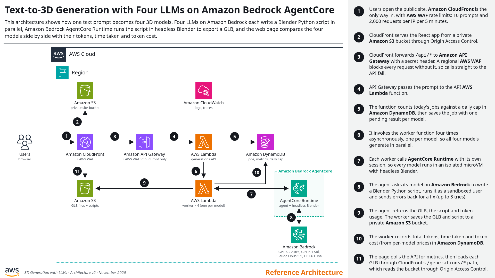

# 3D Generation with LLMs

Compare how well frontier LLMs generate 3D models, side by side, on the same prompt.

**The problem.** Frontier LLMs improving at 3D generation, but they can differ in quality, speed and cost. This project runs several LLM models via Amazon Bedrock on the same prompt and puts their results next to each other, so you can see when to use which model. It is useful for Physical AI teams that need to generate 3D objects to build scenes for their simulation worlds, and for anyone choosing a model for 3D content.

**How it works.** Type a description of an object, and four LLMs each turn it into a 3D model in parallel. Every model writes a Blender Python script on Amazon Bedrock AgentCore Runtime. Headless Blender runs the script and exports a GLB file. If a script fails, the model sees the error and tries again, up to 3 attempts.

**What you get after deploying.** A web page, served by CloudFront behind a Cognito sign-in, with four pages:

- **Generate:** four 3D previews side by side that you can rotate and zoom, and download as GLB. Each model's card shows:
  - **Cost and speed:** time taken, total tokens, token cost in USD and the number of attempts. The fastest and cheapest models are tagged.
  - **Mesh quality**, measured in Blender: whether the model is watertight, plus triangle, vertex and part counts. It also counts holes, flipped faces, loose vertices, zero-area faces and duplicate vertices.
- **Image to 3D:** upload a photo of an object instead of typing a prompt. The upload is scanned for malware, its background is removed, and the four models each try to recreate the object as realistically as they can, with the same previews and metrics.
- **Gallery:** every past generation with its metrics, so you can compare models across many prompts.
- **How it Works:** the architecture of the app.

| Layer | Tech |
|---|---|
| Frontend | React + Vite, `@google/model-viewer` for GLB previews, on S3 + CloudFront |
| Access | Amazon Cognito sign-in (users added by an admin), checked by Lambda@Edge on CloudFront and by API Gateway. CloudFront is the only entry point (AWS WAF on CloudFront and on the API) |
| API | API Gateway (REST) + AWS Lambda (Python 3.14, arm64), with a daily generation cap |
| 3D Generation | Amazon Bedrock AgentCore Runtime (arm64 container with Blender 4.0), in a VPC with no internet access |
| Models | Amazon Bedrock eg. GPT-6.2 Astra, Claude Opus 5.5, etc |
| Image to 3D | GuardDuty Malware Protection for S3 scans uploads; Stable Image Remove Background on Bedrock removes the background |
| Data | DynamoDB (jobs and metrics), S3 (GLB files and scripts, 30-day expiry) |
| Infrastructure | AWS CDK (TypeScript) |

## Models

Defined in [`config/models.json`](config/models.json), with prices per 1M tokens (us-east-1 on-demand, from the AWS Price List API on 2026-11-11):

| Model | Bedrock ID | Endpoint | Input | Output |
|---|---|---|---|---|
| GPT-6.2 Astra | `us.openai.gpt-6.2-astra` | Converse | $8.80 | $44.00 |
| GPT-6.1 Sol | `us.openai.gpt-6.1-sol` | Converse | $2.20 | $11.00 |
| Claude Opus 5.5 (default) | `us.anthropic.claude-opus-5-5` | Converse | $4.40 | $22.00 |
| ↳ or Claude Sonnet 5.5 | `us.anthropic.claude-sonnet-5-5` | Converse | $2.20 | $11.00 |
| ↳ or Claude Haiku 5.5 | `us.anthropic.claude-haiku-5-5` | Converse | $0.11 | $0.55 |
| GPT-6 Luna | `us.openai.gpt-6-luna` | Converse | $0.11 | $0.55 |

To compare different models, edit `config/models.json` and redeploy. IAM permissions follow the file. Move a replaced model to `retired` rather than deleting it, so past generations keep their labels. The agent still supports `"api": "mantle"` (bedrock-mantle Chat Completions with SigV4) for models offered only there.

## Image to 3D

1. The page redraws the chosen image in the browser as a JPEG of at most 1024 px, which also drops metadata such as GPS location, and sends it to `POST /api/image-generations` with an optional description.
2. The API checks it is a JPEG or PNG of a usable size, counts it against the daily upload cap (100 per UTC day, `DAILY_UPLOAD_LIMIT`), and writes it to a private uploads bucket that nothing serves. Objects there expire after one day.
3. GuardDuty Malware Protection for S3 scans each new object and sends the result to EventBridge.
4. A clean result starts the prepare Lambda. It removes the background with Stable Image Remove Background (`us.stability.stable-image-remove-background-v1:0`), saves the PNG as `generations/<jobId>/input.png`, deletes the original, and starts one worker per model. A threat, or an object GuardDuty couldn't scan, rejects the job and deletes the upload.
5. Each model gets the background-removed image in its first message with instructions to match the object's shape, parts, colours and materials. From there it's the same script, Blender and retry loop as a text prompt.

The page shows the upload's progress (scanning, removing the background) and then the four model cards. Background removal isn't included in the cost shown on the page; see Amazon Bedrock pricing for Stability AI image services.

## Job status

Each model's card ends as Done or Failed; none waits forever:

- **Never started:** the worker's queued event expires after 9 minutes, and a model still `PENDING` after 10 minutes shows as failed ("The model never started"). If a worker can't be started at all, that model fails at once and the others still run.
- **Stopped:** a model `RUNNING` for more than 16 minutes (the worker's 15-minute limit plus margin) shows as failed ("Timed out"). An on-failure destination on the worker (`on_failure` in `backend/worker/handler.py`) also marks a model failed as soon as Lambda drops its event or the worker crashes.
- **Saving failed:** if storing the GLB or script fails after the model has run, the card shows "Saving the result failed", and the tokens and cost are still recorded. S3 and DynamoDB calls retry with backoff first.

A generation can be deleted once no model can still start or write files.

## Architecture



Source: `docs/diagram/architecture.html` (re-render with the aws-reference-architecture-diagram skill). The web page shows the same diagram at the bottom.

## Security

- **Cognito sign-in on everything.** Only users an admin adds to the Cognito user pool can sign in; there is no self sign-up. Signed-in users share one history (the Gallery).
  - **Pages and generated files:** a Lambda@Edge gate on CloudFront viewer requests (`edge-auth/src/viewer.ts`, using [cognito-at-edge](https://github.com/awslabs/cognito-at-edge)) sends anyone without a valid session to the Cognito sign-in page. It covers the site and `/generations/*` (GLB files and scripts). Tokens are kept in `httpOnly` cookies, so page JavaScript never sees them.
  - **API:** a second Lambda@Edge gate on `/api/*` (`edge-auth/src/api.ts`) verifies the ID token cookie and returns `401` without it; API Gateway's Cognito authorizer checks the token again.
  - **Sessions:** ID and access tokens last 1 hour and the refresh token 1 day. **Sign out** in the page header ends both the site and the Cognito session.
  - Passwords need 12+ characters with upper and lower case, a digit and a symbol. TOTP MFA is optional.
- **CloudFront is the only way in.** The site and artifacts buckets are private and read only through CloudFront Origin Access Control. CloudFront adds a secret `X-Origin-Verify` header (Secrets Manager) to `/api/*`, and a regional AWS WAF on the API stage blocks every request without it, so calls straight to the `execute-api` URL get `403`.
- **Cost limits.** At most 100 text generations and 100 image uploads per UTC day (`DAILY_GENERATION_LIMIT` and `DAILY_UPLOAD_LIMIT` in `infra/lib/stack.ts`); after that the API returns `429`. Each generation runs four paid models (about $0.25-0.30 in tests).
- **Model-written code is untrusted.** AI-generated Blender code runs in isolated AgentCore Runtime sessions, with these layers:
  - **Script check:** before it runs, an AST check allows only `bpy`, `bmesh`, `mathutils` and maths imports, and blocks `open`, `eval`/`exec`, dunder attributes and Blender's file and script operators.
  - **Unprivileged user:** Blender runs as the `sandbox` user (set with Popen's `user`/`group`, no supplementary groups), with an empty environment (no AWS credentials) and a time limit. Anything the script leaves running is killed when Blender exits.
  - **Output checks:** the agent reads the GLB and metrics only if each is a regular file owned by `sandbox` with one link, opened without following symlinks. So a script can't make the agent read and publish another file from the container.
  - **No internet:** the runtime runs in a VPC with isolated subnets only (no internet or NAT gateway). It reaches AWS through VPC endpoints for Bedrock Runtime, CloudWatch Logs, ECR and S3 (ECR layers only). A Route 53 Resolver DNS Firewall answers NXDOMAIN for anything outside AWS, so data can't leave through DNS lookups either. VPC flow logs record all traffic.
  - **Least privilege:** the runtime role can only invoke the configured models; S3 writes are done by the worker, not the runtime.
- **Uploads are shared and scanned.** Image to 3D uploads appear in the Gallery for every signed-in user (as the background-removed PNG; the original is never served). GuardDuty Malware Protection for S3 scans every upload before anything reads it. There is no content moderation: anything a user uploads can appear in the Gallery until someone deletes it or it expires after 30 days.
- WAF on CloudFront: WAF rules in place eg. Amazon IP reputation, common rule set, known bad inputs, 10 generation or upload POSTs per IP per 5 minutes, 2,000 requests per IP per 5 minutes. Request bodies over 8 KB are blocked except on the image upload route. Optional IP allowlist: `-c allowedCidrs=1.2.3.0/24,5.6.7.8/32`.
- Private S3 buckets (Block Public Access, TLS only, SSE-S3, no CORS).

## Deploy

Prerequisites:

- Node.js 22, Docker with arm64 emulation (QEMU/binfmt) on x86 hosts, and `uv` (for the Python tests).
- AWS credentials for the target account, set up as a named profile in `~/.aws/config` (for example with `aws configure sso`). Check it works with `aws sts get-caller-identity --profile <your-profile>`.
- The account must be CDK-bootstrapped in us-east-1 (`npx cdk bootstrap aws://<account-id>/us-east-1 --profile <your-profile>`) and have Bedrock access to the models in `config/models.json`.

```bash
make install
make test

make deploy PROFILE=<your-profile>
```

`PROFILE` is required for `synth`, `deploy` and `destroy`; they stop with an error if it's missing.

### Add a user

The stack creates no users, and nobody can sign up. Add each person in the Cognito console before they open the site:

1. Open the [Amazon Cognito console](https://console.aws.amazon.com/cognito/v2/idp/user-pools?region=us-east-1) in us-east-1 and choose the user pool **3d-generation-llm-users** (its ID is the `UserPoolId` stack output).
2. Choose **Users** > **Create user**.
3. Enter the person's **Email address** and tick **Mark email address as verified**.
4. Under **Temporary password**, choose **Send an email invitation** (Cognito emails a temporary password) or **Set a password** and share it with them securely.
5. Choose **Create user**.

Then open the `SiteUrl` stack output and sign in with the email and temporary password. Cognito asks for a new password on first sign-in. To remove access, disable or delete the user in the same console page.

### Remove

`make destroy PROFILE=<your-profile>`. It also deletes the user pool and its users. If it fails on the Lambda@Edge functions, CloudFront is still removing their replicas: wait an hour and run it again.

## Project layout

```
agent/          AgentCore Runtime container: app.py (agent loop), llm.py (Converse + mantle),
                blender_runner.py, blender_harness.py (runs inside Blender), script_guard.py
backend/api     REST API Lambda
backend/worker  Per-model worker Lambda, and its on-failure handler
backend/prepare Image to 3D: runs after GuardDuty's scan, removes the background, starts the workers
edge-auth/      Lambda@Edge Cognito sign-in gates for the site and the API
frontend/       React app
infra/          CDK stack and tests
config/         models.json (models and prices)
```
