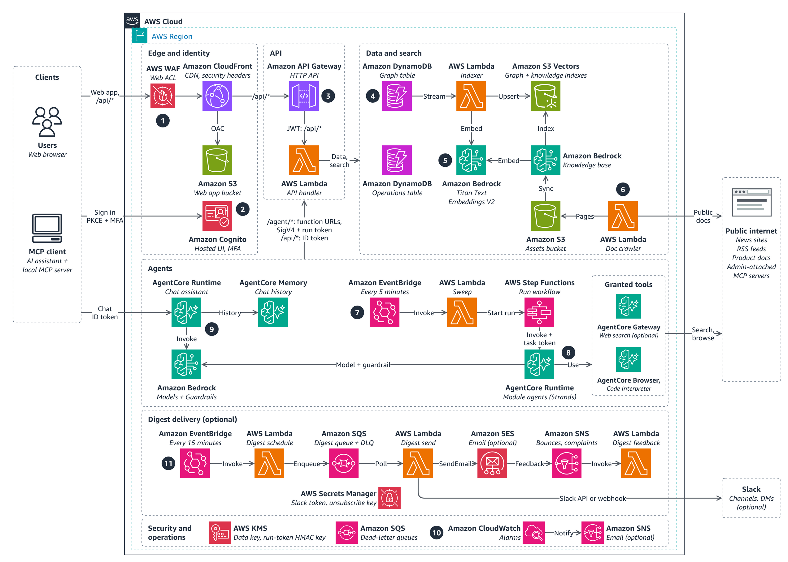
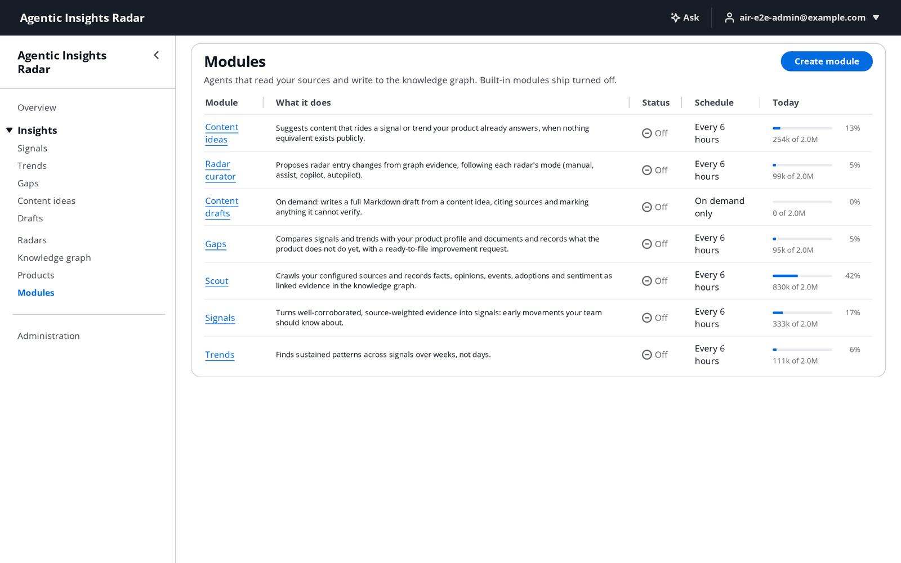

# Agentic Insights Radar on AWS

This is sample code, for non-production usage. You should work with your security and legal teams to meet your organizational security, regulatory and compliance requirements before deployment.

This sample shows how to build an agentic insights radar on AWS: AI agents that watch the
public sources your product depends on, record what they find as linked, cited evidence, and turn
it into signals, trends, product gaps and content ideas your team can act on.

The sample code deploys **Agentic Insights Radar (AIR)**, a working web application built on
Amazon Bedrock AgentCore, Strands Agents, Amazon Bedrock, AWS Lambda, Amazon DynamoDB and Amazon
S3 Vectors. It runs serverless in your own AWS account, with a chat assistant, configurable radars
and an MCP server for your IDE or desktop assistant. Deploy it with one command, then adapt the
agents, prompts and radars to your own domain.

## Table of Contents

1. [Overview](#overview)
    - [Architecture](#architecture)
    - [AWS Well-Architected Pillars](#aws-well-architected-pillars)
    - [Cost](#cost)
2. [Prerequisites](#prerequisites)
    - [Operating System](#operating-system)
    - [Third-party tools](#third-party-tools)
    - [AWS account requirements](#aws-account-requirements)
    - [Service limits](#service-limits)
    - [Supported Regions](#supported-regions)
3. [Deployment Steps](#deployment-steps)
4. [Deployment Validation](#deployment-validation)
5. [Running the sample](#running-the-sample)
6. [Next Steps](#next-steps)
7. [Cleanup](#cleanup)
8. [FAQ, known issues, additional considerations, and limitations](#faq-known-issues-additional-considerations-and-limitations)
9. [Revisions](#revisions)
10. [Notices](#notices)
11. [Authors](#authors)

## Overview

Product teams need to know what the world is saying about the things that matter to their
product: suppliers, competitors, materials, technologies and customer trends. Following that by
hand across news sites, forums, review sites, supplier blogs and public APIs takes time, and the
findings end up scattered across documents and chat threads.

This sample turns that watch into a scheduled, budgeted agent pipeline. It shows how to:

- run long, scheduled agent jobs in AgentCore Runtime under Step Functions, each with a daily token
  budget and only the tools it is granted;
- keep agent output as a knowledge graph in DynamoDB with every claim linked to its source, and
  search it with S3 Vectors instead of a search cluster;
- give agents data access through your own API with per-run signed tokens instead of database
  credentials;
- let users ask questions over the results through a chat agent and an MCP server that act with
  each user's own permissions.

AIR is for any product maker. For example, a standing-desk maker describes its product
(motors, desk frames, accessories), points AIR at industry news, review sites, forums and
supplier blogs, and uploads its internal spec sheets. The agents record a supplier's new long-life
motor as a fact with its source, raise a signal when several sources corroborate it, detect a
trend towards desks with built-in USB-C power, flag the missing accessory as a gap against the
product profile, and suggest content the product can already back up.

What you get:

- **An agent pipeline.** Built-in modules work in stages. *Scout* crawls your sources and records
  evidence (facts, opinions, events, adoptions, sentiment) linked to organizations, people,
  products, topics and segments. *Signals* turns corroborated evidence into signals. *Trends*
  finds sustained patterns across signals. *Gaps* compares signals and trends with your product
  profile and documents and writes a ready-to-file improvement request. *Content ideas* suggests
  content your product already supports. *Content drafts* writes a Markdown draft from a content
  idea on demand. *Radar curator* proposes radar placements from the evidence.
- **Custom modules.** Administrators create their own modules (for example "Competitor watch" or
  "Co-marketing opportunities") with their own prompt, input node types, output kind, model,
  schedule, budget and tool grants. Each custom insight kind gets its own page in the navigation.
- **Configurable radars.** Start from a template (Technology adoption, Competitor landscape, Vendor
  map, Customer segments, or Blank) and rename sectors (1-8), rings (1-6) and markers (0-6). Every
  save is a version you can view, compare and roll back. Import and export CSV and JSON; export
  SVG and PNG. Each radar has an AI suggestions mode: manual, assist, copilot or autopilot.
- **Product knowledge.** Product profiles hold a summary, capabilities, target segments,
  competitors and public documentation URLs. The documentation is crawled into an Amazon Bedrock
  knowledge base and refreshed weekly; you can also upload internal documents (PDF, DOCX, TXT, MD,
  HTML, CSV, up to 50 MB each).
- **Chat assistant.** Answers questions over the graph, insights, radars and product knowledge,
  with citations. It reads with the signed-in user's own permissions and cannot change anything.
- **MCP server.** A local stdio server for MCP clients that signs in as you.
- **Roles.** Three roles: *viewer* (read and chat; users in no group are viewers), *editor* (also
  radars, suggestions, feedback, "working on" and drafts) and *admin* (everything, including users,
  products, modules, budgets and the AI kill switch).
- **Cost controls.** Every module has a daily token budget, chat has a shared and a per-user daily
  budget, and one AI kill switch pauses every model call while reads, search and radars keep working
  (new runs and chat turns are refused at once; a run already in flight stops at its next model call,
  within a minute). Budgets count model tokens only; web search, Browser, Code Interpreter, attached
  MCP servers and page fetches are capped **per run** (60, 120, 30, 200, 120) and not per day, so a
  module on a short schedule can spend much more on them in a day than its token budget suggests:
  see [Controlling cost](docs/cost-estimate.md#controlling-cost). Modules ship turned off, and optional AWS Budgets alert on the account's and the deployment's monthly spend.

### Architecture



The numbered steps match the numbers in the diagram. A slide version with the steps is in [docs/architecture/architecture-slide.png](docs/architecture/architecture-slide.png), and the editable source in [architecture.drawio](docs/architecture/architecture.drawio). The [implementation guide](docs/implementation-guide.md) describes each component in depth.

**Step 1:** Users open the web app through Amazon CloudFront, which serves the single-page app
from a private Amazon Simple Storage Service (Amazon S3) bucket. AWS WAF filters every request with
a per-IP rate limit and AWS managed rule groups.

**Step 2:** Users sign in with the Amazon Cognito hosted UI (classic) and TOTP multi-factor authentication.
Administrators invite users and give each a role: viewer, editor or administrator.

**Step 3:** CloudFront forwards `/api/*` to Amazon API Gateway, which checks the user's Cognito
token. An AWS Lambda function handles the request after checking the user's role.

**Step 4:** Amazon DynamoDB stores the knowledge graph in one table and modules, sources, runs,
budgets, radars and the audit log in another. An S3 assets bucket holds uploaded documents and
drafts, encrypted with an AWS Key Management Service (AWS KMS) customer managed key.

**Step 5:** A DynamoDB stream triggers an indexer function that embeds each changed entry with
Amazon Titan Text Embeddings V2 and writes it to an Amazon S3 Vectors index for hybrid search.

**Step 6:** A crawler function copies each product's public documentation into the assets bucket.
An Amazon Bedrock knowledge base indexes those pages and uploaded documents into a second S3
Vectors index.

**Step 7:** Amazon EventBridge runs a sweep function every 5 minutes. It starts an AWS Step
Functions execution for each enabled module that is due and within its daily token budget.

**Step 8:** Step Functions starts the module agent in Amazon Bedrock AgentCore Runtime and waits up
to 8 hours for it to finish. The agent, built with Strands Agents on an Amazon Bedrock model with
Amazon Bedrock Guardrails, reads and writes the graph only through the agent tool gate (a Lambda
function URL that only the module runtime's IAM role can call, with a signed run token), and can use
AgentCore web search, Browser and Code Interpreter when granted.

**Step 9:** The chat assistant, a second agent in AgentCore Runtime, answers users' questions with
their own Cognito token, so it sees only what the user may see. AgentCore Memory keeps the
conversation's short-term history.

**Step 10:** Amazon CloudWatch alarms on function errors, failed or timed-out runs, dead-letter
queues, indexer lag, API errors and AgentCore errors notify an Amazon Simple Notification Service
(Amazon SNS) topic, which emails the alarm address (the first administrator unless you give another).

**Step 11 (optional):** With digest delivery on (`digestDelivery`, off by default), Amazon EventBridge
runs a scheduler function every 15 minutes that puts each digest that is due on an Amazon Simple
Queue Service (Amazon SQS) queue. A sender function takes one message at a time, builds the digest
with what its reader may see, and posts it to Slack with a bot token or incoming-webhook URL kept in
AWS Secrets Manager, or emails it through Amazon Simple Email Service (Amazon SES). A send that fails
three times goes to a dead-letter queue that alarms. SES bounces and complaints reach a feedback
function through an Amazon SNS topic, which suppresses that subscription.

### AWS Well-Architected Pillars

The architecture diagram above is an example of a solution created with Well-Architected best
practices in mind. To be fully Well-Architected, you should follow as many
[AWS Well-Architected](https://aws.amazon.com/architecture/well-architected/) best practices as
possible.

**Operational excellence.** The whole sample is one AWS CDK application deployed with
`./deployment/deploy.sh` and removed with `./deployment/destroy.sh`, so every environment is
reproducible from code. Lambda functions and the Step Functions workflow send traces to AWS X-Ray,
every function writes to a CloudWatch Logs group kept for 365 days by default (the agent runtimes'
logs, which hold chat questions and page text, for 30), and 46 CloudWatch alarms (function errors
and throttles, failed and timed-out runs, dead-letter queues, indexer lag, API 5xx and refused-request
rate, the two agent tool gates' function URLs, AgentCore errors, throttles, refused requests,
rejected tokens and open sessions per runtime, the account's AgentCore session quota, web-search gateway errors, and -- in a us-east-1 deployment -- WAF blocked
requests and the CloudFront error rate) notify an Amazon SNS topic; a CloudWatch dashboard shows the
same signals, including the edge metrics, which CloudFront and WAF publish only in us-east-1. AWS WAF logs every request with credentials redacted. Every change made through the
API (modules, budgets, radars, products, users, documents, feedback) is written to an audit log, and
a kill switch stops all agent work: new work at once, a run already in flight within a minute.
[Read the Operational Excellence whitepaper](https://docs.aws.amazon.com/wellarchitected/latest/operational-excellence-pillar/welcome.html)

**Security.** AWS WAF filters every request with a 2,000-requests-per-5-minutes per-IP limit and
three AWS managed rule groups. Amazon Cognito requires TOTP multi-factor authentication and has
self sign-up off; API Gateway checks a JWT on every data route and the API checks the caller's
role (viewer, editor, administrator). Agents never get database credentials: each call to the
agent tool gate is SigV4-signed by the module runtime's role (a Lambda function URL that refuses
every other caller) and carries a run token signed by a KMS HMAC key, and the backend allows only
the tools that module is granted. Web content is fetched through an SSRF-safe fetcher and fenced as
untrusted data in prompts; the browser may only open public https addresses. An Amazon Bedrock
Guardrail screens users' chat messages and each run's start message for prompt attacks and model
output for harmful content and credentials; it does not inspect tool results (fetched pages), so the
fence and the server-side grant checks are the controls there. Data at rest is encrypted with a KMS
customer managed key, and buckets reject non-TLS requests.
[Read the Security whitepaper](https://docs.aws.amazon.com/wellarchitected/latest/security-pillar/welcome.html)

**Reliability.** Every data service is a managed, multi-AZ Regional service (DynamoDB, S3, S3
Vectors, Lambda, Step Functions, AgentCore). Both DynamoDB tables have point-in-time recovery, the
assets bucket is versioned, and with the default `retainData=true` tables, buckets and the user
pool survive stack deletion; an optional AWS Backup plan adds daily recovery points kept for 120
days. Module runs are Step Functions executions with a 5-minute heartbeat and an 8-hour limit.
Recording a run's outcome is retried with exponential backoff and, if it still fails, the run is
recorded as failed; a failed run itself is not retried and waits for its next scheduled slot. The
stream indexer retries 5 times and splits failing batches, and failed events land in dead-letter
queues that raise alarms.
[Read the Reliability whitepaper](https://docs.aws.amazon.com/wellarchitected/latest/reliability-pillar/welcome.html)

**Performance efficiency.** CloudFront serves the web app from edge locations, and the API is a
serverless HTTP API throttled at 50 requests per second (burst 100) to protect the backend, with
10 per second (burst 20) for search, product questions and insight listing, which call a model on
every request.
Search combines DynamoDB lookups with S3 Vectors similarity search over Titan Text Embeddings V2,
so it needs no search cluster. Long agent work runs asynchronously in AgentCore Runtime sessions
started by Step Functions, so the API answers in milliseconds while a module runs for up to 8
hours.
[Read the Performance Efficiency whitepaper](https://docs.aws.amazon.com/wellarchitected/latest/performance-efficiency-pillar/welcome.html)

**Cost optimization.** Every component is serverless and billed per use: DynamoDB on demand,
Lambda, Step Functions, API Gateway, AgentCore Runtime and S3 Vectors, which charges for storage and queries with no provisioned
capacity (USD 0.15 a month in the typical estimate). Model tokens, the largest cost, are capped by a daily token budget per
module (2,000,000 by default) and a separate chat budget: a run starts only while its module's
budget is not used up, and stops when the budget left at its start is spent. Web search, Browser
and Code Interpreter are billed per call or per minute, outside the token budgets, and are capped
per run instead. Built-in modules ship turned off, so a new deployment costs about USD 16 per month
until you enable them.
[Read the Cost Optimization whitepaper](https://docs.aws.amazon.com/wellarchitected/latest/cost-optimization-pillar/welcome.html)

**Sustainability.** Compute starts only for a request, a stream record, a due module or the
5-minute sweep (8,640 short runs a month, even with every module off), and AgentCore sessions stop
after 15 idle minutes (module runs) or 5 (chat). Lambda functions run on
AWS Graviton (arm64) processors, which use less energy for the same work. Access logs expire after
the log retention period, and the indexer embeds only the graph entries that changed.
[Read the Sustainability whitepaper](https://docs.aws.amazon.com/wellarchitected/latest/sustainability-pillar/welcome.html)

### Cost

You are responsible for the cost of the AWS services used while running this sample. As of
October 2026, the cost for running this sample with the default settings in the US East
(N. Virginia) Region for 10 users, with the six scheduled built-in modules enabled, is
approximately **USD 300 per month**, of which about USD 16 is fixed and the rest scales with use.
The full breakdown, every assumption and how to cap spend are in
[docs/cost-estimate.md](docs/cost-estimate.md).

We recommend creating a [budget](https://docs.aws.amazon.com/cost-management/latest/userguide/budgets-managing-costs.html)
through [AWS Cost Explorer](https://aws.amazon.com/aws-cost-management/aws-cost-explorer/) to help
manage costs. Prices are subject to change. For full details, refer to the pricing webpage for each
AWS service used in this sample.

The following table shows the typical month by service. Amazon Bedrock model tokens dominate, and
the per-module and chat budgets cap them.

| AWS service | Dimensions | Cost [USD] |
|---|---|---|
| Amazon Bedrock (Claude Sonnet 5.5) | 119.5 million weighted tokens: six modules at 25% of a 2,000,000 daily budget each, 1,100 chat turns, 10 drafts | 239.00 |
| Amazon Bedrock AgentCore Gateway web search | 2,400 queries (10 per run for Scout and Signals) | 16.80 |
| Amazon Bedrock AgentCore Runtime | 730 module runs of about 25 minutes and 220 chat sessions of about 10 minutes, 2 GB each | 13.00 |
| AWS WAF | 1 web ACL, 4 rules, 200,000 requests | 9.12 |
| Amazon Bedrock Guardrails | 40,000 text units of content and prompt-attack filters, 20,000 of the sensitive information filter | 8.00 |
| Amazon CloudWatch | 44 alarms reading 48 metrics, 1 dashboard; 2.3 GB of logs ingested (including WAF request logs), 10 GB stored | 6.25 |
| AWS Key Management Service (AWS KMS) | 2 customer managed keys, 200,000 requests | 2.60 |
| AWS Lambda | 8,640 sweep runs, 150,000 API requests, indexer, crawler and run functions (arm64) | 1.45 |
| Amazon Bedrock AgentCore Memory, Gateway, Browser, Code Interpreter | 2,200 memory events, 2,400 tool calls, 10 browser hours | 1.21 |
| Amazon DynamoDB | On demand: 300,000 write and 3 million read request units, 1 GB with point-in-time recovery | 0.85 |
| Amazon S3 | 2 GB stored, 250,000 requests | 0.40 |
| Amazon Bedrock (Titan Text Embeddings V2) | 15 million tokens | 0.30 |
| AWS X-Ray | 160,000 traces (first 100,000 free) | 0.30 |
| Amazon API Gateway | 150,000 HTTP API requests | 0.15 |
| Amazon S3 Vectors | 0.3 GB stored, 30,000 queries | 0.15 |
| AWS Step Functions | 3,650 state transitions | 0.09 |
| Amazon SNS, Amazon SQS, Amazon EventBridge | Alarm notifications, dead-letter queues, one schedule | 0.01 |
| Amazon Cognito | 10 monthly active users, Essentials | 0.00 |
| Amazon CloudFront | Within the free allowance | 0.00 |
| **Total** | | **299.68** |

## Prerequisites

### Operating System

The deployment scripts run on Linux or macOS with `bash`. They were tested on Amazon Linux 2023,
including the AWS CodeBuild `aws/codebuild/amazonlinux-x86_64-standard:5.0` image. Docker is not
needed: the scripts build arm64 bundles for Lambda and AgentCore on any host. Windows is not
supported (use WSL or a Linux host).

Install these tools:

| Tool | Version | Check |
|---|---|---|
| [AWS CLI](https://docs.aws.amazon.com/cli/latest/userguide/getting-started-install.html) | a current v2 release with the `s3vectors` and `bedrock-agentcore-control` commands (the scripts check) | `aws --version` |
| Python | 3.12 or later | `python3 --version` |
| [uv](https://docs.astral.sh/uv/getting-started/installation/) | current | `uv --version` |
| Node.js | 20 or later | `node --version` |
| npm | bundled with Node.js | `npm --version` |
| git | any | `git --version` |

The AWS CDK CLI is not installed separately: the scripts install the version pinned in `infra/package-lock.json` (currently 2.1144.0) with `npm ci --ignore-scripts`. The web app's dependencies are installed the same way (`deployment/build.py`), so no package install script of either lockfile runs with your deployment credentials.

### Third-party tools

No third-party service, account or licence is needed for the core sample. The build downloads open-source packages
from PyPI and npm at the versions pinned in each `uv.lock` and `package-lock.json`, including
[Strands Agents](https://strandsagents.com) for the agents and the
[Cloudscape Design System](https://cloudscape.design) for the web app; their licences are listed
in [THIRD-PARTY-LICENSES.md](THIRD-PARTY-LICENSES.md). The agents read the public websites and
feeds you configure as sources, so check each site's terms of use.

**Optional Slack digest delivery.** Digest delivery is off by default. With `AIR_DIGEST_DELIVERY`
(see the `digestDelivery` option in the [implementation guide](docs/implementation-guide.md)) the
sample can post digests of new insights to Slack channels or direct messages through a Slack bot
token or an incoming webhook that you create in your own Slack workspace, and email them through
Amazon SES. This code interacts with Slack, which has terms published at
https://slack.com/terms-of-service and pricing described at https://slack.com/pricing. You should
be familiar with the pricing and confirm that your use case complies with the terms before
proceeding.

### AWS account requirements

- **Permissions.** Credentials for the target account that can bootstrap the AWS CDK and create
  the resources in this sample (IAM roles and policies, CloudFront, WAF, Cognito, API Gateway,
  Lambda (functions **and function URLs**), Step Functions, EventBridge, DynamoDB, S3, S3 Vectors,
  KMS, SQS, SNS, CloudWatch (logs, metrics, alarms and dashboards), **AWS X-Ray**, SSM (reading the
  CDK bootstrap version parameter), Amazon Bedrock and Bedrock AgentCore; **AWS Budgets** when you
  set `AIR_MONTHLY_BUDGET_USD`, and **AWS Backup** when you set `AIR_BACKUP`. An administrator role
  is the simplest choice. CDK bootstrap gives CloudFormation the `AdministratorAccess` policy by
  default; to use a narrower policy, create it first and set `AIR_CFN_EXECUTION_POLICIES` to its ARN
  (comma-separated for several), which `deploy.sh` passes to
  `cdk bootstrap --cloudformation-execution-policies` when it bootstraps a Region. The policy must
  allow every service listed here. If the Region is already bootstrapped, `deploy.sh` compares your
  value with the bootstrap stack's `CloudFormationExecutionPolicies` parameter and stops on a
  mismatch, rather than deploying with whatever execution role is already there.
- **CDK bootstrap.** `deploy.sh` bootstraps the AWS CDK in your Region and in `us-east-1` if the
  `CDKToolkit` stack is missing there. You do not need to run `cdk bootstrap` yourself.
- **Amazon Bedrock model access.** Modules and chat call models through `global.` cross-Region
  inference profiles. The default for every module and for chat is **Claude Sonnet 5.5**
  (`global.anthropic.claude-sonnet-5-5`). The model catalog also offers Claude Haiku 4.5, Claude
  Sonnet 4.6, Claude Opus 5.5, Claude Fable 5.1 and Amazon Nova 2 Lite; enable any you plan to
  select. Search and the knowledge base need **Amazon Titan Text Embeddings V2**
  (`amazon.titan-embed-text-v2:0`) in your Region. If your account has not used Anthropic models
  before, Amazon Bedrock may ask you to submit use-case details once before the first call.
- **Amazon Bedrock AgentCore.** Runtime, Memory, Gateway, Browser and Code Interpreter must be
  available in your Region. The AgentCore web-search connector is optional (see
  [Supported Regions](#supported-regions)).
- **Email.** The first administrator's email address must receive mail: Cognito sends the
  invitation with a temporary password there.

### Service limits

The default quotas of a new account are enough for one deployment. Check these if you deploy
several copies, raise module budgets or schedule many modules at once; request increases in the
[Service Quotas console](https://console.aws.amazon.com/servicequotas/home).

| Service | Quota | Why it matters |
|---|---|---|
| Amazon Bedrock | Tokens per minute and requests per minute for the cross-Region inference profile of each model you use | Module runs and chat share them; when they are exceeded, calls are throttled and retried, and a run can fail |
| Amazon Bedrock Guardrails | Text units per second for content filters | Every chat message, run start message and model response is screened |
| Amazon Bedrock AgentCore Runtime | Active session workloads per account (default 5,000 in us-east-1 and us-west-2, 2,500 elsewhere), shared with every other agent in the account | Each module run and each open chat conversation holds one session; `AccountSessions` fires at 80% of the default quota, and `ModuleRuntimeSessions` and `ChatRuntimeSessions` at 80 sessions of this deployment's own |
| Amazon Bedrock AgentCore Browser and Code Interpreter | Concurrent sessions per account | Each granted run that uses them holds a session; raising Scout's concurrency raises browser sessions |
| Amazon Bedrock AgentCore Gateway | Web-search requests per second | Several modules searching at once share it |
| Amazon S3 Vectors | Requests per second per vector index | Every search, every indexed graph change and knowledge base retrieval |
| AWS Step Functions | `SendTaskHeartbeat` and `StartExecution` request rates | Each running module sends a heartbeat every minute |
| AWS Lambda | Concurrent executions per Region (1,000 in an established account; a new account often starts at 10, which is why `AIR_RESERVED_CONCURRENCY` is off by default -- reserving any of 10 makes the deployment fail) | Shared with every other function in the account |
| Amazon Cognito | User pools per account; email sending with the Cognito default email (50 per day) | The stack sends invitations with the Cognito default sender; inviting more than 50 users a day needs Amazon SES, which this sample does not configure for invitations |
| AWS WAF | Web ACLs per account in `us-east-1` | Each deployment creates one |

Run `aws service-quotas list-service-quotas --service-code bedrock` (or `bedrock-agentcore`,
`s3vectors`, `states`) to see your current quotas.

### Supported Regions

This sample was tested in **US East (N. Virginia) `us-east-1`** and **US West (Oregon)
`us-west-2`**. It can run in any Region that offers Amazon Bedrock AgentCore Runtime, Memory and
Gateway, Amazon S3 Vectors, Amazon Bedrock Knowledge Bases, Amazon Titan Text Embeddings V2 and
the models you choose.

- CloudFront only accepts AWS WAF web ACLs created in `us-east-1`. Outside `us-east-1`, `deploy.sh`
  first deploys a small edge stack with the web ACL in `us-east-1`, then the main stack in your
  Region.
- The AgentCore web-search connector is not offered to every account and Region. If it is not
  available and you did not set `AIR_WEB_SEARCH`, `deploy.sh` redeploys without web search; modules
  still read your sources, fetch pages and use the browser.

## Deployment Steps

1. Clone the repository and change into it:

    ```bash
    git clone https://github.com/aws-samples/sample-apj-sup-sa.git
    cd sample-apj-sup-sa/agentic-workloads/agentic-insights-radar
    ```

2. Configure AWS credentials for the target account and choose the Region:

    ```bash
    export AWS_REGION=us-east-1
    aws sts get-caller-identity
    ```

3. Optional: set deployment options as environment variables.

    | Variable | Default | Effect |
    |---|---|---|
    | `AIR_PREFIX` | `air` | Prefix for resource names (2-21 lower-case letters, digits or hyphens, starting with a letter). With the default the stack is `AgenticInsightsRadar`; otherwise `AgenticInsightsRadar-<prefix>`. Use a different prefix to run several deployments in one account. |
    | `AIR_RETAIN_DATA` | `true` | When `true`, deleting the stack keeps the tables, buckets, user pool and data key, and deletion protection is on. Set `false` for test deployments you want to remove completely. |
    | `AIR_WEB_SEARCH` | unset (on) | Set `false` to deploy without the AgentCore web-search connector. When unset, `deploy.sh` falls back to `false` automatically if the connector is unavailable; an explicit `true` fails instead. |
    | `AIR_ALARM_EMAIL` | the first administrator's email | Email address subscribed to alarm notifications. The second argument of `deploy.sh` does the same. Later deploys keep it until you give another; `AIR_ALARM_EMAIL=admin` goes back to the first administrator. |
    | `AIR_LOG_RETENTION_DAYS` | `365` | Retention of the CloudWatch log groups and of the access logs, in a period CloudWatch Logs accepts (for example 30, 90, 180, 365, 731). |
    | `AIR_AGENT_LOG_RETENTION_DAYS` | `30` | Retention of the two AgentCore runtime log groups, which hold chat questions and text from fetched pages. |
    | `AIR_CHAT_MODEL` | `sonnet-5-5` | The chat assistant's model, a key from the model catalog (for example `haiku-4-5`). |
    | `AIR_MONTHLY_BUDGET_USD` | `0` (none) | Creates two AWS Budgets with this monthly limit, each alerting the alarm topic at 80% of actual and 100% of forecast spend: `<prefix>-insights-radar-<region>-account` sees the whole account's spend, model invocations included, and `<prefix>-insights-radar-<region>` only spend tagged `deployment=<prefix>`, which leaves out model invocations (the `global.` inference profiles carry no tag) and reports 0 until **deployment** is activated as a cost allocation tag. |
    | `AIR_BACKUP` | `false` | `true` adds an AWS Backup plan: daily recovery points of both tables and the assets bucket, kept 120 days. |
    | `AIR_PRICE_CLASS` | `100` | CloudFront price class: `100` (North America and Europe), `200` (adds Asia, the Middle East and Africa) or `All`. |
    | `AIR_WAF_RATE_LIMIT` | `2000` | AWS WAF requests per 5 minutes per source IP before blocking. Everyone behind one NAT address shares one limit; raise it if users see "Too many requests from this network address" (a 429 from WAF). |
    | `AIR_GUARDRAIL_GENERATION` | `1` | Raise it by one to recreate the Bedrock guardrail when it was deleted outside CloudFormation (runs then fail with "The guardrail identifier or version provided in the request does not exist"). The new guardrail is named `<prefix>-guardrail-<n>`. |
    | `AIR_SLACK_SECRET_GENERATION`, `AIR_UNSUBSCRIBE_KEY_GENERATION` | `0` | Raise one by one to recreate that digest secret when it was deleted for good outside CloudFormation (the implementation guide's `digestDelivery` row says what each replaces). While digest delivery is on, lowering one needs `--allow-data-loss`. |
    | `AIR_RESERVED_CONCURRENCY` | `false` | `true` reserves Lambda concurrency for the run bookkeeping functions. Needs a Regional concurrent-execution quota above the 10 a new account often starts with; an established account has 1,000. |

    For example: `export AIR_PREFIX=mr-test AIR_RETAIN_DATA=false`. The implementation guide lists
    every option. An update keeps the options a deployment was created with unless you set them
    again: the stack records them in its `DeployOptions` output, `deploy.sh` reads them back, prints
    them, and says when you change one. Turning `AIR_RETAIN_DATA` from `true` to `false` on an
    existing deployment also needs `--allow-data-loss`, and so do a lower `AIR_CHAT_MEMORY_DAYS` and
    a change of `AIR_CHAT_MEMORY_KEY` (which replaces the chat memory and deletes chat history),
    and, while digest delivery is on, turning it fully off (`AIR_DIGEST_DELIVERY=none`, which retires
    the Slack secret and the unsubscribe key) or lowering a digest secret's generation.

4. Deploy, passing the first administrator's email address and, optionally, an alarm email:

    ```bash
    ./deployment/deploy.sh admin@example.com alarms@example.com
    ```

    The script:
    - checks that `aws`, `uv`, `node`, `npm` and `python3` are installed, at the versions above;
    - prints the account, Region, stack and options, and stops on a stack that is being changed or
      that failed to roll back, with the command that fixes it;
    - checks that AgentCore and S3 Vectors are offered in the Region, and warns when the default
      model or Titan Text Embeddings V2 is not available to the account;
    - builds the Lambda bundle, the AgentCore agent bundle and the web app (`deployment/build.py`);
    - bootstraps the AWS CDK in your Region and in `us-east-1` if needed;
    - outside `us-east-1`, deploys the edge stack (`<stack>-<region>-Edge`, for example `AgenticInsightsRadar-us-west-2-Edge`) with the web ACL;
    - deploys the main stack and writes the stack outputs to `build/outputs.json`. A first
      deployment and runs without a terminal use `--require-approval never`; an update from a
      terminal asks before it broadens IAM permissions, and `--diff` shows the whole change and asks
      before applying it;
    - seeds the seven built-in modules (all turned off) and creates the first administrator, who
      receives an email with a temporary password;
    - warns when no one has confirmed the alarm email subscription yet.

    Allow about 30 minutes for a first deployment.

5. Note the stack outputs printed at the end, or read them later. `STACK` is
   `AgenticInsightsRadar`, or `AgenticInsightsRadar-<AIR_PREFIX>` if you set a prefix in step 3:

    ```bash
    STACK=AgenticInsightsRadar          # or AgenticInsightsRadar-mr-test for AIR_PREFIX=mr-test
    aws cloudformation describe-stacks --stack-name "$STACK" \
      --query "Stacks[0].Outputs[].[OutputKey,OutputValue]" --output table
    ```

    | Output | Meaning |
    |---|---|
    | `AppUrl` | The web app address |
    | `FirstAdmin` | The email address that received the invitation |
    | `AlarmTopicArn` | The SNS topic the alarms and the optional budget notify |
    | `DeployOptions` | The options the deployment was made with (read back by `deploy.sh` on updates) |
    | `UserPoolId` | The Cognito user pool |
    | `McpClientId` | The app client the MCP server signs in with |
    | `CognitoDomain` | The sign-in page; set `AIR_COGNITO_DOMAIN` to this for the MCP server |

    `FirstAdmin` and the `alarmEmail` entry of `DeployOptions` hold the email addresses you gave,
    so anyone with `cloudformation:DescribeStacks` on this stack -- including a read-only auditor
    or a CI role -- can read them, and `deploy.sh` copies the outputs into `build/outputs.json`.
    They are outputs because `deploy.sh` reads them back on every update, to keep the first
    administrator and the alarm address unchanged.
    | `SiteBucket`, `DistributionId` | Used by `deployment/publish-site.sh` |

6. Confirm the subscription in the email from Amazon SNS (sent to the alarm email, or to the first
   administrator if you gave none); until then alarms notify nobody.

7. Open `AppUrl`, sign in with the administrator's email and the temporary password (valid for
   3 days), choose a new password (at least 12 characters with upper and lower case letters, a
   digit and a symbol) and register an authenticator app for TOTP when prompted.

## Deployment Validation

1. Check that the stack finished:

    ```bash
    aws cloudformation describe-stacks --stack-name AgenticInsightsRadar --query "Stacks[0].StackStatus"
    ```

    The status is `CREATE_COMPLETE` (or `UPDATE_COMPLETE` after a redeploy). Use
    `AgenticInsightsRadar-<prefix>` if you set `AIR_PREFIX`.

2. Open `AppUrl` in a browser. You are sent to the sign-in page; after signing in you see the
   **Overview** page, and **Modules** lists the seven built-in modules, all turned off.

3. Check the public configuration endpoint and that the API refuses unauthenticated calls:

    ```bash
    STACK=${STACK:-AgenticInsightsRadar}   # the same stack name as in Deployment Steps step 3
    APP_URL=$(aws cloudformation describe-stacks --stack-name "$STACK" \
      --query "Stacks[0].Outputs[?OutputKey=='AppUrl'].OutputValue" --output text)
    curl -s "$APP_URL/api/config"                                   # JSON with user_pool_id
    curl -s -o /dev/null -w '%{http_code}\n' "$APP_URL/api/radars"  # 401
    ```

4. For an automated check, `deployment/validate.sh` deploys a uniquely named test stack, runs
   these checks and removes the stack with `destroy.sh --purge`. It takes no input; set
   `AIR_VALIDATE_REGION` (for example `us-west-2`, which also deploys the edge stack),
   `AIR_VALIDATE_SOURCE=.` to validate your checkout instead of GitHub `main` (by default it
   clones only this folder of `aws-samples/sample-apj-sup-sa`; `AIR_VALIDATE_REPO` and
   `AIR_VALIDATE_SUBDIR` point it elsewhere, `AIR_VALIDATE_SUBDIR=` for a repository holding the
   sample at its root), and
   `AIR_VALIDATE_E2E=true` to also run the end-to-end smoke tests, and
   `AIR_VALIDATE_UPGRADE_FROM=<tag>` to deploy that earlier release first and upgrade it to the
   validated code, checking both: run that against the previous release before every release,
   because upgrade failures (a property the service will not change, a delete order, a name
   collision) never show on a fresh install. The first administrator's invitation is suppressed. `.github/workflows/deploy-validate.yml` runs it from GitHub Actions
   into a sandbox account. GitHub runs workflows only from a repository's root, so this folder's
   `.github/workflows/` (CI, docs site, this validation) take effect when you use the folder as
   a repository of its own, for example a copy of it or `git subtree split --prefix agentic-workloads/agentic-insights-radar`.

5. For deeper checks, the end-to-end suite in `e2e/` signs in as a viewer, an editor and an
   administrator and exercises every API route, the browser, the MCP server, chat and live module
   runs. It creates test users, briefly switches the AI kill switch and spends tokens, so run it
   against a test deployment: see [End-to-end tests](docs/implementation-guide.md#end-to-end-tests).

## Running the sample

Sign in as the administrator and follow these steps. Viewers and editors see the same pages, with
controls they cannot use turned off.

1. **Invite your team.** In **Administration > Users**, choose **Invite user**, enter an email and
   pick a role (viewer, editor or admin). Each person receives a temporary password and sets up an
   authenticator app at first sign-in.
2. **Describe your product.** In **Products**, choose **Add product** and enter the name, summary,
   capabilities, target segments, competitors and up to 20 public documentation URLs (https). The
   documentation is crawled into the knowledge base: up to 200 pages per crawl, only under each
   URL's path, honouring `robots.txt`, and refreshed every 7 days. On the product page, upload
   internal documents (PDF, DOCX, TXT, MD, HTML, HTM, CSV; up to 50 MB each and 500 per product)
   and try **Search product knowledge**.
3. **Point the Scout at sources.** In **Modules**, open **Scout**, add sources (type `web_page`,
   `dynamic_web_page`, `rss` or `public_api`, an https address and an optional instruction), choose
   the product, and turn the module on. Each source keeps a cursor so the next run resumes where
   the last one stopped.
4. **Turn on the analysis modules.** Turn on **Signals**, **Trends**, **Gaps**, **Content ideas**
   and **Radar curator**, and attach your product where offered. Scheduled modules run every
   6 hours by default; **Run now** starts a run at once. Review runs and budgets under
   **Administration > Health**.
5. **Create a radar.** In **Radars**, choose **Create radar**, pick a template, and adjust the
   schema. Set **AI suggestions** to *assist* or *copilot* to review the curator's proposals in a
   queue, or *autopilot* to apply a suggestion after the configured number of days (1-90, default 7)
   unless someone edited the entry. Autopilot applies a *person's* suggestion that way; a proposal
   from the Radar curator module is still held for review unless an administrator also turns on
   **Apply agent proposals without review** in the radar's Settings, which is off by default and
   off on every radar upgraded from an earlier release. Add editors by email in the radar's access
   settings.
6. **Review insights.** The **Insights** section of the navigation lists Signals, Trends, Gaps,
   Content ideas, Drafts and one page per custom insight kind. Each insight shows its description,
   the evidence for and against with source links, related entities and which module created it.
7. **Give feedback and act.** Editors rate insights with thumbs up or down (down needs a comment),
   mark content ideas with **I'm working on this**, and choose **Write a draft** to have the
   Content drafts module write a Markdown draft, which appears under **Drafts** a few minutes later
   and can be downloaded as `.md`. Gaps carry an improvement request (title, problem, impact
   and, where known, a workaround) you can copy into your tracker.
8. **Ask questions.** Choose **Ask** in the top bar to open the chat assistant. Answers link to the
   insights and sources they rely on.
9. **Explore the graph.** **Knowledge graph** shows organizations, people, products, topics,
   evidence and insights, and lets you expand a node's neighbours.

Expected output after the first runs: evidence nodes with source URLs in the knowledge graph, then
signals, trends, gaps and content ideas on the Insights pages, and curator suggestions on your
radars. How much appears depends on your sources and how often the modules run.


*Modules: what each agent does, its schedule, and how much of today's token budget it has used.*

### MCP server

The MCP server lets an MCP client (for example Claude Desktop, Kiro or Amazon Q Developer) search
insights, radars, products and the knowledge graph as you. Viewers read, editors can also give
feedback, and administrators can also run modules.

```bash
# Node.js 20 or later. Install the versions in mcp/package-lock.json, not whatever is newest on npm.
(cd mcp && npm ci --ignore-scripts && npm run build && npm install --global .)
export AIR_API_URL=<AppUrl>         # stack output AppUrl
export AIR_MCP_CLIENT_ID=<id>       # stack output McpClientId
export AIR_COGNITO_DOMAIN=<domain>  # stack output CognitoDomain: the only sign-in page to trust
insights-radar-mcp login            # prints the sign-in domain, opens the sign-in page; tokens are saved
                                    # with owner-only access and used only for this AIR_API_URL
```

Then add it to your MCP client's configuration:

```json
{
  "mcpServers": {
    "insights-radar": {
      "command": "insights-radar-mcp",
      "args": ["serve"],
      "env": {
        "AIR_API_URL": "https://...",
        "AIR_MCP_CLIENT_ID": "...",
        "AIR_COGNITO_DOMAIN": "...-123456789012.auth.us-east-1.amazoncognito.com"
      }
    }
  }
}
```

`AIR_COGNITO_DOMAIN` pins the sign-in page. Set it from the `CognitoDomain` stack output: the
address you type your password into is the one thing a wrong `AIR_API_URL` must not be able to
choose. Without it the server only checks that the domain the deployment reports has the *shape* of
a Cognito hosted-UI domain -- a shape any AWS account can create -- and it prints a warning saying so.

Sign-in uses a loopback redirect on `http://127.0.0.1:8765/callback`. Sessions refresh for 12 hours,
then ask you to sign in again. `insights-radar-mcp logout` revokes the session and removes the saved
tokens. Text in results comes from web pages and is untrusted: use an MCP client that asks before
running shell commands or other tools. An installation for one deployment can carry its addresses,
name and tool list in `mcp/deployment.json` instead of the environment. See
[mcp/README.md](mcp/README.md).

## Next Steps

- **Custom modules.** In **Modules**, choose **Create module**: give it a name, say what it
  publishes (the navigation label), write its instructions and pick its tools. A new module is off
  and runs on demand; on its page set the schedule, model, product, daily token budget and
  concurrency, then turn it on. See the
  [implementation guide](docs/implementation-guide.md#custom-modules).
- **Radar schemas.** Rename, add or remove sectors, rings and markers on any radar, or start from
  the Blank template.
- **Model choice.** Pick a model per module from the catalog. Claude Haiku 4.5 or Amazon Nova 2
  Lite costs less per run; Claude Opus 5.5 or Claude Fable 5.1 costs more.
- **Budgets.** Lower or raise each module's daily token budget (up to 100 million weighted tokens)
  and the chat limits under **Administration > AI controls**.
- **Tailor a deployment.** Rename the app and its lists, hide the ones you do not need, give a list
  typed fields (urgency, countries, dates) with filters, Overview counts and export, and replace a
  module's prompt, all from a seed bundle or the admin API. See
  [Tailoring a deployment](docs/implementation-guide.md#tailoring-a-deployment).
- **Custom domain.** `AIR_DOMAIN_NAME` with `AIR_PARENT_ZONE_ID` (the stack manages DNS and the
  certificate) or `AIR_CERTIFICATE_ARN`; `AIR_REDIRECT_DOMAINS` keeps an old name redirecting after a
  rename. See [Custom domain](docs/implementation-guide.md#custom-domain).
- **Single sign-on.** `AIR_AUTH_MODE=federated` signs people in through your OpenID Connect provider
  instead of user pool passwords. See [Federated sign-in](docs/implementation-guide.md#federated-sign-in).
- **Cognito threat protection.** The user pool uses the Essentials feature plan. To add threat
  protection (compromised-credential checks and adaptive authentication), switch the user pool to
  the Plus feature plan, which is billed per monthly active user. See the
  [implementation guide](docs/implementation-guide.md#security-controls).

## Cleanup

1. Remove the stacks with the same Region you deployed in, naming the stack:

    ```bash
    export AWS_REGION=us-east-1
    ./deployment/destroy.sh --stack AgenticInsightsRadar   # or AgenticInsightsRadar-<prefix>
    ```

    The script prints the account, Region and stack, lists the stack's stateful resources and saves
    the list to `build/purge-<stack>-<region>.json`, and deletes nothing until you type the stack
    name. Without `--stack` it uses the stack `AIR_PREFIX` names. `--yes` skips the question and
    is accepted only with `--stack`. It deletes the main stack and, outside `us-east-1`, the edge
    stack after it. Even with `AIR_RETAIN_DATA=true` the stack deletes the S3 Vectors indexes, the
    knowledge base, the chat history (AgentCore Memory) and the runtimes: a new deployment does not
    re-index existing data into search.

2. If you deployed with `AIR_RETAIN_DATA=true` (the default), these resources are kept so you do not
   lose data, and you delete them yourself after exporting what you need:
    - the two DynamoDB tables (deletion protection is on: turn it off first);
    - the assets bucket `<prefix>-assets-<account>-<region>`, the site bucket and the access-log
      bucket (empty them, including object versions, before deleting);
    - the Cognito user pool `<prefix>-users` (deletion protection is on: turn it off first);
    - the KMS data key (schedule its deletion; KMS waits 7 to 30 days) -- but only after the backup
      vault below, because the vault's recovery points are encrypted with this key and become
      unreadable without it;
    - with `backupPlan=true`, the backup vault and its recovery points;
    - with digest delivery, its two secrets (the Slack token or webhook URL, and the unsubscribe-link
      key; `aws secretsmanager list-secrets --filters Key=description,Values=<prefix>:` lists them),
      and revoke the Slack bot token or remove the webhook in Slack, since deleting the secret does
      not make the token stop working;
    - outside `us-east-1`, the edge stack's resources in **us-east-1**: the WAF request log group
      `aws-waf-logs-<prefix>-<region>` (named after the Region you deployed in, but kept in
      us-east-1 where CloudFront web ACLs live) and the small KMS key that encrypts it. Their
      names are fixed, so a redeploy with the same prefix fails until they are gone.

    They are listed in `build/purge-<stack>-<region>.json`, together with any backup vault or secret encrypted
    with the stack's key that the stack no longer owns (one that `backupPlan` true to false, or
    digest delivery switched off, left behind); `python3 deployment/purge.py apply build/purge-<stack>-<region>.json` deletes them later,
    keeping the backup vaults, any on-demand table backups, and the keys they need. `python3 deployment/purge.py apply <plan> --delete-backups` deletes the
    vault, every recovery point in it, and then the key.

3. To delete them in the same step, run `./deployment/destroy.sh --stack <stack> --purge`. Before anything is
   deleted it lists the stack's tables, buckets, user pool, keys, vector bucket, log groups and secrets,
   including the log groups that AWS Lambda and AgentCore Runtime create for the stack's functions
   and agents, and asks you to type the stack name; afterwards it turns off deletion protection,
   empties every bucket version and deletes them, and schedules the KMS keys for deletion after 7
   days. Add `--yes` to skip the question in automation. If a step fails (for example, your
   session expires during the destroy), the script reports `FAILED` and exits with an error;
   run `python3 deployment/purge.py apply build/purge-<stack>-<region>.json` to retry from the
   saved list. A backup vault is the one thing `--purge` keeps, together with every KMS key its
   recovery points need: add `--delete-backups` to delete the vault, its recovery points and that
   key as well.

4. With `AIR_RETAIN_DATA=false`, the stack deletes all of these, including bucket contents,
   except the log groups that Lambda and AgentCore Runtime create, and, with `backupPlan=true`, the
   backup vault and its recovery points, which are always kept (a vault that holds recovery points
   cannot be deleted). `--purge` deletes the log groups; `--purge --delete-backups` deletes the vault,
   its recovery points and then the data key.

5. The CDK bootstrap stacks (`CDKToolkit`) are shared with other CDK apps and are not removed.

## FAQ, known issues, additional considerations, and limitations

**Web search is missing from my deployment.** The AgentCore web-search connector is not available
to every account and Region. When it is unavailable, `deploy.sh` deploys with `webSearch=false`
and says so. Modules granted web search then run without it and still read your sources, fetch
pages and use the browser.

**The API has a second, direct address.** The HTTP API's default `execute-api` endpoint is
reachable from the internet as well as through CloudFront. The JWT authorizer still applies to
every route except `GET /api/config`, and the stage is throttled, but the AWS WAF web ACL is
attached to CloudFront only, so someone who learns the address can spend the stage's 50 requests
per second with unauthenticated requests. The chat assistant reads through this address with the
user's token. The module runtimes' tool calls and chat usage reports do not use it: each goes to its
own IAM-authenticated Lambda function URL, which refuses callers from other accounts before any code
runs. Closing the direct address needs a code change, not a console change: the chat runtime and the
CloudFront origin both take the `execute-api` address from the stack, so setting
`disableExecuteApiEndpoint` by hand breaks chat, and the next deploy puts the address back. Adding
an API custom domain and pointing CloudFront and the runtime at it means adding an `apiDomain` context
option (the `domainName` option serves only the web app) to `infra/insights_radar_infra/backend.py`, `frontend.py` and
`agents.py`. It is not in this release.

**First deployment ordering.** AgentCore Memory cannot be deleted while it is still being created.
Every other resource waits for the memory, so a failure during a first deployment rolls back
cleanly instead of leaving the stack in `ROLLBACK_FAILED`. If an older template ever leaves the
stack in that state, wait for the memory to become active and delete the stack again.

**Model access errors.** A run that fails with `AccessDeniedException` or a message about model
access usually means the selected model, or its `global.` inference profile, is not enabled for
your account. Enable it in the Amazon Bedrock console or pick another model for the module.

**Costs scale with schedules and budgets.** Each enabled module can spend up to its daily budget
every day. The fixed cost is about USD 16 per month; everything else depends on how many modules
you enable, how often they run and which models they use. See
[docs/cost-estimate.md](docs/cost-estimate.md).

**Indirect prompt injection.** Agents read untrusted web pages, search results, documents and MCP
server output. The sample fences every untrusted tool result, neutralises markers that try to
forge a privileged channel, tells the model to treat fenced text as data, filters prompt attacks
with a Bedrock Guardrail, and, most importantly, enforces on the server what each run may write
from a signed run token. A run cannot write radar entries, only propose them -- unless an
administrator turns on **Apply agent proposals without review** on a radar in autopilot mode, which
lets the curator's proposals become entries after the configured delay with no human in the loop.
Fencing reduces the
risk; it does not remove it. Review AI output before you act on it. See the
[threat model](docs/security/threat-model.md).

**Your data stays in your account.** All data is stored in your account and Region. Model calls
use Amazon Bedrock `global.` cross-Region inference profiles, which can process a request in
another AWS Region. Every model in the catalog is a `global.` profile and no deployment parameter
changes that, so if your data must stay in one geography, change the model catalog
(`backend/src/insights_radar/modules/catalog.py`) to Regional or geographic profiles before you
deploy. The sample sends no telemetry: `infra/cdk.json` turns off the CDK's `AWS::CDK::Metadata`
resource, and the deploy scripts set `CDK_DISABLE_CLI_TELEMETRY=true`.

**What leaves your account.** Agents send web-search queries to the AgentCore web-search provider,
request the pages they fetch or open in the browser from those sites, and send requests to MCP
servers an administrator attached. The prompts tell agents never to put product knowledge or
uploaded documents into a query or an address, but a model can be wrong. A module that holds
`product_knowledge` is refused any of `web_search`, `web_fetch`, `browser`, `code_interpreter` and
`mcp` already, when it is saved and again when a run starts, so no module can both read your
documents and send a request out. To narrow a module that reads only public sources, remove those
grants on its page -- but on a **built-in** module they come back at the next release, because the
`Seed` function resets every built-in's grants to the template (it records the change as a
`module.migrate` audit row and nothing else tells you). The durable ways are
`AIR_WEB_SEARCH=false`, which deploys without web search at all, and a custom module with exactly
the grants you want. The documentation crawler and the source watcher honour `robots.txt`; `http_fetch` and the
browser fetch what a module asks for.

**Personal data.** Chat questions and answers are kept in AgentCore Memory for
`AIR_CHAT_MEMORY_DAYS` days (30 by default, 7 to 365), encrypted with the deployment's KMS key, and
appear in the chat runtime's log group (kept `AIR_AGENT_LOG_RETENTION_DAYS`, 30 by default); API
access logs keep the CloudFront edge address and the caller's `sub` for `AIR_LOG_RETENTION_DAYS`
(365 by default); the WAF log keeps the request for the same period, with the `Authorization` and
`Cookie` headers and the whole query string (which carries the sign-in `code` and `state` and
search terms) redacted. There is no self-service deletion of a user's chat history: to answer an erasure request,
delete the user's memory events with the AgentCore Memory API and the matching log events, or lower
`AIR_CHAT_MEMORY_DAYS`.

**Limitations.** One deployment is one workspace (not multi-tenant). Sources must be public https
addresses; private networks and authenticated crawling are not supported. Notifications of new
insights are limited to the optional Slack and email digests, which are off by default. A custom domain is optional (`AIR_DOMAIN_NAME`, see the implementation guide).

## Revisions

[CHANGELOG.md](CHANGELOG.md) has the full entry for each release, including the **changed
permissions** and **replaced resources** sections that
[Upgrading](docs/implementation-guide.md#upgrading) step 1 tells you to read first.

| Version | Date | Change |
|---|---|---|
| 1.1.0 | October 2026 | Security, reliability and upgrade fixes from three review rounds; read the [CHANGELOG](CHANGELOG.md) before upgrading |
| 1.0.0 | October 2026 | Initial release |

## Notices

This is sample code, for non-production usage. You should work with your security and legal teams to meet your organizational security, regulatory and compliance requirements before deployment.

This sample uses generative AI. Its signals, trends, gaps, content ideas, drafts, radar
suggestions and chat answers are generated by models from public and uploaded content and can be
inaccurate, incomplete or out of date. Have a person review the output, and check the cited
sources, before you act on it or publish it. You are responsible for complying with the terms of
use of the websites and services you point it at.

This sample is licensed under the MIT-0 License. See the [LICENSE](../../LICENSE) file.

## Authors

- Yudho Diponegoro
