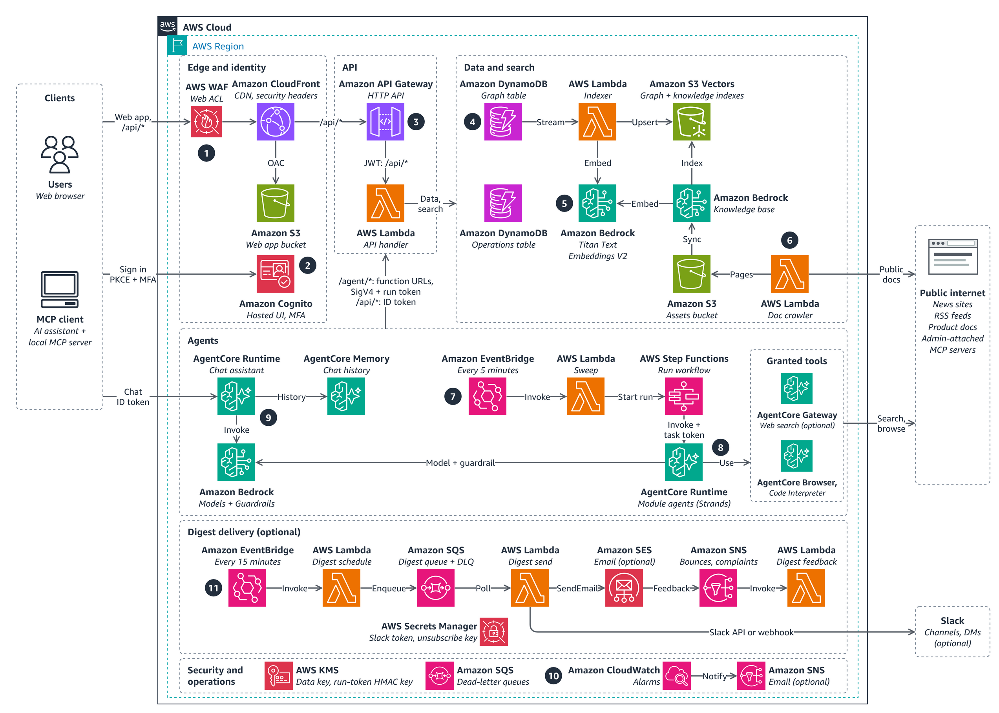

# Implementation guide: Agentic Insights Radar on AWS

This guide is for the people who deploy and operate Agentic Insights Radar (AIR). It explains how the parts fit
together, every deployment parameter, the role and module model, the cost controls, monitoring,
security controls, and what to do when something goes wrong. Start with the
[README](../README.md) for the deployment steps.

## Contents

1. [Overview](#overview)
2. [Plan your deployment](#plan-your-deployment)
3. [Architecture details](#architecture-details)
4. [Data flows](#data-flows)
5. [Deployment parameters](#deployment-parameters)
6. [Roles and permissions](#roles-and-permissions)
7. [Modules](#modules)
8. [Custom modules](#custom-modules)
9. [Tailoring a deployment](#tailoring-a-deployment)
10. [Budgets and the AI kill switch](#budgets-and-the-ai-kill-switch)
11. [Radars](#radars)
12. [Products, documents and the crawler](#products-documents-and-the-crawler)
13. [Chat](#chat)
14. [MCP server](#mcp-server)
15. [Monitoring and alarms](#monitoring-and-alarms)
16. [Logging and retention](#logging-and-retention)
17. [Backups and data retention](#backups-and-data-retention)
18. [Security controls](#security-controls)
19. [Upgrading](#upgrading)
20. [Custom domain](#custom-domain)
21. [Federated sign-in](#federated-sign-in)
22. [Troubleshooting](#troubleshooting)
23. [End-to-end tests](#end-to-end-tests)
24. [Uninstall](#uninstall)
25. [Revisions](#revisions)
26. [Notices](#notices)

## Overview

Agentic Insights Radar (AIR) is a sample web application that shows how to build an agentic
insights radar on AWS. Scheduled AI agents running in Amazon Bedrock AgentCore Runtime read the
public sources you choose, record what they find in a knowledge graph with a source for every
claim, and derive signals, trends, product gaps and content ideas from it. People explore the
results in radars, a chat assistant and an MCP server, each with their own role.



The README describes the numbered steps in the diagram. This guide covers the details you need to
plan, operate, extend and remove a deployment.

## Plan your deployment

### Cost

A deployment costs about USD 16 per month while idle and about USD 300 per month for a typical team
of 10 with the six scheduled modules on, in US East (N. Virginia), as of October 2026. Amazon
Bedrock model tokens are most of the bill, and every model call goes through a budget; web search,
Browser and Code Interpreter are billed outside the budgets and capped per run instead. The
[cost estimate](cost-estimate.md) has the per-service breakdown, four usage scenarios and how to cap
spend.

### Security

The [threat model](security/threat-model.md) and the [security matrix](security/security-matrix.md)
describe the trust boundaries, threats and controls; [Security controls](#security-controls) below
summarizes them.

### Supported Regions and service limits

AIR was tested in `us-east-1` and `us-west-2` and runs in any Region with the services listed in the
README's [Supported Regions](../README.md#supported-regions). Check the quotas in
[Service limits](../README.md#service-limits) before running several deployments in one account.

## Architecture details

One deployment is one CloudFormation stack (`AgenticInsightsRadar`, or `AgenticInsightsRadar-<prefix>`) in your
Region. Outside `us-east-1` a second stack, `<stack>-<region>-Edge` (for example
`AgenticInsightsRadar-us-west-2-Edge`), holds the CloudFront web ACL in
`us-east-1` (see `infra/insights_radar_infra/edge.py`). There is no VPC, NAT gateway, provisioned
database or search cluster: every service is serverless and billed on use.

| Component | AWS service | Defined in |
|---|---|---|
| Web app hosting | Amazon S3 (private, SSE-S3) behind Amazon CloudFront with origin access control; a CloudFront Function rewrites deep links to `index.html` | `infra/insights_radar_infra/frontend.py` |
| Edge protection | AWS WAF web ACL: `RateLimitPerIp` (2,000 requests per IP, blocks), `AWSManagedRulesCommonRuleSet` (with `SizeRestrictions_BODY` in count mode), `AWSManagedRulesKnownBadInputsRuleSet`, `AWSManagedRulesAmazonIpReputationList`; every request logged to the KMS-encrypted log group `aws-waf-logs-<prefix>-<region>` in `us-east-1`, with the `authorization`, `cookie` and `x-mr-run-token` headers redacted | `infra/insights_radar_infra/edge.py` |
| Identity | Amazon Cognito user pool (Essentials plan, classic hosted UI), groups `admin`, `editor`, `viewer`, two public PKCE app clients (web app and MCP server) that allow only the hosted UI and refresh tokens (no SRP or password sign-in) | `infra/insights_radar_infra/auth.py` |
| API | Amazon API Gateway HTTP API, `$default` stage throttled at 50 requests/s (burst 100); `POST /api/graph/search`, `POST /api/graph/ask` and `POST /api/products/{id}/ask`, which call a model on every request, at 10 requests/s (burst 20); relevance listing (`GET /api/insights/{kind}?q=`) embeds too and is limited per user (60 a minute) and per workspace (600 a minute) by the function, because a stage route setting cannot tell it from a plain list page | `infra/insights_radar_infra/backend.py` |
| Agent routes | Two Lambda function URLs with `AWS_IAM` auth and no resource policy: `AgentTools` (`/agent/tools/*`, called only by the module runtime role) and `ChatUsage` (`/agent/chat/usage`, only the chat runtime role) | `infra/insights_radar_infra/backend.py` |
| Functions | AWS Lambda, Python 3.14 on arm64, X-Ray tracing, one IAM role per function | `infra/insights_radar_infra/backend.py` |
| Graph and operational data | Two Amazon DynamoDB tables (on-demand, KMS, point-in-time recovery, TTL attribute `ttl`, one GSI each); the graph table has a stream | `infra/insights_radar_infra/data.py` |
| Files | S3 assets bucket (SSE-KMS, versioned, access-logged) and an access-log bucket | `infra/insights_radar_infra/data.py` |
| Vector search | Amazon S3 Vectors bucket with two 1,024-dimension cosine indexes: `nodes` (graph) and `knowledge` (knowledge base) | `infra/insights_radar_infra/search.py` |
| Product knowledge | Amazon Bedrock knowledge base (Titan Text Embeddings V2, S3 Vectors storage) with one S3 data source on the `docs/` prefix, fixed-size chunks of 512 tokens with 15% overlap | `infra/insights_radar_infra/search.py` |
| Run workflow | AWS Step Functions state machine `<prefix>-runs` and an Amazon EventBridge rule `<prefix>-sweep` every 5 minutes | `infra/insights_radar_infra/backend.py` |
| Source watcher | AWS Lambda `Watch` (15-minute timeout, one concurrent run, failed events kept in the DLQ) started by the EventBridge rule `<prefix>-watch` every 2 hours and by **Check now**; checkpoints in the operational table | `infra/insights_radar_infra/backend.py`, `backend/src/insights_radar/modules/watch.py` |
| Agents | Amazon Bedrock AgentCore Runtime: `<prefix>_modules` (IAM inbound auth) and `<prefix>_chat` (Cognito JWT inbound auth), deployed as direct code (no container) | `infra/insights_radar_infra/agents.py` |
| Chat history | Amazon Bedrock AgentCore Memory, short-term events, 30-day expiry | `infra/insights_radar_infra/agents.py` |
| Web search | Amazon Bedrock AgentCore Gateway with the managed web-search connector target (optional) | `infra/insights_radar_infra/agents.py` |
| Model safety | Amazon Bedrock Guardrail on every model call: prompt-attack and content filters on the newest user message (a user's chat message, or a run's start message; tool results are never screened), content filters on model output, and AWS access keys, secret keys and card numbers masked in model output. Its published version names a hash of its filters, so a changed filter always publishes a new version | `infra/insights_radar_infra/agents.py` |
| Encryption | AWS KMS: a symmetric data key (rotation on) and an HMAC_256 key that signs run tokens | `infra/insights_radar_infra/data.py` |
| Alarms | Amazon CloudWatch alarms and a dashboard (`<prefix>-insights-radar`) to a KMS-encrypted Amazon SNS topic; an optional AWS Budget | `infra/insights_radar_infra/monitoring.py` |
| Backups (optional) | AWS Backup plan: daily recovery points of both tables and the assets bucket, kept 120 days, in a vault encrypted with the data key | `infra/insights_radar_infra/backups.py` |

The Lambda functions (the three that run the API code each hold only the permissions their routes
use: `AgentTools` and `ChatUsage` cannot administer users, sign run tokens or start runs):

| Function | Handler | Trigger | Timeout | Memory |
|---|---|---|---|---|
| `ApiHandler` | `insights_radar.api.app.handler` | HTTP API (`/api/*`) | 29 s | 1,536 MB |
| `AgentTools` | `insights_radar.api.app.handler` | Its function URL (`/agent/tools/*`), from the module runtime | 29 s | 1,536 MB |
| `ChatUsage` | `insights_radar.api.app.handler` | Its function URL (`/agent/chat/usage`), from the chat runtime | 30 s | 1,024 MB |
| `Sweep` | `insights_radar.api.workers.sweep` | EventBridge, every 5 minutes (failures go to the `FailedEvents` queue) | 120 s | 1,024 MB |
| `Invoke` | `insights_radar.api.workers.invoke` | Step Functions task (wait for task token) | 60 s | 1,024 MB |
| `Finalize` | `insights_radar.api.workers.finalize` | Step Functions task | 30 s | 1,024 MB |
| `Indexer` | `insights_radar.api.workers.index` | DynamoDB stream of the graph table (failures go to `IndexerDlq` and are listed for re-indexing); invoked by hand to re-index | 900 s | 1,024 MB |
| `Crawler` | `insights_radar.api.workers.crawl` | Asynchronous invoke from the API or the sweep (failures go to `FailedEvents`) | 900 s | 1,024 MB |
| `Seed` | `insights_radar.api.workers.seed` | CDK trigger, re-run when the function's code or configuration changes (so on every release, not on an infrastructure-only redeploy) | 300 s | 1,024 MB |

## Data flows

### Web requests

1. The browser loads the app from CloudFront. `/api/*` requests go to the same CloudFront origin,
   so the browser needs no CORS for the API. CloudFront forwards them to the HTTP API without
   caching.
2. `GET /api/config` is public: it returns the Region, user pool id, web client id, Cognito domain,
   chat runtime ARN, version and whether AI features are on. The web app and the MCP server read
   their sign-in settings there.
3. Every other `/api/*` route needs a Cognito ID token. The HTTP API's JWT authorizer checks the
   issuer and audience (the two app clients). The Lambda builds the caller's role from the verified
   `cognito:groups` claim and asks one policy table (`backend/src/insights_radar/identity/policy.py`)
   whether the action is allowed. Radar edits also check the radar's access list.
4. Every mutation writes an audit row (actor, action, target, time).

The routes are in `backend/src/insights_radar/api/routes.py`: configuration and identity
(`/api/config`, `/api/me`, `/api/nav`), users (`/api/users`), products and documents
(`/api/products/...`), modules, sources and runs (`/api/modules/...`, `/api/runs`, `/api/models`),
the kill switch (`/api/andon`), chat status and limits (`/api/chat/...`), the graph
(`/api/graph/...`), insights, feedback, working-on and drafts (`/api/insights/...`,
`/api/nodes/...`, `/api/drafts/...`, `/api/feedback`), radars (`/api/radar-templates`,
`/api/radars/...`), and administration (`/api/audit`, `/api/health`).

### Module run lifecycle

1. **Dispatch.** Every 5 minutes the `Sweep` function looks at every enabled module. A module is
   due when its interval has elapsed since its last dispatch. Before a run starts
   (`backend/src/insights_radar/modules/service.py`), the service checks that AI features are on,
   that the module's daily budget is not exhausted and that fewer than `max_concurrency` runs are
   in progress. On-demand runs (`POST /api/modules/{slug}/run`, the **Run now** button and draft
   requests) pass the same checks. The sweep starts modules upstream first (Scout, then Signals and
   custom modules, Trends, Gaps, Content ideas, the Radar curator), and a sweep that starts one stage
   leaves the later stages for the next sweep, when the earlier stage's output exists. It keeps at
   most 8 runs going across the deployment; modules over the cap wait for the next sweep.
2. **Budget hold.** The run reserves part of the module's daily budget before it starts, and spends at
   most that. A scheduled run holds what is left divided by the slots still to come before UTC midnight
   (its own included), so an early run cannot spend the whole day; a run started by hand may hold all of
   it. A Scout run stops between passes when the next pass would not fit in its hold, and its sources
   are read first by the next run.
3. **Run token.** The service records a queued run and issues a run token: claims
   `{module, run_id, tools, exp, product_id}` signed with KMS `GenerateMac` on the HMAC_256 key
   (`backend/src/insights_radar/identity/run_token.py`). The key never leaves KMS. Tokens expire
   after at most 8 hours.
4. **Workflow.** The service starts a Step Functions execution. The `RunModule` task calls the
   `Invoke` function with a task token (`.waitForTaskToken`, heartbeat timeout 5 minutes, task
   timeout 8 hours). `Invoke` calls `InvokeAgentRuntime` on the module runtime and returns at
   once. Step Functions logs exclude execution data, because the run input carries the run token.
   The execution history still holds that input until it expires (90 days), so keep
   `states:GetExecutionHistory` and `states:DescribeExecution` to operators; a copied token is
   useless without the module runtime role, and it expires within 8 hours.
5. **Agent.** The module runtime (`agents/src/insights_radar_agents/module_runtime.py`) reads its run context
   with the token, builds only the tools the module is granted, composes the system prompt and runs
   a Strands agent on a worker thread. It heartbeats the task token every 60 seconds.
6. **Finish.** The runtime reports the outcome and token usage with `SendTaskSuccess` (a failed run
   is reported as success carrying `status=failed` and its usage, so it is still billed);
   `SendTaskFailure` is used only when no outcome could be produced. The `Finalize` function
   records the run (status, tokens, nodes written, summary, error) and charges the module's budget.
   When the run ended early (budget used up, cancelled, failed), it then deletes the entities the run
   created and named in no later write that nothing links to (only the module's own, created since the
   run started, deleted only if it still has no link in or out, in one conditional write), so a run stopped
   between creating an entity and linking it leaves no unlinked entity behind; each such cleanup is
   in the audit log (`graph.delete_run_orphans`) and a failure in it never fails the finalize. A run whose
   step failed outright (a task timeout, a runtime killed before it reported) sends no list, so what it left
   unlinked is cleaned from **Graph hygiene**.
   Finalize is idempotent, so every failure is retried up to 6 times with jittered backoff; a
   success that still cannot be recorded is recorded as a failure, so a run never stays `running`.
7. **Cancel.** An administrator can cancel a queued or running run from the module's **Runs**
   table (`POST /api/modules/{slug}/runs/{run_id}/cancel`). The execution is stopped and the run is
   recorded as cancelled; its tools refuse from then on, so the agent cannot write after it. What
   it wrote stays, and its budget hold stays charged because it may have called the model. Each
   cancel is in the audit log (`module.run_cancel`).

### Agent tool calls

The module runtime calls `POST /agent/tools/{tool}` on the `AgentTools` function URL with a SigV4
signature from its role and the run token in the `X-MR-Run-Token` header. Lambda verifies the
signature and refuses any caller from another account, and any caller in this account without
`lambda:InvokeFunctionUrl` on that function, before the code runs. The backend
(`backend/src/insights_radar/api/agent_tools.py`) then honours a call only if:

1. the caller is the module runtime role;
2. the run token verifies against the KMS key and has not expired;
3. the token lists the tool, **and** the module's current definition still grants it (an
   administrator who removes a grant mid-run takes effect at once).

Authority never comes from model-typed arguments: the module, run and product are read from the
token, every node a module writes is stamped with the module, a module may only create outputs of
its own output kind and edit outputs it created, and radar entries can only be proposed. Web
search, the browser, the code interpreter and remote MCP servers run inside the runtime and have
no backend route, so the runtime gates them itself (`agents/src/insights_radar_agents/tool_policy.py`):
each has a cap on calls per run, each call re-checks the module's current grants at most once a
minute (an administrator who removes one of these grants mid-run stops it within a minute), and the
browser may open only public https addresses with short query strings and may not type, run
script or change cookies. Every result from them is fenced as untrusted (see
[Security controls](#security-controls)).

### Chat

1. The chat panel calls the chat runtime's HTTPS endpoint
   (`bedrock-agentcore.<region>.amazonaws.com`) with the user's Cognito ID token. The runtime's
   inbound JWT authorizer validates it against the user pool's discovery URL and the app client
   audiences.
2. Before the turn, the runtime calls `/api/chat/status` with the same token (kill switch, shared
   and per-user budgets). Each tool calls the user-facing `/api/*` read routes with that token, so
   chat can read exactly what the user can read and cannot write.
3. Before the turn the runtime reserves the turn's ceiling, and after it reports the real usage,
   on the `ChatUsage` function URL (`POST /agent/chat/usage`) signed with its own role; users
   cannot report usage. A reservation throttled before it ran is retried with jittered backoff.
4. Conversation turns are stored as AgentCore Memory short-term events keyed by user and session.
   Restored turns have their tool blocks removed.

### Indexing and search

1. Graph writes go to the DynamoDB graph table. Its stream (new and old images) triggers the
   `Indexer` function in batches of up to 50 records (5-second window, 5 retries, batch bisection
   on error, failed records to `IndexerDlq`).
2. The indexer embeds each changed node with Amazon Titan Text Embeddings V2 and writes it to the
   `nodes` S3 Vectors index, or deletes it when the node is deleted.
3. Search combines semantic results from S3 Vectors with keyword matching. Keyword candidates are
   also read straight from the graph: entity names (with their other spellings, such as a trailing
   "SDK" or a leading "AWS"), and, for a search filtered to up to 4 types, the 50 newest nodes of each
   type, so a node is found by its words before the index has caught up. Title words also match by
   stem ("tariff" finds "tariffs"). New nodes appear in semantic search within about a minute; reads
   of a node you just wrote go to DynamoDB directly.
4. When the embedding model or the vector index fails, search answers with keyword matches alone
   (the 100 newest nodes of each searched type, plus entity names) instead of failing. The API
   response says `"degraded": true`, the graph page says so above the results, and `kg_search`
   tells the agent to search with the words a record would use.
5. Embedding calls are not stopped by the kill switch, so search keeps working while AI features
   are paused.

### Product knowledge ingestion

1. Saving a product with documentation URLs, choosing re-sync, or the weekly refresh invokes the
   `Crawler` function asynchronously. It crawls each URL's path into `docs/<product>/web/` in the
   assets bucket with a metadata sidecar (`backend/src/insights_radar/product/crawler.py`).
2. Uploads use a presigned S3 POST: the browser sends the file straight to S3 under `docs/`, then
   the app confirms the upload.
3. The knowledge base's S3 data source ingests the `docs/` prefix into the `knowledge` index.
   Retrieval is filtered to the product. The sweep refreshes ingestion status every 5 minutes.

## Deployment parameters

The CDK app reads these context values (`infra/insights_radar_infra/config.py` and
`infra/insights_radar_infra/application.py`). `deploy.sh` sets them from its arguments and
environment variables, or from a file of `export NAME=value` lines with `--env-file=FILE` (one
deployment's settings in one place; the file wins over the environment, and may set only `AIR_*` options,
`AWS_PROFILE` and `AWS_REGION`). The stack records the options in its `DeployOptions` output; on an update
`deploy.sh` uses the recorded value of every option you do not set again, prints the options, and
says when you change one.

| Context key | `deploy.sh` input | Default | Effect |
|---|---|---|---|
| `adminEmail` | first argument (or `AIR_ADMIN_EMAIL`) | required | Email of the first administrator. Cognito creates the user in the `admin` group and emails a temporary password. |
| `alarmEmail` | second argument (or `AIR_ALARM_EMAIL`) | the first administrator's email | Subscribes this address to the alarm topic. Confirm the subscription email; `deploy.sh` warns while no subscription is confirmed. It is kept by later deploys until you give another; `AIR_ALARM_EMAIL=admin` goes back to the first administrator (the new subscription must be confirmed). |
| `prefix` | `AIR_PREFIX` | `air` | Resource name prefix; 2-21 lower-case letters, digits or hyphens, starting with a letter. A non-default prefix changes the stack name to `AgenticInsightsRadar-<prefix>`. |
| `retainData` | `AIR_RETAIN_DATA` | `true` | `true`: DynamoDB tables and the user pool get deletion protection, and the tables, buckets, user pool, data key and digest delivery secrets are retained when the stack is deleted (removal policy retain-on-update-or-delete, so a failed first deployment still cleans up). `false`: everything is deleted, including bucket contents. Changing `true` to `false` on an existing deployment needs `deploy.sh --allow-data-loss`. |
| `webSearch` | `AIR_WEB_SEARCH` | `true` | `true` creates the AgentCore Gateway with the web-search connector. `false` deploys without it. |
| `logRetentionDays` | `AIR_LOG_RETENTION_DAYS` | `365` | Retention of the stack's log groups (functions, API access, workflow, WAF) and expiry of the access-log bucket's objects. Must be a value CloudWatch Logs accepts: 1, 3, 5, 7, 14, 30, 60, 90, 120, 150, 180, 365, 400, 545, 731, 1096, 1827, 2192, 2557, 2922, 3288 or 3653. |
| `agentLogRetentionDays` | `AIR_AGENT_LOG_RETENTION_DAYS` | `30` | Retention of the two AgentCore runtime log groups, which hold chat questions and text from fetched pages. Same allowed values. |
| `chatMemoryDays` | `AIR_CHAT_MEMORY_DAYS` | `30` | How long AgentCore Memory keeps a user's chat history, 7 to 365 days. Lower it to answer a shorter-retention requirement without a code change. |
| `chatMemoryKey` | `AIR_CHAT_MEMORY_KEY` | `data-key` on a new install; an existing deployment keeps its own | How AgentCore Memory encrypts chat history: `data-key` (the deployment's KMS data key, memory `<prefix>_chat_k`) or `aws-owned` (an AWS-owned key, memory `<prefix>_chat`, every deployment created before this option). The key is create-only, so changing it replaces the memory and deletes every user's chat history; `deploy.sh` refuses that without `--allow-data-loss`. A direct `cdk deploy` of an existing deployment must pass `-c chatMemoryKey=aws-owned`. |
| `chatModel` | `AIR_CHAT_MODEL` | `sonnet-5-5` | The chat assistant's model: `haiku-4-5`, `nova-2-lite`, `sonnet-5-5`, `sonnet-4-6`, `opus-5-5` or `fable-5-1`. |
| `priceClass` | `AIR_PRICE_CLASS` | `100` | CloudFront price class: `100` (North America and Europe), `200` (adds Asia, the Middle East and Africa) or `All`. Users far from those edges see slower page loads with `100`. |
| `wafRateLimit` | `AIR_WAF_RATE_LIMIT` | `2000` | AWS WAF requests per 5 minutes per source IP before the rate-based rule blocks. 100 to 2,000,000,000. Everyone behind one NAT address or corporate proxy shares one limit, and a list page follows every cursor, so a few people on the admin and audit pages of a large deployment can reach 2,000; raise it if users see 429s from WAF. |
| `guardrailGeneration` | `AIR_GUARDRAIL_GENERATION` | `1` | 1 to 99. A Bedrock guardrail deleted outside CloudFormation cannot be restored by an update, because the stack still holds its id; every module and chat run then fails with "The guardrail identifier or version provided in the request does not exist". Raise this by one and deploy: the stack creates `<prefix>-guardrail-<n>` as a new resource and points both runtimes at it. |
| `slackSecretGeneration` | `AIR_SLACK_SECRET_GENERATION` | `0` | 0 to 999. The digest Slack secret's generation (see `digestDelivery`). Raise it by one and deploy only when that secret was deleted for good outside CloudFormation: the stack makes that one secret again and changes nothing else; put the bot token or webhook URL, and `directory_api_key`, in the new secret, and revoke the old token in Slack. `deploy.sh` keeps the deployed value when the variable is unset, and while digest delivery is on refuses a lower one without `--allow-data-loss`, since that replaces the secret too. With CDK context, keep a raised value in `cdk.json`: a one-shot `-c` is not kept. |
| `unsubscribeKeyGeneration` | `AIR_UNSUBSCRIBE_KEY_GENERATION` | `0` | 0 to 999. The same for the digest emails' unsubscribe-link key. A new key means unsubscribe links already sent stop working, so raise it only when the key was deleted for good. Carried over and guarded like `slackSecretGeneration`. |
| `workspaceRatePerMinute` | `AIR_WORKSPACE_RATE_PER_MINUTE` | `600` | Calls a minute, across every non-admin user, to each model-backed API bucket (search, relevance listing, product ask; graph traversal), 60 to 100,000. Each user also has their own limit of 60 a minute. Administrators count only against their own limit, so viewers at the ceiling cannot lock them out. The `WorkspaceRateLimited` alarm fires when the ceiling refuses calls. |
| `monthlyBudgetUsd` | `AIR_MONTHLY_BUDGET_USD` | `0` | A whole number of US dollars (up to 1,000,000). Above 0, creates two AWS Budgets with this monthly limit, each alerting the alarm topic at 80% of actual and 100% of forecast spend: `<prefix>-insights-radar-<region>-account` sees the whole account's spend, model invocations included, and `<prefix>-insights-radar-<region>` only spend tagged `deployment=<prefix>`, which leaves out model invocations (the `global.` inference profiles carry no tag) and reports 0 until **deployment** is activated as a cost allocation tag. |
| `backupPlan` | `AIR_BACKUP` | `false` | `true` adds the AWS Backup plan (see [Backups and data retention](#backups-and-data-retention)). |
| `reservedConcurrency` | `AIR_RESERVED_CONCURRENCY` | `false` | `true` reserves Lambda concurrency: 2 each for `Invoke` and `Finalize`, 1 for `Sweep`, so a flood of other functions cannot throttle run bookkeeping. Needs a Regional concurrency quota above the new-account default of 10. |
| `suppressInvitation` | `AIR_SUPPRESS_INVITATION` | `false` | `true` creates the first administrator without sending the invitation email (validation stacks). |
| `e2eSignIn` | `AIR_E2E_SIGN_IN` | `false` | `true` lets the e2e suite sign test users in with SRP on the MCP app client. Leave it off on production stacks. Unlike the other options it is never kept from the previous deploy: a deploy without `AIR_E2E_SIGN_IN=true` turns it off. It is still recorded in `DeployOptions`, so `deploy.sh` can say that it is turning SRP sign-in off again and an operator can read from the outputs whether a stack has it on. |
| `seed` | `AIR_SEED` | none | Name of a seed bundle folder, `deployment/seeds/<seed>/bundle.json`, applied on every deploy: the deployment profile, built-in module settings, custom modules and public sources. See [Seed bundles](#seed-bundles). |
| `domainName` | `AIR_DOMAIN_NAME` | none | Serve the app from this name instead of only the `*.cloudfront.net` address. Needs exactly one of `parentZoneId` or `certificateArn`. See [Custom domain](#custom-domain). |
| `parentZoneId` | `AIR_PARENT_ZONE_ID` | none | A Route 53 public hosted zone that holds the parent of `domainName`. The stack creates its own hosted zone for `domainName`, adds one NS record to the parent zone, and issues a DNS-validated certificate. `us-east-1` only. |
| `redirectDomains` | `AIR_REDIRECT_DOMAINS` | none | Up to 3 comma-separated names in the same parent zone that the app answered on before a rename. Each keeps its DNS and answers with a permanent redirect to `domainName`. Needs `parentZoneId`. See [Renaming the domain](#renaming-the-domain). |
| `certificateArn` | `AIR_CERTIFICATE_ARN` | none | An ACM certificate in `us-east-1` for `domainName`; DNS is then yours to point at the distribution. |
| `authMode` | `AIR_AUTH_MODE` | `cognito` | `cognito`: user pool accounts with a password and TOTP, invited by an administrator. `federated`: sign-in only through one OpenID Connect provider (see [Federated sign-in](#federated-sign-in)). Fixed at creation; `deploy.sh` refuses to change it on an existing stack. |
| `oidcIssuer` | `AIR_OIDC_ISSUER` | none | Federated: the provider's `https` issuer URL. |
| `oidcClientId` | `AIR_OIDC_CLIENT_ID` | none | Federated: the client ID the provider issued for this deployment. |
| `oidcClientSecretArn` | `AIR_OIDC_CLIENT_SECRET_ARN` | none | Federated: a Secrets Manager secret whose value is the client secret. The template holds a `{{resolve:secretsmanager:...}}` reference, never the value. |
| `oidcProviderName` | `AIR_OIDC_PROVIDER_NAME` | `SSO` | Federated: the provider's name in the user pool (2-32 letters, digits or hyphens). Usernames become `<name>_<provider subject>`. |
| `oidcTrustEmail` | `AIR_OIDC_TRUST_EMAIL` | `false` | Federated: `false` makes an `adminEmails` address an administrator, and lets an email match a radar's editor list, only when the provider marks it verified (`email_verified`). Set `true` only for a provider whose addresses come from a company directory and cannot be chosen by the user, and which sends no `email_verified` claim. |
| `mcpIssuer` | `AIR_MCP_ISSUER` | none | Federated only: the OpenID Connect issuer (`https://` URL, no port or trailing slash) whose id tokens the MCP server may exchange for AWS credentials, so it signs in without a browser ([MCP server](#mcp-server)). Set with `mcpAudience`. The token's `sub` must be the user's id at the web app's provider, so it names the same Cognito user (`<oidcProviderName>_<sub>`), and STS must accept it as a session name (2-64 of letters, digits and `_+=,.@-`). |
| `mcpAudience` | `AIR_MCP_AUDIENCE` | none | Federated only: the `aud` those id tokens must carry. |
| `mcpProviderArn` | `AIR_MCP_PROVIDER_ARN` | none | With `mcpIssuer`: an IAM OIDC provider for that issuer that already exists in the account. An account holds one IAM OIDC provider per issuer URL, so a second stack using the same issuer must name an existing provider here, or its deploy fails with `EntityAlreadyExists`. The provider's client ID list must hold this stack's `mcpAudience`. A provider another stack created lists only that stack's audience and is deleted with it, so share one only between stacks with the same `mcpAudience`, or create the provider outside every stack (with each audience in its client ID list) and name it in all of them. |
| `oidcClientSecretVersion` | `AIR_OIDC_CLIENT_SECRET_VERSION` | (none) | Federated: the Secrets Manager version id of the client secret to use. To rotate the secret, put the new value and deploy with its version id: an unversioned reference is read only when the identity provider itself changes. |
| `oidcSignOutPrincipal` | `AIR_OIDC_SIGN_OUT_PRINCIPAL` | (none) | Federated: the service principal of the provider's user-lifecycle service (an `amazonaws.com` principal is refused: it would let a service in this account use the role). Creates a role it may assume to list this pool's users and sign them out, on this pool only; the stack outputs `SignOutRoleArn`, `UserPoolId` and `IdentityProviderName` for the provider's logout configuration. Amazon Federate accepts only one role per account, named `FederateKillSwitchCognitoAccessRole`, that lists every user pool it serves: with Federate, leave this unset and add the pool's ARN to that role instead. |
| `adminEmails` | `AIR_ADMIN_EMAILS` | none | Federated: more administrator emails, comma-separated (up to 20). `adminEmail` is always one. |
| `digestDelivery` | `AIR_DIGEST_DELIVERY` (deploy.sh), or CDK context `-c digestDelivery='{...}'` | all off | A JSON object that turns on digest delivery to Slack and email. Keys: `slackMode` (`off`; `bot`: a bot token, channels and DMs; `webhook`: one incoming webhook, channel digests only), `dmResolver` (`none`; `email`: Slack `users.lookupByEmail`; `directory`: a directory lookup, an HTTPS endpoint you run, for example in front of your company directory, that maps an email alias to a Slack member ID (see [Directory lookup for Slack DMs](#directory-lookup-for-slack-dms)), with `directoryRoleArn` (the IAM role the stack assumes to sign its calls) and `directoryEndpoint` (its `https` URL) set together, or neither until the endpoint is ready; needs `slackMode=bot`; `directoryRoleArn`'s trust policy must let the two roles in the `DigestSenderRoleArn` and `DigestApiRoleArn` outputs assume it (the API's for "Send test now"); an API key the endpoint wants, if any, goes in the Slack secret's JSON as `directory_api_key`, next to `slack_bot_token`; switching resolvers later makes existing DM deliveries fail with a message asking their owners to add them again), `emailMode` (`off`, `ses`), `emailSender` (the From address, on the SES identity), and with `ses` exactly one of `sesIdentityArn` (an existing identity in the stack's Region) or `sesDomain` (an Easy DKIM identity made here; with `sesHostedZoneId`, or when the domain is in the stack's own `domainName` zone, also its three DKIM CNAMEs; `sesDmarc: true` with `sesHostedZoneId` also writes a `_dmarc` TXT `v=DMARC1; p=reject;`, off by default because a domain other mail is sent from may already have a DMARC policy, or senders it would reject; `sesHostedZoneId` must be the closest public zone for `sesDomain`: `deploy.sh` refuses a zone that does not hold it, a private zone, one with an NS record delegating `sesDomain`, a name between it and the zone, `_domainkey.<sesDomain>`, or (with `sesDmarc`) `_dmarc.<sesDomain>` to another zone, since the DKIM and DMARC records written there would never be seen and the identity would stay unverified; it cannot check that the zone is the one the parent delegates to (the delegation may run through zones in other accounts, and two zones can share a name), so confirm that yourself: `dig NS <zone name>` must list the zone's own name servers (`aws route53 get-hosted-zone --id <sesHostedZoneId>`); the deploying credentials need `route53:GetHostedZone` and `route53:ListResourceRecordSets` for this check. Without `sesHostedZoneId` the records go to the stack's own `domainName` zone, which the stack delegates itself). Any channel on adds the `DigestSchedule` (every 15 minutes) and `DigestSend` (SQS, one message at a time, dead-letter queue after 3 receives) functions and, with email, `DigestFeedback` (SES bounces and complaints through an encrypted SNS topic); the ops table's `due` index; a Slack secret (bot token or webhook URL: a generated placeholder, so put the real value; the `DigestSlackSecretArn` output names it) and the unsubscribe-link key (generated; the `DigestUnsubscribeKeyArn` output names it), both with no fixed name and a description that starts with `<prefix>:` (`aws secretsmanager list-secrets --filters Key=description,Values=<prefix>:` lists them), and both exist for as long as digest delivery is on, whatever each channel's mode: switching `slackMode` or `emailMode` keeps them (put the new Slack value in the same secret), so links already sent keep working. Only turning digest delivery fully off, or changing a secret's generation (the top-level options `slackSecretGeneration` and `unsubscribeKeyGeneration`, which `deploy.sh` carries over), retires one; while digest delivery is on, `deploy.sh` refuses both turning it fully off and lowering a generation without `--allow-data-loss`; `retainData` keeps a retired one, so delete it (`destroy.sh --purge` also does), and when a Slack token or webhook is replaced or retired, revoke the old one in Slack too. While `emailMode` is `off`, unsubscribe links answer that they are not used; the key is kept, so the same links work again once email is back; the SES configuration set `<prefix>-digest`; and the only other unauthenticated routes, `GET` and `POST /api/digest/unsubscribe` (throttled to 5 a second). Example: `{"slackMode":"bot","dmResolver":"email","emailMode":"ses","emailSender":"radar@mail.example.com","sesDomain":"mail.example.com","sesHostedZoneId":"Z0123456789ABCDEFGHIJ","sesDmarc":true}`. A delivery is switched off after 3 failed sends in a row for its owner's own causes (account gone or disabled, address changed, DM resolver changed, channel removed from the list, Slack account deactivated), and after 7 sends in a row that found no Slack user for its email or alias, each counted on its own. Token, scope, grant, SES and directory lookup errors, and a bot/webhook switch, are shown on the delivery but never switch it off. Alarms: `DigestDeploymentFaults` (the first deployment-side error, or the API's `unsubscribe.key_unusable` line: the unsubscribe-key secret (the `DigestUnsubscribeKeyArn` output) could not be used, so unsubscribe links fail. The secret holds a plain string of at least 32 characters (the stack generates one) or JSON with a `key` or `unsubscribe_key` field of at least 32 characters; the line's `reason` says why it could not be used: `unsubscribe_not_configured`, the value (plain or in the JSON field) is shorter than 32 characters, the JSON has neither field, or a value starting with `{` is not valid JSON; `InvalidRequestException`, the secret is scheduled for deletion (`aws secretsmanager restore-secret`); `ResourceNotFoundException`, the secret is deleted for good (a `delete-secret --force-delete-without-recovery`, or the end of its recovery window), outside CloudFormation, which does not notice and cannot restore it. It comes back by raising its generation by one and deploying: `AIR_UNSUBSCRIBE_KEY_GENERATION` (or `AIR_SLACK_SECRET_GENERATION` for the Slack secret), which `deploy.sh` then keeps; with CDK context, set `"unsubscribeKeyGeneration": 1` in `cdk.json`'s `context` and keep it there, through release updates too (the repository ships its own `cdk.json`), since a one-shot `-c` is not kept, nothing on the CDK path checks the deployed value, and a deploy without it goes back to 0 and replaces the secret again. `deploy.sh` is the guarded path. The stack then makes that one secret again and changes nothing else; put the bot token or webhook URL, and `directory_api_key`, in a new Slack secret, and redrive `DigestDlq` once the secret is back. A new unsubscribe key means links already sent stop working. The same holds for the Slack secret, whose read errors land sends in `DigestDlq` rather than this alarm. Never force-delete either secret; `AccessDeniedException`, the API role's own policy no longer allows `secretsmanager:GetSecretValue` on the secret or `kms:Decrypt` on the data key; `DecryptionFailure`, the data key could not decrypt the secret: check its state with `aws kms describe-key` (disabled: `enable-key`; pending deletion: `cancel-key-deletion`, then `enable-key`, since a cancelled key stays disabled). No test send proves the key readable: a warm container keeps a key it read earlier, and an empty digest reads no key), `DigestLookupMisses` (any Slack user not found that day: if it is every DM, check the bot's workspace or the directory endpoint before the 7-send limit), and `DigestQueueFaults` (a claim, queue or cursor write that failed); `DigestDlq` (a send failed three times; if every send of one channel lands there, its secret may be unreadable or deleted, see the reasons under `DigestDeploymentFaults`, which apply to the Slack secret too): after fixing the cause, a redriven message for a time a later send already covered sends nothing, because its items went out in that later digest. |
| `webAclArn` | set by `deploy.sh` outside `us-east-1` | none | ARN of the edge stack's web ACL. Outside `us-east-1` the main stack requires it; `deploy.sh` reads it from the edge stack's `WebAclArn` output. |

`AWS_REGION` (or `AWS_DEFAULT_REGION`, or the CLI's configured Region) selects the Region, the same
way in `deploy.sh`, `destroy.sh` and `publish-site.sh`. Other `deploy.sh` inputs:
`AIR_CFN_EXECUTION_POLICIES` (policy ARNs for `cdk bootstrap --cloudformation-execution-policies`;
when the Region is already bootstrapped, `deploy.sh` compares this with the bootstrap stack's
`CloudFormationExecutionPolicies` parameter and stops on a mismatch rather than deploying with
whatever role is there), `AIR_SKIP_PREFLIGHT=true` (skip the Region and model checks), `--diff`
(diff every stack and ask before applying anything) and `--allow-data-loss`.

Every option above that is a switch takes only `true` or `false`, in any case. `0`, `1`, `no`, `yes`
and `on` are refused by both `deploy.sh` and the CDK app: they used to mean different things for
different options, so `AIR_WEB_SEARCH=0` left web search on while `AIR_BACKUP=0` turned backups off,
and `AIR_E2E_SIGN_IN=1` opened SRP password sign-in with no warning.

An update keeps every option the stack was deployed with unless its variable is set again. To remove an optional setting (one with no default, such as `seed`, `oidcClientSecretVersion` or `oidcSignOutPrincipal`), set its variable to `none`: `AIR_SEED=none deployment/deploy.sh`.

Every resource in the stack is tagged `application=Agentic Insights Radar`, `deployment=<prefix>`
and `stack=<stack name>`. The data key has the alias `alias/<prefix>-data`, the run-token key
`alias/<prefix>-run-token` and an edge stack's log key `alias/<prefix>-waf-logs-<region>`, so the
keys, buckets and log groups that a retaining destroy leaves behind can be told apart from another
deployment's. Activate **deployment** as a cost allocation tag in Billing and Cost Management to see
per-deployment cost in Cost Explorer and in the optional AWS Budget.

### Directory lookup for Slack DMs

With `dmResolver` set to `directory`, a Slack DM finds its recipient through a directory lookup:
an HTTPS endpoint you run, for example in front of your company directory, that maps an email
alias to a Slack member ID. Use it when people sign in through federation and Slack's own
`users.lookupByEmail` (`dmResolver=email`) is not an option. The alias is the user name of the
person's federated sign-in without the provider prefix (`<provider>_<alias>`), in lower case; it
must match `^[a-z][a-z0-9-]{1,63}$`, and without one the app does not offer the DM option.

The request the app sends, from `DigestSend` and from the API for "Send test now":

- `GET <directoryEndpoint>?alias=<alias>` with `accept: application/json`, a 5-second timeout
  (shorter from the API).
- Signed with SigV4 for the `execute-api` service, with temporary credentials from assuming
  `directoryRoleArn` (session name `digest-delivery`, 15 minutes, reused until a minute before
  they expire). The signing Region is the one in an `*.execute-api.<region>.amazonaws.com` host,
  otherwise the stack's Region. Amazon API Gateway with IAM authorization accepts this as is; any
  other endpoint must verify the signature, or accept the API key below.
- `x-api-key: <directory_api_key>` as well, when the Slack secret's JSON holds a
  `directory_api_key` field. It is read when needed, so a key added or rotated later is used
  within five minutes.

The answer it expects:

| Status | Meaning |
|---|---|
| 200 with a JSON object | The Slack member ID is taken from the first of `slackId`, `slack_id`, `slackUserId`, `userId`, `user_id` or `id` that looks like a Slack user ID (`U` or `W` and at least 8 more capitals or digits), in the object itself or in the one record under `data`, `result` or `user`. A record whose `alias`, `login` or `username` names another alias is skipped, and nothing deeper is searched. No ID found counts as "no Slack user". |
| 404 | No Slack user for that alias: shown on the delivery and counted towards the 7-send limit. |
| 401, 403 | `directory_denied`: the endpoint refused this deployment (a deployment fault, alarmed, never counted). |
| 429, 5xx | `directory_<status>`: retried through the queue. |
| Anything else, or a 200 that is not a JSON object | `directory_bad_answer`: a deployment fault. |

Example answer: `{"alias": "jdoe", "slackId": "U0123456789"}`. A role that cannot be assumed is
`directory_role` (retried); a missing endpoint or role, or an endpoint that is not `https`, is
`directory_not_configured`; both are deployment faults.

## Roles and permissions

Each user has one role, taken from their Cognito group. A user in no group is a viewer. The table
is `backend/src/insights_radar/identity/policy.py`; the API enforces it on every route.

| Action | What it covers | Viewer | Editor | Admin |
|---|---|---|---|---|
| `read` | Insights, graph, radars, products, modules, models | Yes | Yes | Yes |
| `chat` | Use the chat assistant | Yes | Yes | Yes |
| `feedback.give` | Thumbs up or down on insights | | Yes | Yes |
| `working.mark` | "I'm working on this" | | Yes | Yes |
| `content.draft` | Request a content draft | | Yes | Yes |
| `radar.create` | Create radars | | Yes | Yes |
| `radar.edit` | Edit radars you own or are an editor of (entries, schema, access, import, rollback, delete) | | Yes | Yes |
| `suggestion.review` | Accept or discard curator suggestions | | Yes | Yes |
| `radar.admin` | Edit any radar | | | Yes |
| `product.read` | Ask a product's documents (raw passages) and list them, in the app, chat and the MCP server | | Yes | Yes |
| `product.manage` | Product profiles, documents, re-sync | | | Yes |
| `module.manage` | Create, edit and delete modules and sources | | | Yes |
| `module.run` | Start module runs | | | Yes |
| `budget.manage` | Chat limits | | | Yes |
| `andon.manage` | AI kill switch | | | Yes |
| `user.manage` | Invite, change role, disable, enable, delete users | | | Yes |
| `audit.read` | Audit log, feedback list | | | Yes |
| `health.read` | Health page, run history | | | Yes |
| `sample.load` | Load the sample graph and radar (Admin page) | | | Yes |
| `graph.edit` | Delete graph nodes | | | Yes |

Group changes take effect on the user's next token (within an hour, or at next sign-in). The API
trusts a valid ID token's groups until the token expires, so disabling, demoting or signing out a
user does not end their API and chat access at once: it ends when their current ID token expires,
at most an hour later. The API refuses to remove or demote the last administrator. Module runs are never users: they act only
through the agent tool gate.

## First steps in the app

The Overview page opens with a **Getting started** panel. For administrators it is a checklist that
ticks itself from what already exists:

1. **Describe your product** (Products): what you sell, for whom, against whom, and its web pages
   and documents. The Gaps and Content ideas modules compare the market with this profile.
2. **Turn on the modules** (Modules). They ship turned off. Start with Scout: add sources (feeds,
   sites), then **Run now**. Signals and Trends build on what Scout records; Gaps and Content ideas
   need the product; the Radar curator proposes radar changes.
3. **Create a radar** (Radars) from a template, or load the sample under Administration > Sample data.
4. **Look at the knowledge graph** to see how everything links.

Viewers and editors see a three-line tour instead (Insights, Radars, Ask). The panel can be hidden
and brought back; the choice is remembered per browser. Each page explains itself in place: what a
list holds and which module fills it, why a button is unavailable, what each AI suggestions mode
does, and what to do when a run wrote nothing.

## Modules

A module is data: one generic runtime runs every module. The seven built-ins are seeded on every
deployment by the `Seed` function (`backend/src/insights_radar/modules/templates.py`). It keeps your
edits to instructions, schedule, budget, model, product and on/off, and resets each built-in's grants
and input types to the template (see [Upgrading](#upgrading)). All ship **turned off**, with the Claude Sonnet
5.5 model, a 2,000,000 weighted-token daily budget and a concurrency of 1.

| Module (slug) | Purpose | Reads | Writes | Grants | Default schedule |
|---|---|---|---|---|---|
| Scout (`scout`) | Reads the new items the source watcher found on your sources and records facts, opinions, events, adoptions and sentiment as linked evidence | its sources | evidence and entities | `kg_read`, `kg_write_evidence`, `sources`, `web_fetch`, `web_search`, `browser` | every 6 hours |
| Signals (`signal`) | Turns corroborated, source-weighted evidence into signals | evidence | signals | `kg_read`, `kg_write_evidence`, `kg_write_output`, `web_fetch`, `web_search` | every 6 hours |
| Trends (`trend`) | Finds sustained patterns across signals over weeks | signals | trends | `kg_read`, `kg_write_output` | every 6 hours |
| Gaps (`gap`) | Compares signals and trends with the product profile and documents; writes an improvement request | signals, trends | gaps | `kg_read`, `kg_write_output`, `product_knowledge` | every 6 hours |
| Content ideas (`content`) | Suggests content that rides a signal or trend the product already answers | signals, trends, gaps | content ideas | `kg_read`, `kg_write_output`, `product_knowledge` | every 6 hours |
| Content drafts (`draft`) | Writes a Markdown draft from a content idea, citing sources | the content idea | drafts | `kg_read`, `kg_write_output`, `content_draft`, `product_knowledge` | on demand |
| Radar curator (`curator`) | Proposes radar entry changes following each radar's mode | entities, signals, trends, insights | radar suggestions | `kg_read`, `radar_suggest` | every 6 hours |

Tool grants map to agent tools (`backend/src/insights_radar/modules/model.py`). Every module also has
`run_context`, `budget_status` and `progress_update`.

| Grant | Tools | Notes |
|---|---|---|
| `kg_read` | `kg_schema`, `kg_search`, `kg_get`, `kg_neighbors`, `kg_recent` | Required for every module |
| `kg_write_evidence` | `kg_upsert_entity`, `kg_add_evidence`, `kg_link` | Evidence needs a real https source URL |
| `kg_write_output` | `kg_save_output`, `kg_update_output`, `kg_link` | Required when the module has an output kind; only its own kind |
| `product_knowledge` | `product_knowledge_search`, `product_profile` | Knowledge base retrieval for the run's product. Cannot be combined with an outbound grant (`web_fetch`, `web_search`, `browser`, `code_interpreter`, `mcp`). Everything a module that holds it, or ever held it, writes (insights, evidence, entities) is hidden from modules with an outbound grant, as gaps, content ideas and drafts are |
| `sources` | `source_list`, `source_update_cursor` (and `source_address` and `source_inbox_ack`, which only the runtime calls) | Scout and custom modules only. The model sees only each source's `https://<host>` (with `address_redacted` set), never its path or query, and fetches a source by its id; the runtime adds the real address and removes every form of its credentials from what comes back. One rule for `http_fetch` and the watcher's inbox (`UrlGuard.source_scrubber`): credential names the guard lists (camelCase spellings too), and under any name a query value that reads as a key rather than a word (eight digits or more, a mixed-case or very long run of letters, letters mixed with digits beyond a plain term such as `windows11`, a UUID, or a bare `?<token>`; `;` path parameters too), are scrubbed in raw, decoded and re-encoded forms, with their whole field; plain words (`?category=technology`) are left alone. The stored address is shown as `source:<id>` where it stands for the source page itself, never where a link continues it into another page (`/news.php?id=5`, `?section=news&article=5`). Known limits: a lowercase letters-only key shorter than 24 characters under an unknown name, and a letters-only secret at the end of a deep path, are hidden only where the address stands for the source page itself |
| `radar_suggest` | `radar_list`, `radar_get`, `radar_suggest` | Radar curator only |
| `content_draft` | `draft_get_idea`, `draft_save` | Content drafts only |
| `web_fetch` | `http_fetch` | SSRF-guarded GET, 5 redirects, 2 MiB, text content only; 5 s to connect and 20 s for each network read (no overall deadline). Does not read `robots.txt` |
| `web_search` | AgentCore Gateway web search | Only when deployed with web search; at most 60 queries per run |
| `browser` | AgentCore Browser | Public https addresses only, query strings up to 512 characters; no typing, script, cookies or network interception; at most 120 calls per run; screenshots are dropped from tool output (read pages as text). Does not read `robots.txt` |
| `code_interpreter` | AgentCore Code Interpreter | At most 30 calls per run |
| `mcp` | Tools of the module's attached MCP servers | Named `mcp_<server>_<tool>`; at most 200 calls per run |

The system prompt is the template for the module's kind, then the administrator's instructions and
the product profile inserted as data (a module with an outbound grant gets only the product's name
and public documentation addresses, never its summary, capabilities, segments, competitors or notes), then shared rules on quality, writing, untrusted content and
the run protocol (`agents/src/insights_radar_agents/prompts.py`). The untrusted-content rules come after the
administrator's text, so an edit cannot remove them.

### Reading position

A module that reads evidence keeps a cursor: how far it has read. Its page shows it ("Read up to Oct 23,
2026, 05:47 PM") and, for administrators, **Read again from a date** sets it back, to a date or to the
beginning, so the next run re-reads evidence it has already seen (after a change to the module's
instructions, for example). The API is `PUT /api/modules/{slug}/progress` with `{"last_processed_at":
"<RFC 3339>" | null}` (`module.manage`). It refuses a date in the future (400), because runs only move the
cursor forward and a future one would stop the module reading until that date, and it refuses while a
run of the module is in progress (409), because that run's next progress update would overwrite the reset.

When a run pass ends on a guardrail block, its summary line ends "Last tool call before the block:
<tool> (<target>)", naming the source, the page's host or the node the pass was working on, so an
administrator can see which source to fix or drop. Free text such as a search query is never copied in.

### Source watcher

A Scout no longer reads every source on every run. The watcher, a Lambda function with no model,
fetches each enabled source of every enabled Scout-type module every 2 hours, lists the items on it
(a feed's entries, a JSON API's records, a page's same-site links with text, and text rows of 30
characters or more with their numbers masked, so a view counter is not news) and keeps a checkpoint
per source in the operational table (`WATCH#<module>` / `SRC#<source id>`): the fingerprints of the
last 3,000 items seen, when it was checked, and whether the check succeeded.

* **First check.** Everything listed is the baseline. Only items dated within the last 24 hours go
  to the source's inbox, so a new source starts at today instead of its whole archive.
* **Later checks.** Every item not seen before goes to the inbox, except dated items older than 14
  days (an archive page coming into view). Items that share an address (a list whose every entry
  links to one page) are told apart by their title.
* **Inbox.** At most 100 items per source; the oldest are dropped first and counted. The Scout gets
  each source's inbox in `source_list` (40 titles at most, inside the tool result, never in the
  run's start message) and works only on sources with an inbox, plus any not checked yet. The
  runtime acknowledges a pass's items (`source_inbox_ack`) only after the pass finishes, so a run
  that stops early leaves them for the next one. A run with nothing new makes no model call.
* **Start over.** A source's **Start over** clears its read position and the watcher's checkpoint
  (`PATCH /api/modules/{slug}/sources/{id}` with `{"cursor": ""}`): the next check takes a new baseline,
  so the last day's items wait for the Scout again.
* **Status.** The Sources table shows each source's last check: up to date, *N new waiting*, *lists
  no items* (a JavaScript-only page, or a changed layout: the checkpoint is kept) or the fetch error.
  **Only sources with problems** filters to the ones to fix, and **Check now**
  (`POST /api/modules/{slug}/sources/check`, `module.manage`) starts a check without waiting for the
  schedule. Changing a source's address or deleting it resets its checkpoint.

The watcher fetches with the same SSRF-guarded fetcher as the Scout and reads `robots.txt`; it
identifies itself as `AgenticInsightsRadar/1.0`. A module holds up to 500 sources; one check of 500
takes a few minutes with 16 parallel fetches, each limited to 20 seconds.

### Prompt, skills and history

For each module, administrators see and change everything its runs are told:

* **Prompt** (on the module's page, collapsed until opened; `GET /api/modules/{slug}/prompt`): the prompt
  a run gets now, built from the current configuration exactly as the runtime builds it
  (`backend/src/insights_radar/modules/prompts.py`); the **Template** the module starts from, which an
  administrator can replace with their own version (`system_prompt`, up to 64,000 characters, with the same
  `${instructions}`, `${product}` and other slots) and **Reset to default**; and the **Shared rules**
  (quality, writing, untrusted web content, run protocol) appended to every prompt of the kind, read-only so
  no edit can remove the rules for handling fetched content. Saving the packaged template again stores no
  override, so later template fixes still reach the module.
* **How the instructions are used**: *Extend the template* (they fill its focus) or *Replace the template*
  (they are the whole job description, at least 200 characters; the shared rules are still appended).
* **Schedule**: the listed choices or *Custom*, every 15 to 10,080 minutes.
* **Skills** (CTR's agent skills): Markdown instructions in a library under **Administration > Skills**
  (`/api/skills`), each a file with a `name` and a `description` frontmatter, at most 64 KiB. Attach up to
  10 to a module in its Configuration. The prompt lists each attached skill's name and description; a run
  reads a skill's full text with the `skill_load` tool only when a task matches, and only skills attached
  to that module. The library holds two defaults, *humanizer* (MIT, Siqi Chen, see its NOTICE) and
  *no-ai-slop*, written on every deploy unless an administrator edited them, and offered to each built-in
  module once: one an administrator detaches stays detached. A skill in use cannot be deleted; a default
  cannot be deleted at all.
* **History** (in the Prompt panel; `GET /api/modules/{slug}/prompt/history`): each save that changes the
  instructions, template, mode or skills is kept (the newest 50), with who saved it and what changed.
  **Restore this version** saves those values again, as an ordinary audited edit.

## Custom modules

Administrators create custom modules in **Modules > Create module** (name, what it publishes,
instructions of at least 20 characters, tools). The new module is off and runs on demand. On its
page, set the schedule, model, product, daily token budget and concurrency, then turn it on. Each
custom module publishes insight nodes of its own kind, and gets its own page under **Insights**.

Validation rules (`backend/src/insights_radar/modules/model.py`):

- **Slug:** 1-64 lower-case letters, digits or hyphens, unique, not a reserved word. The web app
  derives it from the name.
- **Name** up to 80 characters; **description** up to 1,000; **instructions** up to 20,000, all of
  which go into the system prompt (about 5,000 tokens at the limit, on every model call).
- **Insight kind:** snake_case, 2-41 characters; **label** up to 40 characters.
- **Input types:** up to 16 graph node types; set them through the API (`input_types` on
  `POST /api/modules` or `PATCH /api/modules/{slug}`).
- **Grants:** must include `kg_read` and `kg_write_output`. `radar_suggest` and `content_draft`
  are not available to custom modules.
- **Schedule:** `0` (on demand) or 15 to 10,080 minutes (one week).
- **Budget:** 0 to 100,000,000 weighted tokens per day. **Concurrency:** 1 to 10.
- **Model:** a key from the catalog (`GET /api/models`): `haiku-4-5`, `nova-2-lite`, `sonnet-5-5`
  (default), `sonnet-4-6`, `opus-5-5`, `fable-5-1`.

### MCP servers

Any module, built-ins included, can use tools from up to 10 remote MCP servers that an
administrator attaches (`module.manage`). On the module's page, **Configuration > MCP servers** takes a
name and an `https` address per server; Save adds the `mcp` grant while any server is attached and
removes it with the last one. A module that searches product knowledge cannot have MCP servers (its
documents must not leave with an outbound request), and the form says so. Through the API, send
`mcp_servers` as a list of `{"name", "url"}` objects, with the `mcp` grant, on `POST /api/modules` or
`PATCH /api/modules/{slug}`.

- The URL must be public `https` with no user name or password in it; loopback, private, link-local, reserved,
  multicast and cloud metadata addresses are refused, including encoded IP forms
  (`backend/src/insights_radar/core/urls.py`). The check runs when you save and again before each
  connection.
- The runtime connects through a client that only opens TCP connections to addresses it vetted
  at connect time, with redirects and proxy settings off (`agents/src/insights_radar_agents/connectors.py`).
- Names are 1-40 letters, digits, `-` or `_`, unique per module. At most 60 tools are loaded per
  run. A server that fails is skipped; the run continues.
- MCP tool output is untrusted and fenced like web content. You are responsible for the servers
  you attach: what they return reaches the model, and what the model sends them leaves your
  account.
- A server that needs a key can only take it in its URL (for example a query parameter): there is no
  header or secret-store option. Such a URL is stored in plaintext in the module definition and is
  shown to every administrator in `GET /api/modules`; the runtime keeps HTTP client logs at WARNING
  so the URL is not logged. Prefer servers that need no key, scope and rotate any key you embed.

## Tailoring a deployment

One deployment can be renamed and reshaped for a single job (for example a watch on public rule
changes) without a code change. Four settings do it; a [seed bundle](#seed-bundles) applies all of
them at deploy time.

### Deployment profile

What the deployment calls itself and its lists, and which lists it shows. An administrator edits it
in the API (`GET` and `PUT /api/admin/profile`, with `expected_version` so two editors cannot
overwrite each other) or through a seed bundle. Every field is optional; an unset field keeps the
built-in text.

After a rollback, the stored profile can hold fields or sections that only a newer release knows. This code
keeps them and writes them back on every save, so rolling forward again restores them. `GET` lists their names
under `unknown` (`footer_md`, `sections.<key>`), outside `profile`, so sending `profile` back is always accepted.
To remove one, add its name to `drop_unknown` in the `PUT`; the audit entry records the dropped names (not their values, so copy a value first if you may need it again).

| Field | Effect |
|---|---|
| `app_name` (1-60 characters) | Page titles, the header, the prompts' framing line ("Signals module of `<app_name>`") and the MCP server's instructions. |
| `tagline` (up to 160) | The Overview header and the sign-in page. |
| `about_md` (up to 4,000) | Markdown shown at the top of the Overview under **About this deployment**: what the deployment watches, its sources, and what not to enter. |
| `lists.<key>` | For `signals`, `trends`, `gaps`, `content`, `drafts` or a custom list `insight:<kind>`: `label` (the list), `item` (one record), `help`, `visible` and `order` (0-99). A hidden list leaves the navigation and the Overview. |
| `sections.products` (`true` or `false`, default `true`) | `false` takes **Products** out of the navigation and Getting started, and answers its pages with a "turned off" notice. Use it for a deployment that does not describe a product of its own (the Gaps and Content ideas modules read product profiles, so turn those off too). Stored products and the API are kept. |
| `sections.radars` (`true` or `false`, default `true`) | `false` takes **Radars** out of the navigation and Getting started, answers radar pages with a "turned off" notice, stops a record's page looking it up on radars, and hides the Radar curator on Modules unless it is turned on. Use it when the lists, the graph and chat are the whole job (a regulatory-change watch, for example). Stored radars and the API are kept. |
| `sections.sample_data` (`true` or `false`, default `true`) | `false` removes **Administration > Sample data** and its mention on Radars, and `POST /api/admin/sample-data` answers 404. Use it on a deployment that holds real data, where a mistaken click would mix fictional companies into the knowledge graph (a seed can set it). |
| `radars_help` (up to 400) | What a radar is for in this deployment, on the Radars page and in Getting started. Unset, the text speaks of competitors, vendors and technologies. |

The profile is served by the unauthenticated `/api/config`, so it must hold display text only. It
is cached for 60 seconds per function instance.

### Typed fields

A module that publishes a list can declare the fields every record must, or may, carry
(`attribute_schema`, up to 20 fields). The agent's write tool checks each record against them and
returns every problem at once, so the agent fixes them in one retry; the module's prompt gets a
generated "Fields to fill" section.

| Type | Value | `filter` | `sort` |
|---|---|---|---|
| `enum` | one of `values` (each with a `label` and a `rank` used for sorting and badge colour) | yes | by rank |
| `string_list` | a list, optionally limited to `values`, up to `max_items` | yes | no |
| `date` | `YYYY-MM-DD` | no | yes |
| `url` | an `https` URL that passes the same URL checks as fetched pages | no | no |
| `text` | up to `max_len` characters | no | no |
| `number` | a number | no | yes |

On a list with fields, the web app shows them on each card and adds a filter per `filter` field
and a "Sort by a field" menu. The API takes `filter.<key>=a,b` and `sort=attr:<key>&order=asc|desc`
on `GET /api/insights/<list>`. Filters and field sorts read up to 2,000 records and say when a list
is larger (`truncated`). The Overview card of such a list shows a count per value of each filter
field, each linking to the filtered list, and the records whose date fields fall in the next 90
days (`GET /api/insights/<list>/facets?days=`). **Export** on a list downloads the filtered list as
CSV or a Markdown table (`GET /api/insights/<list>/export?format=csv|md`); CSV cells that a
spreadsheet would run as a formula are prefixed with a quote mark.

### Prompt mode

A module's `instructions` normally fill the FOCUS slot of its built-in prompt (`prompt_mode:
extend`). With `prompt_mode: replace` they replace the built-in body: use it when the job is not the
built-in one, for example "regulatory changes" instead of "market signals". The shared rules on
quality, writing, untrusted page content and the run protocol, and the generated "Fields to fill"
section, are always appended, so a replacement cannot remove them. `replace` needs at least 200
characters of instructions. `${app_name}`, `${list_label}` and `${item_label}` are filled in from
the profile.

### Seed bundles

A seed bundle is one JSON file, `deployment/seeds/<name>/bundle.json`, applied on every deploy
when `AIR_SEED=<name>` (context `seed`). `deployment/seeds/policy-watch` is a worked example that
uses every feature.

| Key | Content |
|---|---|
| `version` | `1` |
| `description` | What the bundle sets up. |
| `profile` | A [deployment profile](#deployment-profile). |
| `modules` | Built-in module settings by `slug`: `name`, `description`, `instructions`, `prompt_mode`, `attribute_schema`, `input_types`, `interval_minutes`, `daily_token_budget`, `enabled`, `insight_label`. Tool grants cannot be widened from a bundle. |
| `custom_modules` | New modules: the same fields plus `slug`, `insight_kind`, `grants` and `model_key`. |
| `sources` | Public sources per module: `module`, `name`, `type` (`web_page`, `dynamic_web_page`, `rss`, `public_api`), `address`, `instruction`, `enabled`. |
| `retired_sources` | Sources the bundle added before and replaces now: `module`, `address`. Each is turned off once (not deleted); an administrator who turns one back on keeps it on. |

The seed function applies a bundle idempotently. It records what it wrote; on the next deploy it
changes an item only if nobody has edited it since, so an administrator's edits in the app always
win, and it adds sources but never removes them. A bundle added to a deployment already in use
leaves every module an administrator has edited as it is. An unchanged bundle writes nothing, so
redeploying does not bump versions under an open editor. A deploy whose seed stopped part-way tries the
bundle again; an entry that was refused (for example a source for a module that does not exist) is
reported in the seed's log and tried again only when the bundle changes. The profile is the exception: if
reading or saving it fails for any reason, the error is reported and the next deploy tries the bundle again,
so the same release applies the profile once the cause (a permission, throttling) is fixed. Whether an item is still the
bundle's is decided by its values, so a release's own migration of a built-in module does not count as an
edit. A unit test loads every bundle in
`deployment/seeds/` through the same validators as the API. Put only public information in a
bundle: it is stored in the assets bucket and its profile is served without sign-in.

## Budgets and the AI kill switch

Budgets count **weighted tokens**, so one number works for every model
(`backend/src/insights_radar/core/tokens.py`):

`weighted = input + 5 x output + 1.25 x cache write + 0.1 x cache read`

| Budget | Default | Where to change |
|---|---|---|
| Each module, per day | 2,000,000 | The module's page (**Daily token budget**) |
| Chat, shared per day | 2,000,000 | **Administration > AI controls** (**Everyone, per day**) |
| Chat, per user per day | 300,000 | **Administration > AI controls** (**Each user, per day**) |

Every limit can be 0 to 100,000,000. Budget days reset at 00:00 UTC.

| Share used | State | Effect |
|---|---|---|
| under 70% | open | Runs start normally |
| 70% | warn | Runs start; the agent is told to prefer the most valuable items |
| 90% | half-open | New runs are refused; a run in progress finishes the current item, saves progress and stops |
| 100% | closed | New runs are refused; a run in progress stops |

Size each module's daily budget for its whole day, not for one run: a run holds all that is left of
the day's budget when it starts (shared between `max_concurrency` runs), so one heavy run can leave
nothing for the later ones. Set **daily budget >= runs per day x the most a run uses**. For example,
a module every 360 minutes runs 4 times a day; if its heaviest run (the run history shows each run's
tokens) used 400,000 weighted tokens, give it at least 1,600,000. The 2,000,000 default covers 4 runs
of up to 500,000.

A module run also stops when it has used the budget that was left when it started, or after 200
model calls. Budgets count model tokens only: web search (billed per query), Browser and Code
Interpreter (billed per minute), attached MCP servers and `http_fetch` are capped per run instead
(60, 120, 30, 200 and 120 calls; see the grants
table), and AgentCore Runtime session time is not budgeted. A chat turn stops at
the smaller of the shared and personal budget left, or after 12 model calls.

The **AI kill switch** (**Administration > AI controls**) stops every model call: module runs,
chat, drafts and product knowledge search. A new run or chat turn is refused at once. A run already
in progress stops and saves progress at its next backend tool call, and -- if it only uses
runtime-side tools (web search, the browser, the code interpreter, an attached MCP server,
`http_fetch`), which never reach the backend -- at its next model call, because the runtime re-reads
`budget_status` before a model call at most once a minute. Reads, graph search, radars and exports keep working. The reason you enter is
recorded in the audit log, and the web app shows a banner while AI features are paused.

## Radars

- **Entry history.** An entry's panel has **Entry history**: for each of the radar's newest 50
  versions that changed the entry, what changed (added, moved ring or sector, which fields were
  edited, removed, put back), who saved it and when, and **AI suggestion** when the version was
  written from the Radar curator's suggestions (`GET /api/radars/{slug}/entries/{key}/history`).
- **Version tags.** On the **History** tab, editors tag a version with a name such as `Q3 2026`
  (1 to 40 letters, digits, spaces, dots, dashes or underscores; not only digits). A tag that reads
  like another (`q3-2026` beside `Q3 2026`) is refused with the existing tag named. **Open** shows an
  older version read-only, with a notice and **Open the current version**; **Copy link** copies a
  link to a version, by its tag when it has one (`/radars/<slug>?tag=Q3%202026`, or `?v=<n>`).
  The radar and its export take `?tag=` too (`GET /api/radars/{slug}?tag=`, `.../export?tag=`).
  Tags are listed with `GET /api/radars/{slug}/tags`, set with
  `PUT /api/radars/{slug}/versions/{n}/tag` and removed with `DELETE /api/radars/{slug}/tags/{tag}`,
  and both changes are in the audit log.

- **Favourites.** Each person can star radars (the star next to a radar's name, in the list and on
  the radar). Favourites come first in the radar list, and **Only favourites** shows them alone.
  A favourite of a deleted radar is dropped, and does not pass to a new radar with the same slug.
- **Find an entry across radars** on the Radars page searches every radar's current version by
  name, and a graph node's page lists the radars with an entry linked to it (**On radars**). The
  API is `GET /api/radars/entries?q=<name>` or `?node_id=<type>/<uid>`, and the MCP server's
  `find_radar_entries`.

Editors create radars from a template (`backend/src/insights_radar/radars/model.py`). The **Create
radar** dialog fills the headings and the sector, ring and marker lists from the template; edit
them there (one per line, with a live preview) before the radar is created, or later on the
**Settings** tab:

| Template | Purpose | Sectors | Rings | Markers |
|---|---|---|---|---|
| Technology adoption | Which technologies to adopt, trial, assess or hold | Techniques, Tools, Platforms, Materials & components | Adopt, Trial, Assess, Hold | New, Moved in, Moved out |
| Competitor landscape | Who competes with us, how closely, and how they are moving | Direct, Adjacent, Emerging, Substitutes | Leader, Challenger, Niche, Watch | Gaining, Steady, Losing |
| Vendor map | Suppliers and other third parties by category and relationship | Components, Materials, Logistics, Software & services | Strategic, Preferred, Approved, Exit | New, At risk |
| Customer segments | Customer segments by priority | Consumers, Small business, Enterprise, Public sector | Core, Growth, Explore, Deprioritise | none |
| Blank | A general-purpose radar | General | Now, Next, Later | none |

- Limits: 1-8 sectors, 1-6 rings, 0-6 markers, up to 300 entries; dimension names up to 40
  characters, entry titles up to 120, descriptions up to 4,000.
- Every save creates a version: view history, compare two versions, roll back (as a new version).
- Import and export CSV and JSON; export SVG and PNG from the chart. CSV exports neutralise
  spreadsheet formulas by prefixing cells that start with `=`, `+`, `-`, `@`, tab or carriage
  return with an apostrophe.
- **AI suggestions** mode: *manual* (no suggestions), *assist* and *copilot* (suggestions wait in
  the review queue), *autopilot* (a suggestion is applied after **Apply after (days)**, 1-90,
  default 7, unless someone changed the entry since it was proposed). On autopilot, proposals from
  the Radar curator module apply without review only when an administrator turns on **Apply agent
  proposals without review** in the radar's Settings (`auto_apply_agent`), and only while every
  evidence node they cite still exists and they come from at least two registrable domains
  (`www.reuters.com` and `reuters.com` are one). A module's evidence counts only when its run
  really fetched the page it cites, as the module runtime (never the model) records it; evidence a
  person recorded always counts. Evidence recorded before this release has no such record, so a
  proposal citing only that waits for review. With it off, which is the default and what every radar
  upgraded from an earlier release gets, autopilot holds them for review as in copilot; the
  Suggestions tab says how many are past the delay and held.
- Access: the owner and the editors listed on the radar can change it; administrators can change
  any radar; everyone can read every radar.
- Entries can carry an optional **sub-sector** (free text, up to 120 characters; CSV headers
  `sub_sector`, `sub-segment` or `subcategory`). The legend groups entries by sector, then
  sub-sector, then ring, and the blip numbers follow that order.
- The legend's filter box dims the blips that do not match and is kept in the address
  (`/radars/<slug>?q=<text>`), so a filtered view can be shared.
- An entry linked to a graph node shows **View in Knowledge Graph**, which opens
  `/graph?focus=<type>/<uid>` with the node's neighbours drawn. The graph page opens on an
  overview of the 150 most connected nodes when no node is chosen.

### Knowledge graph

The **Knowledge graph** page draws the graph on a canvas (the CoP Tech Radar's viewer, with this
deployment's node and relationship types).

- **Overview.** With no node chosen, the page draws the 150 most connected nodes as small dots,
  sized by connections, and labels the 10 most connected. Scroll to zoom and drag to pan or to move
  a node. More detail appears as you zoom in: first a **+N** badge on nodes with connections the
  picture leaves out, then every node's name, then the relationship names on the links.
- **Click** a node or a link to open its details beside the canvas. A node's panel has its type,
  summary, connections, last update, **Show its relationships** and **Open page**. A link's panel has
  both ends, who added it, when, and the confidence. Clicking a node also fades everything not
  directly connected to it.
- **Double-click** a node (or **Show its relationships**) to show that node and its direct
  neighbours as large labelled discs. The banner above names the node and its number of
  connections, and **Back to overview** returns. A node with more than 149 neighbours is shown a
  page at a time: **More neighbours** and **Previous neighbours** step through them. The address keeps the
  node and the page (`/graph?focus=<type>/<uid>&offset=<n>`), so the browser's Back button and a
  shared link both work.
- **Legend.** Each node type can be hidden or shown from the legend (the node a view is centred on
  always stays). Relationships are coloured by type, and the two that oppose (contradicts, competes
  with) are also dashed.
- **Keyboard and screen readers.** Under the canvas, **The graph as a list** holds every drawn node
  and link as a button: Enter opens the details, and a double-click opens the relationships.
- **Search** above the canvas finds nodes by meaning and keyword, optionally by type. A result opens
  the node in the graph, and **Open** goes to its page.

The API pages one node's direct neighbours with `GET /api/graph/nodes/{id}/neighbors?depth=1&offset=<n>`.
The answer adds `total` (how many direct neighbours there are) and `offset`. An offset with a depth
other than 1 is refused with 400.

### Asking the graph

`POST /api/graph/ask` with `{"question": "...", "types": [...]}` (and the MCP server's `ask_graph`)
answers with the records that bear on the question rather than with generated text: up to 8 search
hits, each with up to 6 linked records (an entity's evidence and outputs, an output's supporting and
contradicting evidence, the outputs that cite an evidence record), the sources among them (newest
first) and a `coverage` saying how well they back an answer: `none` (nothing matches), `loose` (sourced records that are only near the question in meaning: none shares half of its terms.
A word counts as shared only as itself or its regular plural or singular (-s; -es after ss, x, z, ch or sh; -ies); single letters, stopwords,
question words and filler are not terms; a run of Chinese characters, katakana, Thai, Lao, Myanmar or
Khmer (cut at hiragana and punctuation) is shared when it appears whole; hiragana are not judged.
The check only picks a caution note, so it errs toward showing it: irregular plurals and other word forms
do not meet, and an unpunctuated Chinese or Thai question is usually `loose`), `no_sources`
(records match but none links a source; this wins over `loose`), `single_source` (all from one site) or `sourced`. The
`note` tells the caller's model what to do with each, so it does not fill a gap from general
knowledge. No model is called, so it costs one embedding, and it is limited like search.

`GET /api/graph/nodes/{type}/{id}/brief` (MCP `research_entity`) researches one record: its whole
summary, its 10 newest evidence records, up to 10 linked trends, gaps, signals and ideas, the radars
whose current version places it, and its sources with the same `coverage` and `note`. It needs no
embedding and no model.

### Watching records and What's new

A record's page has a **Watch** button (`PUT`/`DELETE /api/me/watches/nodes/{type}/{id}`, up to 50
per person). **What's new** (`GET /api/me/digest`, MCP `whats_new`) lists what arrived since the
person last marked it read (a week back the first time, never more than 90 days, or from `?since=`):
the new signals, trends, gaps and content ideas, and the new records about each watched one. Viewers
do not see gaps or private records here either. `POST /api/me/digest/read` marks it read. The digest
is read in the app or through MCP; nothing is emailed.

### Duplicate and unlinked entities

Modules write the same company, product or topic under different spellings. Entity names already
match their common variants when they are written (a trailing "SDK", "framework", "library" or
"toolkit", a leading "AWS" or "Amazon", a trailing "(alias)"), and the rest is tidied by hand under
**Administration > Entities**:

- **Likely duplicates** groups entities that share a name or a spelling of one (one entity's other
  name is another's name), the best-linked first. **Merge** shows what the merge does before it
  does it: how many links move, which are dropped (a link that would join the kept entity to
  itself, or a link the kept entity's type cannot carry), the names it gains and the descriptions
  whose links are updated. Merging moves every link, with its writer, confidence and run, to the
  kept entity, points links in other records' descriptions at it, adds the duplicate's name and
  other names to it, fills any summary or description it lacked, and deletes the duplicate. The
  duplicate's name then resolves to the kept entity, so the next mention lands there. An entity
  with more than 500 links is refused: merge the other way round.
- **Unlinked entities** lists entities nothing links to, with **Delete**. A module run's own
  unlinked entities are deleted when the run is finalized, so this list holds what people, imports
  and earlier releases left, and entities whose links were removed later.

The API: `GET /api/graph/hygiene` (the report) and `POST /api/graph/nodes/{id}/merge` with
`{"into": "<id>", "apply": false}` (a dry run; `"apply": true` merges). Both need the `graph.edit`
action (administrators). Each merge is in the audit log (`graph.merge`).

### Sample data

A new deployment has an empty graph. To see the radar and graph features before any module has
run, an administrator opens **Admin > Sample data** and chooses **Load sample data**
(`POST /api/admin/sample-data`). It adds a small fictional CRM market (12 entities, 8 pieces of
evidence, 6 signals, trends, gaps and content ideas, and the links between them) and the radar
`sample-crm-competitors`, whose entries link to the graph. Loading again adds nothing; the action
is recorded in the audit log. Delete the sample radar and nodes like any other.

## Products, documents and the crawler

| Item | Limit |
|---|---|
| Product profiles | 20 per deployment |
| Capabilities, segments, competitors | 50 each, up to 300 characters per item |
| Documentation URLs | 20 per product, https and SSRF-checked |
| Crawl scope | Pages under each URL's host and path (`https://docs.example.com/guide/` covers `/guide/**`) |
| Crawl size | Up to 200 pages, depth 4, 600 seconds, 0.5 s between requests; pages with under 200 characters of text are skipped |
| Crawl manners | `robots.txt` is honoured for the crawler's user agent `AgenticInsightsRadar/1.0`; every request goes through the SSRF-safe fetcher |
| Refresh | Products last crawled more than 7 days ago are re-crawled by the sweep; a crawl stuck for over an hour is retried |
| Uploaded documents | PDF, DOCX, TXT, MD, HTML, HTM, CSV; up to 50 MB each; up to 500 per product |

The crawler skips links to binary and non-page files (for example `.pdf`, `.zip`, images, `.css`,
`.js`, `.json`). Upload such files instead.

## Chat

- Model: Claude Sonnet 5.5 by default (`chatModel` / `AIR_CHAT_MODEL` picks another catalog model), up
  to 4,096 output tokens per model call.
- A chat session ends after 5 idle minutes (each session holds an AgentCore Runtime microVM and a slot
  of the account's session quota, which module runs share).
- Questions are limited to 8,000 characters. A turn makes at most 12 model calls.
- History: AgentCore Memory short-term events, 30-day expiry, keyed by user and session. Earlier
  turns are restored without their tool results.
- Answers render as restricted Markdown with safe links; raw HTML is never interpreted.
- Budgets: see [Budgets and the AI kill switch](#budgets-and-the-ai-kill-switch). When a budget is
  used up, chat answers "Today's chat budget is used up. Try again tomorrow."

## MCP server

The MCP server in `mcp/` (TypeScript on Node.js 20 or later) runs on the user's machine over stdio.
It signs in with the `McpClientId` app client (PKCE with a loopback redirect on
`http://127.0.0.1:8765/callback`), stores tokens with
owner-only file permissions (repairing a file others can read, refusing one another user owns), and
refreshes them for 12 hours. It accepts only a sign-in domain of the stack's own form,
`<prefix>-<account>.auth.<region>.amazoncognito.com`, or the one `AIR_COGNITO_DOMAIN` names, and
prints it before opening the browser. Every tool result is wrapped in the same untrusted-content
fence the agents use. Results carry text agents copied from web pages into the user's assistant,
which may hold shell and file tools: use a client that asks before running tools.

Tools: `search`, `get_node`, `neighbors`, `list_insights`, `insight_detail`, `list_navigation`,
`list_radars`, `find_radar_entries`, `get_radar`, `export_radar`, `radar_suggestions`, `list_products`, `ask_product`,
`list_modules`, `ask_graph`, `radar_versions`, `radar_data_diff`, `radar_entry_history`, `get_radar_version`, `radar_tags`,
`give_feedback` (editors and admins) and `run_module` (admins). The API applies the
user's role to every call.

Radar edits are offered only when the server is started with `AIR_MCP_RADAR_WRITES=true`:
`import_radar_entries` (CSV or JSON, merge or replace; without `confirm=true` it is a dry run that
returns the validation report), `tag_radar_version` and `restore_radar_version`. They are marked
destructive and need `confirm=true`, and the API still checks that the user is one of the radar's
editors. The two writes are marked destructive for the client's approval policy;
`run_module` also needs `confirm=true` and starts each module at most once every 10 minutes. The
`confirm` flag is set by the assistant, so it is a speed bump rather than a human gate: rely on the
client asking before destructive tools. Setup is in the [README](../README.md#mcp-server) and
[mcp/README.md](../mcp/README.md).

An installation for one deployment can carry that deployment's identity in an optional
`mcp/deployment.json` (or the file `AIR_MCP_CONFIG` names): `name` (the server's name and the
command its messages name), `tokenDir` (the folder under `~/.config` for its tokens), `defaults`
for `AIR_API_URL`, `AIR_MCP_CLIENT_ID`, `AIR_COGNITO_DOMAIN`, `AIR_MCP_WEB_IDENTITY_COMMAND` and
`AIR_MCP_ROLE_ARN`, `AIR_MCP_API_URL`, and `tools`, the only tools it offers. The environment overrides each default.
The file is checked strictly: an unknown key, a value that is not a string or a tool that does not
exist stops the server. Without the file the server is `insights-radar-mcp`, keeps tokens in
`~/.config/insights-radar/` and offers every tool.

**Sign-in without a browser (`mcpIssuer`, `mcpAudience`).** A federated deployment can let the MCP
server use an id token the user's machine already has from the same identity provider. The stack
then adds an IAM OIDC provider for `mcpIssuer` and a role whose trust policy requires the token's
`aud` to be `mcpAudience` and the STS session name to be the token's `sub`; the role may call only
the API's `/iam/api/*` routes, which use the IAM authorizer. `/api/config` advertises the role,
issuer and audience. It does not name the API Gateway URL the signed requests go to (SigV4 signs that
host, so they cannot go through CloudFront): calls straight to that origin skip CloudFront's web
firewall, so the URL is handed to MCP users by the operator, from the stack output `McpApiUrl`, as
`AIR_MCP_API_URL` (or in `deployment.json`). When `AIR_MCP_WEB_IDENTITY_COMMAND` is set, the server runs
that command (no shell, the audience as its one argument), checks the token it prints (issuer,
audience, expiry, subject), exchanges it with `AssumeRoleWithWebIdentity` for 15-minute credentials
and signs every request with SigV4; `AIR_MCP_ROLE_ARN` pins the role it accepts. The API maps the
session to the Cognito user `<oidcProviderName>_<sub>` and refuses a user who has never signed in to
the web app, or is disabled; the user's role and email follow the browser path's rules. Without
`AIR_MCP_WEB_IDENTITY_COMMAND` (in the environment or `deployment.json`), or with it set to an
empty value in the environment, the server keeps the browser sign-in.

## Monitoring and alarms

`infra/insights_radar_infra/monitoring.py` creates 46 alarms in a us-east-1 deployment (42
elsewhere, one fewer of each with `webSearch=false`) and a dashboard,
`<prefix>-insights-radar-<region>` (dashboard names are global per account, so the name carries the
Region like every other fixed name in the stack).
Each alarm fires when the threshold is met in one evaluation period, treats missing data as not
breaching, and notifies the SNS alarm topic. The topic always has an email subscription: the alarm
email, or the first administrator's.

| Alarm | Metric | Threshold |
|---|---|---|
| `<Function>Errors` for each of the 10 functions | Lambda `Errors`, sum over 5 minutes | 1 or more for `Invoke` and `Finalize` (one failure leaves a run unstarted or unrecorded), 3 or more for the others |
| `<Function>Throttles` for each of the 10 functions | Lambda `Throttles`, sum over 5 minutes | 1 or more for `Invoke`, `Finalize` and `Indexer`, 5 or more for the others |
| `RunsFailed` | Step Functions `ExecutionsFailed`, sum over 15 minutes | 1 or more |
| `RunsTimedOut` | `AgenticInsightsRadar/<prefix>` `RunTimeouts`, a metric filter counting `TaskTimedOut` and `ExecutionTimedOut` events in the workflow log, sum over 15 minutes | 1 or more |
| `IndexerDlq` | Visible messages in the indexer dead-letter queue, maximum over 5 minutes | 1 or more |
| `IndexerIteratorAge` | The indexer's `IteratorAge`, maximum over 5 minutes | 1 hour or more (the stream keeps changes 24 hours) |
| `FailedEvents` | Visible messages in the `FailedEvents` queue (crawler and sweep failures), maximum over 5 minutes | 1 or more |
| `Api5xx` | API Gateway `5xx` on the `$default` stage, sum over 5 minutes | 5 or more |
| `Api4xxRate` | API Gateway `4xx` as a percentage of `Count` over 5 minutes, reported as 0 below 50 requests | 50% or more |
| `AgentToolsUrl5xx`, `ChatUsageUrl5xx` | Lambda `Url5xxCount` for each tool-gate function URL, sum over 5 minutes | 5 or more |
| `AgentToolsUrl4xxRate`, `ChatUsageUrl4xxRate` | Lambda `Url4xxCount` as a percentage of `UrlRequestCount` over 5 minutes, reported as 0 below 20 requests. The handler answers every exception as an HTTP response, so the function's `Errors` metric stays at 0 while a broken tool gate refuses every call and runs still end `succeeded` | 50% or more |
| `ModuleRuntimeSystemErrors`, `ChatRuntimeSystemErrors` | AgentCore Runtime `SystemErrors`, sum over 5 minutes | 1 or more |
| `ModuleRuntimeThrottles`, `ChatRuntimeThrottles` | AgentCore Runtime `Throttles`, sum over 5 minutes | 1 or more |
| `ModuleRuntimeUserErrors`, `ChatRuntimeUserErrors` | AgentCore Runtime `UserErrors` (4xx: bad payload, budget, authorization), sum over 5 minutes | 10 or more |
| `ModuleRuntimeAuthFailures`, `ChatRuntimeAuthFailures` | AgentCore Runtime `InboundAuthorizationFailure` for the runtime's ARN (`ResourceId`), summed over every `ExceptionType` with a Metrics Insights query, over 5 minutes: a misconfigured JWT authorizer returns 401 to every user and raises nothing else | 5 or more |
| `ModuleRuntimeSessions`, `ChatRuntimeSessions` | AgentCore Runtime `Sessions` for that runtime, maximum over 5 minutes. Counted per runtime, so other agents in a shared account neither trip it nor hide this deployment's load | 80 or more |
| `AccountSessions` | AgentCore `ActiveSessionCount` for `AgentCore.Runtime`, maximum over 5 minutes: every agent's sessions in the account, against the account's "active session workloads" quota that this deployment shares (default 5,000 in us-east-1 and us-west-2, 2,500 elsewhere) | 80% of the Region's default quota |
| `WafBlocked` (us-east-1 deployments only) | `AWS/WAFV2` `BlockedRequests` for the web ACL's name (`Rule=ALL`), sum over 5 minutes | 20 or more |
| `WebSearchGatewayErrors` (`webSearch=true`) | AgentCore `SystemErrors` for `Operation=InvokeGateway` on the web-search gateway, sum over 5 minutes | 5 or more |
| `Cdn5xxRate` (us-east-1 deployments only) | `AWS/CloudFront` `5xxErrorRate`, average over 5 minutes, counted only above 50 requests in the period (`Requests`, sum) | 5% or more |

CloudFront and the CLOUDFRONT-scope web ACL publish their metrics in us-east-1 only, and a CloudWatch
alarm cannot read a metric from another Region, so the last two alarms exist only when you deploy in
us-east-1. The dashboard shows both wherever you deploy, because a dashboard widget can read another
Region: watch the **Edge (us-east-1)** widget, or add the two alarms by hand in us-east-1.

With `monthlyBudgetUsd` set, two AWS Budgets notify the same topic. `<prefix>-insights-radar-<region>-account`
has no filter: it sees the whole account, including the model invocations, the largest line of the bill,
which run through the system-defined `global.` inference profiles and carry no resource tag. It is the
one that catches a runaway module, and it also counts anything else the account runs.
`<prefix>-insights-radar-<region>` is filtered to `deployment=<prefix>`, the tag every resource in the
stack carries, so it reports this deployment's own resources but not its model spend -- and you must
activate **deployment** as a cost allocation tag in Billing and Cost Management > Cost allocation tags,
or it reports 0. Each module run also writes one
`run_metrics` line to the module runtime's log group: tool calls by name, runtime-side tool calls
and refusals by grant, fenced tool results and model calls, which CloudWatch Logs Insights can sum
per module (for example `filter @message like /run_metrics/`). There are no alarms on Bedrock
throttling, Guardrail interventions or knowledge base ingestion failures; the Health page shows
ingestion status per product.

In the app, **Administration > Health** shows today's budget use per module and recent runs with
their status, tokens and errors. Each module page shows its runs and backlog.

## Logging and retention

| Data | Where | Retention |
|---|---|---|
| Lambda logs | One CloudWatch log group per function, KMS-encrypted, structured JSON | `logRetentionDays` (365) |
| API access logs | CloudWatch log group: request id, source IP, method, path, status, latency, authorizer and integration errors; no query strings or headers | `logRetentionDays` |
| Step Functions logs | CloudWatch log group, all events, without execution data | `logRetentionDays` |
| AgentCore runtime logs | One log group per runtime (`/aws/bedrock-agentcore/runtimes/<runtime id>-DEFAULT`), KMS-encrypted with the data key by the stack; they hold chat questions and text from fetched pages | `agentLogRetentionDays` (30) |
| WAF request logs | `aws-waf-logs-<prefix>-<region>` in `us-east-1`, KMS-encrypted (the data key in `us-east-1`, the edge stack's own key elsewhere); credential headers redacted | `logRetentionDays` |
| CloudFront and S3 access logs | Access-log bucket (`cdn/`, `site/`, `assets/` prefixes) | expire after `logRetentionDays` |
| Traces | AWS X-Ray (Lambda and Step Functions) | X-Ray default |
| Audit log | Ops table | 400 days (TTL) |
| Run records | Ops table | 180 days (TTL) |
| Budget ledgers | Ops table | 90 days (TTL) |
| Chat history | AgentCore Memory | 30 days |

## Backups and data retention

- Both DynamoDB tables have point-in-time recovery (35 days). DynamoDB restores only to a new
  table, and the stack keeps using its own tables, so a restore is a copy back:
  1. Turn on the AI kill switch, so no run writes while you repair.
  2. Restore to a new table: `aws dynamodb restore-table-to-point-in-time --source-table-name <table>
     --target-table-name <table>-restored --restore-date-time <time> --sse-specification-override
     Enabled=true,SSEType=KMS,KMSMasterKeyId=<data key ARN>`. The table names are in the stack's
     resources (`aws cloudformation list-stack-resources --stack-name <stack>`).
  3. Copy the items you need from `<table>-restored` back into `<table>` (`aws dynamodb get-item`
     and `put-item` for a few items; an AWS Glue job or a short scan-and-write script for many).
     Items you write to the graph table are re-indexed into search by the stream.
  4. Delete `<table>-restored`, and turn AI features back on.
- The assets bucket is versioned; non-current versions expire after 30 days, and incomplete
  multipart uploads after 1 day.
- With `retainData=true` (the default), the tables and user pool have deletion protection, and
  the tables, buckets, user pool and data key survive stack deletion. See
  [Cleanup](../README.md#cleanup).
- With `backupPlan=true`, AWS Backup keeps a daily recovery point of both tables and the assets
  bucket for 120 days in the vault the stack creates (always retained when the stack is deleted). A table restores to a new table like PITR above; S3 restores to the same or
  a new bucket. To keep copies in another Region or account, add a copy rule to the plan in AWS
  Backup (cross-account copies need AWS Organizations). Recovery points: once a day (RPO 24 hours,
  or minutes with PITR within 35 days); restore time depends on the data size, typically under an
  hour for this sample's data.
- The vault and every recovery point in it are encrypted with the deployment's KMS data key (the
  same key that encrypts the tables and the assets bucket). Scheduling that key for deletion makes
  every recovery point unreadable once the 7-day window ends, so `destroy.sh --purge` and
  `purge.py apply` keep both the vault and the keys its recovery points need, including a vault that
  turning `backupPlan` off left behind, and the on-demand table backups taken before an upgrade
  (also encrypted with that key); `--delete-backups` deletes the vaults, their recovery points, the
  table backups and then the key. Export what you need before using it.
- The web app and the agent bundles can be rebuilt by redeploying. The S3 Vectors graph index is
  written only from the table stream, which keeps changes for 24 hours: nodes that were not indexed
  in time (an indexer outage past 24 hours, a restored table, a stack deleted and deployed again)
  are missing from search until they are re-indexed. The `IndexerIteratorAge` and `IndexerDlq`
  alarms say when indexing falls behind. The dead-letter queue records stream positions only, so the
  indexer also lists each node it failed on in the ops table. To re-index, invoke the `Indexer`
  function by hand (the function name is in the stack's resources):

  ```bash
  # The nodes the stream failed on (cleared as each is indexed):
  aws lambda invoke --function-name <Indexer function> --payload '{"reindex": "failed"}' \
    --cli-binary-format raw-in-base64-out out.json && cat out.json
  # Every node, 500 a call: repeat with the returned cursor until it is null
  aws lambda invoke --function-name <Indexer function> --payload '{"reindex": "all"}' \
    --cli-binary-format raw-in-base64-out out.json && cat out.json
  aws lambda invoke --function-name <Indexer function> \
    --payload "{\"reindex\": \"all\", \"cursor\": $(jq -c .cursor out.json)}" \
    --cli-binary-format raw-in-base64-out out.json
  ```

  Re-indexing is idempotent; each node costs one embedding call.

## Security controls

| Area | Control | Where |
|---|---|---|
| Edge | AWS WAF on CloudFront (rate limit, managed rule groups, full request log with credentials redacted); HTTPS only; CSP (no inline script, no remote images), HSTS, `X-Frame-Options: DENY`, `nosniff`, strict referrer policy | `infra/insights_radar_infra/edge.py`, `frontend.py` |
| Sign-in | Cognito: admin-only sign-up, required TOTP MFA, 12-character password with all character classes, email-only recovery, user-existence errors suppressed, hosted UI only (no SRP or password sign-in through the app clients), token revocation, 1-hour ID and access tokens, 12-hour refresh | `infra/insights_radar_infra/auth.py` |
| Authorization | JWT authorizer on `/api/*`; IAM-authenticated function URLs for the agent routes (no cross-account callers); server-side role table; radar access lists; last-admin protection | `backend/src/insights_radar/identity/`, `infra/insights_radar_infra/backend.py` |
| Agent authority | KMS-signed run token, checked against the module's current grants on every backend tool call; runtime-side tools (including `http_fetch`) capped per run and re-checked against current grants every minute, failing closed when the backend refuses the check; a tool that is neither backend-gated nor registered runtime-side is refused; writes stamped and limited to the module's own output kind; radars only by suggestion | `backend/src/insights_radar/api/agent_tools.py`, `agents/src/insights_radar_agents/tool_policy.py` |
| SSRF | `UrlGuard` on every URL at save and fetch time; `SafeResolver` and `PinnedBackend` connect only to vetted public addresses (no DNS rebinding), also for MCP servers | `backend/src/insights_radar/core/urls.py`, `core/fetch.py`, `agents/src/insights_radar_agents/connectors.py` |
| Prompt injection | Every untrusted tool result is fenced and its markers neutralised (`UntrustedOutputGuard`, `Defang`), and images are dropped (text in pixels cannot be screened); administrator text and user briefs are inserted as data; a prompt rule forbids putting private material into queries or addresses; Bedrock Guardrail prompt-attack filter on users' messages and run start messages (not on tool results) | `agents/src/insights_radar_agents/guard.py`, `backend/src/insights_radar/core/defang.py`, `agents/src/insights_radar_agents/prompt_templates/_untrusted.md` |
| Stored content | Descriptions sanitised to `p, br, strong, em, a, code` with safe link schemes on the server, rendered without `innerHTML` in the browser | `backend/src/insights_radar/core/html.py`, `frontend/src/components/SafeHtml.tsx` |
| Cost | Per-module and chat budgets, chat turn guard, per-run caps on web search, browser, code interpreter, MCP and `http_fetch` calls, kill switch (re-read before a model call at most once a minute), modules off by default, API and WAF throttles, optional AWS Budget | see [Budgets](#budgets-and-the-ai-kill-switch) |
| Encryption | KMS customer managed key for tables, the assets bucket, S3 Vectors, the knowledge base data source, queues, the SNS topic, logs and Lambda environment variables; TLS for all traffic | `infra/insights_radar_infra/` |
| Least privilege | One IAM role per function and runtime, scoped to named resources; cdk-nag AwsSolutions checks on every synthesis | `infra/insights_radar_infra/backend.py`, `nag.py` |

The full threat model is in [security/threat-model.md](security/threat-model.md), and a per-service
summary with every scanner suppression in [security/security-matrix.md](security/security-matrix.md).

**Cognito threat protection.** The user pool uses the Essentials feature plan. Threat protection
(compromised-credential detection, adaptive authentication) needs the Plus plan, which is billed
per monthly active user. To switch, change `feature_plan` to `cognito.FeaturePlan.PLUS` in
`infra/insights_radar_infra/auth.py` and redeploy, then turn on threat protection for the user pool
in the Cognito console or with `aws cognito-idp set-risk-configuration`.

**Geo restriction.** The distribution serves every country. If your users are in known countries,
add a CloudFront geographic restriction to the distribution.

## Upgrading

1. Read [CHANGELOG.md](../CHANGELOG.md) for this release's **changed permissions** and
   **replaced resources** sections; the README's Revisions table carries the date and summary.
2. Take an on-demand backup of both tables (`aws dynamodb create-backup --table-name <table>
   --backup-name before-upgrade`), or rely on point-in-time recovery.
3. Turn on the AI kill switch, or wait until no run is `running`: an update that replaces an
   AgentCore runtime ends its sessions, so runs in progress fail and open chats stop.
4. Pull the new version and run `./deployment/deploy.sh --diff` with the same Region and prefix.
   No email argument is needed on an upgrade: the script reads the stack's `FirstAdmin` output. It
   keeps the options the deployment was created with (you do not need to set them again;
   `AIR_E2E_SIGN_IN` is the exception), diffs the edge stack and the main stack **before deploying
   either**, and applies the change only after you type `yes`. Without `--diff`, an update from a
   terminal still asks before it broadens IAM permissions.

   A change that deletes data is refused unless you also pass `--allow-data-loss`: `retainData`
   from `true` to `false`, a lower `logRetentionDays` or `agentLogRetentionDays` (log data older
   than the new period goes at once, including the WAF and API access logs an investigation needs),
   and `backupPlan` from `true` to `false` (the vault and its recovery points are orphaned), a lower
   `chatMemoryDays` (older chat history expires at once), and any change of `chatMemoryKey`.
   A deployment created before `chatMemoryKey` existed keeps its chat memory on an AWS-owned key;
   `AIR_CHAT_MEMORY_KEY=data-key` with `--allow-data-loss` moves it to the data key by replacing the
   memory, which deletes every user's chat history.

   Of the resources that moved to the data key in this release, only the chat memory needs a
   decision. Its `EncryptionKeyArn` is create-only, so it keeps its key as above. The web-search
   gateway's key cannot be changed in place either (AgentCore refuses it, although CloudFormation
   lists it as updatable), but the gateway stores no data, so it is replaced: the update creates
   `<prefix>-web-<last group of the stack id>` on the data key, gives the module runtime its URL, and
   deletes `<prefix>-web` at the end. Before you upgrade a stack whose earlier upgrade attempt
   rolled back, check for a gateway that attempt left behind (`deploy.sh` reports it, see
   [Clearing an orphaned web-search gateway](#clearing-an-orphaned-web-search-gateway)). The guardrail's key is changed in place. The Step Functions state machine stays on
   the AWS-owned key and the log groups were already on the data key, so neither changes. The
   CHANGELOG has the table.
   `suppressInvitation` cannot be changed at all on a live deployment: it is create-only on the
   first administrator's user, so every deploy would fail at `FirstAdmin`.
5. Check the stack status, sign in, and turn AI features back on.

To roll back, check out the previous version and run `deploy.sh` again; data in the tables and
buckets is kept. To publish only a web app change, run `./deployment/publish-site.sh`: it keeps the
files of the previous build, uploads `index.html` last with `Cache-Control: no-cache` and
invalidates it, so browsers that still hold the old page keep working. The site bucket is
versioned (old versions kept 30 days), so a bad web build can also be rolled back by restoring the
previous objects.

The `Seed` function adds any new built-in module, removes from each existing built-in module a grant
the safety rule forbids it to hold together with another, and applies the template changes the new
version lists once (`TEMPLATE_CHANGES` in `backend/src/insights_radar/modules/templates.py`): this
release removes `web_search` from Trends and raises Content drafts from 1 to 5 concurrent runs if it
is still at 1. Each module records the changes it has had in `extra.template_changes`, and an
administrator's edit that undoes one is recorded in `extra.template_overrides`, so a grant you put
back afterwards is kept. A recorded change whose effect is gone without such an edit is applied
again: that is what an upgrade that rolled back leaves behind, because the rollback runs the previous
release's seed, which restored the old template's grants. The seed runs after every other resource
of the stack, so a failure anywhere else happens before it changes data. It also turns off a custom module stored with `content_draft` or
`radar_suggest` together with an outbound tool (it could not run anyway), and re-keys stored nodes
and working-on marks for the indexes this release reads. It runs when its own code or configuration
changes, which a new release does -- not on an infrastructure-only redeploy of the same version. It
writes a `module.migrate` audit row naming what changed. Your instructions, schedule, budget, model,
product and other settings are kept.

Gaps, Content ideas and Content drafts read private product documents, so from this release they
hold no web tools (`web_fetch`, `web_search`, `code_interpreter`). A deployment installed before it
gets them removed at the first deploy. Independently of the seed, a module that holds
`product_knowledge` together with any outbound grant is refused when a run starts and on every tool
call, so such a definition cannot run even if it was stored by hand.

Manual changes to stack resources (such as the custom domain below) are overwritten when a
redeploy updates the same resource. Reapply them after each upgrade, or make the change in the CDK
code instead.

## Custom domain

By default the app is served from its `*.cloudfront.net` address. Set `domainName` to serve it from
your own name as well; the Cognito callback and sign-out URLs, the API's allowed origin, the assets
bucket's CORS rule and the stack's `AppUrl` output all follow it, and upgrades keep it.

- **The stack manages DNS** (`domainName` + `parentZoneId`, `us-east-1` only): the stack creates a
  public hosted zone for `domainName`, adds one NS record for it to the parent zone, requests a
  certificate validated through its own zone, and adds A and AAAA alias records to the
  distribution. Nothing else in the parent zone is touched. The first deployment waits for the
  certificate (usually a few minutes).

  ```bash
  AIR_DOMAIN_NAME=radar.example.com AIR_PARENT_ZONE_ID=Z0123456789ABCDEFGHIJ \
    ./deployment/deploy.sh admin@example.com
  ```

- **You manage DNS** (`domainName` + `certificateArn`): request a public certificate for the name
  in ACM in **`us-east-1`**, pass its ARN, then point the name at the distribution's domain (stack
  output `AppUrl` shows your name; the distribution's own domain is in the CloudFront console).

The distribution uses the `TLSv1.2_2021` security policy for the custom name. The Content Security
Policy allows the app's own origin, so a new name needs no change there.

### Renaming the domain

To move a deployment that manages its DNS to a new name in the same parent zone, deploy with the new
`domainName` and the old one in `redirectDomains`:

```bash
AIR_DOMAIN_NAME=new.example.com AIR_REDIRECT_DOMAINS=radar.example.com ./deployment/deploy.sh admin@example.com
```

The new name gets its own zone, delegation and alias records. The old name keeps the ones it was created
with, so nothing is replaced and the old address never stops answering. The certificate is reissued for
both names, the distribution serves both, and a CloudFront function answers every request for the old
name with a `301` to the same path and query on the new one (the distribution's own `*.cloudfront.net`
address keeps serving the app). Sign-in, the API's allowed origin and
`AppUrl` move to the new name; the Cognito domain does not change, so a federated identity provider needs
no update. Keep the old name first in `redirectDomains` on every later update (the deploy script carries it over, and
refuses a list that drops it or puts another name first): the stack's original DNS resources belong to it,
so any other first name would make CloudFormation move them while that name's own delegation still exists,
and the update would fail on the duplicate NS record. A second rename appends the previous name:
`AIR_DOMAIN_NAME=third.example.com AIR_REDIRECT_DOMAINS=radar.example.com,new.example.com`.

## Federated sign-in

With `authMode=federated` people sign in only through one OpenID Connect provider, such as a
company's single sign-on. The stack adds the provider to the user pool and makes it the app
clients' only identity provider; it creates no user, password or invitation email. The web app
sends people straight to the provider.

1. **Register the client** with your provider: an OIDC client with a secret, scopes `openid` and
   `email`, and the redirect URI `https://<prefix>-<account>.auth.<region>.amazoncognito.com/oauth2/idpresponse`.
2. **Store the secret** in Secrets Manager in the deployment Region (plain-text value).
3. **Deploy**:

   ```bash
   AIR_AUTH_MODE=federated AIR_OIDC_ISSUER=https://idp.example.com AIR_OIDC_CLIENT_ID=<client id> \
   AIR_OIDC_CLIENT_SECRET_ARN=arn:aws:secretsmanager:<region>:<account>:secret:<name> \
   AIR_ADMIN_EMAILS=second@example.com ./deployment/deploy.sh admin@example.com
   ```

Anyone the provider lets in becomes a viewer at first sign-in and appears under
**Administration > Users**, where an administrator can make them an editor or an administrator. A
sign-in hook makes every address in `adminEmail` and `adminEmails` a member of the `admin` group;
it never removes a group, so to demote a listed administrator take the address off the list,
redeploy, then change their role in the app. A listed address counts only when the provider
marks it verified; if your provider is a company directory that sends no `email_verified` claim, set
`AIR_OIDC_TRUST_EMAIL=true`. The same rule applies to a radar's editor list, which names people by
email: an unverified address matches no list. User invitations are refused in this mode. Who can sign in
is decided by the provider, so restrict access there if the deployment is not for everyone it
serves. `authMode` cannot be changed on an existing stack.

In federated mode the app clients issue access tokens for 10 minutes, ID tokens for an hour and refresh
tokens for 10 hours, the lifetimes company identity providers such as Amazon Federate require for
Cognito; the web app refreshes them silently. When the provider registers before the user pool exists
(it needs the pool's ID for its logout configuration), deploy first with a placeholder value in the
client secret, register the provider with the `UserPoolId`, `IdentityProviderName` and
`SignOutRoleArn` outputs, put the real secret, and deploy again with `AIR_OIDC_CLIENT_SECRET_VERSION`
set to its version id.

## Troubleshooting

| Symptom | Cause and fix |
|---|---|
| Stack in `ROLLBACK_COMPLETE` or `UPDATE_ROLLBACK_COMPLETE` | Read the first failed event: `aws cloudformation describe-stack-events --stack-name AgenticInsightsRadar`. Fix the cause and run `deploy.sh` again; a stack that failed its first create must be deleted first (`./deployment/destroy.sh`). |
| Stack in `ROLLBACK_FAILED` | Usually AgentCore Memory that was still being created. Wait until it is active, then delete the stack again. Current templates order every resource after the memory to prevent this. |
| `A gateway with name '<prefix>-web...' already exists` during deployment, or `deploy.sh` stops with "has the name this deploy creates" | A gateway that an earlier attempt could not delete still holds the name. Clear it with [Clearing an orphaned web-search gateway](#clearing-an-orphaned-web-search-gateway), then run `deploy.sh` again. |
| `DELETE_FAILED` on `AgentsWebSearchGateway...` with `not authorized to perform: kms:GenerateDataKey` or `not authorized to perform AssumeRole on Gateway role` | CloudFormation deleted the gateway role's key grant (or the role) before the gateway. Templates from this release order the grant after the gateway; a stack built with an earlier one leaves the gateway behind. Clear it with [Clearing an orphaned web-search gateway](#clearing-an-orphaned-web-search-gateway). |
| `deploy.sh` stops with "backup vault ... is left from an earlier deployment" | The vault kept when backups were turned off, or when a stack with backups was destroyed, has the name the stack would create again. Deploy with `AIR_BACKUP=false`, or delete its recovery points and the vault as the message says once you no longer need them. Restore from them first if you do. |
| `web-search is not available` during deployment | The AgentCore web-search connector is not offered to your account in this Region. With `AIR_WEB_SEARCH` unset, `deploy.sh` redeploys without it. With `AIR_WEB_SEARCH=true` it stops; rerun with `AIR_WEB_SEARCH=false`. |
| A run fails with `AccessDeniedException` or a model access message | The module's model or its `global.` inference profile is not enabled. Enable it in the Amazon Bedrock console, or choose another model on the module's page. For Anthropic models, submit the one-time use-case details if Bedrock asks. |
| A user lost their authenticator | Someone with AWS access clears the user's TOTP setting, keeping the user (and so their radar ownership, editor entries and audit history): `aws cognito-idp admin-set-user-mfa-preference --user-pool-id <UserPoolId> --username <email> --software-token-mfa-settings Enabled=false,PreferredMfa=false`. The pool requires MFA, so at the next sign-in Cognito asks the user to register a new authenticator. Deleting and re-inviting the user gives them a new identity and loses those links. |
| Runs refused with "has used its daily token budget" | The module reached 100% of its budget. Wait for the reset at 00:00 UTC or raise the budget on the module's page. |
| Chat says the budget is used up | The shared or the user's chat budget is exhausted. Wait for 00:00 UTC or raise the limits in **Administration > AI controls**. |
| "AI features are paused" | The kill switch is on. An administrator turns it off in **Administration > AI controls**. |
| A product shows few or no crawled pages | The site's `robots.txt` disallows the crawler, the pages are outside the URL's path, they need JavaScript to render, or they have under 200 characters of text. Check the site's `robots.txt`, use a URL whose path covers the pages, or upload the documents instead. |
| Module run already in progress (409) | The module is at its `max_concurrency`. Wait for the run to finish or raise the concurrency. |
| Alarm emails never arrive | The SNS subscription was never confirmed, and the confirmation link expires after 3 days. Redeploying with the same address changes nothing and sends nothing, so resubscribe: `aws sns subscribe --topic-arn <AlarmTopicArn> --protocol email --notification-endpoint <address>` sends a new confirmation. Check who is subscribed with `aws sns list-subscriptions-by-topic --topic-arn <AlarmTopicArn>`; a `SubscriptionArn` of `PendingConfirmation` means nobody is told when an alarm fires, which is what `deploy.sh` warns about. |
| Search misses a node written a moment ago | Indexing runs from the table stream and takes up to about a minute. If it never appears, check the `IndexerDlq` and `IndexerIteratorAge` alarms; a node not indexed within 24 hours stays missing until it is re-indexed (see [Backups and data retention](#backups-and-data-retention)). |
| A blank page, or `AccessDenied` (403) from CloudFront | The web app was not uploaded. `deploy.sh` stops when `build/site/index.html` is missing; for a stack deployed another way, run `./deployment/publish-site.sh`. |
| A run stays `running` | Find its execution: `aws stepfunctions list-executions --state-machine-arn <arn of <prefix>-runs> --status-filter RUNNING`. An execution that ended while the run still says `running` was not finalized; the run is released when its record expires (8 hours). An execution still running past its 5-minute heartbeat ends as timed out (`RunsTimedOut`). |
| `FailedEvents` or `IndexerDlq` alarm | Read a message (`aws sqs receive-message --queue-url <url>`) and fix the cause (for example a crawl of a removed site, or a model access error). `FailedEvents` holds failed crawl requests and sweeps: once fixed, choose re-sync on the product page (the next sweep runs by itself), then empty the queue with `aws sqs purge-queue --queue-url <url>`. `IndexerDlq` messages name stream positions only, not the changes: purge it once handled, and note that changes older than 24 hours are gone from the stream. |
| An invited user receives no email | The Cognito default sender sends at most 50 emails a day and is often filtered as spam: ask the user to check spam, resend the invitation (**Administration > Users**), or configure Amazon SES for the user pool. |
| The **first** administrator missed the invitation, so nobody can sign in | Nobody can resend it from the app (that needs a signed-in administrator), and re-running `deploy.sh` does not resend it. Resend it from the CLI: `aws cognito-idp admin-create-user --user-pool-id <UserPoolId> --username <email> --message-action RESEND`. The temporary password is valid for 3 days from the resend. |
| `insights-radar-mcp login` says the port is in use | Another program listens on 127.0.0.1:8765, which the MCP app client's redirect needs. Close it and run `login` again. |
| CDK says the bootstrap stack is too old | Re-bootstrap the Region: `infra/node_modules/.bin/cdk bootstrap aws://<account>/<region>` (and `us-east-1` outside it). |
| Runs or chat fail with a session limit, or `AccountSessions`, `ModuleRuntimeSessions` or `ChatRuntimeSessions` fires | Each run and each open chat holds one AgentCore session, and the quota ("active session workloads per account") is shared by every agent in the account. `AccountSessions` counts them all; the per-runtime alarms count this deployment's own, so you can tell whose load it is. Lower module concurrency, or request a higher quota in Service Quotas. |
| A product's documents show ingestion `FAILED` | Open the knowledge base's data source in the Amazon Bedrock console to read the ingestion job's failure reasons (unsupported or encrypted files, size limits), remove or replace the document, and choose re-sync on the product page. |
| Chat or the MCP server returns 401 after about an hour | The ID token expired and was not refreshed: reload the web app, or run `insights-radar-mcp login` again if its 12-hour session ended. |

### Clearing an orphaned web-search gateway

AgentCore needs the gateway's role, and the role's access to the data key, to delete a gateway that
is encrypted with the data key. When CloudFormation deleted those first (templates before this
release did, in every rollback, `destroy.sh` and `webSearch` true-to-false), the gateway delete
failed and CloudFormation left the gateway behind, outside the stack. `deploy.sh` lists such
gateways before it deploys. To remove one, put back a role with the same name and the key grant,
delete the gateway, then delete the role again. Nothing in the stack refers to the orphan, so this
does not touch the deployment.

1. Set the Region and the orphan's gateway ID (the ID `deploy.sh` printed, or find it with
   `aws bedrock-agentcore-control list-gateways --query 'items[].[gatewayId,name,status]' --output text`),
   and read what the gateway points at:

   ```bash
   export AWS_REGION=us-east-1
   GW=<gateway id, for example air-web-k-aa8kjdiesg>
   aws bedrock-agentcore-control get-gateway --gateway-identifier "$GW" \
     --query '[gatewayArn,roleArn,kmsKeyArn,status]' --output text
   GW_ARN=$(aws bedrock-agentcore-control get-gateway --gateway-identifier "$GW" --query gatewayArn --output text)
   ROLE_ARN=$(aws bedrock-agentcore-control get-gateway --gateway-identifier "$GW" --query roleArn --output text)
   KEY_ARN=$(aws bedrock-agentcore-control get-gateway --gateway-identifier "$GW" --query kmsKeyArn --output text)
   ROLE_NAME=${ROLE_ARN##*/}
   ACCOUNT=$(aws sts get-caller-identity --query Account --output text)
   ```

2. Check the key: `aws kms describe-key --key-id "$KEY_ARN" --query KeyMetadata.KeyState`. It
   must be `Enabled`. If it is `PendingDeletion` (a `destroy.sh --purge` scheduled it), cancel that
   first with `aws kms cancel-key-deletion --key-id "$KEY_ARN"` and
   `aws kms enable-key --key-id "$KEY_ARN"`, and schedule it again after step 6 if you still want it
   deleted.

3. If `aws iam get-role --role-name "$ROLE_NAME"` says `NoSuchEntity`, create the role again with a
   trust policy for this gateway only:

   ```bash
   cat > gateway-trust.json <<EOF
   {"Version": "2012-10-17", "Statement": [{"Effect": "Allow",
     "Principal": {"Service": "bedrock-agentcore.amazonaws.com"}, "Action": "sts:AssumeRole",
     "Condition": {"StringEquals": {"aws:SourceAccount": "$ACCOUNT"},
                   "ArnLike": {"aws:SourceArn": "$GW_ARN"}}}]}
   EOF
   aws iam create-role --role-name "$ROLE_NAME" --assume-role-policy-document file://gateway-trust.json \
     --description "Temporary: lets AgentCore delete orphaned gateway $GW"
   ```

   If the role still exists, skip this step, and in step 6 delete only the policy, not the role.

4. Give the role the data-key access AgentCore uses to delete the gateway:

   ```bash
   cat > gateway-key.json <<EOF
   {"Version": "2012-10-17", "Statement": [{"Effect": "Allow",
     "Action": ["kms:Decrypt", "kms:Encrypt", "kms:GenerateDataKey*", "kms:ReEncrypt*", "kms:DescribeKey"],
     "Resource": "$KEY_ARN"}]}
   EOF
   aws iam put-role-policy --role-name "$ROLE_NAME" --policy-name orphan-gateway-delete \
     --policy-document file://gateway-key.json
   sleep 20   # IAM changes take a few seconds to reach AgentCore
   ```

5. Delete the gateway's targets, then the gateway, and wait until it is gone:

   ```bash
   for t in $(aws bedrock-agentcore-control list-gateway-targets --gateway-identifier "$GW" \
                --query 'items[].targetId' --output text); do
     aws bedrock-agentcore-control delete-gateway-target --gateway-identifier "$GW" --target-id "$t"
   done
   aws bedrock-agentcore-control delete-gateway --gateway-identifier "$GW"
   aws bedrock-agentcore-control get-gateway --gateway-identifier "$GW" --query status --output text
   # repeat the last command until it fails with ResourceNotFoundException
   ```

   If the delete still reports `not authorized`, wait a minute (IAM propagation) and run it again.

6. Remove the temporary access, and the role if you created it in step 3:

   ```bash
   aws iam delete-role-policy --role-name "$ROLE_NAME" --policy-name orphan-gateway-delete
   aws iam delete-role --role-name "$ROLE_NAME"
   rm -f gateway-trust.json gateway-key.json
   ```

Then run `deploy.sh` again. It no longer lists the gateway.

## End-to-end tests

The suite in `e2e/` checks a live deployment: every API route as every role, the `/agent` boundary
(callers that are not a runtime role, forged run tokens, the direct API address), the web app in a
browser, the MCP server, chat, and two live module runs on fixture pages it publishes in the site
bucket (one checks that a run writes evidence, charges its budget and appears in search; one that
instructions planted on a page are not followed).

**Prerequisites.** `uv`; Node.js 20 or later and the MCP server built for the MCP test
(`cd mcp && npm ci --ignore-scripts && npm run build`); Playwright's Chromium for the browser tests
(`cd e2e && uv run playwright install chromium`); AWS credentials for the account that can manage
the user pool's users (create, delete, set passwords, list), read the stack's resources and outputs,
read the Lambda function URLs, and write to the site bucket. The stack must be deployed with
`AIR_E2E_SIGN_IN=true`.

**Run.**

```bash
cd e2e
AIR_E2E_TARGET=AgenticInsightsRadar-<prefix> uv run pytest tests -q                       # everything
AIR_E2E_TARGET=AgenticInsightsRadar-<prefix> uv run pytest tests -q -m "not browser and not ai"  # smoke
```

`AIR_E2E_TARGET` must name the stack described by `build/outputs.json` (`AIR_OUTPUTS` points at
another copy); otherwise the suite stops before it does anything.

**Side effects.** It creates three users per run (`air-e2e-<role>-<run>@example.com`, invitations
suppressed) and deletes them at the end; users left by an interrupted run are deleted by the next
run once they are 6 hours old. Their passwords and TOTP secrets stay in `~/.cache/insights-radar-e2e/`
(owner-only) for the run. It switches the AI kill switch on and back off in one test (never on
behind an administrator who turned AI off), creates and deletes temporary modules, sources, radars
and products, and the `ai` tests spend model tokens (a few dollars per full run on the default
model). Run it against a test deployment, not production.

## Uninstall

1. Remove the stacks with the same Region you deployed in, naming the stack:

    ```bash
    export AWS_REGION=us-east-1
    ./deployment/destroy.sh --stack AgenticInsightsRadar   # or AgenticInsightsRadar-<prefix>
    ```

    The script prints the account, Region and stack, lists the stack's stateful resources and saves
    the list to `build/purge-<stack>-<region>.json`, and deletes nothing until you type the stack
    name. Without `--stack` it uses the stack `AIR_PREFIX` names. `--yes` skips the question and
    is accepted only with `--stack`. It deletes the main stack and, outside `us-east-1`, the edge
    stack after it. Even with `retainData=true` the stack deletes the S3 Vectors indexes, the
    knowledge base, the chat history (AgentCore Memory), the runtimes and the run-token key.

2. If you deployed with `AIR_RETAIN_DATA=true` (the default), these resources are kept so you do not
   lose data, and you delete them yourself after exporting what you need:
    - the two DynamoDB tables (deletion protection is on: turn it off first);
    - the assets bucket `<prefix>-assets-<account>-<region>`, the site bucket and the access-log
      bucket (empty them, including object versions, before deleting);
    - the Cognito user pool `<prefix>-users` (deletion protection is on: turn it off first);
    - the KMS data key (schedule its deletion; KMS waits 7 to 30 days) -- but only after the backup
      vault below, because the vault's recovery points are encrypted with this key and become
      unreadable without it;
    - with `backupPlan=true`, the backup vault and its recovery points;
    - with digest delivery, its two secrets (the Slack token or webhook URL, and the unsubscribe-link
      key; `aws secretsmanager list-secrets --filters Key=description,Values=<prefix>:` lists them),
      and revoke the Slack bot token or remove the webhook in Slack, since deleting the secret does
      not make the token stop working;
    - outside `us-east-1`, the edge stack's resources in **us-east-1**: the WAF request log group
      `aws-waf-logs-<prefix>-<region>` (named after the Region you deployed in, but kept in
      us-east-1 where CloudFront web ACLs live) and the small KMS key that encrypts it. Their
      names are fixed, so a redeploy with the same prefix fails until they are gone.

    They are listed in `build/purge-<stack>-<region>.json`, together with any backup vault or secret encrypted
    with the stack's key that the stack no longer owns (one that `backupPlan` true to false, or
    digest delivery switched off, left behind); `python3 deployment/purge.py apply build/purge-<stack>-<region>.json` deletes them later,
    keeping the backup vaults, any on-demand table backups, and the keys they need. `python3 deployment/purge.py apply <plan> --delete-backups` deletes the
    vault, every recovery point in it, and then the key.

3. To delete them in the same step, run `./deployment/destroy.sh --stack <stack> --purge`. Before anything is
   deleted it lists the stack's tables, buckets, user pool, keys, vector bucket, log groups and secrets,
   including the log groups that AWS Lambda and AgentCore Runtime create for the stack's functions
   and agents, and asks you to type the stack name; afterwards it turns off deletion protection,
   empties every bucket version and deletes them, and schedules the KMS keys for deletion after 7
   days. Add `--yes` to skip the question in automation. If a step fails (for example, your
   session expires during the destroy), the script reports `FAILED` and exits with an error;
   run `python3 deployment/purge.py apply build/purge-<stack>-<region>.json` to retry from the
   saved list. A backup vault is the one thing `--purge` keeps, together with every KMS key its
   recovery points need: add `--delete-backups` to delete the vault, its recovery points and that
   key as well.

4. With `AIR_RETAIN_DATA=false`, the stack deletes all of these, including bucket contents,
   except the log groups that Lambda and AgentCore Runtime create, and, with `backupPlan=true`, the
   backup vault and its recovery points, which are always kept (a vault that holds recovery points
   cannot be deleted). `--purge` deletes the log groups; `--purge --delete-backups` deletes the vault,
   its recovery points and then the data key.

5. The CDK bootstrap stacks (`CDKToolkit`) are shared with other CDK apps and are not removed.

## Revisions

| Version | Date | Change |
|---|---|---|
| 1.1.0 | October 2026 | Security, reliability and upgrade fixes from three review rounds; read the [CHANGELOG](../CHANGELOG.md) before upgrading |
| 1.0.0 | October 2026 | Initial release |

## Notices

This is sample code, for non-production usage. You should work with your security and legal teams to meet your organizational security, regulatory and compliance requirements before deployment.

This sample uses generative AI. Its signals, trends, gaps, content ideas, drafts, radar
suggestions and chat answers are generated by models from public and uploaded content and can be
inaccurate, incomplete or out of date. Have a person review the output, and check the cited
sources, before you act on it or publish it. You are responsible for complying with the terms of
use of the websites and services you point it at.

Digest delivery to Slack is optional and off by default. This code interacts with Slack, which has terms published at https://slack.com/terms-of-service and pricing described at https://slack.com/pricing. You should be familiar with the pricing and confirm that your use case complies with the terms before proceeding.

This sample is licensed under the MIT-0 License. See the [LICENSE](../../../LICENSE) file.
