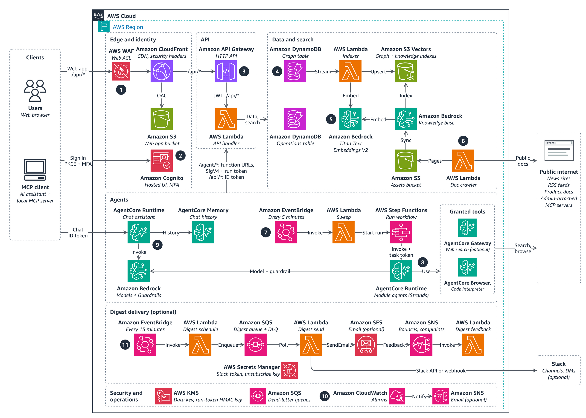

# Agentic Insights Radar on AWS

This is sample code, for non-production usage. You should work with your security and legal teams to meet your organizational security, regulatory and compliance requirements before deployment.

This sample shows how to build an agentic insights radar on AWS: AI agents that watch the public
sources your product depends on, record what they find as linked, cited evidence, and turn it into
signals, trends, product gaps and content ideas your team can act on.

- [Implementation guide](implementation-guide.md): plan, deploy, operate and remove the sample.
- [Cost estimate](cost-estimate.md): per-service breakdown, usage scenarios and cost controls.
- [Threat model](security/threat-model.md) and [security matrix](security/security-matrix.md).

The sample code, deployment steps and README are in the
[GitHub repository](https://github.com/aws-samples/sample-apj-sup-sa/tree/main/agentic-workloads/agentic-insights-radar).
