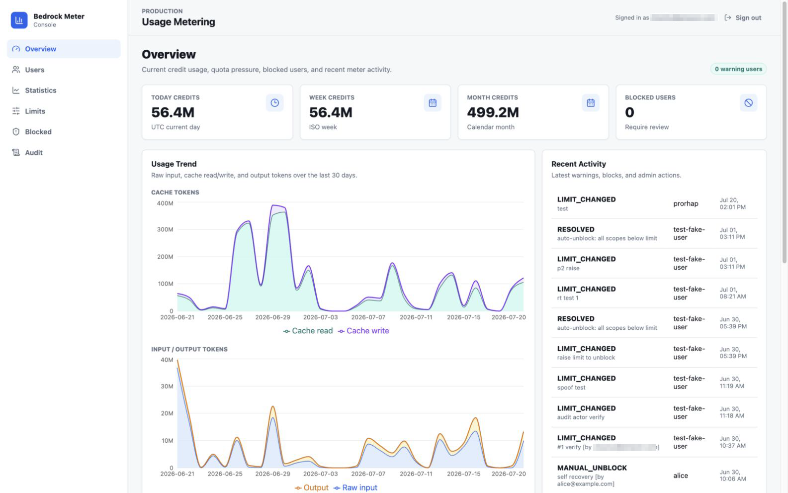
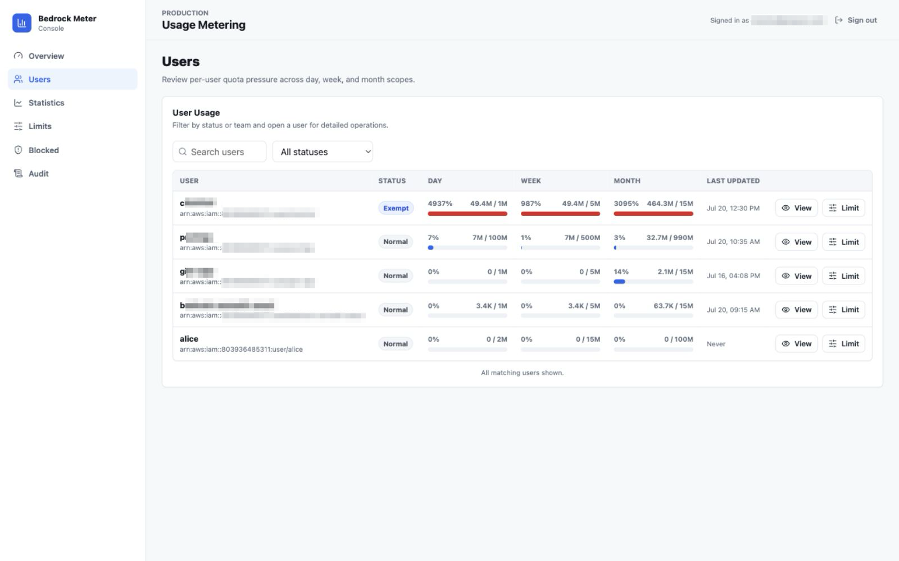
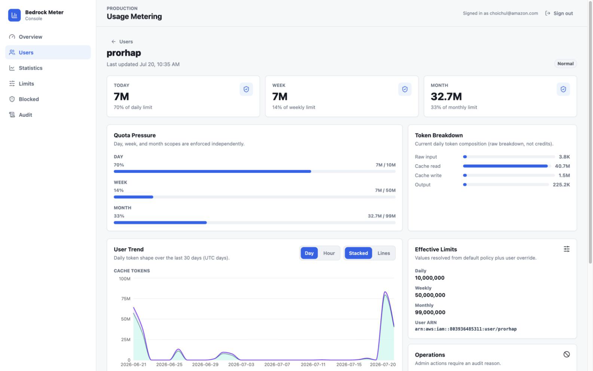
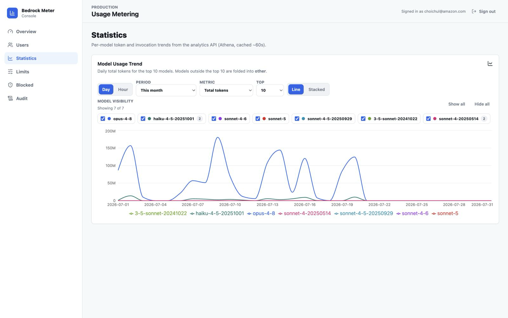
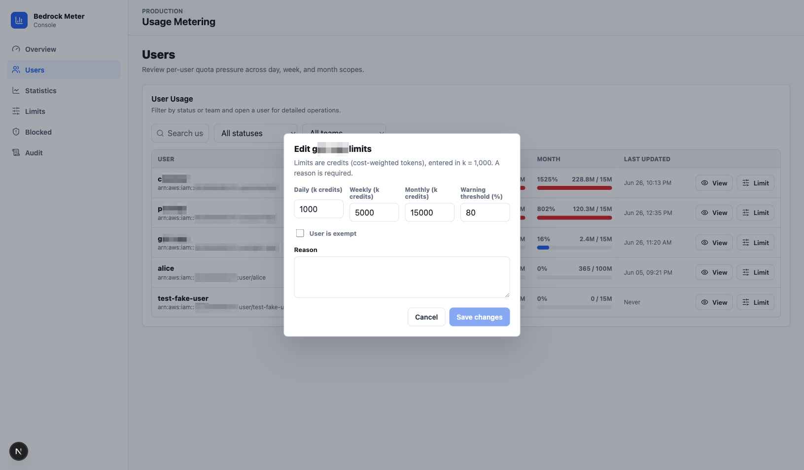
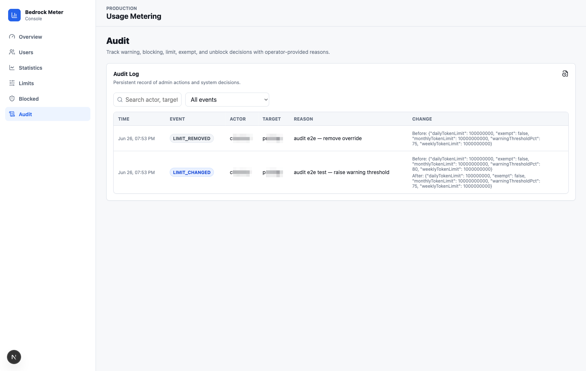
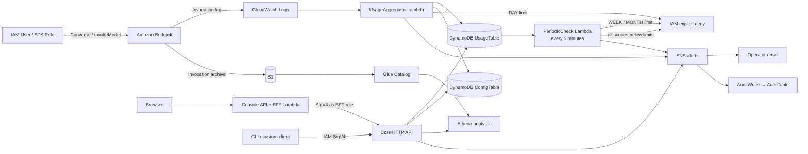

[English](README.md) | [한국어](README.ko.md)

# Bedrock Meter

Amazon Bedrock 호출을 그대로 유지하면서 사용자별 사용량을 측정하고, 일/주/월 한도에 따라
경고·자동 차단·자동 해제를 수행하는 AWS 서버리스 운영 도구입니다.

Bedrock Meter는 LiteLLM 같은 **Proxy가 아닙니다**. 애플리케이션과 Claude Code는 기존처럼
Amazon Bedrock을 직접 호출하고, Bedrock이 호출 후 전달하는 invocation log를 이용해 사용량을
집계합니다. 따라서 호출 경로에 별도 gateway를 넣지 않고 도입할 수 있지만, 차단은 요청 전에
이루어지는 것이 아니라 로그가 도착한 뒤 적용됩니다.

## 콘솔 미리보기

Overview에서 전체 day/week/month 사용량, 30일 token 추세, 차단 수와 최근 운영 event를 함께
확인할 수 있습니다.

[](docs/images/screenshots/console-overview.png)

| Users: 사용자별 quota와 상태 | user 상세 화면 |
|---|---|
| [](docs/images/screenshots/console-users.png) | [](docs/images/screenshots/console-user-detail.png) |
| **모델별 Statistics** | **한도와 예외 정책 편집** |
| [](docs/images/screenshots/console-statistics.png) | [](docs/images/screenshots/console-limit-editor.png) |
| **운영 변경 Audit** | |
| [](docs/images/screenshots/console-audit.png) | warning, block, limit 변경과 unblock 사유를 영속적으로 추적합니다. |

이미지를 선택하면 원본 크기로 볼 수 있습니다.

## 언제 적합한가

- Claude Code나 사내 애플리케이션이 이미 Amazon Bedrock을 직접 호출하고 있다.
- 별도 Proxy의 가용성, 인증, 네트워크 경로를 운영하고 싶지 않다.
- IAM User 또는 IAM Role 단위로 사용량을 보고 한도를 적용하고 싶다.
- 정확한 선결제 차단보다 간단한 도입, AWS 네이티브 운영, 사후 수 초 내 차단이 더 중요하다.

다음 요구에는 Proxy 또는 별도 gateway가 더 적합할 수 있습니다.

- 한도를 넘는 **그 요청 자체를 실행 전에** 거부해야 한다.
- API key, 조직, 프로젝트처럼 IAM principal보다 세밀한 단위로 한도를 나눠야 한다.
- 모델 라우팅, fallback, response cache, request 변환이 필요하다.
- 프롬프트와 응답을 invocation log에 남길 수 없는 보안 정책을 사용한다.

## Proxy 방식과의 차이

| 항목 | Bedrock Meter | LiteLLM 등 Proxy |
|---|---|---|
| 호출 경로 | Client → Bedrock 직접 호출 | Client → Proxy → Model provider |
| 도입 변경 | Bedrock endpoint와 SDK 설정 유지 | Client endpoint/auth 변경 필요 |
| 한도 판정 시점 | 호출 로그 수신 후 | 요청 전달 전 |
| 초과분 | 로그·IAM 반영 지연만큼 발생 가능 | 정상 동작 시 해당 요청부터 차단 가능 |
| 운영 부담 | AWS 관리형 서비스 중심 | Proxy의 배포, 확장, HA, credential 관리 필요 |
| 사용자 식별 | Bedrock log의 IAM/STS ARN | Proxy가 인증한 API key/user/team |
| 부가 기능 | 계측, 경고, IAM 차단, 분석 | 라우팅, fallback, cache 등 확장 가능 |

이 모델의 가장 큰 장점은 **기존 Bedrock 호출 경로에 장애 지점을 추가하지 않는 것**입니다.
반대로 invocation logging이 중단되거나 호출 리전이 다르면 계측과 차단도 동작하지 않습니다.

## 주요 기능

- IAM principal별 Bedrock input/cache/output token 집계
- 비용 차이를 반영한 credit 기반 일/주/월 한도
- 기본 한도와 사용자별 override, `exempt` 정책
- 기본 80% 도달 시 SNS 이메일 경고
- 일 한도는 CloudWatch Logs 수신 직후, 주/월 한도는 5분 주기로 차단
- IAM explicit deny를 이용한 Bedrock 호출 차단
- 모든 scope가 한도 미만일 때 자동 해제, 운영자 강제 해제
- Cognito 로그인 기반 운영 콘솔과 SigV4 Core API
- 모델별 통계, 시간/일 추세, audit log
- Lambda 오류, 로그 전달 실패, Athena 비용에 대한 CloudWatch Alarm

한도 단위는 raw token 합이 아니라 **credits**입니다.

```text
credits =
  raw input × 1
  + cache read × 0.1
  + cache write × 1.25
  + output × 5
```

Claude Code처럼 prompt caching 비중이 높은 workload에서 저렴한 cache read가 사용량을 과도하게
부풀리지 않도록 하기 위한 상대 비용 단위입니다. 실제 AWS 청구 금액과 동일한 통화 단위는 아닙니다.

## 설치

### 1. 터미널 준비

macOS 또는 Linux의 Bash(Windows는 WSL), AWS CLI v2, npm을 포함한 **Node.js 22.12 이상**(24 권장), `jq`가
필요합니다. Python 3.12 이상은 Python 테스트, Core API 도구, 수동 보존 기간 도구에서만
필요하며 `deploy-all.sh`에는 필요하지 않습니다. nvm을 사용한다면 `nvm install`, `nvm use`로
`.nvmrc`의 버전을 적용합니다. 모든 명령은 이 프로젝트 디렉터리(상위 저장소의
`agentic-workloads/bedrock-meter`)에서 실행합니다.

AWS 자격증명/profile과 애플리케이션이 Bedrock을 호출하는 리전을 선택합니다.
Named profile을 사용하는 예시는 다음과 같습니다.

```bash
export AWS_PROFILE=my-profile
# 선택한 profile에 올바른 리전이 이미 있으면 생략 가능:
export AWS_REGION=ap-northeast-2
aws sts get-caller-identity
node --version
npm --version
jq --version
```

먼저 평소 사용하는 AWS 로그인 절차를 완료합니다(SSO profile은 예를 들어
`aws sso login --profile my-profile`). 계정은 STS에서 확인하며, 리전은 `AWS_REGION` →
`AWS_DEFAULT_REGION` → 선택한 profile 순으로 결정합니다. 리전이 없거나 자격증명을 확인할
수 없으면 중단합니다. 스크립트는 변경 전에 대상을 표시합니다. Bootstrap, 배포, 사용자 생성,
이후 재배포 모두 같은 AWS 대상을 사용해야 합니다.

배포 주체에는 CDK/CloudFormation 배포 권한이 필요하며 bootstrap은 지원 리소스도 생성합니다.
[배포 권한](docs/DeveloperGuide.ko.md#배포-principal)을 확인하세요. 테스트 주체에는 별도로
같은 리전에서 Bedrock 모델을 호출할 권한이 필요합니다.

### 2. 프로젝트 옵션 설정

```bash
cp .env.deploy.example .env.deploy.local
```

파일을 운영자에 맞게 수정합니다.

```dotenv
BEDROCK_METER_ADMIN_USERNAMES=alice
BEDROCK_METER_ADMIN_EMAILS=ops@example.com
# 선택 사항: 생략하면 최초 배포 시 호스트 timezone을 감지하고 저장합니다.
# BEDROCK_METER_QUOTA_TIME_ZONE=Asia/Seoul
```

`ADMIN_USERNAMES`는 Core API 관리자 경로를 직접 호출할 IAM username 목록이며,
`ADMIN_EMAILS`는 SNS 알림 수신 이메일을 쉼표로 구분한 목록입니다. `QUOTA_TIME_ZONE`은
최초 quota calendar 기준입니다. 이 파일은 Git에서 제외되며 배포·사용자 스크립트가 읽습니다.

### 3. Bootstrap과 배포

계정·리전의 최초 배포:

```bash
./scripts/deploy-all.sh --bootstrap
```

스크립트가 lockfile 의존성을 설치하고 정적 콘솔과 BFF를 빌드한 뒤 bootstrap, stack 배포를
실행하고 `cdk-outputs.json`을 저장합니다. 이 CDK 앱은 synth에서도 콘솔 산출물이 필요하므로
빌드를 bootstrap보다 먼저 실행합니다. 별도 `npx cdk bootstrap`은 필요하지 않습니다.

이미 bootstrap된 대상에 재배포할 때:

```bash
./scripts/deploy-all.sh
```

새 ConfigTable에는 감지·지정한 timezone을 적용합니다. 기존 runtime 설정은 유지하며,
**Limits → Global Quota Calendar**에서 변경합니다. 재배포는 과거 데이터의 보존 기간을
backfill하지 않습니다. [수동 보존 기간 연장](docs/OperationalGuide.ko.md#수동-보존-기간-연장)을 참조하세요.

실패하면 스크립트가 실패 단계를 표시합니다.
[설치 실패와 수동 복구](docs/OperationalGuide.ko.md#설치-실패와-수동-복구)를 따르세요.
Bedrock 로깅은 계정·리전 단위 singleton이므로 기존 설정과 충돌하면 소유자를 먼저 확인합니다.
스크립트는 리소스를 자동 삭제하거나 로깅 overwrite를 자동 활성화하지 않습니다.

### 4. 이메일 확인과 첫 관리자 생성

각 알림 수신자에게 도착한 **AWS Notification - Subscription Confirmation** 이메일을
승인합니다. 승인 전에는 SNS 이메일 알림을 받을 수 없습니다.

같은 터미널의 AWS 대상을 사용하여 실행합니다.

```bash
scripts/add-console-admin.sh alice alice@example.com
```

실제 사용자 풀을 확인한 뒤 비밀번호를 숨김 입력으로 받습니다. Cognito username과 IAM
username은 별개입니다. 선택적 자동 관리자 설정을 명시하지 않았다면 최초 콘솔에는 사용자가
없습니다. 같은 사용자 명령을 다시 실행하면 비밀번호를 재설정하고 해당 권한 그룹을 지정합니다.

읽기 전용 viewer:

```bash
scripts/add-console-viewer.sh bob bob@example.com
```

### 5. 콘솔 접속과 확인

```bash
jq -r '.BedrockMeterCoreStack.ConsoleUrl' cdk-outputs.json
```

URL을 열어 로그인합니다. 같은 리전의 테스트 주체로 Bedrock을 한 번 호출하고 사용량을
확인합니다. 배포 완료만으로 로그인이나 Bedrock 로그 전달까지 검증된 것은 아닙니다.

## 설치 후 확인

1. 선택한 리전에서 테스트 IAM User로 Bedrock 모델을 호출합니다.
2. 로그 전달 후 Users에 사용자와 사용량이 나타나는지 확인합니다(보통 5~30초, 지연 가능).
3. S3 전달 이후 Statistics/history가 나타나기까지 약 10분을 허용합니다.
4. SNS 구독이 `Confirmed`인지, viewer가 한도를 변경할 수 없는지 확인합니다.
5. 운영자의 IAM User에는 충분한 한도 또는 검토한 `exempt` 정책을 설정합니다.

같은 AWS 자격증명·리전으로 stack과 로깅 상태를 확인합니다.

```bash
aws bedrock get-model-invocation-logging-configuration
aws cloudformation describe-stacks \
  --stack-name BedrockMeterCoreStack \
  --query 'Stacks[0].StackStatus' --output text
```

## 동작 구조



### 처리 경로

| 경로 | 사용 서비스 | 목적 | 일반적인 지연 |
|---|---|---|---|
| Hot path | Bedrock → CloudWatch Logs → Lambda → DynamoDB | 일 사용량과 DAY 차단 | 약 5~30초 + IAM 반영 |
| Periodic path | EventBridge → Lambda → DynamoDB | 주/월 차단과 자동 해제 | 최대 약 5분 + IAM 반영 |
| Analytics path | Bedrock → S3 → Glue → Athena | 모델별 통계와 history | 보통 5~10분 |

주/월 enforcement도 DynamoDB의 active quota-policy `DAY` row를 합산합니다. Quota calendar는
ConfigTable의 전역 IANA 타임존(예: `Asia/Seoul`)을 사용하고, Athena 분석 시간축은 UTC를 유지합니다.
Athena는 분석용이며 차단 판정 경로에 포함되지 않습니다.

### 회사 내부 운영 콘솔 호스팅

현재 웹 콘솔은 소수의 운영자가 사용하는 **회사 내부 운영 콘솔**을 전제로 단순하게 구성되어
있습니다. Next.js가 배포 전에 HTML, JavaScript, CSS를 정적 파일로 생성하고, 이 파일을 BFF 코드와
함께 하나의 Lambda 배포 패키지에 넣습니다. Lambda가 요청마다 HTML을 렌더링하는 SSR 구조가
아니라, 미리 생성된 파일을 읽어 반환하는 구조입니다.

```text
Next.js source
  → client/app/out/                         정적 build
  → client/app/bff-lambda/dist/public/      Lambda에 포함

BFF source
  → client/app/bff-lambda/dist/index.cjs

Browser
  → Console API Gateway HTTP API
  → 같은 BFF Lambda
      ├─ 페이지·JS·CSS 요청 → bundled public/ 파일 반환
      └─ /api/console/*    → Cognito 검증 → Core API SigV4 호출
```

따라서 웹 리소스를 공개 S3 bucket이나 CloudFront에서 제공하지 않습니다. CDK가 배포 패키지를
bootstrap asset bucket에 업로드할 수 있지만 이는 CloudFormation/Lambda 배포용이며, 브라우저가
접근하는 웹 호스팅 bucket이 아닙니다. 정적 UI와 API가 한 origin을 사용하므로 별도의 public S3,
CDN, CORS 구성이 필요 없고 `./scripts/deploy-all.sh` 한 번으로 함께 갱신됩니다. 해시가 붙은
`/_next/static/*` 파일은 장기 cache하고 HTML은 `no-cache`로 반환합니다.

이 구조는 운영자 수와 접속 빈도가 낮은 내부 도구에는 적합합니다. 외부 사용자에게 공개하거나,
동시 사용자가 많거나, 전 세계 전송 지연·대용량 정적 파일·독립적인 프런트엔드 배포가 중요해지면
**CloudFront + private S3(OAC)** 또는 **AWS Amplify Hosting**으로 정적 UI를 분리하는 것을
검토하세요. 이 경우에도 브라우저에 AWS credential이나 Core API endpoint를 노출하지 않고,
Cognito token을 받은 BFF가 Core API에 SigV4로 접근하는 보안 경계는 유지해야 합니다. 상세 전환
기준과 구성은 [DeveloperGuide.ko.md](docs/DeveloperGuide.ko.md)를 참고하세요.

### 현재 구성이 적합한 이유와 확장 시점

현재의 DynamoDB + raw JSON S3 + Athena 구성은 초기·중간 규모에 적합합니다. 한도 판정은 빠르고
예측 가능한 DynamoDB에 두고, 분석은 별도 분석 서버 없이 Athena가 원본 로그를 읽습니다.
Statistics/history 조회 지연이나 Athena 스캔 alarm·비용이 반복되면 분석 경로에만 일별 Parquet
집계 계층을 추가하고, 한도 판정은 DynamoDB에 그대로 둡니다. 판단 기준은
[DesignDoc.ko.md §12.3](docs/DesignDoc.ko.md#123-athena-확장-경계), 구현 방법은
[DeveloperGuide.ko.md §2.7](docs/DeveloperGuide.ko.md#27-athena-확장-판단과-parquet-집계)을 참고하세요.

## 사용하는 AWS 서비스

| 서비스 | 용도 |
|---|---|
| Amazon Bedrock | 모델 호출과 regional invocation logging |
| CloudWatch Logs | 실시간 invocation log 수신과 Lambda subscription |
| AWS Lambda | 집계, 주기 판정, API, audit writer, 콘솔 BFF |
| DynamoDB | 사용량, 설정, 중복 방지 claim, 차단 상태, audit |
| EventBridge | 5분 주기 week/month 재평가 |
| IAM | 사용자/role 식별과 inline explicit deny 차단 |
| Amazon S3 | invocation log archive와 Athena 결과 |
| AWS Glue / Athena | partition projection 기반 모델·history 분석 |
| API Gateway HTTP API | IAM SigV4 Core API와 공개 콘솔 endpoint |
| Amazon Cognito | 콘솔 username/password 로그인과 admin/viewer group |
| Amazon SNS | warning, block, resolved, audit, alarm 이메일 |
| CloudWatch / X-Ray | dashboard, custom metric, alarm, trace |
| AWS CDK / CloudFormation | 전체 인프라 배포 |

> **데이터 주의:** `textDataDeliveryEnabled=true`이므로 Bedrock invocation log에 프롬프트와
> 응답 내용이 포함될 수 있습니다. 조직의 민감정보·보존·접근 통제 정책을 검토한 뒤 사용하세요.

## 기본 정책

| 항목 | 기본값 |
|---|---|
| 리전 | 터미널/AWS profile의 리전; 미설정 시 중단 |
| 일/주/월 한도 | 3,000,000 / 15,000,000 / 45,000,000 credits |
| 경고 | 각 scope의 80%, 기간당 1회 |
| IAM User enforcement | 활성 |
| IAM Role enforcement | 비활성, 사용량 집계만 수행 |
| DAY row 보존 | 90일 |
| Audit 보존 | 730일(2년) |
| Lambda/접근 로그 | 30일 |
| S3 archive | 30일 후 Standard-IA, 400일 후 Glacier |
| 콘솔 읽기 | 로그인한 admin/viewer만 가능 |
| 콘솔 MFA | 비활성 |
| 콘솔 비밀번호 | 7자 이상, 숫자 1개 이상 |

경고선을 한 번에 건너뛰어 100% 이상이 되면 `WARNING` 없이 바로 `BLOCKED`가 발송될 수 있습니다.
`exempt: true`인 principal은 사용량은 기록하지만 경고와 차단은 수행하지 않습니다.

## Core API 빠른 사용

Core API는 IAM authorizer를 사용하므로 SigV4 서명이 필요합니다.

```bash
python3 -m venv .venv
source .venv/bin/activate
python3 -m pip install boto3 requests requests-aws4auth

export BEDROCK_METER_API_ENDPOINT="$(
  jq -r '.BedrockMeterCoreStack.CoreApiEndpoint' cdk-outputs.json
)"
export AWS_REGION=ap-northeast-2

scripts/api-call.py GET /usage/me
scripts/api-call.py GET '/usage/aggregate?limit=100'
scripts/api-call.py PUT '/limits/alice' '{"dailyTokenLimit":2000000}'
scripts/api-call.py POST '/admin/unblock/alice'
```

전체 endpoint와 schema는 [API.ko.md](docs/API.ko.md)를 참고하세요.

## 삭제

프로젝트 디렉터리에서 배포에 사용한 같은 터미널/profile과 리전으로 실행합니다.

```bash
bash scripts/destroy-all.sh
```

터미널에 배포할 때의 AWS 설정이 남아 있다면 다시 export할 필요가 없습니다.
스크립트가 계정·리전을 자동으로 읽어 표시하며, 사용자에게 다시 입력받지 않습니다.

영문 질문에서 한 번만 선택합니다. **1**은 서비스를 삭제하고 데이터를 보존하며, **2**는
목록에 표시된 데이터 리소스까지 삭제합니다. Enter는 취소입니다. 계정·리전을 다시 입력하거나
CDK를 빌드할 필요가 없습니다. Node.js/Python 없이 AWS CLI v2와 `jq`를 사용합니다.

**두 모드 모두 Bedrock 호출 로그와 로깅 설정을 보존합니다.** 호출 로그용 CloudWatch Log Group,
S3 저장소, 전달 역할·권한도 삭제하지 않습니다. 삭제 대상은 선택한 stack이 관리하는 Meter 리소스와
Meter가 기록된 주체에 붙인 quota deny 정책뿐입니다. Stack 밖의 IAM 사용자·역할, 공유 CDK
bootstrap 리소스, 별도 백업·export 사본은 제외합니다. 2번은 Meter의 사용량·설정·감사 테이블,
콘솔 사용자 풀, 조회 결과 저장소 등 목록에 표시된 Meter 데이터까지 삭제합니다.
[상세 삭제 안내](docs/OperationalGuide.ko.md#삭제)를 참고하세요.

## 주요 제약

- Invocation logging은 account/region 단위 singleton입니다.
- Bedrock 호출 리전과 stack 리전이 다르면 해당 호출은 계측되지 않습니다.
- 로그 기반이므로 이미 실행된 마지막 요청의 비용은 되돌릴 수 없고 한도를 일부 초과할 수 있습니다.
- CloudWatch Logs subscription은 at-least-once입니다. 시스템은 dedup table과 transaction으로
  이중 집계를 방지하지만 로그 전달 자체가 중단되면 계측할 수 없습니다.
- IAM User는 기본 차단 대상입니다.
- STS assumed-role은 stable IAM Role ARN으로 합산됩니다. role enforcement를 켜면 그 role의
  모든 session이 함께 차단되므로 기본값은 비활성입니다.
- IAM path user와 SSO 개인 사용자 단위의 관리 API/enforcement는 지원 범위가 제한됩니다.
- IAM explicit deny 반영·해제에는 보통 수 초의 eventual consistency가 있습니다.
- Cognito와 IAM은 별도 identity store입니다. Console admin 권한은 Cognito group으로, Bedrock
  enforcement 대상은 IAM principal로 각각 관리합니다.

## 프로젝트 구조

```text
cdk/                         CDK v2 TypeScript IaC
lambda/                      Python 3.12 Lambda와 공통 모듈
client/app/                  Next.js 정적 UI + BFF Lambda
scripts/                     배포, 사용자 생성, SigV4 운영 도구
docs/API.ko.md                  Core API 상세 명세
docs/DesignDoc.ko.md            현재 아키텍처, 설계 결정과 불변조건
docs/DeveloperGuide.ko.md       개발·변경·배포 가이드
docs/OperationalGuide.ko.md     운영자 절차와 장애 대응
```

## 다음 문서

- [DeveloperGuide.ko.md](docs/DeveloperGuide.ko.md): AWS 리소스, 코드 구조, 정책 불변조건, 테스트와 배포
- [OperationalGuide.ko.md](docs/OperationalGuide.ko.md): 한도, 예외, 차단 해제, 계정, 알림, 운영 runbook
- [API.ko.md](docs/API.ko.md): Core API endpoint와 request/response
- [DesignDoc.ko.md](docs/DesignDoc.ko.md): 현재 아키텍처, 설계 결정, 정합성 모델과 불변조건
- [콘솔 README](client/app/README.ko.md): 콘솔 구조, 인증과 로컬 개발
- [CDK README](cdk/README.ko.md): 인프라 명령어와 배포 환경

문서는 기본 `.md` 파일에 영어, 같은 위치의 `.ko.md` 파일에 한국어를 제공합니다.
각 문서 상단의 언어 선택 링크로 전환할 수 있습니다. 문서를 수정할 때는 두 언어를 함께 갱신하고,
언어 선택 링크를 제외한 문서 링크는 같은 언어로 연결하세요. 이미지와 소스 코드는 두 언어가 공유합니다.
