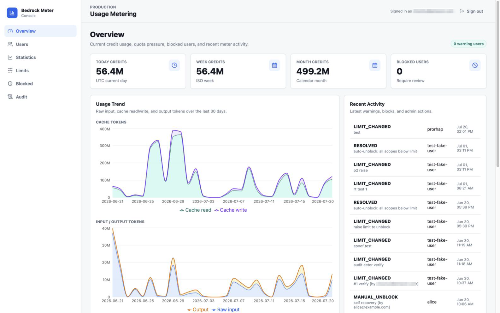
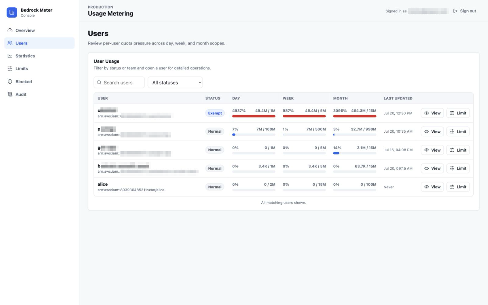
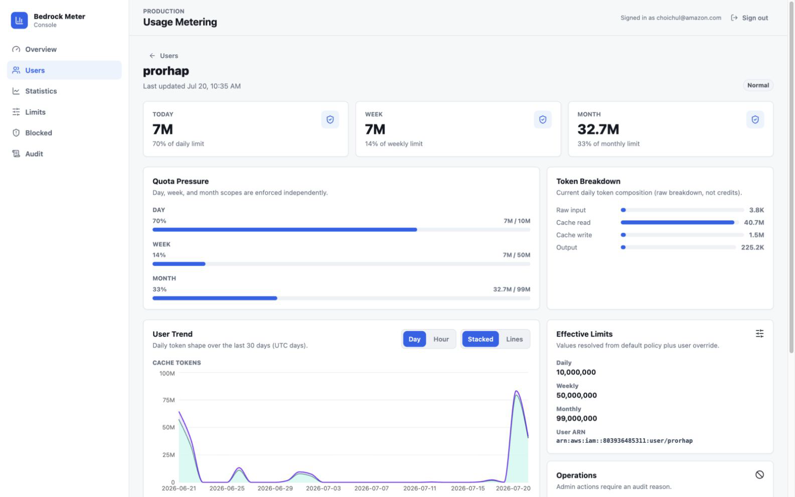
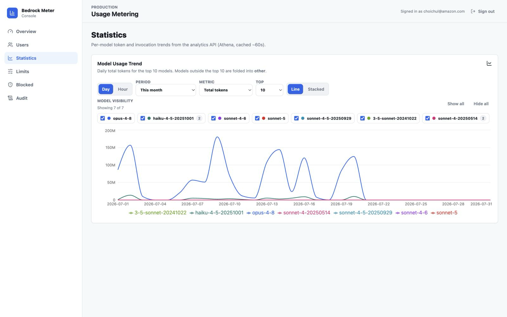
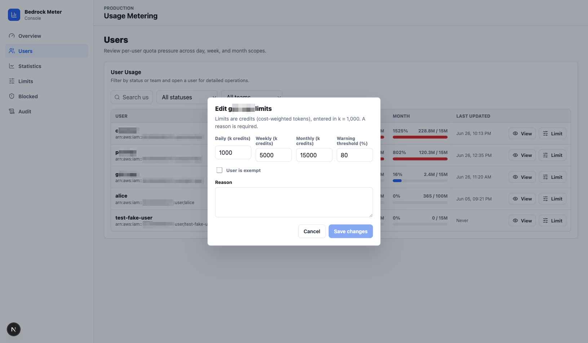
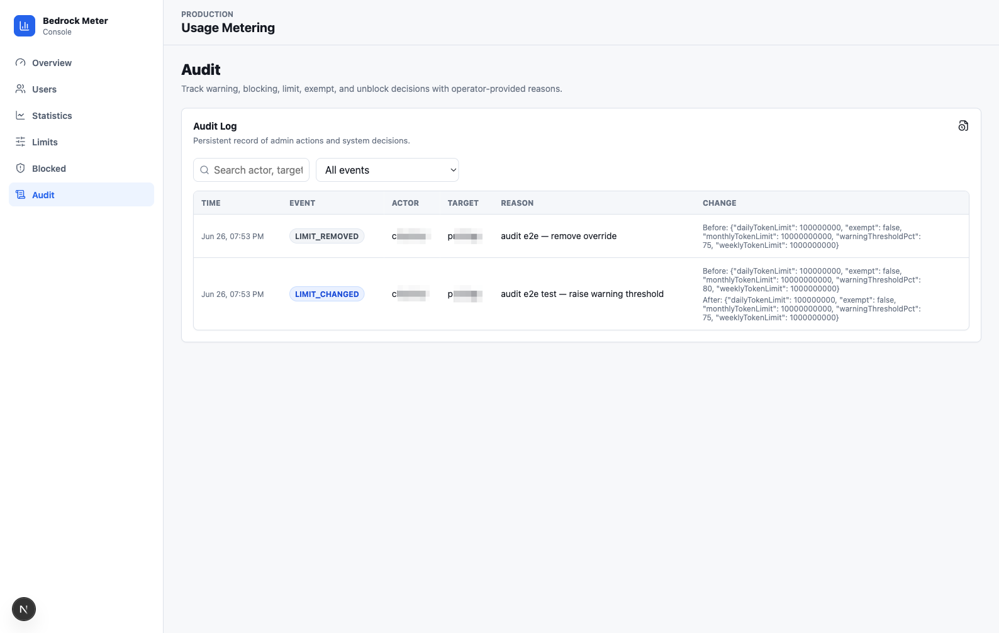
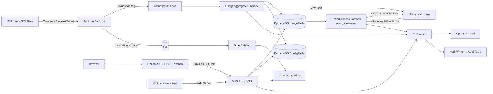

[English](README.md) | [한국어](README.ko.md)

# Bedrock Meter

An AWS serverless operations tool that measures per-user usage while preserving direct Amazon
Bedrock calls, with alerts, automatic blocking, and automatic unblocking based on daily, weekly,
and monthly limits.

Bedrock Meter is **not a proxy** like LiteLLM. Applications and Claude Code continue to call
Amazon Bedrock directly. Usage is aggregated from invocation logs delivered by Bedrock after
each call. No gateway is added to the request path, but blocking takes effect after logs arrive,
rather than before a request executes.

## Console preview

Overview brings together daily, weekly, and monthly usage, 30-day token trends, blocked counts,
and recent operational events.

[](docs/images/screenshots/console-overview.png)

| Users: per-user quotas and status | User details |
|---|---|
| [](docs/images/screenshots/console-users.png) | [](docs/images/screenshots/console-user-detail.png) |
| **Model statistics** | **Limit and exemption policy editor** |
| [](docs/images/screenshots/console-statistics.png) | [](docs/images/screenshots/console-limit-editor.png) |
| **Operational audit** | |
| [](docs/images/screenshots/console-audit.png) | Persistently tracks warnings, blocks, limit changes, and reasons for unblocking. |

Select an image to view it at full size.

## When to use it

- Claude Code or internal applications already call Amazon Bedrock directly.
- You do not want to operate a separate proxy's availability, authentication, or network path.
- You want usage visibility and limits at the IAM User or IAM Role level.
- Simple adoption, AWS-native operations, and blocking within seconds after usage matter more
  than exact pre-request enforcement.

A proxy or separate gateway may be more suitable when:

- You must reject **the request that would exceed the limit before it executes**.
- You need quotas at a finer level than IAM principals, such as API keys, organizations, or projects.
- You need model routing, fallback, response caching, or request transformation.
- Your security policy prohibits recording prompts and responses in invocation logs.

## Comparison with a proxy

| Aspect | Bedrock Meter | Proxies such as LiteLLM |
|---|---|---|
| Request path | Client → Bedrock directly | Client → Proxy → Model provider |
| Adoption changes | Keep Bedrock endpoints and SDK configuration | Change client endpoint/authentication |
| Limit evaluation | After invocation logs arrive | Before forwarding a request |
| Overshoot | Possible during log delivery and IAM propagation | Can block the triggering request during normal operation |
| Operations | Primarily AWS managed services | Proxy deployment, scaling, HA, and credential management |
| User identity | IAM/STS ARN in Bedrock logs | API key/user/team authenticated by the proxy |
| Additional capabilities | Metering, alerts, IAM blocking, analytics | Extensible routing, fallback, caching, and more |

The main advantage is **not adding a failure point to the existing Bedrock request path**.
However, metering and blocking cannot work if invocation logging stops or calls use a different region.

## Features

- Bedrock input/cache/output token aggregation per IAM principal
- Daily, weekly, and monthly credit limits reflecting relative costs
- Default limits, per-user overrides, and an `exempt` policy
- SNS email warnings at 80% by default
- Daily enforcement on CloudWatch Logs ingestion; weekly/monthly enforcement every five minutes
- Bedrock blocking through IAM explicit deny
- Automatic unblocking when all scopes are below their limits, plus operator force-unblock
- Cognito-authenticated operations console and SigV4 Core API
- Model statistics, hourly/daily trends, and audit logs
- CloudWatch alarms for Lambda errors, log delivery failures, and Athena costs

Limits use **credits**, not a simple sum of raw tokens.

```text
credits =
  raw input × 1
  + cache read × 0.1
  + cache write × 1.25
  + output × 5
```

This relative cost unit prevents inexpensive cache reads from inflating measured usage in
prompt-cache-heavy workloads such as Claude Code. It is not a currency unit equivalent to an AWS bill.

## How it works



### Processing paths

| Path | Services | Purpose | Typical latency |
|---|---|---|---|
| Hot path | Bedrock → CloudWatch Logs → Lambda → DynamoDB | Daily usage and DAY blocking | About 5–30 seconds + IAM propagation |
| Periodic path | EventBridge → Lambda → DynamoDB | Weekly/monthly blocking and automatic unblocking | Up to about 5 minutes + IAM propagation |
| Analytics path | Bedrock → S3 → Glue → Athena | Model statistics and history | Usually 5–10 minutes |

Weekly/monthly enforcement also sums DynamoDB `DAY` rows for the active quota policy. The quota
calendar uses the global IANA timezone in ConfigTable, such as `Asia/Seoul`, while Athena analytics
remain in UTC. Athena is used for analytics and does not participate in blocking decisions.

### Hosting the internal operations console

The web console is deliberately simple and intended for **a small group of internal operators**.
Next.js generates static HTML, JavaScript, and CSS before deployment. These files and the BFF code
share one Lambda deployment package. Lambda reads and returns prebuilt files; it does not render
HTML per request through SSR.

```text
Next.js source
  → client/app/out/                         static build
  → client/app/bff-lambda/dist/public/      included in Lambda

BFF source
  → client/app/bff-lambda/dist/index.cjs

Browser
  → Console API Gateway HTTP API
  → same BFF Lambda
      ├─ page/JS/CSS requests → return bundled public/ files
      └─ /api/console/*    → Cognito verification → Core API SigV4 call
```

Web resources are therefore not served from a public S3 bucket or CloudFront. CDK may upload the
deployment package to its bootstrap asset bucket, but that bucket supports CloudFormation/Lambda
deployment and is not browser-facing web hosting. The static UI and API share an origin, removing
the need for separate public S3, CDN, or CORS configuration. `./scripts/deploy-all.sh` updates both.
Hashed `/_next/static/*` files use long-lived caching, while HTML is returned with `no-cache`.

This suits internal tools with few operators and infrequent access. Consider separating the static
UI into **CloudFront + private S3 (OAC)** or **AWS Amplify Hosting** if you need external access,
high concurrency, global delivery, large assets, or independent frontend deployments. Preserve
the security boundary: do not expose AWS credentials or the Core API endpoint to browsers; the
BFF receives Cognito tokens and calls Core with SigV4. See [DeveloperGuide.md](docs/DeveloperGuide.md)
for migration criteria and configuration.

### DynamoDB versus Athena

| Data source | Features |
|---|---|
| DynamoDB | Real-time daily token/credit counters, daily/weekly/monthly limit evaluation, warning/block state, automatic unblocking, default/per-user limits, deduplication, audit logs |
| Athena | User history, user rankings, model totals, and hourly/daily trends from archived S3 invocation logs |

Core APIs using DynamoDB:

- Current usage: `GET /usage/me`, `GET /usage/{username}`, `GET /users/{username}`
- All users and trends: `GET /users`, `GET /usage/aggregate`, `GET /usage/history/all`
- Limits: `GET /limits/me`, `GET /limits/{username}`, `PUT /limits/{username}`,
  `DELETE /limits/{username}`
- Operations: `GET /admin/blocked`, `POST /admin/unblock/{username}`, `GET /admin/audit`

Core APIs using Athena:

- User history: `GET /usage/me/history`, `GET /usage/{username}/history`,
  `GET /users/{username}/history`
- Analytics: `GET /usage/top`, `GET /usage/by-model`, `GET /usage/by-model/trend`

Usage aggregation and blocking continue even if Athena or S3 delivery is delayed. DynamoDB is
suited to current state; Athena is suited to analyzing original invocations by model and time.

### Why this architecture fits, and when to scale

DynamoDB + raw JSON in S3 + Athena suits early and medium-scale deployments. Limits stay in fast,
predictable DynamoDB, while Athena reads original logs for analytics whose dimensions may change.
There is no need to operate a separate analytics server or per-model DynamoDB indexes in advance.

Avoid adding another analytics store until these symptoms recur:

- Statistics/history queries frequently take more than 5–10 seconds.
- The `Athena ProcessedBytes > 2GB/hour` alarm recurs rather than firing occasionally.
- A typical 30-day query repeatedly scans hundreds of MB to 1 GB or more.
- Bedrock archives grow by several GB per day, or thousands of small JSON objects are created daily.
- Multiple operators query dashboards frequently or repeatedly inspect 6–12 months or more of trends.
- Athena becomes a material share of operating costs.

At that point, add an analytics layer that aggregates tokens and invocations by
`date × principal × model` into daily Snappy-compressed Parquet. Keep the original S3 JSON for
auditing and detailed investigation, and let console statistics read the smaller aggregates.
If same-day freshness matters, use hourly aggregates or combine completed historical Parquet
with today's raw logs.

See [DeveloperGuide.md](docs/DeveloperGuide.md) and [OperationalGuide.md](docs/OperationalGuide.md)
for detailed criteria and implementation principles.

## AWS services

| Service | Purpose |
|---|---|
| Amazon Bedrock | Model invocations and regional invocation logging |
| CloudWatch Logs | Real-time invocation logs and Lambda subscriptions |
| AWS Lambda | Aggregation, periodic evaluation, API, audit writer, console BFF |
| DynamoDB | Usage, configuration, deduplication claims, block state, audit |
| EventBridge | Weekly/monthly reevaluation every five minutes |
| IAM | User/role identity and inline explicit-deny blocking |
| Amazon S3 | Invocation archives and Athena results |
| AWS Glue / Athena | Model/history analytics using partition projection |
| API Gateway HTTP API | IAM SigV4 Core API and public console endpoint |
| Amazon Cognito | Console username/password login and admin/viewer groups |
| Amazon SNS | Warning, block, resolved, audit, and alarm emails |
| CloudWatch / X-Ray | Dashboards, custom metrics, alarms, traces |
| AWS CDK / CloudFormation | Infrastructure deployment |

> **Data handling:** With `textDataDeliveryEnabled=true`, Bedrock invocation logs may contain
> prompts and responses. Review your organization's sensitive-data, retention, and access policies.

## Default policy

| Setting | Default |
|---|---|
| Region | Terminal/AWS profile region; must be configured |
| Daily/weekly/monthly limits | 3,000,000 / 15,000,000 / 45,000,000 credits |
| Warning | 80% of each scope, once per period |
| IAM User enforcement | Enabled |
| IAM Role enforcement | Disabled; usage is still metered |
| DAY row retention | 90 days |
| Audit retention | 730 days (2 years) |
| Lambda/access logs | 30 days |
| S3 archive | Standard-IA after 30 days, Glacier after 400 days |
| Console reads | Authenticated admins/viewers only |
| Console MFA | Disabled |
| Console password | At least 7 characters, including at least 1 digit |

If usage jumps past the warning threshold to 100% or more, `BLOCKED` may be sent without `WARNING`.
Principals with `exempt: true` are metered but do not receive warnings or blocks.

## Installation

### 1. Prepare the terminal

Use Bash on macOS or Linux (Windows users: WSL), AWS CLI v2, **Node.js 24** with npm, and `jq`.
Python 3.12 or later is only needed for the Python tests, Core API helper, and manual retention tool;
it is not required by `deploy-all.sh`. If you use nvm, run `nvm install` and `nvm use` to read `.nvmrc`.
Run all commands from this project's directory (`agentic-workloads/bedrock-meter` in the parent repository).

Select your AWS credentials/profile and the region where your applications invoke Bedrock. For example,
if you use a named profile:

```bash
export AWS_PROFILE=my-profile
# Optional if the selected profile already contains the correct region:
export AWS_REGION=ap-northeast-2
aws sts get-caller-identity
node --version
npm --version
jq --version
```

Use your normal AWS sign-in flow first (for example `aws sso login --profile my-profile` for an SSO profile).
The scripts derive the account from STS and choose the region from `AWS_REGION`, then
`AWS_DEFAULT_REGION`, then the selected profile. They stop if no region is configured or credentials
cannot be verified. They display the target before making changes. Keep the same AWS target for
bootstrap, deployment, user creation, and later redeployment.

The deployment principal needs CDK/CloudFormation deployment permissions; bootstrap also creates
its supporting resources. See [deployment permissions](docs/DeveloperGuide.md#deployment-principal).
A test principal must separately have permission to invoke a Bedrock model in this region.

### 2. Set project options

```bash
cp .env.deploy.example .env.deploy.local
```

Edit the file for your operators:

```dotenv
BEDROCK_METER_ADMIN_USERNAMES=alice
BEDROCK_METER_ADMIN_EMAILS=ops@example.com
# Optional: otherwise the first deployment detects and saves the host timezone.
# BEDROCK_METER_QUOTA_TIME_ZONE=Asia/Seoul
```

`ADMIN_USERNAMES` lists IAM usernames allowed to use Core API admin routes directly. `ADMIN_EMAILS`
is a comma-separated list of SNS notification recipients. `QUOTA_TIME_ZONE` defines the initial
quota calendar. The file is Git-ignored and loaded by the deployment/user scripts.

**Do not put AWS credentials, profile, or region settings in this file.** Set them in the terminal
or AWS profile. If upgrading from the earlier instructions, remove `CDK_DEFAULT_ACCOUNT` and
`CDK_DEFAULT_REGION`; those inputs (and legacy `REGION`) no longer select the target. Files that
change `AWS_*` environment settings are rejected before AWS calls.

### 3. Bootstrap and deploy

For the first deployment to an account/region:

```bash
./scripts/deploy-all.sh --bootstrap
```

The script installs locked dependencies, builds the static console and BFF, runs bootstrap, then
deploys `BedrockMeterCoreStack` and writes `cdk-outputs.json`. Build precedes bootstrap because this
CDK app requires the console artifact even during synthesis. You do not need a separate `npx cdk bootstrap`.

For subsequent deployments to an already bootstrapped target:

```bash
./scripts/deploy-all.sh
```

New ConfigTables start with the detected/explicit timezone. Existing runtime settings are retained;
change them through **Limits → Global Quota Calendar**. Redeployment does not backfill old data's
retention. See [manual retention extension](docs/OperationalGuide.md#manual-retention-extension).

If installation fails, the script prints the failed stage. Follow
[installation failures and manual recovery](docs/OperationalGuide.md#installation-failures-and-manual-recovery).
Existing Bedrock logging is an account/region singleton; inspect any conflicting owner before changing
it. The script does not automatically delete resources or enable logging overwrite.

### 4. Confirm email and create the first console administrator

Confirm the **AWS Notification - Subscription Confirmation** email for each notification recipient.
SNS email alerts are not delivered until confirmation.

Using the same terminal AWS target, run:

```bash
scripts/add-console-admin.sh alice alice@example.com
```

The script verifies the live user pool, then prompts for a password without echoing it. Cognito
usernames are separate from IAM usernames. The initial console has no users unless you explicitly
supplied the optional automated administrator settings. Running the user command again resets that
user's password and assigns the requested group.

For a read-only viewer:

```bash
scripts/add-console-viewer.sh bob bob@example.com
```

### 5. Open and verify the console

```bash
jq -r '.BedrockMeterCoreStack.ConsoleUrl' cdk-outputs.json
```

Open the URL and sign in. Invoke Bedrock once using a test principal in the same region and verify
that usage appears. Deployment completion alone does not verify login or Bedrock log delivery.

## Post-installation checks

1. Invoke a Bedrock model as a test IAM User in the selected region.
2. Confirm the principal and usage on Users after log delivery (typically 5–30 seconds; allow for delays).
3. Allow about 10 minutes for archived Statistics/history after S3 delivery.
4. Confirm the SNS subscription is `Confirmed` and a viewer cannot change limits.
5. Give the operator's IAM User sufficient limits or a reviewed `exempt` policy.

Use the same AWS credentials/region to inspect the stack and logging:

```bash
aws bedrock get-model-invocation-logging-configuration
aws cloudformation describe-stacks \
  --stack-name BedrockMeterCoreStack \
  --query 'Stacks[0].StackStatus' --output text
```

## Core API quick start

The Core API uses an IAM authorizer and requires SigV4 signing.

```bash
python3 -m venv .venv
source .venv/bin/activate
python3 -m pip install boto3 requests requests-aws4auth

export BEDROCK_METER_API_ENDPOINT="$(
  jq -r '.BedrockMeterCoreStack.CoreApiEndpoint' cdk-outputs.json
)"
export AWS_REGION=ap-northeast-2

scripts/api-call.py GET /usage/me
scripts/api-call.py GET '/usage/aggregate?limit=100'
scripts/api-call.py PUT '/limits/alice' '{"dailyTokenLimit":2000000}'
scripts/api-call.py POST '/admin/unblock/alice'
```

See [docs/API.md](docs/API.md) for all endpoints and schemas.

## Limitations

- Invocation logging is a singleton per account/region.
- Calls in a different region from the stack are not metered.
- Log-based enforcement cannot reverse the cost of the last completed request, so overshoot is possible.
- CloudWatch Logs subscriptions deliver at least once. Deduplication tables and transactions prevent
  double counting, but metering cannot continue if log delivery stops.
- IAM Users are blocked by default.
- STS assumed-role sessions are aggregated under a stable IAM Role ARN. Role enforcement blocks
  all sessions of that role, so it is disabled by default.
- Management APIs and enforcement have limited support for IAM path users and individual SSO users.
- Applying or removing an IAM explicit deny usually involves a few seconds of eventual consistency.
- Cognito and IAM are separate identity stores. Cognito groups authorize console admins;
  IAM principals identify Bedrock enforcement targets.

## Project structure

```text
cdk/                         CDK v2 TypeScript IaC
lambda/                      Python 3.12 Lambdas and common modules
client/app/                  Next.js static UI + BFF Lambda
scripts/                     Deployment, user creation, SigV4 operations tools
docs/API.md                  Core API reference
docs/DesignDoc.md            Architecture, design decisions, invariants
docs/DeveloperGuide.md       Development, changes, deployment
docs/OperationalGuide.md     Operator procedures and troubleshooting
```

## Further documentation

- [InstallationReadinessPlan.md](docs/InstallationReadinessPlan.md): Implementation scope and verification status for first-installation readiness
- [DeveloperGuide.md](docs/DeveloperGuide.md): AWS resources, code structure, policy invariants, testing, deployment
- [OperationalGuide.md](docs/OperationalGuide.md): Limits, exemptions, unblocking, accounts, alerts, runbooks
- [docs/API.md](docs/API.md): Core API endpoints and requests/responses
- [DesignDoc.md](docs/DesignDoc.md): Architecture, design decisions, consistency model, invariants
- [docs/architecture.drawio](docs/architecture.drawio): Editable architecture diagram
- [Console README](client/app/README.md): Console architecture, authentication, local development
- [CDK README](cdk/README.md): Infrastructure commands and deployment environment

Documentation uses English in the default `.md` files and Korean in matching `.ko.md` files.
Use the language selector at the top of each page. When updating documentation, update both versions
and keep document links within the same language, except for the language selector. Images and source
code are shared between translations.
