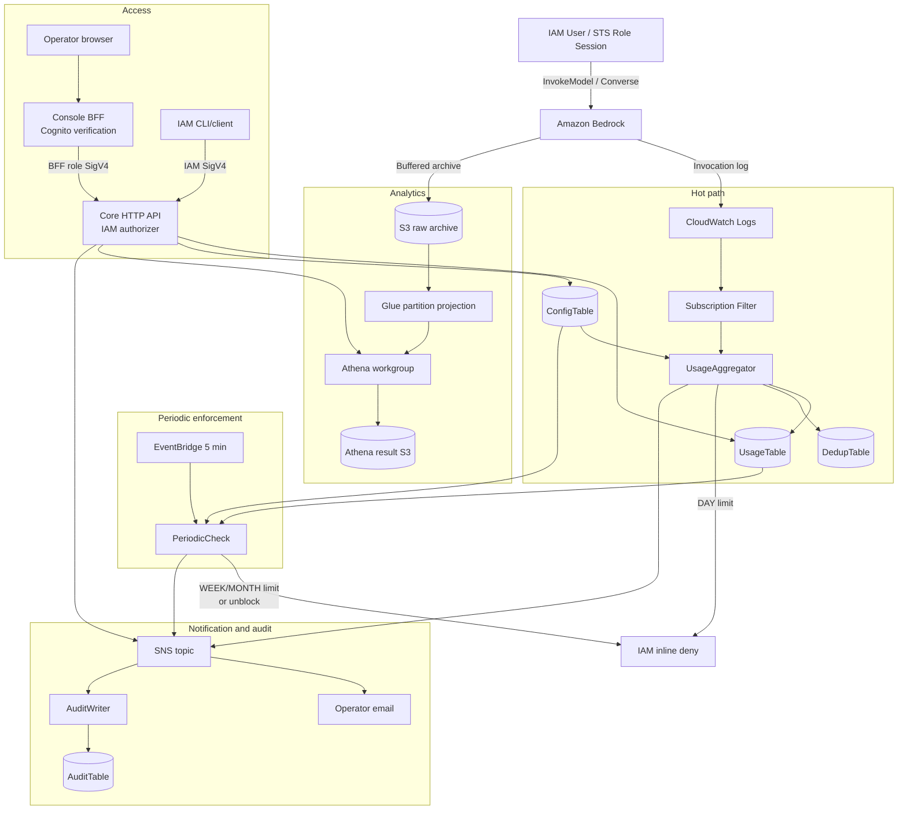

[English](DesignDoc.md) | [한국어](DesignDoc.ko.md)

# Bedrock Meter 설계 문서

> 상태: 현재 아키텍처와 설계 계약
> 구현 대조일: 2026-07-20

## 1. 문서 목적

Bedrock Meter는 모델 호출 경로에 Proxy를 넣지 않고 Amazon Bedrock 사용량을 AWS principal별로
측정하며, 일·주·월 한도에 따라 경고와 IAM 차단을 수행합니다.

이 문서는 다음 내용을 설명하는 canonical design document입니다.

- 현재 아키텍처를 선택한 이유
- 각 AWS 서비스와 코드의 책임
- 사용량, credits, identity, 차단과 해제의 의미
- 장애와 동시성 상황에서 지켜야 할 정합성
- 현재 구조가 적합한 범위와 확장 시점
- 향후 변경에서도 유지해야 할 설계 불변조건

문서별 역할은 다음과 같습니다.

- [README.ko.md](../README.ko.md): 제품 소개와 설치
- [DeveloperGuide.ko.md](DeveloperGuide.ko.md): 코드 변경, 테스트와 배포
- [OperationalGuide.ko.md](OperationalGuide.ko.md): 일상 운영과 장애 대응
- [API.ko.md](API.ko.md): Core API 계약

과거 설계 자료와 내용이 충돌하면 이 문서와 현재 코드를 우선합니다.

## 2. 목표와 범위

### 2.1 목표

1. AWS principal별 raw input, cache read, cache write, output token을 측정합니다.
2. 상대 비용을 반영한 credits로 일·주·월 한도를 평가합니다.
3. 각 기간의 warning threshold와 limit 도달을 운영자에게 알립니다.
4. 한도 초과 시 IAM explicit deny로 Bedrock runtime 호출을 차단합니다.
5. 모든 enforced scope가 한도 미만일 때만 자동 해제합니다.
6. 재배포 없이 default와 principal별 한도 및 exempt를 변경합니다.
7. IAM SigV4 Core API와 Cognito 기반 사내 운영 콘솔을 제공합니다.
8. 원본 invocation log를 보존해 사용자·모델·시간별 분석을 제공합니다.
9. Bedrock Meter 장애가 기존 Bedrock 호출 경로의 장애가 되지 않게 합니다.
10. 스타트업이나 소규모 내부 플랫폼 팀이 감당할 수 있는 운영 복잡도와 비용을 유지합니다.

### 2.2 비목표

- 모델 요청을 중계하는 Proxy, gateway 또는 router가 아닙니다.
- 한도를 넘기는 바로 그 요청을 실행 전에 차단하지 않습니다.
- credits는 AWS 청구 금액이나 통화 단위가 아닙니다.
- API key, project 또는 최종 사용자 단위 quota를 제공하지 않습니다.
- 모델 routing, fallback, response cache, prompt 변환을 제공하지 않습니다.
- 공유 IAM Role 뒤의 IAM Identity Center 사용자를 개인별로 구분하지 않습니다.
- 여러 리전을 합친 global quota를 제공하지 않습니다.
- 현재 콘솔 hosting은 대규모 public website를 목표로 하지 않습니다.

## 3. 핵심 설계 결정

### 3.1 Proxy 대신 사후 관측

Application과 Claude Code는 기존과 같이 Bedrock을 직접 호출합니다.

```text
Client → Amazon Bedrock
              |
              └─ invocation log → Bedrock Meter
```

Bedrock Meter가 중단되어도 기존 Bedrock 요청은 Meter를 통과하지 않으므로 호출 경로 자체는 영향을
받지 않습니다. 대신 usage는 요청 실행 후 관측됩니다. 로그 전달과 IAM 전파 시간만큼 한도를 초과할
수 있으며, 정확한 사전 차단이 필요하면 별도 Proxy나 synchronous gateway가 필요합니다.

### 3.2 사용자별 Metric Filter를 사용하지 않음

User ARN을 CloudWatch Metric dimension으로 사용하면 cardinality가 커지고, 사용자마다 metric과
alarm을 생성해야 합니다. 신규 사용자마다 인프라 변경이 필요하며 일별 경계도 자연스럽지 않습니다.

현재 구조는 다음과 같습니다.

```text
CloudWatch Logs Subscription Filter
  → UsageAggregator Lambda
  → DynamoDB atomic counter
```

Principal은 첫 로그 수신 시 자동으로 row가 생성됩니다. CloudWatch custom metric은 사용자별
dimension 대신 전체·모델별 token과 blocked principal 수처럼 낮은 cardinality에만 사용합니다.

### 3.3 Enforcement와 analytics 분리

| 경로 | Source of truth | 책임 |
|---|---|---|
| Hot path | DynamoDB 오늘 `DAY#` row | ingestion, DAY warning과 block |
| Periodic path | DynamoDB 최근 `DAY#` rows | WEEK/MONTH warning·block, all-scope unblock |
| Analytics path | S3 raw log + Glue + Athena | history, top user, 모델 합계와 추세 |

Athena는 quota 판단에 참여하지 않습니다. S3 전달, Glue 또는 Athena에 장애가 나도 Statistics와
history만 늦어지고 일·주·월 enforcement는 계속 동작해야 합니다.

### 3.4 Token component 저장, credits는 읽을 때 계산

저장하는 값은 weighted total 하나가 아니라 네 종류의 token component입니다.

```text
credits =
  raw input × 1
  + cache read × 0.1
  + cache write × 1.25
  + output × 5
```

Raw input을 제외한 weight는 ConfigTable의 `default` row에 있습니다. Component를 보존하면 weight
변경 시 최근 90일 사용량을 다시 쓰지 않고 새로운 credits를 계산할 수 있습니다.

Weight는 global policy입니다. Periodic path와 API가 default weight를 사용하므로 principal별 weight
override는 지원 계약이 아닙니다.

### 3.5 IAM explicit deny로 차단

Lambda가 부착하는 inline policy는 다음과 같습니다.

```json
{
  "Version": "2012-10-17",
  "Statement": [{
    "Sid": "AutoBlockBedrockQuotaExceeded",
    "Effect": "Deny",
    "Action": [
      "bedrock:Invoke*",
      "bedrock:Converse*",
      "bedrock:RetrieveAndGenerate*",
      "bedrock:InvokeAgent*"
    ],
    "Resource": "*"
  }]
}
```

Policy 이름은 `AutoBlocked-BedrockMeter-QuotaExceeded`입니다. Explicit deny는 broad allow보다
우선하며, wildcard action family는 신규 Bedrock runtime API가 차단 정책에서 빠질 위험을 줄입니다.

### 3.6 운영 정책은 DynamoDB에 저장

Default와 principal별 limit, warning threshold, exempt는 ConfigTable에 저장합니다. 운영자는 CDK
재배포 없이 정책을 변경할 수 있습니다.

CDK seed는 `default` row가 없을 때만 생성합니다. 소스의 seed 값을 바꾸어도 이미 배포된 환경은
갱신되지 않으며, API나 명시적인 migration으로 변경해야 합니다.

### 3.7 Bedrock logging singleton 소유권 보호

Model invocation logging은 account/region 단위 singleton입니다. Custom Resource는 현재 CloudWatch와
S3 destination이 이 stack의 desired owner와 같은지 확인합니다.

다른 구성이 이미 존재하면 기본 배포는 실패합니다. 기존 owner를 검토한 뒤에만 명시적인 overwrite
옵션을 사용합니다. Stack 삭제 시 logging configuration도 기본적으로 유지합니다.

### 3.8 사내 운영 콘솔에 맞춘 hosting

현재 콘솔은 소수의 회사 내부 운영자가 사용하는 환경을 전제로 합니다. Next.js가 build 시 HTML,
JavaScript, CSS를 생성하고 정적 export와 BFF를 하나의 Lambda package로 배포합니다.

Lambda가 요청마다 HTML을 렌더링하는 SSR이 아닙니다. 미리 생성된 파일을 읽어 반환합니다. 이 방식은
한 origin과 한 번의 배포라는 장점이 있지만, browser cache에 없는 static 요청도 API Gateway와
Lambda를 통과합니다.

외부 또는 대규모 사용, global edge latency, 독립 frontend 배포가 필요해지면 CloudFront + private
S3(OAC) 또는 Amplify Hosting으로 static UI를 분리할 수 있습니다.

## 4. 전체 아키텍처



### 4.1 지연 특성

아래 값은 hard SLA가 아니라 일반적인 운영 기대치입니다.

| 결과 | 일반적인 지연 |
|---|---|
| DAY usage 반영 | 호출 후 보통 5~30초 |
| DAY block | 로그 전달 + IAM 전파 수 초 |
| WEEK/MONTH block | 다음 5분 periodic run까지 + IAM 전파 |
| 자동 unblock | 다음 5분 periodic run까지 |
| 모델/history 분석 | S3 delivery로 보통 5~10분 지연 |
| Limit 상향 후 blocked 재평가 | write API가 즉시 수행 |

## 5. 시간과 quota 의미

### 5.1 기간 정의

Quota 경계는 ConfigTable `default.quotaTimeZone`의 전역 IANA 타임존을 사용합니다. 신규 설치는
`deploy-all.sh`를 실행한 환경의 타임존을 감지하며, 명시적인
`BEDROCK_METER_QUOTA_TIME_ZONE` 값이 우선합니다. 기존 설치에서 필드가 없으면 UTC로 호환됩니다.

| Scope | 정의 |
|---|---|
| DAY | quota timezone의 calendar day |
| WEEK | quota timezone의 ISO week, 월요일~일요일 |
| MONTH | quota timezone의 calendar month |

Quota row는 Bedrock event 내부 timestamp가 아니라 Lambda ingestion instant를 quota timezone으로
변환한 날짜를 사용합니다. Hot path와 Periodic path가 같은 row를 사용해 일관된 판단을 하기 위한
선택입니다.

Analytics는 raw event timestamp와 UTC S3 partition을 사용합니다. 따라서 Analytics의 UTC 일별
그래프와 quota-calendar DAY 합계는 서로 다른 시간 경계를 가질 수 있습니다.

타임존 변경은 `quotaTimeZoneVersion`을 증가시킵니다. version 1은 기존 `DAY#yyyy-mm-dd`, 이후
version은 `DAY#V<version>#yyyy-mm-dd` namespace를 사용합니다. 이 방식은 서로 다른 타임존의
카운터가 같은 row에 섞이는 것을 막습니다. 변경 시 active day/week/month 카운터는 0부터 시작하고,
기존 row는 TTL까지 보존됩니다.

### 5.2 기본 정책

| 항목 | 기본값 |
|---|---:|
| Daily limit | 3,000,000 credits |
| Weekly limit | 15,000,000 credits |
| Monthly limit | 45,000,000 credits |
| Warning threshold | 80% |
| IAM User enforcement | 활성 |
| IAM Role enforcement | 비활성 |

API는 `1..10^12` 범위의 정수 limit과 다음 관계를 강제합니다.

```text
monthly >= weekly >= daily
```

내부 enforcement에서 0 이하는 해당 scope 비활성을 의미하지만, API는 운영자가 0을 "모두 차단"으로
오해하지 않도록 0을 거부합니다.

### 5.3 Warning과 block

- DAY는 새 ingestion batch 적용 직후 평가합니다.
- PeriodicCheck는 MONTH를 먼저, WEEK를 다음으로 평가합니다.
- Warning은 DAY, ISO WEEK, calendar MONTH마다 한 번만 발행합니다.
- Warning 구간을 건너뛰고 limit에 도달하면 `WARNING` 없이 `BLOCKED`만 발행할 수 있습니다.
- Concurrent path가 같은 principal을 차단해도 신규 block 알림은 한 번만 발행합니다.
- `exempt: true`는 metering을 유지하지만 warning과 block을 생략합니다.

### 5.4 Unblock

자동 해제는 block 시점부터의 timer가 아니라 현재 사용량 재평가입니다.

```text
DAY < daily
AND WEEK < weekly
AND MONTH < monthly
```

모든 enforced scope가 한도 미만이어야 합니다. Exempt principal은 enforced scope가 없으므로 해제
대상입니다. Limit 상향 또는 exempt 변경으로 blocked principal이 기준 미만이 되면 Core write API가
즉시 재평가하고, PeriodicCheck가 이후 safety net 역할을 합니다.

Force unblock은 limit을 변경하지 않습니다. 현재 사용량이 여전히 초과라면 다음 ingestion 또는
PeriodicCheck에서 다시 차단될 수 있습니다.

## 6. Identity 모델

### 6.1 Metering principal

| Invocation identity | 저장 key |
|---|---|
| `arn:aws:iam::...:user/alice` | 같은 IAM User ARN |
| `arn:aws:sts::...:assumed-role/RoleName/session` | `arn:aws:iam::...:role/RoleName` |

STS session name은 안정적인 사용자 ID로 신뢰하지 않습니다. 같은 Role의 모든 session을 하나로
합산하므로 role-level metering은 가능하지만 SSO 개인별 attribution은 지원하지 않습니다.

### 6.2 Enforcement principal

IAM User는 기본적으로 `PutUserPolicy` 차단 대상입니다. IAM Role enforcement는 opt-in입니다.
`PutRolePolicy`는 해당 Role의 모든 session을 함께 차단하므로 공유 Role의 blast radius를 승인한
경우에만 활성화해야 합니다.

Role enforcement가 꺼져 있어도 role usage는 기록됩니다. Warning과 block은 생략됩니다.

### 6.3 Core API identity

Core API는 API Gateway IAM authorizer로 보호됩니다.

- Self route는 SigV4 caller ARN으로 범위를 제한합니다.
- Admin route는 배포 설정의 IAM username allowlist를 확인합니다.
- Console BFF의 고정 Role 이름은 admin caller로 허용됩니다.
- 관리 path는 path-less IAM username만 허용합니다.
- IAM path user와 IAM Role은 metering될 수 있지만 username API로 완전히 관리할 수 없습니다.

### 6.4 Console identity

Cognito와 IAM은 서로 다른 identity store입니다.

| Cognito group | 권한 |
|---|---|
| `console-admins` | 조회와 변경 |
| `console-viewers` | 조회 전용 |

Self-signup과 MFA는 비활성입니다. 비밀번호는 7자 이상이며 숫자 하나를 포함해야 하고, 대소문자와
symbol 조건은 없습니다.

BFF는 Cognito ID token을 검증하고 자신의 Lambda execution-role 임시 credential로 Core API를
SigV4 서명합니다. AWS access key와 Core credential은 browser로 전달하지 않습니다.

Cognito와 IAM은 별도 identity store입니다. Console admin 권한은 Cognito group으로, Bedrock
enforcement 대상은 IAM principal로 관리하며, Cognito username과 IAM username의 일치는 요구하지
않습니다.

## 7. 데이터 설계

### 7.1 UsageTable

Physical name: `BedrockMeterUsageTable`

```text
PK = UserARN
SK = DAY#yyyy-mm-dd | DAY#V<version>#yyyy-mm-dd | STATE
```

DAY row:

| Attribute | 의미 |
|---|---|
| `inputTokens` | 호환용 합계: raw + cache read + cache write |
| `rawInputTokens` | uncached input |
| `cacheReadTokens` | cache-read input |
| `cacheWriteTokens` | cache-write input |
| `outputTokens` | output |
| `invocationCount` | 집계한 invocation 수 |
| `warned` | DAY warning dedup |
| `quotaTimeZone`, `quotaPolicyVersion` | row를 만든 quota calendar |
| `lastUpdated` | 마지막 ingestion 시각 |
| `expiresAt` | 마지막 update로부터 90일 TTL |

STATE row:

| Attribute | 의미 |
|---|---|
| `blocked` | 현재 차단 상태 |
| `blockedScope` | `DAY`, `WEEK`, `MONTH` |
| `blockedAt`, `blockedAtEpoch` | 차단 시각 |
| `blockedReason` | credits total과 limit |
| `warnedWeekKey` | WEEK warning period key |
| `warnedMonthKey` | MONTH warning period key |

UsageTable은 On-Demand, PITR 활성, `RemovalPolicy.RETAIN`입니다. STATE에는 TTL을 적용하지 않습니다.

### 7.2 DedupTable

```text
PK = UserARN
SK = BATCH#<payload sha256 앞 16자>
```

`claimedAt`, 최초 `quotaDay`, `quotaTimeZone`, `quotaPolicyVersion`과 7일 TTL을 저장합니다. Key에
date를 넣지 않는 것이 중요합니다. CloudWatch Logs 재전달이 quota 자정을 넘어와도 같은 claim과
충돌해야 이중 집계를 막을 수 있습니다.

DedupTable은 자동 생성 physical name과 `RemovalPolicy.DESTROY`를 사용합니다. Business history가
아니라 재생성 가능한 전달 상태입니다.

### 7.3 ConfigTable

Physical name: `BedrockMeterConfigTable`

```text
PK = ConfigKey
```

| Key | 목적 |
|---|---|
| `default` | Global limits, warning percentage, credit weights |
| Full principal ARN | 부분 override와 `exempt` |

Effective config:

```text
code fallback → default row → principal override
```

ConfigTable은 On-Demand, PITR 활성, RETAIN입니다. Deployment seed는 `default`가 없을 때만 생성합니다.

### 7.4 AuditTable

Physical name: `BedrockMeterAuditTable`

```text
PK = AUDIT#yyyy-mm
SK = <ISO timestamp>#<SNS MessageId>
```

SNS MessageId를 사용해 redelivery를 멱등 처리합니다. Event, severity, scope, actor, target, reason,
before/after를 저장합니다.

Trusted BFF가 전달한 실제 operator identity는 proxy Role ARN보다 우선합니다. System decision은
`system`으로 저장하고 Console은 이를 `BedrockMeter`로 표시합니다.

AuditTable은 On-Demand, PITR, RETAIN이며 record TTL은 730일(2년)입니다. API는 opaque cursor로 최대 최근
24개월 partition을 순회합니다.

### 7.5 S3, Glue와 Athena

Bedrock raw gzip JSON prefix:

```text
bedrock-logs/AWSLogs/<account>/BedrockModelInvocationLogs/<region>/<yyyy>/<mm>/<dd>/<HH>/
```

Glue:

- Database: `bedrock_meter`
- Table: `invocations`
- Partition projection: `year/month/day/hour`
- JSON SerDe와 malformed record tolerance
- Crawler 없음

Athena workgroup:

- 이름: `bedrock-meter`
- Enforced SSE-S3 result location
- CloudWatch metric 활성
- Query당 5GiB scan cutoff
- Result object 30일 expiration

Core API는 history, top user, model 분석에만 Athena를 사용합니다. User 입력은 ExecutionParameters로
전달하고, warm Lambda는 결과를 최대 128개, 10초 동안 cache합니다.

## 8. Component 동작

### 8.1 Bedrock logging

Stack은 다음을 생성합니다.

- 30일 보존, RETAIN인 invocation Log Group
- Public access가 차단된 SSE-S3 archive bucket
- RETAIN인 Bedrock service role
- Account/region logging singleton을 관리하는 ownership-aware Custom Resource

Text delivery는 활성이고 image와 embedding delivery는 비활성입니다. Text log에는 prompt와 response가
포함될 수 있습니다.

Archive lifecycle:

| 기간 | Storage class |
|---|---|
| 0~29일 | S3 Standard |
| 30~399일 | Standard-IA |
| 400일 이후 | Glacier Flexible Retrieval |

현재 archive expiration은 없습니다.

### 8.2 UsageAggregator

Trigger:

```text
CloudWatch Logs Subscription Filter: identity.arn exists
```

처리 순서:

1. Base64 + gzip payload를 해제합니다.
2. JSON event를 읽고 malformed 또는 모든 token이 0인 record를 제외합니다.
3. STS assumed-role ARN을 stable IAM Role ARN으로 정규화합니다.
4. Batch 안에서 principal/model별 token component를 합산합니다.
5. Principal마다 하나의 cross-table transaction을 실행합니다.
   - DedupTable conditional claim
   - UsageTable DAY row atomic `ADD`
6. DAY row를 consistent read합니다.
7. Cache 없이 default와 principal config를 읽습니다.
8. Credits를 계산하고 DAY warning/block을 평가합니다.
9. 새로 적용된 usage만 전체·모델별 CloudWatch metric으로 발행합니다.

Duplicate batch는 counter를 증가시키지 않지만 threshold는 다시 평가합니다. 이전 호출이 DynamoDB
commit 후 IAM 또는 SNS 단계에서 실패한 경우를 회복하기 위한 동작입니다.

### 8.3 PeriodicCheck

EventBridge가 5분마다 실행합니다.

1. ConfigTable 전체를 읽어 effective config map을 만듭니다.
2. STATE row를 읽어 blocked set과 WEEK/MONTH warning key를 만듭니다.
3. DAY row를 한 번 consistent scan해 현재 day/week/month component를 합산합니다.
4. Global credit weight를 적용합니다.
5. Non-blocked enforceable principal을 MONTH, WEEK 순서로 평가합니다.
6. 모든 blocked principal을 DAY/WEEK/MONTH 기준으로 재평가합니다.
7. STATE가 blocked인데 IAM deny가 없으면 초과 상태에서 policy를 복원합니다.
8. 모든 scope가 한도 미만이면 reconciliation을 거쳐 해제합니다.
9. `BlockedUserCount` metric을 발행합니다.

Periodic scan 비용은 raw invocation 수가 아니라 90일 DAY row와 STATE row 수에 비례합니다.
DedupTable 분리는 batch claim이 이 scan을 크게 만들지 않도록 합니다.

### 8.4 Core API

Core HTTP API는 IAM authorizer와 하나의 Python Lambda를 사용합니다.

- Self usage와 limits
- Admin user discovery와 snapshot
- DynamoDB 기반 day/week/month aggregate
- Athena 기반 history, top user, model analytics
- Limit, warning threshold, exempt 변경
- Blocked 목록과 force unblock
- Persistent audit query

API response는 `no-store`이며 stage throttle은 20 rps / burst 40입니다. 상세 계약은
[API.ko.md](API.ko.md)를 따릅니다.

### 8.5 Console

Build:

```text
client/app/out/
  → bff-lambda/dist/public/

bff-lambda/handler.ts
  → bff-lambda/dist/index.cjs

bff-lambda/dist/
  → 하나의 Lambda code asset
```

Runtime:

```text
Browser
  → Console HTTP API $default route
  → BFF Lambda
      ├─ 일반 GET/HEAD     → prebuilt static file
      └─ /api/console/*   → Cognito authorization → Core SigV4
```

Console HTTP API에는 API Gateway authorizer가 없고 BFF가 인증을 수행합니다. Default 설정에서는 모든
data read에 viewer/admin이 필요하고 write에는 항상 admin이 필요합니다. Static asset과
`/api/console/config`는 app boot를 위해 공개됩니다.

`/_next/static/*`는 1년 immutable cache, HTML과 나머지 path는 `no-cache`입니다. Stage throttle은
50 rps / burst 100입니다.

### 8.6 Notification과 audit

하나의 SNS topic이 다음 event를 받습니다.

- `WARNING`, `BLOCKED`, `RESOLVED`
- `LIMIT_CHANGED`, `LIMIT_REMOVED`, `MANUAL_UNBLOCK`
- CloudWatch alarm notification

설정된 email subscription이 알림을 받습니다. AuditWriter는 `event` 필드가 있는 structured Bedrock
Meter message만 AuditTable에 저장합니다.

### 8.7 Monitoring과 region guardrail

Alarm 대상:

- UsageAggregator, PeriodicCheck, Core API, AuditWriter, Console BFF의 error/throttle
- EventBridge failed invocation
- Bedrock CloudWatch/S3 delivery failure
- Athena 1시간 scan 2GiB 초과

Optional region guardrail managed policy는 metered region 밖의 Bedrock runtime action을 deny합니다.
기본 설정은 policy를 생성하지만 principal에 자동 부착하지 않습니다.

## 9. 정합성과 장애 모델

### 9.1 At-least-once delivery

CloudWatch Logs Subscription은 at-least-once입니다. 정합성 경계는 하나의 DynamoDB transaction입니다.

```text
Conditional BATCH claim + DAY atomic ADD
```

두 write 중 하나만 commit될 수 없습니다. Claim의 conditional failure만 duplicate로 처리하고,
`TransactionConflict`는 Lambda 내부의 bounded full-jitter exponential backoff로 재시도합니다.
재시도 예산을 소진한 conflict와 throttle·validation failure는 raise하여 CloudWatch Logs
Subscription redelivery에 맡깁니다.

### 9.2 Concurrent block

IAM policy attachment는 idempotent이고 STATE transition은 다음 조건을 사용합니다.

```text
attribute_not_exists(blocked) OR blocked = false
```

경쟁에서 이긴 호출만 신규 block event를 발행합니다.

### 9.3 IAM과 STATE reconciliation

IAM과 DynamoDB를 하나의 transaction으로 묶을 수 없으므로 unblock은 다음 순서를 사용합니다.

1. STATE를 `blocked=false`로 표시합니다.
2. IAM deny를 제거합니다.
3. STATE가 여전히 false인 경우에만 block metadata를 제거합니다.
4. Delete 중 concurrent re-block이 발생했으면 deny를 복원합니다.

Policy 삭제가 실패하면 STATE를 다시 blocked로 되돌립니다. STATE는 blocked인데 policy가 없고 여전히
한도 초과라면 PeriodicCheck가 deny를 복원합니다.

### 9.4 Consistency 선택

- Counter는 DynamoDB atomic `ADD`를 사용합니다.
- Enforcement DAY read는 consistent합니다.
- Periodic policy scan은 `ConsistentRead=True`입니다.
- Config read는 eventually consistent입니다.
- Write 직후 재평가는 방금 계산한 effective config를 직접 전달해 stale read를 피합니다.
- S3/Athena analytics는 의도적으로 eventual합니다.
- IAM policy 반영과 삭제에는 수 초의 eventual consistency가 있습니다.

### 9.5 장애별 영향

| 장애 | 동작 |
|---|---|
| Metering pipeline | 기존 Bedrock 호출은 계속되며 usage/enforcement가 늦어질 수 있음 |
| DynamoDB transaction | Partial count 없이 Lambda retry |
| IAM block | Lambda 실패 후 retry |
| IAM unblock | STATE를 blocked로 복구 |
| S3/Athena | Analytics만 저하, quota는 계속 동작 |
| Console | Core API와 Bedrock 호출은 계속 동작 |
| 다른 Bedrock logging owner | 명시적 승인 전 배포 실패 |

기존 Bedrock 요청 경로에는 fail-open이지만, 이미 성립한 block의 해제 정합성은 fail-closed입니다.

## 10. 보안과 개인정보

### 10.1 Trust boundary

- Bedrock은 설정된 Log Group과 private archive bucket에 기록합니다.
- Core API는 API Gateway IAM authentication을 신뢰합니다.
- Admin caller는 allowlisted IAM username 또는 pinned BFF Role입니다.
- Operator header는 caller가 승인된 BFF Role일 때만 신뢰합니다.
- BFF는 Cognito ID token과 group을 검증합니다.
- Browser에는 AWS credential을 전달하지 않습니다.

### 10.2 Data protection

- S3 bucket은 public access를 차단하고 SSE-S3를 사용합니다.
- DynamoDB는 AWS-managed encryption을 사용합니다.
- Usage, Config, Audit, Cognito, invocation log와 archive는 retention policy에 따라 stack 삭제 후에도
  남습니다.
- Runtime/access Log Group은 30일 보존 후 stack과 함께 삭제됩니다.
- Text invocation logging에는 prompt와 response가 포함될 수 있습니다.

CloudWatch invocation log, archive/result bucket, Glue/Athena query, Audit와 Console 권한을 민감
데이터 기준으로 최소화해야 합니다.

### 10.3 Self-lockout

Direct IAM API caller는 자신의 token limit을 변경하거나 자신을 exempt로 만들 수 없습니다. Console
호출은 Core에서 BFF Role로 보이므로 BFF가 Cognito username과 IAM username naming rule을 이용해
같은 보호를 수행합니다.

DynamoDB 직접 변경은 이 보호를 우회하므로 승인된 break-glass 작업에만 사용합니다.

## 11. Retention과 lifecycle

| Resource | Retention/lifecycle | Removal |
|---|---|---|
| Usage DAY | 90일 TTL | Table RETAIN + PITR |
| Usage STATE | TTL 없음 | Table RETAIN + PITR |
| Dedup claim | 7일 TTL | Table DESTROY |
| ConfigTable | TTL 없음 | RETAIN + PITR |
| Audit record | 730일 TTL | Table RETAIN + PITR |
| Bedrock invocation Log Group | 30일 | RETAIN |
| Lambda/API access log | 30일 | DESTROY |
| Raw archive S3 | 30일 IA, 400일 Glacier | RETAIN |
| Athena result S3 | Object 30일 expiration | Bucket RETAIN |
| Cognito User Pool | 자동 삭제 없음 | RETAIN |
| Bedrock logging role/config | 기본 유지 | RETAIN |

Stack 삭제는 전체 데이터 폐기 절차가 아닙니다.

## 12. 확장성과 비용 판단

### 12.1 스타트업에 적합한 이유

- Always-on compute가 없습니다.
- DynamoDB는 On-Demand입니다.
- 신규 principal에 재배포가 필요 없습니다.
- Enforcement가 Athena query를 실행하지 않습니다.
- 한 번의 periodic scan으로 전체 week/month를 계산합니다.
- Raw log를 유지해 분석 schema를 미리 고정하지 않습니다.
- 내부 Console과 BFF를 한 번에 배포합니다.

주요 비용원은 CloudWatch log ingestion/storage, Lambda, DynamoDB read/write, Athena scan,
API Gateway, Dashboard와 X-Ray입니다.

### 12.2 DynamoDB 확장 경계

PeriodicCheck와 일부 Console aggregate는 최근 DAY와 STATE row를 scan합니다. 다음 조건에서는 현재
구조가 단순하고 적합합니다.

- Principal 수가 많지 않습니다.
- 90일 row가 2분 Lambda timeout 안에서 충분히 처리됩니다.
- 5분 policy 주기가 허용됩니다.
- Scan 비용이 운영 단순성보다 작습니다.

한계에 접근하면 DAY row를 source of truth로 유지하면서 current-period index나 aggregate table을
추가하고 reconciliation을 설계합니다. Enforcement를 raw-log Athena로 되돌리는 것은 기본 해법이
아닙니다.

### 12.3 Athena 확장 경계

다음 현상이 여러 날 지속될 때 scheduled Parquet aggregate를 검토합니다.

- 일반적인 30일 query가 수백 MiB~GiB를 scan합니다.
- Statistics/history p95가 반복해서 5~10초 이상입니다.
- 2GiB/hour alarm이 반복됩니다.
- Raw archive가 하루 수 GiB 이상입니다.
- 작은 file이 하루 수천 개 이상 생성됩니다.
- Dashboard가 같은 aggregate를 반복 query합니다.
- 6~12개월 추세를 자주 조회합니다.

Raw JSON은 감사와 재처리를 위해 보존하고, date/hour × principal × model별 component를 Snappy
Parquet으로 저장합니다. Analytics route만 전환하고 quota path는 DynamoDB에 유지합니다.

### 12.4 Console hosting 확장 경계

다음 요구가 생기면 CloudFront + private S3/OAC 또는 Amplify Hosting으로 static UI를 분리합니다.

- 외부 또는 다수 동시 사용
- Global edge latency 개선
- Static transfer의 API Gateway/Lambda 비용 증가
- Frontend 독립 preview, rollback, release
- Edge WAF, bot control, custom domain 정책

CloudFront 사용 시 `/api/console/*`는 cache를 끄고 Authorization header를 전달해 API Gateway/BFF로
routing합니다. 어떤 hosting에서도 Cognito 검증과 Core SigV4 signing은 BFF에 남깁니다.

## 13. 배포와 설정

지원하는 전체 배포 entry point:

```bash
./scripts/deploy-all.sh
```

스크립트는 다음을 수행합니다.

1. Console/CDK dependency 설치
2. Static UI와 BFF bundle 생성
3. `BedrockMeterCoreStack` 배포
4. `cdk-outputs.json` 저장
5. 신규 설치 quota timezone 감지·고정
6. 환경변수가 모두 있으면 Console admin 선택적 bootstrap

CDK 설정은 account/region, 신규 설치 quota timezone, email/IAM admin, logging overwrite,
role enforcement, dashboard, region guardrail 생성 여부를 포함합니다.

Runtime 설정은 quota timezone, limits, warning threshold, exempt, global credit weight입니다.
일반적인 runtime 정책 변경에는 재배포가 필요 없습니다.

Stack region과 Bedrock logging region은 같아야 합니다. 다른 리전 호출은 해당 regional logging에
전달되지 않습니다.

## 14. 폐기되거나 대체된 설계

| 과거 설계 | 현재 판단 | 이유 |
|---|---|---|
| 사용자별 Metric Filter + Alarm | 폐기 | Cardinality, 사용자별 resource, 비용과 일 경계 |
| Bedrock Meter Proxy | 비목표 | Synchronous 장애 지점과 credential boundary 추가 |
| Logs Insights만 state store로 사용 | 폐기 | 5분 지연, warning 중복, scan 비용과 조회성 |
| WEEK/MONTH를 Athena로 enforcement | 대체 | S3 지연과 query 장애가 policy를 좌우하면 안 됨 |
| 별도 scheduled Unblock Lambda | 제거 | PeriodicCheck가 모든 scope를 함께 재평가 |
| Spike cooldown timer | 제거 | 경과 시간이 아니라 현재 policy 상태로 해제 |
| SSO session name을 개인 ID로 사용 | 폐기 | 불안정하고 공유 Role에서 신뢰할 수 없음 |
| Role enforcement 기본 활성 | 폐기 | 모든 Role session에 미치는 blast radius |
| Slack webhook/Chatbot | 미구현 | 현재 지원 notification은 SNS email |
| Public S3 static website | 폐기 | Public access guardrail과 불필요한 노출 |
| Console Lambda Function URL | 폐기 | Public `Principal:*` account guardrail |
| 현재 Console에 CloudFront | 보류 | 낮은 내부 traffic에서 추가 복잡도 이점이 작음 |
| 모든 storage SSE-KMS | 대체 | 현재는 service-managed encryption/SSE-S3 |
| Raw token 1:1 limit | 대체 | Cache/output 비용 차이를 반영하는 credits |

## 15. 알려진 한계

1. Limit을 넘기는 요청은 이미 실행된 뒤입니다.
2. Log delivery 중단은 metering과 enforcement blind spot입니다.
3. Region guardrail을 붙이지 않으면 다른 리전 호출은 계측되지 않을 수 있습니다.
4. IAM propagation 동안 짧은 불일치가 발생합니다.
5. Shared Role 뒤의 SSO 사용자를 개인별로 구분하지 않습니다.
6. Role enforcement는 전체 Role에 영향을 주며 username API 지원도 제한됩니다.
7. IAM path user는 path-less admin API로 관리할 수 없습니다.
8. Credits는 상대 비용이며 모델별 실제 가격을 모두 반영하지 않습니다.
9. Analytics는 수 분 늦고 ingestion/event-time 경계가 다를 수 있습니다.
10. Console endpoint는 internet-reachable이며 data route는 Cognito/BFF가 보호합니다.
11. MFA는 현재 비활성입니다.
12. RETAIN resource는 별도의 폐기 절차가 필요합니다.

## 16. 설계 불변조건

1. Bedrock 요청은 Bedrock Meter를 경유하지 않습니다.
2. User ARN dimension의 CloudWatch Metric Filter를 사용하지 않습니다.
3. DAY enforcement는 Subscription Filter hot path가 담당합니다.
4. WEEK/MONTH enforcement와 자동 unblock은 DynamoDB DAY row를 사용합니다.
5. Dedup claim과 DAY counter update는 하나의 DynamoDB transaction입니다.
6. Dedup key에 wall-clock date를 넣지 않습니다.
7. Token component를 분리 저장하고 credits는 component에서 계산합니다.
8. Credit weight는 global default policy입니다.
9. Block transition은 conditional하고 notification-idempotent합니다.
10. Unblock은 모든 scope를 재평가하고 IAM/STATE를 reconcile합니다.
11. Athena의 사용자 값은 ExecutionParameters로 전달합니다.
12. STS Role session은 stable IAM Role ARN으로 정규화합니다.
13. IAM Role enforcement는 opt-in입니다.
14. Browser는 AWS credential을 받거나 Core IAM API를 직접 호출하지 않습니다.
15. Operator header는 승인된 BFF Role caller에게서만 신뢰합니다.
16. Bedrock logging overwrite 전에 기존 owner를 검토합니다.
17. Stack region과 Bedrock logging region은 일치해야 합니다.
18. Existing ConfigTable default는 CDK seed 변경이 아니라 migration으로 갱신합니다.
19. Aggregate analytics를 추가해도 raw invocation log를 보존합니다.
20. Static hosting을 분리해도 private storage와 BFF security boundary를 유지합니다.

## 17. 구현 위치

```text
cdk/
  lib/bedrock-meter-core-stack.ts
  lib/config.ts
  lib/constructs/
    bedrock-logging.ts
    analytics.ts
    usage-pipeline.ts
    periodic-check.ts
    api.ts
    audit.ts
    notification.ts
    console-auth.ts
    console-hosting.ts
    operational-monitoring.ts
    region-guardrail.ts
    dashboard.ts

lambda/
  common/
    principals.py
    pricing.py
    enforcement.py
    dates.py
    athena.py
    cache.py
  bedrock-logging-config/index.py
  usage-aggregator/index.py
  periodic-quota-check/index.py
  api-handler/index.py
  audit-writer/index.py

client/app/
  src/app/
  src/features/
  src/lib/server/
  bff-lambda/

scripts/
  deploy-all.sh
  api-call.py
  add-console-admin.sh
  add-console-viewer.sh
  manual-unblock.sh
```
