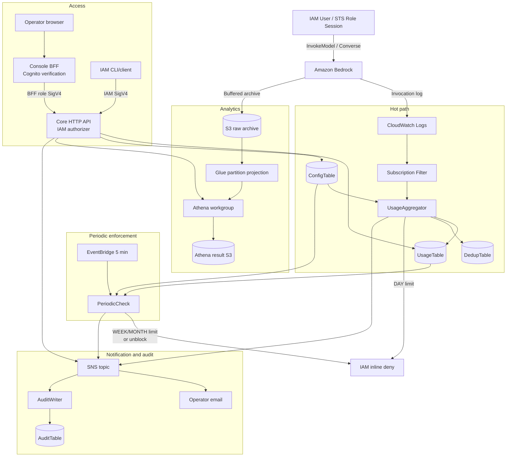

[English](DesignDoc.md) | [한국어](DesignDoc.ko.md)

# Bedrock Meter Design Document

> Status: Current architecture and design contract
> Implementation review date: 2026-07-20

## 1. Purpose

Bedrock Meter measures Amazon Bedrock usage per AWS principal and issues warnings and IAM blocks
based on daily, weekly, and monthly limits, without inserting a proxy into the model request path.

This is the canonical design document covering:

- Why the current architecture was chosen
- Responsibilities of each AWS service and code component
- The meaning of usage, credits, identity, blocking, and unblocking
- Consistency requirements under failures and concurrency
- The appropriate operating range and when to scale
- Design invariants that future changes must preserve

Related documents serve these roles:

- [README.md](../README.md): Product introduction and installation
- [DeveloperGuide.md](DeveloperGuide.md): Code changes, testing, deployment
- [OperationalGuide.md](OperationalGuide.md): Daily operations and troubleshooting
- [API.md](API.md): Core API contract

Use this document and the current implementation as the authority when older design material conflicts.

## 2. Goals and Scope

### 2.1 Goals

1. Measure raw input, cache-read, cache-write, and output tokens per AWS principal.
2. Evaluate daily, weekly, and monthly limits in credits reflecting relative costs.
3. Notify operators when each period's warning threshold or limit is reached.
4. Block Bedrock runtime calls with IAM explicit deny when limits are exceeded.
5. Automatically unblock only when all enforced scopes are below their limits.
6. Change default and per-principal limits and exemptions without redeploying.
7. Provide an IAM SigV4 Core API and a Cognito-based internal operations console.
8. Retain original invocation logs for user/model/time analytics.
9. Keep a Bedrock Meter failure from becoming a failure in the existing Bedrock request path.
10. Keep operational complexity and costs manageable for startups and small internal platform teams.

### 2.2 Non-goals

- Acting as a proxy, gateway, or router for model requests.
- Blocking the very request that crosses a limit before it executes.
- Representing AWS billing amounts or currency through credits.
- Providing API-key, project, or end-user quotas.
- Providing model routing, fallback, response caching, or prompt transformation.
- Distinguishing individual IAM Identity Center users behind a shared IAM Role.
- Providing global quotas across multiple regions.
- Hosting a large public website with the current console architecture.

## 3. Key Design Decisions

### 3.1 Observe usage after requests instead of proxying them

Applications and Claude Code continue to call Bedrock directly.

```text
Client → Amazon Bedrock
              |
              └─ invocation log → Bedrock Meter
```

Existing requests do not pass through Meter, so a Meter outage does not directly affect the request
path. Usage is observed after execution. Overshoot is possible during log delivery and IAM
propagation. Exact pre-request blocking requires a separate proxy or synchronous gateway.

### 3.2 Avoid per-user metric filters

Using User ARNs as CloudWatch metric dimensions increases cardinality and requires a metric and
alarm for each user. Every new user would require infrastructure changes, and daily boundaries
would be awkward to implement.

The current path is:

```text
CloudWatch Logs Subscription Filter
  → UsageAggregator Lambda
  → DynamoDB atomic counter
```

A principal's row is created automatically on its first log. Custom CloudWatch metrics use only
low-cardinality dimensions such as overall/per-model tokens and blocked-principal counts.

### 3.3 Separate enforcement from analytics

| Path | Source of truth | Responsibility |
|---|---|---|
| Hot path | Today's DynamoDB `DAY#` row | Ingestion, DAY warning and blocking |
| Periodic path | Recent DynamoDB `DAY#` rows | WEEK/MONTH warnings and blocking, all-scope unblocking |
| Analytics path | S3 raw logs + Glue + Athena | History, top users, model totals and trends |

Athena does not participate in quota decisions. S3 delivery, Glue, or Athena failures should delay
only Statistics/history; daily, weekly, and monthly enforcement must continue.

### 3.4 Store token components and calculate credits at read time

Four token components are stored rather than a single weighted total.

```text
credits =
  raw input × 1
  + cache read × 0.1
  + cache write × 1.25
  + output × 5
```

Weights other than raw input are stored in ConfigTable's `default` row. Preserving components
allows credit weights to change without rewriting the last 90 days of usage.

Weights are global policy. The periodic path and API use default weights; per-principal weight
overrides are not part of the supported contract.

### 3.5 Block with IAM explicit deny

Lambda attaches this inline policy:

```json
{
  "Version": "2012-10-17",
  "Statement": [{
    "Sid": "AutoBlockBedrockQuotaExceeded",
    "Effect": "Deny",
    "Action": [
      "bedrock:Invoke*",
      "bedrock:Converse*",
      "bedrock:RetrieveAndGenerate*",
      "bedrock:InvokeAgent*"
    ],
    "Resource": "*"
  }]
}
```

The policy is named `AutoBlocked-BedrockMeter-QuotaExceeded`. Explicit deny takes precedence over
broad allows. Wildcard action families reduce the risk of missing new Bedrock runtime APIs.

### 3.6 Store operational policy in DynamoDB

ConfigTable stores default/per-principal limits, warning thresholds, and exemptions. Operators
can change policy without redeploying CDK.

CDK seeds the `default` row only when it does not exist. Changing source seed values does not update
an existing deployment; use the API or an explicit migration.

### 3.7 Protect ownership of the Bedrock logging singleton

Model invocation logging is a singleton per account/region. The Custom Resource checks whether
the current CloudWatch and S3 destinations match this stack's intended owner.

Deployment fails by default if a different configuration exists. Use the explicit overwrite option
only after reviewing the existing owner. Logging configuration is retained by default on stack deletion.

### 3.8 Host for internal operations

The console targets a small group of internal operators. Next.js generates HTML, JavaScript, and
CSS at build time, and the static export and BFF are deployed in one Lambda package.

Lambda reads and returns prebuilt files rather than rendering HTML per request through SSR.
This provides one origin and one deployment, but static requests missing from the browser cache
still pass through API Gateway and Lambda.

For external/large-scale use, global edge latency, or independent frontend releases, separate the
static UI into CloudFront + private S3 (OAC) or Amplify Hosting.

## 4. Overall Architecture



### 4.1 Latency characteristics

These are typical operational expectations, not hard SLAs.

| Result | Typical latency |
|---|---|
| DAY usage update | Usually 5–30 seconds after invocation |
| DAY block | Log delivery + a few seconds of IAM propagation |
| WEEK/MONTH block | Until the next five-minute periodic run + IAM propagation |
| Automatic unblock | Until the next five-minute periodic run |
| Model/history analytics | Usually delayed 5–10 minutes by S3 delivery |
| Block reevaluation after raising a limit | Performed immediately by the write API |

## 5. Time and Quota Semantics

### 5.1 Period definitions

Quota boundaries use the global IANA timezone in ConfigTable `default.quotaTimeZone`. New
installations detect the timezone of the environment running `deploy-all.sh`; an explicit
`BEDROCK_METER_QUOTA_TIME_ZONE` takes precedence. Existing installations without the field use
UTC for compatibility.

| Scope | Definition |
|---|---|
| DAY | Calendar day in the quota timezone |
| WEEK | ISO week, Monday–Sunday, in the quota timezone |
| MONTH | Calendar month in the quota timezone |

Quota rows use the Lambda ingestion instant converted to a date in the quota timezone, not the
timestamp inside the Bedrock event. This lets hot and periodic paths make consistent decisions
from the same rows.

Analytics uses raw event timestamps and UTC S3 partitions. Its daily UTC charts may therefore
have different boundaries from quota-calendar DAY totals.

Changing timezone increments `quotaTimeZoneVersion`. Version 1 uses `DAY#yyyy-mm-dd`; later
versions use `DAY#V<version>#yyyy-mm-dd`. This prevents counters from different timezones from
mixing in the same row. Active day/week/month counters restart at zero, and old rows remain until TTL.

### 5.2 Default policy

| Setting | Default |
|---|---:|
| Daily limit | 3,000,000 credits |
| Weekly limit | 15,000,000 credits |
| Monthly limit | 45,000,000 credits |
| Warning threshold | 80% |
| IAM User enforcement | Enabled |
| IAM Role enforcement | Disabled |

The API requires integer limits in `1..10^12` and this ordering:

```text
monthly >= weekly >= daily
```

Internally, enforcement treats zero or negative limits as disabling that scope. The API rejects
zero to prevent operators from mistaking it for "block everything."

### 5.3 Warnings and blocks

- DAY is evaluated immediately after applying a new ingestion batch.
- PeriodicCheck evaluates MONTH before WEEK.
- Warnings are published once per DAY, ISO WEEK, and calendar MONTH.
- If usage skips the warning range and reaches the limit, only `BLOCKED` may be published.
- Concurrent paths blocking the same principal publish only one new-block notification.
- `exempt: true` preserves metering but skips warnings and blocking.

### 5.4 Unblocking

Automatic unblocking reevaluates current usage; it is not a timer starting from the block event.

```text
DAY < daily
AND WEEK < weekly
AND MONTH < monthly
```

All enforced scopes must be below their limits. Exempt principals have no enforced scopes and
qualify for unblocking. If a limit increase or exemption change brings a blocked principal below
its thresholds, the Core write API reevaluates immediately. PeriodicCheck provides a safety net.

Force-unblock does not change limits. Usage that remains over a limit may trigger another block
on the next ingestion or PeriodicCheck run.

## 6. Identity Model

### 6.1 Metering principals

| Invocation identity | Stored key |
|---|---|
| `arn:aws:iam::...:user/alice` | The same IAM User ARN |
| `arn:aws:sts::...:assumed-role/RoleName/session` | `arn:aws:iam::...:role/RoleName` |

STS session names are not trusted as stable user IDs. All sessions of a role are aggregated,
providing role-level metering but not individual SSO attribution.

### 6.2 Enforcement principals

IAM Users are blocked through `PutUserPolicy` by default. IAM Role enforcement is opt-in.
`PutRolePolicy` blocks all sessions of the role, so enable it only after approving the impact
on a shared role.

Role usage is still recorded when role enforcement is disabled. Warnings and blocking are skipped.

### 6.3 Core API identity

An API Gateway IAM authorizer protects the Core API.

- Self-service routes are scoped to the SigV4 caller ARN.
- Admin routes check the IAM username allowlist in deployment configuration.
- The console BFF's fixed role name is allowed as an admin caller.
- Management paths accept only path-less IAM usernames.
- IAM path users and IAM Roles may be metered but cannot be fully managed by the username API.

### 6.4 Console identity

Cognito and IAM are separate identity stores.

| Cognito group | Permissions |
|---|---|
| `console-admins` | Read and write |
| `console-viewers` | Read only |

Self-signup and MFA are disabled. Passwords require at least seven characters and one digit,
with no uppercase, lowercase, or symbol requirement.

The BFF verifies Cognito ID tokens and signs Core API calls with SigV4 using its own Lambda
execution-role temporary credentials. AWS access keys and Core credentials never reach the browser.

Cognito groups authorize console admins, while IAM principals identify Bedrock enforcement
targets. Cognito usernames do not have to match IAM usernames.

## 7. Data Design

### 7.1 UsageTable

Physical name: `BedrockMeterUsageTable`

```text
PK = UserARN
SK = DAY#yyyy-mm-dd | DAY#V<version>#yyyy-mm-dd | STATE
```

DAY row:

| Attribute | Meaning |
|---|---|
| `inputTokens` | Compatibility total: raw + cache read + cache write |
| `rawInputTokens` | Uncached input |
| `cacheReadTokens` | Cache-read input |
| `cacheWriteTokens` | Cache-write input |
| `outputTokens` | Output |
| `invocationCount` | Number of aggregated invocations |
| `warned` | DAY warning deduplication |
| `quotaTimeZone`, `quotaPolicyVersion` | Quota calendar that created the row |
| `lastUpdated` | Last ingestion time |
| `expiresAt` | TTL, 90 days after the last update |

STATE row:

| Attribute | Meaning |
|---|---|
| `blocked` | Current block state |
| `blockedScope` | `DAY`, `WEEK`, `MONTH` |
| `blockedAt`, `blockedAtEpoch` | Block time |
| `blockedReason` | Credit total and limit |
| `warnedWeekKey` | WEEK warning period key |
| `warnedMonthKey` | MONTH warning period key |

UsageTable uses On-Demand capacity, PITR, and `RemovalPolicy.RETAIN`. STATE has no TTL.

### 7.2 DedupTable

```text
PK = UserARN
SK = BATCH#<first 16 characters of payload sha256>
```

Stores `claimedAt`, the initial `quotaDay`, `quotaTimeZone`, `quotaPolicyVersion`, and a seven-day
TTL. The key must not contain a date: a CloudWatch Logs redelivery crossing quota midnight must
collide with the same claim to prevent double counting.

DedupTable has an autogenerated physical name and `RemovalPolicy.DESTROY`. It contains
reconstructable delivery state, not business history.

### 7.3 ConfigTable

Physical name: `BedrockMeterConfigTable`

```text
PK = ConfigKey
```

| Key | Purpose |
|---|---|
| `default` | Global limits, warning percentage, credit weights |
| Full principal ARN | Partial overrides and `exempt` |

Effective configuration:

```text
code fallback → default row → principal override
```

ConfigTable uses On-Demand capacity, PITR, and RETAIN. Deployment seeds `default` only if absent.

### 7.4 AuditTable

Physical name: `BedrockMeterAuditTable`

```text
PK = AUDIT#yyyy-mm
SK = <ISO timestamp>#<SNS MessageId>
```

SNS MessageId makes redelivery idempotent. Records include event, severity, scope, actor, target,
reason, and before/after values.

The actual operator identity supplied by a trusted BFF takes precedence over the proxy role ARN.
System decisions are stored as `system`, displayed as `BedrockMeter` in the console.

AuditTable uses On-Demand capacity, PITR, and RETAIN, with a 730-day (two-year) record TTL. The
API uses an opaque cursor to traverse up to the most recent 24 monthly partitions.

### 7.5 S3, Glue, and Athena

Bedrock raw gzip JSON prefix:

```text
bedrock-logs/AWSLogs/<account>/BedrockModelInvocationLogs/<region>/<yyyy>/<mm>/<dd>/<HH>/
```

Glue:

- Database: `bedrock_meter`
- Table: `invocations`
- Partition projection: `year/month/day/hour`
- JSON SerDe with malformed-record tolerance
- No crawler

Athena workgroup:

- Name: `bedrock-meter`
- Enforced SSE-S3 result location
- CloudWatch metrics enabled
- 5 GiB scan cutoff per query
- Result objects expire after 30 days

The Core API uses Athena only for history, top users, and model analytics. User input is supplied
through ExecutionParameters. Warm Lambda instances cache up to 128 results for 10 seconds.

## 8. Component Behavior

### 8.1 Bedrock logging

The stack creates:

- An invocation Log Group with 30-day retention and RETAIN
- An SSE-S3 archive bucket with public access blocked
- A retained Bedrock service role
- An ownership-aware Custom Resource managing the account/region logging singleton

Text delivery is enabled; image and embedding delivery are disabled. Text logs may contain
prompts and responses.

Archive lifecycle:

| Age | Storage class |
|---|---|
| Days 0–29 | S3 Standard |
| Days 30–399 | Standard-IA |
| Day 400 onward | Glacier Flexible Retrieval |

There is currently no archive expiration.

### 8.2 UsageAggregator

Trigger:

```text
CloudWatch Logs Subscription Filter: identity.arn exists
```

Processing sequence:

1. Decode the base64 + gzip payload.
2. Parse JSON events, excluding malformed records and records with all token counts at zero.
3. Normalize STS assumed-role ARNs to stable IAM Role ARNs.
4. Sum token components by principal/model within the batch.
5. Execute one cross-table transaction per principal: a conditional DedupTable claim and an
   atomic `ADD` to the UsageTable DAY row.
6. Consistently read the DAY row.
7. Read default and principal configuration without caching.
8. Calculate credits and evaluate DAY warnings/blocks.
9. Publish only newly applied usage as overall/per-model CloudWatch metrics.

Duplicate batches do not increment counters, but thresholds are reevaluated. This recovers from
an earlier invocation that committed to DynamoDB but failed during IAM or SNS processing.

### 8.3 PeriodicCheck

EventBridge invokes it every five minutes.

1. Read ConfigTable and construct an effective-configuration map.
2. Read STATE rows to build the blocked set and WEEK/MONTH warning keys.
3. Consistently scan DAY rows once to sum current day/week/month components.
4. Apply global credit weights.
5. Evaluate enforceable, non-blocked principals in MONTH, then WEEK order.
6. Reevaluate all blocked principals against DAY/WEEK/MONTH.
7. Restore the policy if STATE is blocked, IAM deny is absent, and usage remains over a limit.
8. Reconcile and unblock if all scopes are below their limits.
9. Publish `BlockedUserCount`.

Periodic scan cost scales with the number of 90-day DAY rows and STATE rows, not raw invocations.
Keeping batch claims in DedupTable prevents them from inflating this scan.

### 8.4 Core API

The Core HTTP API uses an IAM authorizer and one Python Lambda.

- Self-service usage and limits
- Admin user discovery and snapshots
- DynamoDB day/week/month aggregates
- Athena history, top users, and model analytics
- Changes to limits, warning thresholds, and exemptions
- Blocked-user listing and force-unblock
- Persistent audit queries

Responses use `no-store`. Stage throttling is 20 rps / burst 40. See [API.md](API.md) for the contract.

### 8.5 Console

Build:

```text
client/app/out/
  → bff-lambda/dist/public/

bff-lambda/handler.ts
  → bff-lambda/dist/index.cjs

bff-lambda/dist/
  → one Lambda code asset
```

Runtime:

```text
Browser
  → Console HTTP API $default route
  → BFF Lambda
      ├─ regular GET/HEAD     → prebuilt static file
      └─ /api/console/*   → Cognito authorization → Core SigV4
```

The Console HTTP API has no API Gateway authorizer; the BFF authenticates requests. By default,
all data reads require viewer/admin membership, and writes always require admin membership.
Static assets and `/api/console/config` are public so the application can boot.

`/_next/static/*` uses one-year immutable caching. HTML and remaining paths use `no-cache`.
Stage throttling is 50 rps / burst 100.

### 8.6 Notifications and audit

One SNS topic receives:

- `WARNING`, `BLOCKED`, `RESOLVED`
- `LIMIT_CHANGED`, `LIMIT_REMOVED`, `MANUAL_UNBLOCK`
- CloudWatch alarm notifications

Configured email subscriptions receive notifications. AuditWriter persists only structured
Bedrock Meter messages containing an `event` field to AuditTable.

### 8.7 Monitoring and region guardrails

Alarms cover:

- Errors/throttles for UsageAggregator, PeriodicCheck, Core API, AuditWriter, and Console BFF
- EventBridge failed invocations
- Bedrock CloudWatch/S3 delivery failures
- Athena scans exceeding 2 GiB in one hour

An optional region-guardrail managed policy denies Bedrock runtime actions outside the metered
region. It is created by default but not automatically attached to principals.

## 9. Consistency and Failure Model

### 9.1 At-least-once delivery

CloudWatch Logs subscriptions deliver at least once. One DynamoDB transaction is the consistency boundary:

```text
Conditional BATCH claim + DAY atomic ADD
```

Neither write can commit alone. Only a conditional claim failure is treated as a duplicate.
`TransactionConflict` is retried within Lambda using bounded full-jitter exponential backoff.
Conflicts that exhaust the retry budget, throttling, and validation failures are raised for
CloudWatch Logs subscription redelivery.

### 9.2 Concurrent blocking

IAM policy attachment is idempotent. STATE transitions use this condition:

```text
attribute_not_exists(blocked) OR blocked = false
```

Only the winning invocation publishes a new-block event.

### 9.3 IAM and STATE reconciliation

IAM and DynamoDB cannot share one transaction, so unblocking proceeds as follows:

1. Mark STATE as `blocked=false`.
2. Remove the IAM deny.
3. Clear block metadata only if STATE is still false.
4. Restore the deny if a concurrent re-block occurred during deletion.

If policy deletion fails, STATE is restored to blocked. If STATE is blocked but the policy is
missing and usage remains over a limit, PeriodicCheck restores the deny.

### 9.4 Consistency choices

- Counters use DynamoDB atomic `ADD`.
- Enforcement DAY reads are consistent.
- Periodic policy scans use `ConsistentRead=True`.
- Configuration reads are eventually consistent.
- Immediate post-write reevaluation receives the just-computed effective configuration directly
  to avoid stale reads.
- S3/Athena analytics is intentionally eventual.
- Applying/removing IAM policies involves a few seconds of eventual consistency.

### 9.5 Failure impact

| Failure | Behavior |
|---|---|
| Metering pipeline | Existing Bedrock calls continue; usage/enforcement may lag |
| DynamoDB transaction | Lambda retries without partial counts |
| IAM block | Lambda fails and retries |
| IAM unblock | STATE is restored to blocked |
| S3/Athena | Analytics degrades; quotas continue |
| Console | Core API and Bedrock calls continue |
| Different Bedrock logging owner | Deployment fails until explicitly approved |

The existing Bedrock request path fails open, while consistency when removing an established
block is fail-closed.

## 10. Security and Privacy

### 10.1 Trust boundaries

- Bedrock writes to the configured Log Group and private archive bucket.
- The Core API trusts API Gateway IAM authentication.
- Admin callers are allowlisted IAM usernames or the pinned BFF role.
- Operator headers are trusted only from an approved BFF role caller.
- The BFF verifies Cognito ID tokens and groups.
- Browsers never receive AWS credentials.

### 10.2 Data protection

- S3 buckets block public access and use SSE-S3.
- DynamoDB uses AWS-managed encryption.
- Usage, Config, Audit, Cognito, invocation logs, and archives survive stack deletion according
  to their retention policies.
- Runtime/access Log Groups have 30-day retention and are deleted with the stack.
- Text invocation logging may include prompts and responses.

Minimize access to CloudWatch invocation logs, archive/result buckets, Glue/Athena queries,
Audit, and Console as sensitive-data resources.

### 10.3 Self-lockout

Direct IAM API callers cannot change their own token limits or exempt themselves. Core sees
console calls as the BFF role, so the BFF applies the same protection using the Cognito/IAM
username naming rule.

Direct DynamoDB changes bypass this protection and should be reserved for approved break-glass operations.

## 11. Retention and Lifecycle

| Resource | Retention/lifecycle | Removal |
|---|---|---|
| Usage DAY | 90-day TTL | Table RETAIN + PITR |
| Usage STATE | No TTL | Table RETAIN + PITR |
| Dedup claim | 7-day TTL | Table DESTROY |
| ConfigTable | No TTL | RETAIN + PITR |
| Audit record | 730-day TTL | Table RETAIN + PITR |
| Bedrock invocation Log Group | 30 days | RETAIN |
| Lambda/API access log | 30 days | DESTROY |
| Raw archive S3 | IA after 30 days, Glacier after 400 days | RETAIN |
| Athena result S3 | Objects expire after 30 days | Bucket RETAIN |
| Cognito User Pool | No automatic deletion | RETAIN |
| Bedrock logging role/config | Retained by default | RETAIN |

Deleting the stack is not a complete data-disposal procedure.

## 12. Scalability and Cost

### 12.1 Why it suits startups

- No always-on compute.
- DynamoDB On-Demand capacity.
- No redeployment for new principals.
- Enforcement runs no Athena queries.
- A single periodic scan computes all weekly/monthly totals.
- Raw logs avoid committing to an analytics schema too early.
- The internal console and BFF deploy together.

Main costs are CloudWatch log ingestion/storage, Lambda, DynamoDB reads/writes, Athena scans,
API Gateway, dashboards, and X-Ray.

### 12.2 DynamoDB scaling boundary

PeriodicCheck and some console aggregates scan recent DAY and STATE rows. The current architecture
is simple and suitable when:

- The principal count is modest.
- Ninety days of rows can be processed comfortably within the two-minute Lambda timeout.
- A five-minute policy interval is acceptable.
- Scan costs are outweighed by operational simplicity.

Near these limits, retain DAY rows as the source of truth and add a current-period index or
aggregate table with reconciliation. Moving enforcement back to raw-log Athena is not the default solution.

### 12.3 Athena scaling boundary

Consider scheduled Parquet aggregation when these conditions persist for multiple days:

- Typical 30-day queries scan hundreds of MiB to GiB.
- Statistics/history p95 repeatedly exceeds 5–10 seconds.
- The 2 GiB/hour alarm recurs.
- Raw archives grow by several GiB daily.
- Thousands of small files are generated each day.
- Dashboards repeatedly query the same aggregates.
- Six-to-twelve-month trends are queried frequently.

Retain raw JSON for auditing and reprocessing. Store components by date/hour × principal × model
in Snappy Parquet. Switch only analytics routes; keep quota paths in DynamoDB.

### 12.4 Console hosting scaling boundary

Separate static UI hosting into CloudFront + private S3/OAC or Amplify Hosting when you need:

- External access or many concurrent users
- Better global edge latency
- Lower API Gateway/Lambda costs for static transfers
- Independent frontend previews, rollbacks, and releases
- Edge WAF, bot control, or custom-domain policies

With CloudFront, disable caching for `/api/console/*`, forward the Authorization header, and
route to API Gateway/BFF. Keep Cognito verification and Core SigV4 signing in the BFF under any host.

## 13. Deployment and Configuration

Supported full-deployment entry point:

```bash
./scripts/deploy-all.sh
```

The script:

1. Installs Console/CDK dependencies.
2. Builds the static UI and BFF bundle.
3. Deploys `BedrockMeterCoreStack`.
4. Saves `cdk-outputs.json`.
5. Detects and persists the quota timezone for new installations.
6. Optionally bootstraps a console admin when all required environment variables are present.

CDK configuration covers account/region, initial quota timezone, email/IAM admins, logging
overwrite, role enforcement, dashboard creation, and region-guardrail creation.

Runtime configuration includes quota timezone, limits, warning thresholds, exemptions, and global
credit weights. Ordinary runtime policy changes do not require redeployment.

The stack region must match the Bedrock logging region. Calls in another region are not delivered
to this regional logging configuration.

## 14. Retired or Superseded Designs

| Earlier design | Current decision | Reason |
|---|---|---|
| Per-user Metric Filter + Alarm | Retired | Cardinality, per-user resources, cost, daily boundaries |
| Bedrock Meter proxy | Non-goal | Adds a synchronous failure point and credential boundary |
| Logs Insights as the sole state store | Retired | Five-minute latency, duplicate warnings, scan costs, queryability |
| Athena WEEK/MONTH enforcement | Replaced | S3 delays and query failures must not drive policy |
| Separate scheduled Unblock Lambda | Removed | PeriodicCheck reevaluates all scopes together |
| Spike cooldown timer | Removed | Unblocking follows current policy state, not elapsed time |
| SSO session names as personal IDs | Retired | Unstable and untrustworthy for shared roles |
| Role enforcement enabled by default | Retired | Impact on every session of a role |
| Slack webhook/Chatbot | Not implemented | Supported notifications currently use SNS email |
| Public S3 static website | Retired | Public-access guardrails and unnecessary exposure |
| Console Lambda Function URL | Retired | Account guardrail against public `Principal:*` |
| CloudFront for the current console | Deferred | Limited benefit relative to complexity at low internal traffic |
| SSE-KMS for all storage | Replaced | Currently service-managed encryption/SSE-S3 |
| Raw-token 1:1 limits | Replaced | Credits reflect cache/output cost differences |

## 15. Known Limitations

1. The request crossing a limit has already executed.
2. Log delivery interruptions create metering/enforcement blind spots.
3. Calls in other regions may be unmetered without an attached region guardrail.
4. IAM propagation creates brief inconsistencies.
5. Individual SSO users behind shared roles are not distinguished.
6. Role enforcement affects the entire role, and username API support is limited.
7. IAM path users cannot be managed through the path-less admin API.
8. Credits reflect relative cost, not every model's actual price.
9. Analytics lags by minutes, and ingestion/event-time boundaries may differ.
10. The console endpoint is internet-reachable; Cognito/BFF protects data routes.
11. MFA is currently disabled.
12. Retained resources require a separate disposal process.

## 16. Design Invariants

1. Bedrock requests do not pass through Bedrock Meter.
2. Do not use CloudWatch Metric Filters with User ARN dimensions.
3. Subscription Filter hot paths handle DAY enforcement.
4. WEEK/MONTH enforcement and automatic unblocking use DynamoDB DAY rows.
5. Dedup claims and DAY counter updates share one DynamoDB transaction.
6. Dedup keys contain no wall-clock date.
7. Store token components separately and calculate credits from them.
8. Credit weights are global default policy.
9. Block transitions are conditional and notifications are idempotent.
10. Unblocking reevaluates all scopes and reconciles IAM/STATE.
11. Pass Athena user values through ExecutionParameters.
12. Normalize STS role sessions to stable IAM Role ARNs.
13. IAM Role enforcement is opt-in.
14. Browsers never receive AWS credentials or call the Core IAM API directly.
15. Trust operator headers only from approved BFF role callers.
16. Review the existing owner before overwriting Bedrock logging.
17. Stack and Bedrock logging regions must match.
18. Update existing ConfigTable defaults through migrations, not CDK seed changes.
19. Preserve raw invocation logs when adding aggregate analytics.
20. Preserve private storage and the BFF security boundary when separating static hosting.

## 17. Implementation Locations

```text
cdk/
  lib/bedrock-meter-core-stack.ts
  lib/config.ts
  lib/constructs/
    bedrock-logging.ts
    analytics.ts
    usage-pipeline.ts
    periodic-check.ts
    api.ts
    audit.ts
    notification.ts
    console-auth.ts
    console-hosting.ts
    operational-monitoring.ts
    region-guardrail.ts
    dashboard.ts

lambda/
  common/
    principals.py
    pricing.py
    enforcement.py
    dates.py
    athena.py
    cache.py
  bedrock-logging-config/index.py
  usage-aggregator/index.py
  periodic-quota-check/index.py
  api-handler/index.py
  audit-writer/index.py

client/app/
  src/app/
  src/features/
  src/lib/server/
  bff-lambda/

scripts/
  deploy-all.sh
  api-call.py
  add-console-admin.sh
  add-console-viewer.sh
  manual-unblock.sh
```
