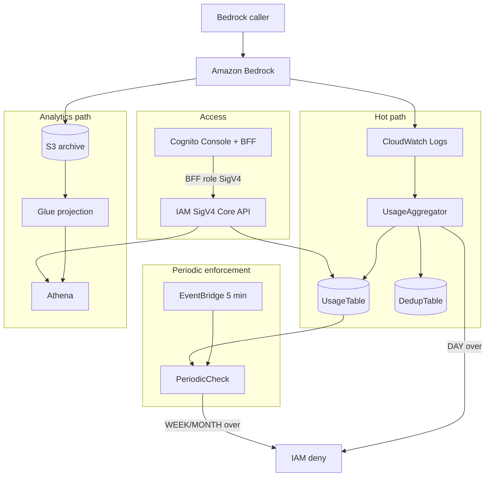

[English](DeveloperGuide.md) | [한국어](DeveloperGuide.ko.md)

# Bedrock Meter 개발 가이드

이 문서는 Bedrock Meter의 AWS 구조와 정책을 이해하고, 코드를 변경·검증·배포하는 개발자를
위한 가이드입니다. 설치와 최초 배포는 [README.ko.md](../README.ko.md), 일상 운영은
[OperationalGuide.ko.md](OperationalGuide.ko.md), HTTP 계약은 [API.ko.md](API.ko.md)를 먼저
참고하세요.

## 1. 설계 목표

Bedrock Meter는 애플리케이션 호출 경로에 Proxy를 추가하지 않습니다.

```text
Application / Claude Code → Amazon Bedrock
                                  |
                                  └─ invocation log → Bedrock Meter
```

이 선택으로 얻는 장점:

- 기존 Bedrock endpoint, SDK, IAM 인증을 변경하지 않는다.
- Meter가 장애여도 Bedrock 호출 경로 자체는 영향을 받지 않는다.
- Proxy fleet, provider credential, routing layer를 별도로 운영하지 않는다.
- Bedrock log의 `identity.arn`을 AWS principal 기준 사용량으로 바로 활용한다.

대신 다음 성질을 반드시 유지해야 합니다.

- enforcement는 사전 승인이 아니라 **로그 수신 후 사후 차단**이다.
- 호출 리전의 Bedrock invocation logging이 정상이어야 한다.
- 로그 도착과 IAM eventual consistency만큼 한도를 초과할 수 있다.
- prompt/response가 CloudWatch Logs와 S3에 기록될 수 있다.
- 사용자보다 세밀한 project/API-key 단위는 request metadata 같은 별도 식별 설계가 필요하다.

## 2. 전체 아키텍처

시스템은 세 개의 데이터 경로와 두 개의 접근 경로로 나뉩니다.



### 2.1 Hot path

1. Bedrock이 invocation log를 `/aws/bedrock/modelinvocations`로 전달합니다.
2. CloudWatch Logs Subscription Filter가 `identity.arn`이 있는 event를 Lambda로 보냅니다.
3. `UsageAggregator`가 base64+gzip batch를 해제하고 principal/model별 token을 합산합니다.
4. DedupTable conditional put과 UsageTable DAY counter update를 하나의
   `TransactWriteItems`로 실행합니다.
5. effective config를 읽어 DAY warning 또는 block을 평가합니다.
6. 새 상태 전이만 SNS로 발행합니다.

CloudWatch Logs subscription은 at-least-once이므로 멱등 claim과 counter update를 분리하면 안 됩니다.
같은 principal의 DAY row를 여러 Lambda가 동시에 갱신할 때 발생하는 `TransactionConflict`는
full-jitter exponential backoff로 최대 5회 시도합니다. 기본값은 50ms에서 시작하고 최대 1초로
제한하며, CDK의 `DDB_TRANSACTION_*` 환경변수로 조정합니다. 재시도 예산을 모두 소진한 경우에만
Lambda error로 올려 subscription redelivery에 맡깁니다.

### 2.2 Periodic enforcement

`PeriodicCheck`는 EventBridge에 의해 5분마다 실행됩니다.

- ConfigTable의 전역 quota timezone과 policy version을 consistent read합니다.
- UsageTable의 active-policy DAY row를 한 번 scan해 현재 local day, ISO week, calendar month를 합산합니다.
- 주/월 warning과 block을 평가합니다.
- blocked principal은 day/week/month를 모두 재평가합니다.
- 모든 scope가 한도 미만이면 IAM deny와 STATE를 함께 정리합니다.
- Athena는 이 경로에서 사용하지 않습니다.

### 2.3 Analytics path

S3 archive는 Glue partition projection으로 Athena에 연결됩니다. 모델별 통계, 일/시간 history,
top-N 분석에만 사용합니다. S3 전달이 buffered되므로 DDB snapshot보다 늦게 보이는 것이 정상입니다.

### 2.4 접근 경로

- Core API: API Gateway IAM authorizer, 모든 호출에 SigV4 필요
- Console: 공개 HTTP API가 정적 UI와 BFF Lambda를 제공
- Browser: Cognito ID token으로 BFF 인증
- BFF: 고정 이름의 execution role로 Core API에 SigV4 요청

브라우저에 AWS access key를 전달하지 않습니다.

### 2.5 Console 정적 리소스 호스팅

#### 현재 선택과 의도

현재 콘솔은 소수의 승인된 운영자가 간헐적으로 접속하는 **회사 내부 운영 콘솔**을 대상으로 합니다.
이 범위에서는 별도 CDN과 웹 hosting infrastructure보다 단일 배포 단위, 같은 origin, 단순한 장애
지점을 우선합니다.

콘솔은 Next.js SSR이 아닙니다. `output: 'export'`가 빌드 시점에 페이지별 HTML과 JavaScript/CSS를
생성하며, BFF Lambda는 요청 시 이 파일을 읽어 반환합니다.

```text
client/app/
  src/                                  Next.js/React source
  out/                                  next build의 정적 export
  bff-lambda/
    dist/
      index.cjs                         esbuild로 묶은 BFF handler
      public/                           out/을 복사한 정적 UI
        index.html
        audit.html
        users.html
        _next/static/...
```

`npm run build:console-artifact`는 다음 순서로 artifact를 만듭니다.

1. `next build`: `client/app/out/`에 정적 HTML, JS, CSS, image/font를 생성합니다.
2. `build:bff`: `bff-lambda/handler.ts`를 `dist/index.cjs`로 bundle합니다.
3. `sync:static`: `out/`을 `dist/public/`으로 복사합니다.
4. CDK `lambda.Code.fromAsset()`이 `dist/` 전체를 하나의 Console BFF Lambda code asset으로
   배포합니다.

CDK는 Lambda asset을 bootstrap S3 bucket에 staging한 뒤 Lambda code로 배포할 수 있습니다. 이
bucket은 배포 도구용이며 웹 origin이 아닙니다. Bedrock invocation archive S3와도 별개입니다.

#### 런타임 요청과 cache

```text
Browser
  → Console API Gateway HTTP API의 $default route
  → Console BFF Lambda
      ├─ GET /, /users, /_next/static/* → dist/public/ 파일
      ├─ GET /api/console/config        → public runtime config
      └─ /api/console/*                 → Cognito 검증 → Core API SigV4
```

- Lambda는 HTML을 동적으로 생성하지 않고 `dist/public/`의 완성된 파일을 반환합니다.
- 브라우저 cache에 없는 HTML, JS, CSS, image 요청은 API Gateway와 Lambda를 통과합니다.
- 해시가 붙은 `/_next/static/*`는 `max-age=31536000, immutable`입니다.
- HTML과 그 밖의 파일은 `no-cache`로 갱신 여부를 확인하므로 새 배포가 이전 HTML에 가려지지 않습니다.
- 정적 UI와 BFF가 같은 origin이므로 production에서 CORS나 별도 API base URL이 필요 없습니다.
- `/api/console/config`가 Cognito public client 정보와 API base를 런타임에 제공하므로 환경별 값을
  정적 build에 넣지 않습니다.

이 구성은 public S3와 CloudFront 없이 운영할 수 있고 `deploy-all.sh` 한 번으로 UI와 BFF를 함께
갱신합니다. 반면 cache miss마다 Lambda가 실행되고 정적 UI와 BFF의 배포 주기가 결합됩니다.

#### 호스팅 분리를 검토할 조건

다음 조건이 지속되면 현재 내부 운영 콘솔의 범위를 벗어난 것으로 보고 정적 hosting을 분리합니다.

- 회사 외부 또는 다수의 일반 사용자가 콘솔을 사용합니다.
- 정적 요청량이나 동시 접속 증가로 API Gateway/Lambda 비용과 throttle이 의미 있게 증가합니다.
- 여러 리전의 사용자가 접속해 edge cache와 전 세계 전송 지연 개선이 필요합니다.
- image, font, source map 등 정적 artifact가 커지거나 다운로드가 많아집니다.
- 프런트엔드를 backend와 독립적으로 자주 배포하거나 즉시 rollback해야 합니다.
- custom domain, WAF, bot control, access log, CDN cache 정책을 edge에서 일관되게 적용해야 합니다.

일시적인 접속 증가만으로 분리하지 않습니다. Console API access log와 BFF Lambda의
`Invocations`, `Duration`, `ConcurrentExecutions`, `Throttles`, API Gateway 요청 수·지연·비용을
함께 보고 판단합니다.

#### 대안 1: CloudFront + private S3

정적 export는 private S3 bucket에 배포하고 CloudFront Origin Access Control(OAC)만 bucket을 읽게
합니다. `/api/console/*` behavior는 기존 Console API Gateway origin으로 전달하면 브라우저 관점의
same-origin 경계를 유지할 수 있습니다.

- 기본 behavior: private S3의 HTML/JS/CSS
- `/api/console/*`: API Gateway + BFF Lambda
- HTML: cache 비활성 또는 짧은 TTL
- `/_next/static/*`: 긴 TTL + immutable
- S3 Block Public Access: 유지

현재 export는 `/users.html`, `/users/detail.html` 형태이므로 CloudFront Function 또는 동등한
rewrite로 `/users`를 `/users.html`에 연결해야 합니다. `/api/console/*` behavior는 cache를
비활성화하고 `Authorization`, query string, 필요한 CORS header와 모든 운영 method를 origin에
전달해야 합니다. 정적 behavior와 API behavior의 우선순위를 배포 전에 테스트합니다.

#### 대안 2: AWS Amplify Hosting

프런트엔드를 독립 배포하고 branch preview, managed CI/CD, custom domain이 중요하면 Amplify
Hosting을 사용할 수 있습니다. extensionless page path를 해당 `.html` export에 연결하는 rewrite를
설정하고 BFF는 API Gateway/Lambda에 유지합니다. UI와 BFF가 다른 origin이면 허용 origin, CSP
`connect-src`, CORS, runtime API base를 명시적으로 설정해야 합니다.

두 대안 모두 다음 보안 계약을 유지해야 합니다.

1. AWS access key와 BFF execution-role credential을 브라우저에 전달하지 않습니다.
2. 브라우저가 Core IAM API를 직접 호출하지 않습니다.
3. Cognito token 검증과 admin/viewer 인가는 BFF에서 계속 수행합니다.
4. BFF만 자신의 execution role로 Core API를 SigV4 서명합니다.
5. `/api/console/config` 또는 동등한 runtime config에서 secret을 반환하지 않습니다.
6. 기존 Lambda의 정적 serving을 제거하기 전에 deep link, cache invalidation, rollback을 검증합니다.

### 2.6 DynamoDB와 Athena 책임 경계

한도 enforcement는 Athena availability나 S3 delivery 지연에 의존하지 않아야 합니다.

| 실행 구성요소 | 데이터 소스 | 책임 |
|---|---|---|
| `UsageAggregator` | DynamoDB UsageTable, ConfigTable, DedupTable | DAY counter와 STATE 갱신, effective config 조회, batch 멱등 claim, DAY warning/block |
| `PeriodicCheck` | DynamoDB UsageTable, ConfigTable | DAY row를 합산한 WEEK/MONTH warning/block, blocked principal 재평가와 자동 해제 |
| `AuditWriter` | DynamoDB AuditTable | SNS warning/block/resolved/config 변경 event 영속화 |
| Core API Lambda | DynamoDB | 현재 사용량, 전체 사용자, 한도, 차단 상태, audit, 강제 해제 |
| Core API Lambda | Athena → Glue → S3 | 사용자 history, top-N, 모델별 합계와 추세 |
| Console BFF | Core API | DynamoDB나 Athena에 직접 접근하지 않고 Core API를 호출 |

#### DynamoDB API

| Endpoint | 사용하는 테이블 또는 추가 동작 |
|---|---|
| `GET /usage/me` | UsageTable + ConfigTable |
| `GET /usage/{username}`, `GET /users/{username}` | UsageTable + ConfigTable |
| `GET /users`, `GET /usage/aggregate` | UsageTable + ConfigTable |
| `GET /usage/history/all` | UsageTable의 최근 DAY row |
| `GET /limits/me`, `GET /limits/{username}` | ConfigTable |
| `PUT /limits/{username}`, `DELETE /limits/{username}` | ConfigTable, SNS audit 발행 |
| `GET /admin/blocked` | UsageTable STATE row |
| `POST /admin/unblock/{username}` | UsageTable STATE row + IAM inline policy |
| `GET /admin/audit` | AuditTable |

#### Athena API

| Endpoint | 분석 내용 |
|---|---|
| `GET /usage/me/history` | 호출자의 일/시간별 사용 이력 |
| `GET /usage/{username}/history`, `GET /users/{username}/history` | 지정 사용자의 일/시간별 사용 이력 |
| `GET /usage/top` | 기간·metric 기준 사용자 순위 |
| `GET /usage/by-model` | 기간별 모델 사용 합계 |
| `GET /usage/by-model/trend` | 모델별 일/시간 추세 |

Athena API만 warm Lambda 메모리의 10초 TTL cache를 사용합니다. S3 delivery 때문에 결과가 보통
5~10분 늦을 수 있으며, 이 결과를 warning, block, unblock 판단에 사용하면 안 됩니다.
`GET /usage/history/all`은 이름에 `history`가 있지만 전체 사용자 Overview를 빠르게 그리기 위한
DynamoDB DAY-row 집계라는 점에 주의하세요.

### 2.7 Athena 확장 판단과 Parquet 집계

#### 현재 구조를 유지하는 기본 판단

현재 구조는 enforcement와 analytics의 failure domain을 분리합니다. DynamoDB DAY row만으로
day/week/month를 계산하므로 Athena query failure, S3 delivery 지연, Glue catalog 문제는
Statistics/history만 늦출 뿐 quota 정책에는 영향을 주지 않습니다. 동시에 raw invocation log를
Athena로 직접 읽으면 초기에 필요한 query 형태를 빠르게 변경할 수 있고, 모델별 aggregate row와
secondary index를 hot path에 계속 추가하지 않아도 됩니다.

따라서 다음 조건에서는 raw JSON + partition projection을 유지합니다.

- Athena 조회가 운영자가 허용할 수 있는 비동기 분석 지연 안에 끝난다.
- scan alarm이 드물고 비용이 예산 안에 있다.
- dashboard 동시 조회가 낮다.
- 주로 최근 7~30일을 조회한다.
- schema와 분석 축이 아직 자주 바뀐다.

#### 재검토 신호

아래 수치는 AWS의 hard limit이 아니라 이 프로젝트에서 확장 검토를 시작하기 위한 운영 기준입니다.
한 번의 spike가 아니라 여러 날 또는 여러 주 반복되는지를 확인합니다.

| 신호 | 검토 기준 예시 | 의미 |
|---|---|---|
| Query latency | Statistics/history p95가 5~10초 이상 | 콘솔 UX와 Lambda timeout 여유 악화 |
| Scan volume | 일반적인 30일 query가 수백 MB~1GB 이상 | 같은 aggregate를 위해 raw JSON을 반복 scan |
| Alarm | `ProcessedBytes > 2GB/hour`가 반복 발생 | 조회 빈도 또는 대상 데이터 증가 |
| Daily ingest | archive가 하루 수 GB 이상 | 보존 기간 증가에 따라 scan 비용이 빠르게 증가 |
| Small files | JSON object가 하루 수천 개 이상 | planning/open 비용과 query latency 증가 |
| Concurrency | 운영자·dashboard가 시간당 수십 회 이상 조회 | 동일 데이터를 반복 계산 |
| Retention | 6~12개월 이상 추세를 자주 조회 | raw event 전체 scan이 비효율적 |
| Cost | Athena 비용이 월 운영비에서 무시하기 어려움 | 사전 집계의 운영 비용이 정당화됨 |

CloudWatch alarm, Athena query execution의 `DataScannedInBytes`와 `EngineExecutionTimeInMillis`, S3
Storage Lens 또는 Inventory의 object 수/크기를 함께 봅니다. 데이터 크기만으로 결정하지 말고
지연·빈도·비용 중 둘 이상이 지속적으로 나빠질 때 도입하는 편이 안전합니다.

#### 권장 목표 구조

```text
Bedrock invocation
        ├─ CloudWatch Logs → UsageAggregator → DynamoDB → enforcement
        └─ S3 raw JSON
              ├─ 감사·상세 조사
              └─ scheduled aggregate job
                    → S3 Snappy Parquet
                    → Glue aggregate table
                    → Statistics/history API
```

집계 row의 권장 grain은 `UTC date/hour × stable principal ARN × model ID`입니다. 최소한 다음 raw
component를 별도 column으로 유지합니다.

- raw input tokens
- cache read tokens
- cache write tokens
- output tokens
- invocation count

credits만 저장하면 ConfigTable의 weight를 바꿀 때 과거 값을 다시 계산할 수 없습니다. raw component를
보존하고 query 시 `weighted_total`과 같은 공식을 적용해야 합니다.

#### 구현 원칙

1. Raw JSON bucket은 source of truth와 감사 자료로 계속 보존합니다.
2. EventBridge scheduled Lambda, Athena CTAS/`INSERT INTO`, 또는 Glue job 중 규모에 맞는 하나를
   선택하고, 출력은 Snappy Parquet과 `usage_date` partition을 사용합니다.
3. 집계 완료 watermark를 저장하고 같은 날짜를 재실행해도 중복되지 않도록 overwrite 또는
   idempotent partition 교체 방식을 사용합니다.
4. 늦게 도착한 S3 log를 포함하도록 최근 1~2개 partition을 재처리하고 backfill 절차를 제공합니다.
5. event timestamp와 UTC 경계를 사용해 Athena history 의미를 유지합니다.
6. Core API의 history/model query만 aggregate table로 전환합니다. quota Lambda와 DDB API는
   변경하지 않습니다.
7. 집계 전후의 principal/model별 token component 합계를 비교하는 reconciliation test를 둡니다.
8. Parquet query에도 partition predicate, workgroup cutoff, parameter binding을 유지합니다.

일별 batch는 최대 하루가량 freshness를 늦출 수 있습니다. 당일 통계가 중요하면 시간별 Parquet을
만들거나, 완료된 과거 partition은 Parquet에서 읽고 오늘 partition만 raw table에서 읽어 합치는
hybrid query를 사용합니다. 이 복잡성이 현재 Athena 비용보다 큰 동안에는 도입하지 않습니다.

## 3. AWS 리소스와 설정

| 리소스 | 구현 | 핵심 설정 |
|---|---|---|
| Bedrock logging | `bedrock-logging.ts` | text logging 활성, CW Logs+S3 dual destination |
| Invocation Log Group | CloudWatch Logs | 이름 고정, 30일, RETAIN |
| Archive bucket | S3 | SSE-S3, public 차단, 30일 IA, 400일 Glacier, RETAIN |
| UsageTable | DynamoDB | On-Demand, PITR, TTL, RETAIN |
| DedupTable | DynamoDB | On-Demand, 7일 TTL, DESTROY, 자동 이름 |
| ConfigTable | DynamoDB | On-Demand, PITR, RETAIN |
| AuditTable | DynamoDB | On-Demand, PITR, 730일 TTL, RETAIN |
| UsageAggregator | Lambda Python 3.12 | 512MB, 30초, X-Ray |
| PeriodicCheck | Lambda Python 3.12 | 512MB, 2분, 5분 schedule |
| Core API Lambda | Lambda Python 3.12 | 512MB, 30초 |
| AuditWriter | Lambda Python 3.12 | 256MB, SNS subscription |
| Console BFF | Lambda Node.js 24 | 1024MB, 30초, 정적 UI 포함 |
| Core HTTP API | API Gateway v2 | IAM authorizer, 20 rps/40 burst |
| Console HTTP API | API Gateway v2 | public endpoint, BFF 내부 인증, 50 rps/100 burst |
| Cognito User Pool | Cognito | self-signup off, MFA off, admin/viewer groups |
| SNS topic | SNS | system/audit/alarm fan-in, email subscription |
| Glue table | Glue | `year/month/day/hour` partition projection |
| Athena workgroup | Athena | SSE-S3 results, query당 5GB cutoff |
| Dashboard/Alarm | CloudWatch | Lambda, EventBridge, Bedrock delivery, Athena scan |
| Region guardrail | IAM managed policy | 다른 리전 Bedrock 호출 deny, 생성만 하고 자동 부착하지 않음 |

## 4. 데이터 모델

### 4.1 UsageTable

PK는 full principal ARN인 `UserARN`, SK는 row type입니다.

| SK | 목적 | 주요 필드 |
|---|---|---|
| `DAY#yyyy-mm-dd` | policy version 1의 quota-calendar ingestion day | raw/cache read/cache write/output, invocation count, warned, TTL |
| `DAY#V<n>#yyyy-mm-dd` | timezone 변경 후 active policy day | 위 필드 + quota timezone/version |
| `STATE` | 차단과 warning 상태 | blocked, scope, reason, timestamp, week/month warning key |

DAY row는 90일 후 만료됩니다. 월 합산에 최대 31일이 필요하며, 90일 보존은 최근 사용량
추세를 DynamoDB에서 빠르게 조회할 수 있는 여유를 제공합니다.
`scripts/deploy-all.sh`는 배포 후 아직 삭제되지 않은 기존 DAY row의 `expiresAt`도
`lastUpdated + 90일`로 조건부 연장합니다.

### 4.2 DedupTable

```text
PK = UserARN
SK = BATCH#<payload-sha256-prefix>
```

- 날짜를 key에 넣지 않습니다. 자정을 넘겨 재전달된 동일 batch도 충돌해야 하기 때문입니다.
- TTL은 7일입니다.
- claim put과 DAY ADD는 하나의 cross-table transaction입니다.
- 이 테이블은 재생성 가능한 운영 데이터라 stack 삭제 시 제거됩니다.

### 4.3 ConfigTable

```text
ConfigKey = default
ConfigKey = arn:aws:iam::<account>:user/<username>
ConfigKey = arn:aws:iam::<account>:role/<role-name>
```

`default`와 principal override를 merge해 effective config를 만듭니다.

주요 필드:

- `dailyTokenLimit`
- `weeklyTokenLimit`
- `monthlyTokenLimit`
- `warningThresholdPct`
- `exempt`
- `costWeightCacheRead`
- `costWeightCacheWrite`
- `costWeightOutput`
- `quotaTimeZone` (`Asia/Seoul` 같은 IANA 이름, default row 전용)
- `quotaTimeZoneVersion` (timezone 변경 때 증가, default row 전용)

CDK custom resource의 default seed는 신규 설치에서 `attribute_not_exists(ConfigKey)` 조건을
사용합니다. 기존 설치를 업그레이드할 때는 현재 한도가 이전 기본값인
`1,000,000 / 5,000,000 / 15,000,000`과 정확히 일치할 때만
`3,000,000 / 15,000,000 / 45,000,000`으로 조건부 갱신합니다. 운영자가 이미 바꾼 default
한도는 배포가 덮어쓰지 않습니다.

### 4.4 AuditTable

```text
PK = AUDIT#yyyy-mm
SK = <timestamp>#<sns-message-id>
```

SNS message ID를 포함해 redelivery를 멱등 처리합니다. TTL은 기본 730일(2년)입니다.
배포 스크립트는 기존 Audit record도 `timestamp + 730일`로 조건부 연장합니다. TTL에 의해 이미
삭제된 record는 복구하지 않습니다.

### 4.5 S3/Glue schema

Bedrock native prefix:

```text
bedrock-logs/AWSLogs/<account>/BedrockModelInvocationLogs/<region>/<yyyy>/<mm>/<dd>/<HH>/
```

Glue column은 Bedrock JSON의 lower-case projection을 사용합니다. `timestamp`는 Athena SQL에서
예약어 충돌을 피하도록 quote해야 합니다.

## 5. 사용량과 정책 계산

### 5.1 Credits

```text
raw input    = 1.0
cache read   = 0.1
cache write  = 1.25
output       = 5.0
```

`weighted_total()`이 모든 enforcement와 DDB aggregate의 기준입니다. Athena query도
`athena_weighted_sum()`으로 같은 식을 사용해야 합니다.

가중치를 저장 시점에 미리 적용하지 않습니다. raw component를 저장하고 읽을 때 계산하므로
ConfigTable 가중치 변경이 기존 DAY row에도 반영됩니다.

### 5.2 기간

- DAY: ingestion instant를 `default.quotaTimeZone`으로 변환한 calendar date
- WEEK: 같은 timezone의 ISO 8601 week, 월요일~일요일
- MONTH: 같은 timezone의 calendar month
- Athena history: Bedrock event timestamp 기준 UTC 분석

Quota와 Analytics는 의도적으로 시간이 다릅니다. DDB quota path는 운영자가 정한 calendar 경계를
사용하고 Athena history/model trend는 원본 UTC event time을 유지합니다.

타임존 변경은 `quotaTimeZoneVersion`을 증가시키고 새 DAY key prefix를 사용합니다. 이전 timezone
row를 재해석하거나 새 row와 합치지 마세요. Active counters는 새 version에서 0부터 시작하며 기존
row는 90일 TTL까지 남습니다. WEEK/MONTH warning dedup key에도 version이 포함됩니다.

### 5.3 Warning

- 기본 threshold는 scope limit의 80%입니다.
- DAY는 DAY row의 `warned=true`로 하루 한 번 발송합니다.
- WEEK/MONTH는 STATE의 period key로 기간당 한 번 발송합니다.
- block 검사가 warning보다 먼저입니다. 한 batch로 80% 미만에서 100% 이상이 되면 warning 없이
  `BLOCKED`만 발행될 수 있습니다.
- `exempt`이면 warning과 block을 모두 생략합니다.

### 5.4 Block

정책 이름:

```text
AutoBlocked-BedrockMeter-QuotaExceeded
```

deny action:

```json
[
  "bedrock:Invoke*",
  "bedrock:Converse*",
  "bedrock:RetrieveAndGenerate*",
  "bedrock:InvokeAgent*"
]
```

IAM explicit deny는 모든 allow보다 우선합니다. `mark_blocked_if_new()`의 conditional update가
동시 block 경쟁에서 한 호출만 SNS를 발행하도록 보장합니다.

### 5.5 Unblock

자동 해제는 시간이 지났다는 이유만으로 수행하지 않습니다.

1. 현재 day/week/month total과 effective limit을 다시 계산합니다.
2. 하나라도 초과 중이면 deny policy를 유지하거나 복원합니다.
3. 모두 미만이면 STATE를 unblocking으로 전환합니다.
4. IAM policy를 삭제합니다.
5. STATE metadata를 정리하고 `RESOLVED`를 발행합니다.

강제 해제 API는 한도 초과 여부와 무관하게 해제하므로, 사용량이 여전히 높으면 다음 평가에서
다시 차단될 수 있습니다.

## 6. Principal과 인증 모델

### 6.1 Metering principal

- IAM User ARN: 그대로 저장하고 기본 enforcement 대상
- STS assumed-role ARN: session suffix를 제거한 stable IAM Role ARN으로 정규화
- IAM Role: 기본적으로 집계만 수행
- `roleEnforcementEnabled=true`: role inline deny를 허용하지만 모든 session이 함께 차단됨

기본 설정에서도 hot path의 DAY 사용량이 80~100% 구간에 들어가면 warning이 발행될 수 있습니다.
그러나 limit 이상에서는 role block을 건너뛰며, PeriodicCheck의 WEEK/MONTH 평가는 role 자체를
건너뜁니다. Role에 일관된 warning/block 정책이 필요하면 이 동작을 함께 재설계하거나
`roleEnforcementEnabled`의 blast radius를 검토해 활성화해야 합니다.

관리 API의 `{username}`은 path-less IAM User만 지원합니다. IAM path user와 role을 동일한 UX로
관리하려면 route와 principal parser를 별도로 확장해야 합니다.

### 6.2 Core API auth

API Gateway IAM authorizer가 SigV4 caller를 확인합니다.

- `/usage/me` snapshot은 IAM User caller 전용이며 caller ARN으로 범위를 제한합니다.
- admin IAM User는 `ADMIN_USERNAMES`와 비교합니다.
- Console BFF role은 `ADMIN_ROLE_NAMES`에 고정 이름으로 등록됩니다.

### 6.3 Console auth

Cognito와 IAM은 별도 identity store입니다.

- Cognito: 콘솔 로그인과 `console-admins`/`console-viewers` 권한
- IAM: Bedrock 호출 principal과 차단 대상
- BFF: Cognito token을 검증하고 자기 Lambda role로 Core를 호출

Console admin은 Cognito group으로 인가되며, 로그인 username과 IAM username의 일치는 요구하지
않습니다. admin은 자신을 포함한 IAM User의 한도와 `exempt` 설정을 변경할 수 있고, BFF가 전달한
operator identity가 Audit에 기록됩니다.

MFA는 현재 비활성이고 비밀번호 정책은 7자 이상, 숫자 1개 이상입니다. production 보안 요구에
따라 `console-auth.ts`에서 강화할 수 있습니다.

## 7. 코드 구조

```text
cdk/
  bin/app.ts                         환경변수 → stack config
  lib/config.ts                      기본 인프라 설정
  lib/bedrock-meter-core-stack.ts    construct 조립과 output
  lib/lambda-asset.ts                Lambda 코드 staging
  lib/constructs/
    bedrock-logging.ts               regional logging singleton
    usage-pipeline.ts                DDB + aggregator + subscription
    periodic-check.ts                5분 enforcement
    analytics.ts                     Glue + Athena
    api.ts                           Core API
    audit.ts                         AuditTable + writer
    console-auth.ts                  Cognito
    console-hosting.ts               UI/BFF Lambda + console API
    notification.ts                  SNS
    operational-monitoring.ts        alarms
    region-guardrail.ts              선택적 region deny

lambda/
  common/
    principals.py                    ARN validation/normalization
    pricing.py                       credits
    dates.py                         UTC/ISO period
    enforcement.py                   deny, state, alert
    athena.py                        parameterized query
    cache.py                         bounded TTL cache
  usage-aggregator/index.py
  periodic-quota-check/index.py
  api-handler/index.py
  audit-writer/index.py
  bedrock-logging-config/index.py

client/app/
  src/app/                            pages
  src/features/                       page workflows
  src/lib/auth.tsx                    browser Cognito login
  src/lib/server/cognito-auth.ts      BFF authorization
  src/lib/server/sigv4.ts             Core SigV4 signing
  bff-lambda/handler.ts               static + API handler

scripts/
  deploy-all.sh
  api-call.py
  add-console-admin.sh
  add-console-viewer.sh
  manual-unblock.sh
```

## 8. 설정 계층

### 8.1 배포 환경변수

`cdk/bin/app.ts`가 읽는 값:

| 변수 | 목적 |
|---|---|
| `CDK_DEFAULT_ACCOUNT` | 내부 값: 배포 스크립트가 STS 결과로 설정. 사용자 입력 아님 |
| `CDK_DEFAULT_REGION` | 내부 값: 터미널/profile에서 확인한 리전 |
| `BEDROCK_METER_BEDROCK_REGION` | 명시적 Bedrock region, stack region과 같아야 함 |
| `BEDROCK_METER_ADMIN_USERNAMES` | Core API IAM admin |
| `BEDROCK_METER_ADMIN_EMAILS` | SNS email subscriber |
| `BEDROCK_METER_QUOTA_TIME_ZONE` | 신규 ConfigTable의 quota calendar; 생략 시 배포 환경에서 감지 |
| `BEDROCK_METER_CONSOLE_EMERGENCY_ADMINS` | emergency username/email allowlist |
| `BEDROCK_METER_ALLOW_LOGGING_OVERWRITE` | logging singleton takeover |
| `BEDROCK_METER_ROLE_ENFORCEMENT_ENABLED` | role deny 활성 |
| `BEDROCK_METER_ENABLE_DASHBOARD` | dashboard 생성 |
| `BEDROCK_METER_CREATE_REGION_GUARDRAIL_POLICY` | unattached guardrail policy 생성 |

`scripts/deploy-all.sh`는 기본적으로 `.env.deploy.local`을 source합니다. timezone 변수가 없으면
Node의 `Intl.DateTimeFormat().resolvedOptions().timeZone`으로 IANA 이름을 감지해 파일에 기록합니다.
CI에서는 자동 기록하지 않으며, CloudShell/CodeBuild/컨테이너는 UTC일 수 있으므로 변수를 명시하세요.
이 값은 ConfigTable의 **최초 seed에만** 쓰이고 기존 `default` row는 덮어쓰지 않습니다.

### 8.2 정적 기본값

리소스 이름, retention, dashboard와 console 설정은 `cdk/lib/config.ts`에 있습니다.
리전/계정별 값과 제품 기본값을 섞지 마세요.

### 8.3 런타임 정책

quota timezone, 한도, warning threshold, exempt, credit weight는 ConfigTable에 둡니다. 운영 정책
변경을 위해 CDK를 재배포하지 않는 것이 원칙입니다.

## 9. 로컬 개발

### 9.1 의존성

Node.js 22.12 이상을 사용합니다(`.nvmrc`는 24 권장). 아래 Python 명령은 virtualenv를 사용합니다.

```bash
cd cdk && npm ci && cd ..
cd client/app && npm ci && cd ../..
python3 -m venv .venv
source .venv/bin/activate
python3 -m pip install -r lambda/requirements-dev.txt
python3 -m pip install boto3 requests requests-aws4auth
```

### 9.2 테스트

순서대로 실행하는 것을 권장합니다. TypeScript build가 생성하는 `.js`와 Jest를 병렬 실행하지 마세요.

```bash
(cd client/app && npm run build:console-artifact)
cd cdk
npm run build
npm test -- --runInBand
cd ..

AWS_DEFAULT_REGION=ap-northeast-2 AWS_ACCESS_KEY_ID=testing AWS_SECRET_ACCESS_KEY=testing AWS_EC2_METADATA_DISABLED=true \
  python3 -m unittest discover -s lambda -p 'test_*.py'
python3 -m unittest discover -s scripts/tests -p 'test_*.py'

cd client/app
npm test
npm run build
npm audit --audit-level=high
```

### 9.3 Console 개발

```bash
cd client/app
npm run dev
```

production artifact:

```bash
npm run build:console-artifact
```

산출물은 `client/app/bff-lambda/dist/index.cjs`와 `dist/public/`입니다. CDK synth는
`index.cjs`와 `public/index.html`이 없으면 실패합니다. 로컬 `npm run dev`는 production의
API Gateway/Lambda 정적 serving 경로를 재현하지 않으므로, 배포 전 production artifact build도
반드시 확인합니다.

## 10. 변경 방법

### Lambda 변경

`lambda/<name>/`과 `lambda/common/`은 `lambdaCode()`가 함께 staging합니다. 공통 모듈을 변경하면
이를 사용하는 모든 Lambda asset hash가 바뀌어야 합니다. 새 handler를 추가할 때도 이 helper를
사용하세요.

### API endpoint 추가

1. `cdk/lib/constructs/api.ts`에 route를 추가합니다.
2. `lambda/api-handler/index.py`의 routing과 validation을 구현합니다.
3. BFF가 필요하면 `console-service.ts`와 `bff-lambda/handler.ts`를 연결합니다.
4. `docs/API.ko.md`를 갱신합니다.
5. IAM admin/self 경계 테스트를 추가합니다.

같은 API Gateway hierarchy에서 `{a}`와 `{b}`처럼 이름만 다른 variable route는 충돌합니다.
기존 route 이름을 바꾸면 old route를 먼저 제거해야 할 수 있습니다.

### Quota 정책 변경

- 계산식: `lambda/common/pricing.py`
- seed: `usage-pipeline.ts`
- validation/API: `api-handler/index.py`
- Console validation/display: `client/app`
- existing stack migration: 별도 API/DDB migration 필요

hot, periodic, API aggregate, Athena query가 같은 단위를 쓰는지 반드시 테스트하세요.

### Principal 지원 확장

`principals.py`를 중심으로 설계하되 다음을 함께 고려합니다.

- 저장 key의 안정성
- IAM API가 적용할 entity
- admin route 식별자
- Console operator identity and Audit attribution
- 역할 공유 세션의 blast radius

SSO session name을 사용자 ID로 간주하면 session마다 달라지거나 위조 가능한 문자열에 정책을
연결하게 될 수 있으므로 사용하지 않습니다.

### DynamoDB schema 변경

고정 `tableName`을 가진 DynamoDB resource는 key schema replacement를 제자리에서 수행할 수 없습니다.
새 테이블, data migration, consumer cutover, old table 제거 순서로 설계하세요. RETAIN resource를
CloudFormation에서 제거할 때 orphan 여부도 확인해야 합니다.

## 11. 배포

### 배포 principal

CDK bootstrap이 끝난 계정/리전에서 CloudFormation execution role을 사용할 수 있어야 합니다.
조직 정책에 따라 직접 배포 role을 만들 때는 최소한 다음 리소스군의 생성·갱신·삭제 권한과
`iam:PassRole`이 필요합니다.

- CloudFormation/CDK bootstrap asset
- Lambda와 CloudWatch Logs
- DynamoDB
- S3
- IAM role/policy
- API Gateway v2
- Cognito User Pool
- SNS
- EventBridge
- Glue/Athena
- CloudWatch dashboard/alarm과 X-Ray
- Bedrock model invocation logging configuration

production에서는 개인 관리자 권한보다 승인된 deployment role과 CloudFormation change set을
사용하세요. Runtime Lambda role 권한은 CDK construct가 별도로 최소 범위로 생성합니다.

### 권장 흐름

```bash
git diff
./scripts/deploy-all.sh
```

최초 계정·리전 준비가 필요하면 `./scripts/deploy-all.sh --bootstrap`을 사용합니다.
스크립트는 Node.js 22.12 이상과 필수 도구를 확인하고 현재 AWS 자격증명으로 계정을 조회합니다.
리전은 `AWS_REGION` → `AWS_DEFAULT_REGION` → 선택한 profile 순서이며, 없으면 중단합니다.
계정·리전은 `.env.deploy.local`에서 설정하지 않습니다.

그다음 timezone을 확인하고 `npm ci`, 콘솔 빌드, 선택적 bootstrap, CDK 배포를 실행합니다.
출력 파일을 확인하고 선택적 자동 관리자 생성 또는 수동 생성 명령을 안내합니다.
기존 데이터의 보존 기간 backfill은 배포에서 실행하지 않습니다.

변경 범위를 먼저 보고 싶다면:

```bash
cd client/app && npm run build:console-artifact && cd ../..
cd cdk
npx cdk diff BedrockMeterCoreStack
```

직접 deploy할 때는 `.env.deploy.local`이 자동 로드되지 않으므로 필요한 환경변수를 export해야 합니다.

신규 설치의 타임존을 명시하려면:

```bash
BEDROCK_METER_QUOTA_TIME_ZONE=Asia/Seoul ./scripts/deploy-all.sh
```

기존 stack은 CDK seed가 `attribute_not_exists(ConfigKey)`이므로 이 환경변수로 변경되지 않습니다.
배포 후 Limits 화면 또는 `PUT /admin/settings/quota`를 사용하세요.

### 배포 후 검증

```bash
aws cloudformation describe-stacks \
  --stack-name BedrockMeterCoreStack \
  --query 'Stacks[0].StackStatus' --output text

aws bedrock get-model-invocation-logging-configuration
```

최소 smoke test:

1. Bedrock text 호출
2. DAY row 증가
3. Console/API snapshot 증가
4. S3 object와 Athena history 확인
5. test principal의 낮은 한도로 warning/block
6. force unblock과 IAM/STATE reconciliation 확인

production 운영자 본인의 principal로 block test를 하지 마세요.

## 12. 중요한 불변조건

1. Stack region과 Bedrock 호출/logging region은 같아야 합니다.
2. Bedrock invocation logging은 account/region singleton입니다.
3. 기존 logging destination이 다르면 기본 배포는 실패해야 합니다.
4. text logging을 끄면 text token 계측도 멈춥니다.
5. Subscription Filter batch는 at-least-once입니다.
6. dedup claim과 DAY counter는 같은 transaction이어야 합니다.
7. DAY counter는 DynamoDB `ADD`를 사용해야 합니다.
8. week/month enforcement는 DDB DAY row를 기준으로 합니다.
9. 내부 principal key는 full stable ARN이어야 합니다.
10. IAM User만 기본 enforcement 대상입니다.
11. block transition과 SNS 발행은 conditional STATE update로 중복을 막아야 합니다.
12. unblock은 모든 scope를 재평가하고 IAM/STATE를 보상 가능한 순서로 갱신해야 합니다.
13. Athena의 사용자 값은 ExecutionParameters로 전달해야 합니다.
14. Config default seed 변경은 기존 환경 migration이 아닙니다.
15. Console BFF role 이름은 Core admin allowlist와 안정적으로 일치해야 합니다.

## 13. 알려진 함정

### Logging singleton 충돌

다른 시스템이 같은 리전의 Bedrock logging을 소유하면 overwrite하지 말고 destination과 owner를
확인합니다. `BEDROCK_METER_ALLOW_LOGGING_OVERWRITE=true`는 검토 후 한 번만 사용합니다.

### Region이 다른 inference profile

호출이 실제로 처리·logging되는 source region을 확인합니다. Meter stack이 없는 리전의 log는 잡히지
않습니다. 필요한 경우 제공된 region guardrail policy를 대상 principal에 명시적으로 부착합니다.

### Subscription Filter quota

CloudWatch Log Group당 subscription filter 수 제한을 확인합니다. 다른 소비자가 이미 같은 Log Group을
사용 중이면 배포 전에 통합 설계를 결정합니다.

### 수동 IAM policy 삭제

STATE는 blocked인데 policy만 없어지는 drift가 생깁니다. PeriodicCheck가 복원할 수 있으므로 운영 해제는
항상 API를 사용합니다.

### Force unblock 후 즉시 재차단

강제 해제는 limit을 바꾸지 않습니다. 사용량이 여전히 초과 중이면 다음 invocation 또는 5분 평가에서
다시 차단됩니다.

### Retained resource

stack 삭제 후에도 Usage/Config/Audit table, archive/result bucket, invocation Log Group, Cognito User Pool,
logging role과 Bedrock logging 설정이 남을 수 있습니다. 재설치 전에 orphan resource를 확인하세요.

## 14. 보안과 개인정보

- Bedrock text invocation logging은 prompt와 response를 포함할 수 있습니다.
- S3와 DynamoDB는 public access 없이 배포되지만 운영 IAM 권한을 최소화해야 합니다.
- Console endpoint 자체는 public이며 데이터 route 인증은 BFF에서 수행합니다.
- `consoleRequireAuthForReads=false`는 조직 전체 사용량과 audit를 공개할 수 있으므로 production에서
  사용하지 않는 것이 기본입니다.
- Cognito MFA는 현재 OFF입니다. 환경 요구사항에 따라 password policy와 MFA를 강화하세요.
- emergency allowlist는 group 장애 복구용이며 상시 권한 관리 수단으로 사용하지 않습니다.
- role enforcement는 공유 role 전체를 중단시킬 수 있습니다.

## 15. 관측성과 장애 분석

주요 metric/alarm:

- 각 Lambda `Errors`, `Throttles`
- EventBridge `FailedInvocations`
- Bedrock `ModelInvocationLogsCloudWatchDeliveryFailure`
- Bedrock `ModelInvocationLogsS3DeliveryFailure`
- Athena `ProcessedBytes > 2GB/hour`
- custom `InputTokens`, `OutputTokens`, `BlockedUserCount`

조사 순서:

1. CloudFormation stack 상태
2. Bedrock logging configuration
3. CloudWatch alarm과 UsageAggregator logs
4. Subscription Filter destination
5. UsageTable/DedupTable write
6. PeriodicCheck logs와 IAM policy
7. S3 object, Glue partition projection, Athena workgroup
8. Core API/BFF access logs

상세 운영 runbook은 [OperationalGuide.ko.md](OperationalGuide.ko.md)를 참고하세요.

## 16. Release checklist

- [ ] 요구사항이 log-based 사후 enforcement의 지연을 허용하는가
- [ ] hot/periodic/analytics 경로의 단위가 일치하는가
- [ ] principal과 IAM blast radius를 검토했는가
- [ ] CDK build/test가 통과하는가
- [ ] Python tests가 통과하는가
- [ ] Console test/build/audit가 통과하는가
- [ ] `cdk diff`에서 replacement와 retained orphan을 확인했는가
- [ ] logging singleton owner를 확인했는가
- [ ] test principal로 E2E를 수행했는가
- [ ] 문서와 API schema를 갱신했는가
