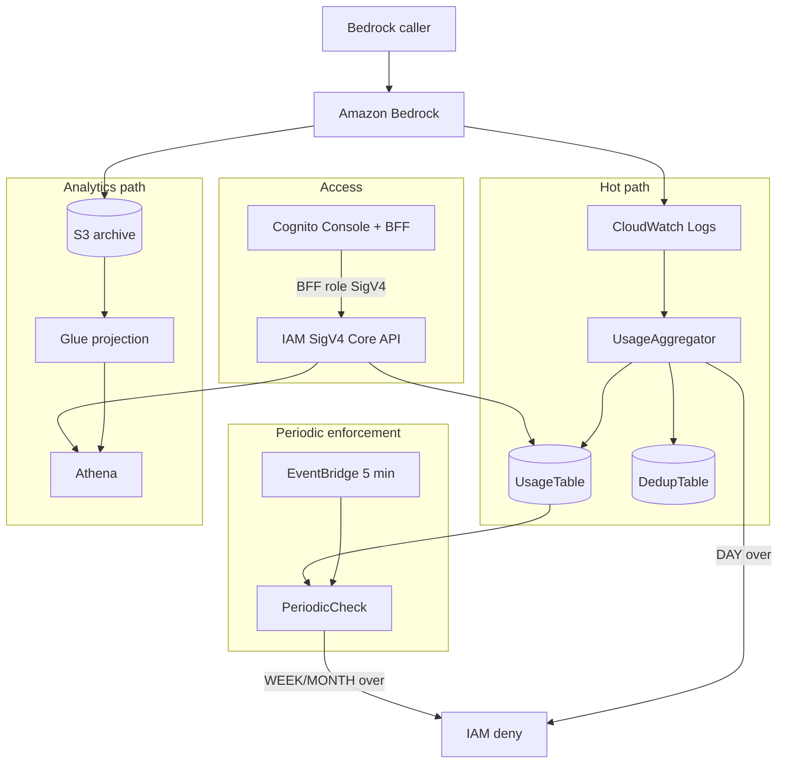

[English](DeveloperGuide.md) | [한국어](DeveloperGuide.ko.md)

# Bedrock Meter Developer Guide

This guide is for developers who need to understand Bedrock Meter's AWS architecture and policies,
then change, verify, and deploy its code. Start with [README.md](../README.md) for installation,
[OperationalGuide.md](OperationalGuide.md) for daily operations, and [API.md](API.md) for the HTTP contract.

## 1. Design Goals

Bedrock Meter does not add a proxy to the application's request path.

```text
Application / Claude Code → Amazon Bedrock
                                  |
                                  └─ invocation log → Bedrock Meter
```

Benefits of this choice:

- Existing Bedrock endpoints, SDKs, and IAM authentication remain unchanged.
- A Meter outage does not directly affect the Bedrock request path.
- No separate proxy fleet, provider credentials, or routing layer to operate.
- Bedrock log `identity.arn` directly identifies usage by AWS principal.

The following properties must be respected:

- Enforcement is **blocking after log ingestion**, not pre-request approval.
- Bedrock invocation logging must be healthy in the invocation region.
- Usage can overshoot during log delivery and IAM eventual consistency.
- Prompts/responses may be recorded in CloudWatch Logs and S3.
- Finer project/API-key attribution requires a separate identity design, such as request metadata.

## 2. Overall Architecture

The system has three data paths and two access paths.



### 2.1 Hot path

1. Bedrock delivers invocation logs to `/aws/bedrock/modelinvocations`.
2. A CloudWatch Logs Subscription Filter sends events containing `identity.arn` to Lambda.
3. `UsageAggregator` decodes base64+gzip batches and sums tokens by principal/model.
4. A single `TransactWriteItems` performs the DedupTable conditional put and UsageTable DAY counter update.
5. Effective configuration is read to evaluate DAY warnings or blocks.
6. Only new state transitions are published to SNS.

CloudWatch Logs subscriptions deliver at least once; never separate the idempotent claim from
the counter update. `TransactionConflict` can occur when multiple Lambdas update the same
principal's DAY row concurrently. The function makes up to five attempts with full-jitter
exponential backoff, starting at 50 ms and capped at one second by default. CDK's
`DDB_TRANSACTION_*` environment variables control these values. Only exhausted retries become
Lambda errors handled through subscription redelivery.

### 2.2 Periodic enforcement

EventBridge invokes `PeriodicCheck` every five minutes.

- Consistently reads the global quota timezone and policy version from ConfigTable.
- Scans active-policy DAY rows once to sum the current local day, ISO week, and calendar month.
- Evaluates weekly/monthly warnings and blocks.
- Reevaluates day/week/month for blocked principals.
- Clears IAM deny and STATE together when all scopes are below their limits.
- Does not use Athena.

### 2.3 Analytics path

Glue partition projection connects the S3 archive to Athena for model statistics, daily/hourly
history, and top-N analysis only. Buffered S3 delivery means these results normally lag DDB snapshots.

### 2.4 Access paths

- Core API: API Gateway IAM authorizer; SigV4 is required for every call.
- Console: A public HTTP API serves static UI and the BFF Lambda.
- Browser: Authenticates to the BFF using Cognito ID tokens.
- BFF: Signs Core API requests with SigV4 using its fixed-name execution role.

AWS access keys never reach the browser.

### 2.5 Hosting console static resources

#### Current choice and intent

The console serves **a small group of approved internal operators** with occasional access.
Within that scope, a single deployment, same origin, and simple failure model take priority over
separate CDN and web-hosting infrastructure.

The console does not use Next.js SSR. `output: 'export'` generates page HTML and JavaScript/CSS
at build time. The BFF Lambda reads and returns those files on request.

```text
client/app/
  src/                                  Next.js/React source
  out/                                  static export from next build
  bff-lambda/
    dist/
      index.cjs                         BFF handler bundled with esbuild
      public/                           static UI copied from out/
        index.html
        audit.html
        users.html
        _next/static/...
```

`npm run build:console-artifact` produces the artifact in this order:

1. `next build`: Generates static HTML, JS, CSS, images, and fonts in `client/app/out/`.
2. `build:bff`: Bundles `bff-lambda/handler.ts` into `dist/index.cjs`.
3. `sync:static`: Copies `out/` into `dist/public/`.
4. CDK `lambda.Code.fromAsset()` deploys the entire `dist/` directory as one Console BFF Lambda asset.

CDK may stage the Lambda asset in its bootstrap S3 bucket before deploying it as Lambda code.
That bucket is deployment infrastructure, not a web origin, and is separate from the Bedrock
invocation archive bucket.

#### Runtime requests and caching

```text
Browser
  → Console API Gateway HTTP API $default route
  → Console BFF Lambda
      ├─ GET /, /users, /_next/static/* → dist/public/ files
      ├─ GET /api/console/config        → public runtime config
      └─ /api/console/*                 → Cognito verification → Core API SigV4
```

- Lambda returns completed files from `dist/public/`; it does not generate HTML dynamically.
- HTML, JS, CSS, and image requests absent from the browser cache pass through API Gateway and Lambda.
- Hashed `/_next/static/*` files use `max-age=31536000, immutable`.
- HTML and other files use `no-cache` revalidation so stale HTML does not hide a new deployment.
- Static UI and BFF share an origin; production needs no CORS or separate API base URL.
- `/api/console/config` supplies public Cognito client information and the API base at runtime,
  so environment values are not baked into the static build.

This runs without public S3 or CloudFront, and `deploy-all.sh` updates UI and BFF together.
The tradeoffs are a Lambda invocation on every cache miss and coupled UI/BFF deployment cycles.

#### When to separate hosting

Persistent conditions like these exceed the current internal-console scope:

- External users or many general users access the console.
- Static traffic or concurrency materially increases API Gateway/Lambda cost and throttling.
- Users across regions need edge caching and better global delivery latency.
- Static artifacts such as images, fonts, and source maps grow or are downloaded frequently.
- The frontend needs frequent independent releases or immediate rollback.
- Custom domains, WAF, bot control, access logs, or CDN cache policy must be managed at the edge.

Do not migrate for a temporary traffic spike alone. Consider Console API access logs, BFF
`Invocations`, `Duration`, `ConcurrentExecutions`, and `Throttles`, along with API Gateway
request counts, latency, and cost.

#### Option 1: CloudFront + private S3

Deploy the static export to a private S3 bucket readable only through CloudFront Origin Access
Control (OAC). Route `/api/console/*` to the existing Console API Gateway origin to preserve
same-origin access in the browser.

- Default behavior: HTML/JS/CSS from private S3.
- `/api/console/*`: API Gateway + BFF Lambda.
- HTML: No caching or a short TTL.
- `/_next/static/*`: Long TTL + immutable.
- S3 Block Public Access: Remains enabled.

The export contains files such as `/users.html` and `/users/detail.html`. Use a CloudFront Function
or equivalent rewrite to map `/users` to `/users.html`. Disable caching for `/api/console/*` and
forward `Authorization`, query strings, required CORS headers, and all operational methods to the
origin. Test static/API behavior precedence before deployment.

#### Option 2: AWS Amplify Hosting

Use Amplify Hosting when independent frontend deployments, branch previews, managed CI/CD, and
custom domains matter. Rewrite extensionless page paths to their `.html` exports and retain the
BFF on API Gateway/Lambda. If UI and BFF use different origins, explicitly configure allowed
origins, CSP `connect-src`, CORS, and the runtime API base.

Both options must preserve these security contracts:

1. Never send AWS access keys or BFF execution-role credentials to the browser.
2. Browsers must not call the Core IAM API directly.
3. Keep Cognito token verification and admin/viewer authorization in the BFF.
4. Only the BFF signs Core API requests using its execution role.
5. Never return secrets from `/api/console/config` or equivalent runtime configuration.
6. Verify deep links, cache invalidation, and rollback before removing Lambda static serving.

### 2.6 DynamoDB and Athena responsibilities

Limit enforcement must not depend on Athena availability or S3 delivery latency.

| Component | Data source | Responsibility |
|---|---|---|
| `UsageAggregator` | DynamoDB UsageTable, ConfigTable, DedupTable | DAY counters and STATE, effective config, idempotent batch claims, DAY warnings/blocks |
| `PeriodicCheck` | DynamoDB UsageTable, ConfigTable | WEEK/MONTH warnings/blocks from DAY sums, blocked-principal reevaluation and automatic unblocking |
| `AuditWriter` | DynamoDB AuditTable | Persist SNS warning/block/resolved/config-change events |
| Core API Lambda | DynamoDB | Current usage, all users, limits, block state, audit, force-unblock |
| Core API Lambda | Athena → Glue → S3 | User history, top-N, model totals and trends |
| Console BFF | Core API | Calls Core rather than accessing DynamoDB or Athena directly |

#### DynamoDB APIs

| Endpoint | Tables or additional actions |
|---|---|
| `GET /usage/me` | UsageTable + ConfigTable |
| `GET /usage/{username}`, `GET /users/{username}` | UsageTable + ConfigTable |
| `GET /users`, `GET /usage/aggregate` | UsageTable + ConfigTable |
| `GET /usage/history/all` | Recent UsageTable DAY rows |
| `GET /limits/me`, `GET /limits/{username}` | ConfigTable |
| `PUT /limits/{username}`, `DELETE /limits/{username}` | ConfigTable, SNS audit publishing |
| `GET /admin/blocked` | UsageTable STATE rows |
| `POST /admin/unblock/{username}` | UsageTable STATE row + IAM inline policy |
| `GET /admin/audit` | AuditTable |

#### Athena APIs

| Endpoint | Analysis |
|---|---|
| `GET /usage/me/history` | Caller's daily/hourly usage history |
| `GET /usage/{username}/history`, `GET /users/{username}/history` | Specified user's daily/hourly history |
| `GET /usage/top` | User rankings by period and metric |
| `GET /usage/by-model` | Model usage totals by period |
| `GET /usage/by-model/trend` | Daily/hourly model trends |

Only Athena APIs use the warm Lambda's 10-second in-memory TTL cache. S3 delivery typically delays
results by 5–10 minutes; never use these results to decide warnings, blocks, or unblocks.
Despite its name, `GET /usage/history/all` aggregates DynamoDB DAY rows for a fast all-user Overview.

### 2.7 Scaling Athena with Parquet aggregates

#### When to keep the current architecture

The architecture separates enforcement and analytics failure domains. Day/week/month totals use
only DynamoDB DAY rows, so Athena query failures, S3 delays, and Glue catalog issues affect
Statistics/history rather than quotas. Reading raw invocation logs with Athena also makes early
query changes easy without adding per-model aggregate rows and secondary indexes to the hot path.

Keep raw JSON + partition projection when:

- Athena queries finish within acceptable asynchronous analytics latency.
- Scan alarms are rare and costs stay within budget.
- Dashboard concurrency is low.
- Queries usually cover the last 7–30 days.
- Schemas and analysis dimensions still change frequently.

#### Signals to reconsider

These are project operating criteria for reviewing scale, not AWS hard limits. Look for repetition
over days or weeks rather than a single spike.

| Signal | Example threshold | Implication |
|---|---|---|
| Query latency | Statistics/history p95 above 5–10 seconds | Worse console UX and less Lambda timeout headroom |
| Scan volume | Typical 30-day query scans hundreds of MB to 1 GB or more | Repeated raw JSON scans for the same aggregates |
| Alarm | Recurring `ProcessedBytes > 2GB/hour` | More queries or data |
| Daily ingest | Several GB of archives per day | Scan costs grow rapidly with retention |
| Small files | Thousands of JSON objects daily | Higher planning/open overhead and latency |
| Concurrency | Dozens or more operator/dashboard queries per hour | Recomputing the same data |
| Retention | Frequent trends over 6–12 months or longer | Full raw-event scans become inefficient |
| Cost | Athena is a material share of monthly operating costs | Preaggregation overhead becomes justified |

Inspect CloudWatch alarms, Athena `DataScannedInBytes` and `EngineExecutionTimeInMillis`, and
object counts/sizes from S3 Storage Lens or Inventory together. Prefer migration when two or more
of latency, frequency, and cost deteriorate persistently, rather than based on data size alone.

#### Recommended target architecture

```text
Bedrock invocation
        ├─ CloudWatch Logs → UsageAggregator → DynamoDB → enforcement
        └─ S3 raw JSON
              ├─ auditing and detailed investigation
              └─ scheduled aggregate job
                    → S3 Snappy Parquet
                    → Glue aggregate table
                    → Statistics/history API
```

Recommended aggregate grain: `UTC date/hour × stable principal ARN × model ID`. Preserve at least
these raw components in separate columns:

- Raw input tokens
- Cache-read tokens
- Cache-write tokens
- Output tokens
- Invocation count

Storing credits alone prevents recalculating historical values after changing ConfigTable weights.
Keep raw components and apply the same formula as `weighted_total` at query time.

#### Implementation principles

1. Retain the raw JSON bucket as source of truth and audit evidence.
2. Choose EventBridge-scheduled Lambda, Athena CTAS/`INSERT INTO`, or a Glue job appropriate to
   the scale. Output Snappy Parquet partitioned by `usage_date`.
3. Store a completion watermark and use overwrite or idempotent partition replacement so rerunning
   a date cannot duplicate usage.
4. Reprocess the latest one or two partitions for late S3 logs and provide a backfill procedure.
5. Preserve Athena history semantics using event timestamps and UTC boundaries.
6. Switch only Core history/model queries to aggregate tables. Leave quota Lambdas and DDB APIs unchanged.
7. Add reconciliation tests comparing per-principal/model token components before and after aggregation.
8. Preserve partition predicates, workgroup cutoffs, and parameter binding in Parquet queries.

Daily batches can delay freshness by roughly a day. If today's statistics matter, create hourly
Parquet or use hybrid queries combining completed historical Parquet with today's raw partition.
Do not add this complexity while it costs more to operate than the current Athena workload.

## 3. AWS Resources and Configuration

| Resource | Implementation | Key settings |
|---|---|---|
| Bedrock logging | `bedrock-logging.ts` | Text logging enabled, dual CW Logs + S3 destinations |
| Invocation Log Group | CloudWatch Logs | Fixed name, 30 days, RETAIN |
| Archive bucket | S3 | SSE-S3, public access blocked, IA at 30 days, Glacier at 400 days, RETAIN |
| UsageTable | DynamoDB | On-Demand, PITR, TTL, RETAIN |
| DedupTable | DynamoDB | On-Demand, 7-day TTL, DESTROY, autogenerated name |
| ConfigTable | DynamoDB | On-Demand, PITR, RETAIN |
| AuditTable | DynamoDB | On-Demand, PITR, 730-day TTL, RETAIN |
| UsageAggregator | Lambda Python 3.12 | 512 MB, 30 seconds, X-Ray |
| PeriodicCheck | Lambda Python 3.12 | 512 MB, 2 minutes, 5-minute schedule |
| Core API Lambda | Lambda Python 3.12 | 512 MB, 30 seconds |
| AuditWriter | Lambda Python 3.12 | 256 MB, SNS subscription |
| Console BFF | Lambda Node.js 24 | 1024 MB, 30 seconds, includes static UI |
| Core HTTP API | API Gateway v2 | IAM authorizer, 20 rps/40 burst |
| Console HTTP API | API Gateway v2 | Public endpoint, BFF authentication, 50 rps/100 burst |
| Cognito User Pool | Cognito | Self-signup off, MFA off, admin/viewer groups |
| SNS topic | SNS | System/audit/alarm fan-in, email subscriptions |
| Glue table | Glue | `year/month/day/hour` partition projection |
| Athena workgroup | Athena | SSE-S3 results, 5 GB cutoff per query |
| Dashboard/Alarm | CloudWatch | Lambda, EventBridge, Bedrock delivery, Athena scans |
| Region guardrail | IAM managed policy | Denies Bedrock calls in other regions; created but not automatically attached |

## 4. Data Model

### 4.1 UsageTable

PK is `UserARN`, the full principal ARN. SK identifies the row type.

| SK | Purpose | Main fields |
|---|---|---|
| `DAY#yyyy-mm-dd` | Quota-calendar ingestion day for policy version 1 | Raw/cache-read/cache-write/output tokens, invocation count, warned, TTL |
| `DAY#V<n>#yyyy-mm-dd` | Active-policy day after timezone changes | Above fields + quota timezone/version |
| `STATE` | Block and warning state | Blocked, scope, reason, timestamp, week/month warning keys |

DAY rows expire after 90 days. Monthly sums need at most 31 days; 90-day retention also supports
fast recent-usage trends in DynamoDB. After deployment, `scripts/deploy-all.sh` conditionally
extends `expiresAt` on surviving older DAY rows to `lastUpdated + 90 days`.

### 4.2 DedupTable

```text
PK = UserARN
SK = BATCH#<payload-sha256-prefix>
```

- No date in the key: redelivery of the same batch across midnight must still collide.
- TTL is seven days.
- Claim put and DAY ADD share one cross-table transaction.
- The table is deleted with the stack because it holds reconstructable operational data.

### 4.3 ConfigTable

```text
ConfigKey = default
ConfigKey = arn:aws:iam::<account>:user/<username>
ConfigKey = arn:aws:iam::<account>:role/<role-name>
```

Merge `default` with principal overrides to compute effective configuration.

Main fields:

- `dailyTokenLimit`
- `weeklyTokenLimit`
- `monthlyTokenLimit`
- `warningThresholdPct`
- `exempt`
- `costWeightCacheRead`
- `costWeightCacheWrite`
- `costWeightOutput`
- `quotaTimeZone`: IANA name such as `Asia/Seoul`; default row only.
- `quotaTimeZoneVersion`: Incremented on timezone changes; default row only.

The CDK Custom Resource seeds new installations using `attribute_not_exists(ConfigKey)`. During
upgrades, limits are conditionally changed from `1,000,000 / 5,000,000 / 15,000,000` to
`3,000,000 / 15,000,000 / 45,000,000` only if they exactly match the old defaults. Deployment never
overwrites defaults already customized by an operator.

### 4.4 AuditTable

```text
PK = AUDIT#yyyy-mm
SK = <timestamp>#<sns-message-id>
```

SNS message IDs make redelivery idempotent. Default TTL is 730 days (two years). The deployment
script also conditionally extends existing audit records to `timestamp + 730 days`. It cannot
restore records already deleted by TTL.

### 4.5 S3/Glue schema

Bedrock native prefix:

```text
bedrock-logs/AWSLogs/<account>/BedrockModelInvocationLogs/<region>/<yyyy>/<mm>/<dd>/<HH>/
```

Glue columns use lowercase projections of Bedrock JSON. Quote `timestamp` in Athena SQL to avoid
reserved-word conflicts.

## 5. Usage and Policy Calculations

### 5.1 Credits

```text
raw input    = 1.0
cache read   = 0.1
cache write  = 1.25
output       = 5.0
```

`weighted_total()` defines all enforcement and DDB aggregates. Athena queries must use the same
formula through `athena_weighted_sum()`.

Do not apply weights before storing usage. Store raw components and calculate at read time so
ConfigTable weight changes also apply to existing DAY rows.

### 5.2 Periods

- DAY: Ingestion instant converted to a calendar date in `default.quotaTimeZone`.
- WEEK: ISO 8601 week, Monday–Sunday, in that timezone.
- MONTH: Calendar month in that timezone.
- Athena history: UTC analytics based on the Bedrock event timestamp.

Quota and analytics intentionally use different time semantics. DDB quotas follow the operator's
calendar boundaries; Athena history/model trends preserve original UTC event time.

Timezone changes increment `quotaTimeZoneVersion` and use a new DAY key prefix. Never reinterpret
old-timezone rows or merge them into new rows. Active counters restart at zero in the new version;
old rows remain until their 90-day TTL. WEEK/MONTH warning deduplication keys also include the version.

### 5.3 Warnings

- Default threshold is 80% of the scope limit.
- DAY warnings use `warned=true` on the DAY row to send once daily.
- WEEK/MONTH warnings use period keys in STATE to send once per period.
- Blocking is checked before warnings. A batch jumping from below 80% to 100% or more can publish
  only `BLOCKED`, without a warning.
- `exempt` skips both warnings and blocks.

### 5.4 Blocking

Policy name:

```text
AutoBlocked-BedrockMeter-QuotaExceeded
```

Deny actions:

```json
[
  "bedrock:Invoke*",
  "bedrock:Converse*",
  "bedrock:RetrieveAndGenerate*",
  "bedrock:InvokeAgent*"
]
```

IAM explicit deny overrides all allows. The conditional update in `mark_blocked_if_new()` ensures
that only one competing block invocation publishes to SNS.

### 5.5 Unblocking

Automatic unblocking is not based only on elapsed time.

1. Recalculate current day/week/month totals and effective limits.
2. Retain or restore the deny policy if any scope remains over its limit.
3. Transition STATE to unblocking when all scopes are below their limits.
4. Delete the IAM policy.
5. Clear STATE metadata and publish `RESOLVED`.

Force-unblock ignores current usage, so high usage can trigger another block at the next evaluation.

## 6. Principal and Authentication Model

### 6.1 Metering principals

- IAM User ARN: Stored unchanged; enforced by default.
- STS assumed-role ARN: Normalized to a stable IAM Role ARN without the session suffix.
- IAM Role: Metered only by default.
- `roleEnforcementEnabled=true`: Allows role inline deny, affecting all sessions together.

Even under defaults, the hot path can emit a warning when DAY usage enters the 80–100% range.
At or above the limit, role blocking is skipped; PeriodicCheck skips roles entirely for WEEK/MONTH.
If roles need consistent warning/block behavior, redesign this behavior together or review the
impact of enabling `roleEnforcementEnabled`.

Management API `{username}` supports only path-less IAM Users. Supporting IAM path users and
roles with the same UX requires extending routes and principal parsing.

### 6.2 Core API authentication

The API Gateway IAM authorizer identifies SigV4 callers.

- `/usage/me` snapshots are for IAM User callers only and are scoped to the caller ARN.
- Admin IAM Users are checked against `ADMIN_USERNAMES`.
- The Console BFF role is registered by fixed name in `ADMIN_ROLE_NAMES`.

### 6.3 Console authentication

Cognito and IAM are separate identity stores.

- Cognito: Console login and `console-admins`/`console-viewers` permissions.
- IAM: Bedrock invocation principals and enforcement targets.
- BFF: Verifies Cognito tokens and calls Core using its own Lambda role.

Console admins are authorized by Cognito groups; login and IAM usernames need not match.
Admins can change IAM User limits and `exempt`, including for themselves. Audit records the
operator identity supplied by the BFF.

MFA is disabled. Passwords require seven or more characters and at least one digit. Strengthen
these settings in `console-auth.ts` according to production security requirements.

## 7. Code Structure

```text
cdk/
  bin/app.ts                         environment variables → stack config
  lib/config.ts                      default infrastructure settings
  lib/bedrock-meter-core-stack.ts    construct composition and outputs
  lib/lambda-asset.ts                Lambda code staging
  lib/constructs/
    bedrock-logging.ts               regional logging singleton
    usage-pipeline.ts                DDB + aggregator + subscription
    periodic-check.ts                five-minute enforcement
    analytics.ts                     Glue + Athena
    api.ts                           Core API
    audit.ts                         AuditTable + writer
    console-auth.ts                  Cognito
    console-hosting.ts               UI/BFF Lambda + console API
    notification.ts                  SNS
    operational-monitoring.ts        alarms
    region-guardrail.ts              optional region deny

lambda/
  common/
    principals.py                    ARN validation/normalization
    pricing.py                       credits
    dates.py                         UTC/ISO period
    enforcement.py                   deny, state, alert
    athena.py                        parameterized query
    cache.py                         bounded TTL cache
  usage-aggregator/index.py
  periodic-quota-check/index.py
  api-handler/index.py
  audit-writer/index.py
  bedrock-logging-config/index.py

client/app/
  src/app/                            pages
  src/features/                       page workflows
  src/lib/auth.tsx                    browser Cognito login
  src/lib/server/cognito-auth.ts      BFF authorization
  src/lib/server/sigv4.ts             Core SigV4 signing
  bff-lambda/handler.ts               static + API handler

scripts/
  deploy-all.sh
  api-call.py
  add-console-admin.sh
  add-console-viewer.sh
  manual-unblock.sh
```

## 8. Configuration Layers

### 8.1 Deployment environment variables

Read by `cdk/bin/app.ts`:

| Variable | Purpose |
|---|---|
| `CDK_DEFAULT_ACCOUNT` | Internal: set by the deploy script from STS, not a user setting |
| `CDK_DEFAULT_REGION` | Internal: set from the terminal/profile region |
| `BEDROCK_METER_BEDROCK_REGION` | Explicit Bedrock region; must match the stack region |
| `BEDROCK_METER_ADMIN_USERNAMES` | Core API IAM admins |
| `BEDROCK_METER_ADMIN_EMAILS` | SNS email subscribers |
| `BEDROCK_METER_QUOTA_TIME_ZONE` | New ConfigTable quota calendar; detected from the host if omitted |
| `BEDROCK_METER_CONSOLE_EMERGENCY_ADMINS` | Emergency username/email allowlist |
| `BEDROCK_METER_ALLOW_LOGGING_OVERWRITE` | Logging singleton takeover |
| `BEDROCK_METER_ROLE_ENFORCEMENT_ENABLED` | Enable role deny |
| `BEDROCK_METER_ENABLE_DASHBOARD` | Create dashboard |
| `BEDROCK_METER_CREATE_REGION_GUARDRAIL_POLICY` | Create unattached guardrail policy |

`scripts/deploy-all.sh` sources `.env.deploy.local` by default. If timezone is absent, it detects
the IANA name with Node's `Intl.DateTimeFormat().resolvedOptions().timeZone` and writes it to the
file. CI does not automatically persist it. CloudShell/CodeBuild/containers may report UTC, so
set the variable explicitly there. It is used **only for the initial ConfigTable seed** and does
not overwrite an existing `default` row.

### 8.2 Static defaults

Resource names, retention, dashboard, and console settings live in `cdk/lib/config.ts`.
Keep account/region-specific values separate from product defaults.

### 8.3 Runtime policy

ConfigTable holds quota timezone, limits, warning thresholds, exemptions, and credit weights.
Operational policy changes should not require CDK redeployment.

## 9. Local Development

### 9.1 Dependencies

Use Node.js 22.12 or later; `.nvmrc` recommends 24. The Python commands below use a virtual environment.

```bash
cd cdk && npm ci && cd ..
cd client/app && npm ci && cd ../..
python3 -m venv .venv
source .venv/bin/activate
python3 -m pip install -r lambda/requirements-dev.txt
python3 -m pip install boto3 requests requests-aws4auth
```

### 9.2 Tests

Run in order. Do not run the TypeScript build that generates `.js` files in parallel with Jest.

```bash
(cd client/app && npm run build:console-artifact)
cd cdk
npm run build
npm test -- --runInBand
cd ..

AWS_DEFAULT_REGION=ap-northeast-2 AWS_ACCESS_KEY_ID=testing AWS_SECRET_ACCESS_KEY=testing AWS_EC2_METADATA_DISABLED=true \
  python3 -m unittest discover -s lambda -p 'test_*.py'
python3 -m unittest discover -s scripts/tests -p 'test_*.py'

cd client/app
npm test
npm run build
npm audit --audit-level=high
```

### 9.3 Console development

```bash
cd client/app
npm run dev
```

Production artifact:

```bash
npm run build:console-artifact
```

Outputs are `client/app/bff-lambda/dist/index.cjs` and `dist/public/`. CDK synth fails without
`index.cjs` and `public/index.html`. Local `npm run dev` does not reproduce production API
Gateway/Lambda static serving, so verify the production artifact build before deployment.

## 10. Making Changes

### Changing Lambda code

`lambdaCode()` stages `lambda/<name>/` together with `lambda/common/`. A common-module change
must change every consuming Lambda asset hash. Use this helper for new handlers too.

### Adding an API endpoint

1. Add a route to `cdk/lib/constructs/api.ts`.
2. Implement routing and validation in `lambda/api-handler/index.py`.
3. If a BFF route is needed, connect `console-service.ts` and `bff-lambda/handler.ts`.
4. Update [API.md](API.md).
5. Add tests for IAM admin/self-service boundaries.

Variable routes differing only by parameter name, such as `{a}` and `{b}`, conflict in the same
API Gateway hierarchy. Renaming an existing route may require removing the old route first.

### Changing quota policy

- Formula: `lambda/common/pricing.py`
- Seed: `usage-pipeline.ts`
- Validation/API: `api-handler/index.py`
- Console validation/display: `client/app`
- Existing stack migration: Separate API/DDB migration required

Test that hot, periodic, API aggregate, and Athena paths use the same units.

### Extending principal support

Design around `principals.py`, considering:

- Storage-key stability
- The entity targeted by IAM APIs
- Admin route identifiers
- Console operator identity and audit attribution
- Impact on sessions sharing a role

Do not use SSO session names as user IDs: this can bind policy to strings that vary per session
or can be spoofed.

### Changing DynamoDB schemas

A DynamoDB resource with a fixed `tableName` cannot undergo an in-place key-schema replacement.
Plan a new table, data migration, consumer cutover, then old-table removal. Check for orphaned
resources when removing RETAIN resources from CloudFormation.

## 11. Deployment

### Deployment principal

You must be able to use the CloudFormation execution role in a bootstrapped account/region.
When creating a deployment role under organizational policy, grant at least create/update/delete
permissions for the following resource families, plus `iam:PassRole`:

- CloudFormation/CDK bootstrap assets
- Lambda and CloudWatch Logs
- DynamoDB
- S3
- IAM roles/policies
- API Gateway v2
- Cognito User Pools
- SNS
- EventBridge
- Glue/Athena
- CloudWatch dashboards/alarms and X-Ray
- Bedrock model invocation logging configuration

Use approved deployment roles and CloudFormation change sets in production rather than personal
administrator permissions. CDK constructs separately scope runtime Lambda roles to required permissions.

### Recommended workflow

```bash
git diff
./scripts/deploy-all.sh
```

For the first account/region setup, use `./scripts/deploy-all.sh --bootstrap`.
The script checks Node.js 22.12 or later and required tools and obtains the account using current AWS credentials.
It resolves region from `AWS_REGION`, then `AWS_DEFAULT_REGION`, then the selected profile, stopping
if none is set. Account and region are not configured in `.env.deploy.local`.

It then validates timezone, runs `npm ci`, builds the console, optionally bootstraps, deploys CDK,
and validates outputs. It optionally creates an explicitly configured administrator or prints the
manual user-creation command. Deployment does not run retention backfill on existing data.

To inspect changes first:

```bash
cd client/app && npm run build:console-artifact && cd ../..
cd cdk
npx cdk diff BedrockMeterCoreStack
```

Direct deployments do not automatically load `.env.deploy.local`; export the required variables.

To specify the timezone for a new installation:

```bash
BEDROCK_METER_QUOTA_TIME_ZONE=Asia/Seoul ./scripts/deploy-all.sh
```

Existing stacks are unaffected because CDK seeds with `attribute_not_exists(ConfigKey)`.
After deployment, use Limits or `PUT /admin/settings/quota`.

### Post-deployment verification

```bash
aws cloudformation describe-stacks \
  --stack-name BedrockMeterCoreStack \
  --query 'Stacks[0].StackStatus' --output text

aws bedrock get-model-invocation-logging-configuration
```

Minimum smoke test:

1. Invoke Bedrock with text input.
2. Confirm the DAY row increases.
3. Confirm the Console/API snapshot increases.
4. Check S3 objects and Athena history.
5. Use a low limit on a test principal to trigger warnings/blocks.
6. Verify force-unblock and IAM/STATE reconciliation.

Never use a production operator's own principal for block testing.

## 12. Important Invariants

1. Stack and Bedrock invocation/logging regions must match.
2. Bedrock invocation logging is a singleton per account/region.
3. Deployment must fail by default if an existing logging destination differs.
4. Disabling text logging stops text-token metering.
5. Subscription Filter batches deliver at least once.
6. Dedup claims and DAY counters must share a transaction.
7. DAY counters must use DynamoDB `ADD`.
8. Week/month enforcement must use DDB DAY rows.
9. Internal principal keys must be full stable ARNs.
10. Only IAM Users are enforced by default.
11. Conditional STATE updates must deduplicate block transitions and SNS publishing.
12. Unblocking must reevaluate all scopes and update IAM/STATE in a compensatable order.
13. Athena user values must use ExecutionParameters.
14. Changing a Config default seed is not a migration for existing deployments.
15. The Console BFF role name must stably match the Core admin allowlist.

## 13. Known Pitfalls

### Logging singleton conflicts

If another system owns Bedrock logging in the same region, inspect its destination and owner
before overwriting. Use `BEDROCK_METER_ALLOW_LOGGING_OVERWRITE=true` only once after review.

### Inference profiles in another region

Check the source region where calls are actually processed and logged. Logs from regions without
the Meter stack are not captured. Explicitly attach the supplied region-guardrail policy to target
principals when needed.

### Subscription Filter quotas

Check the subscription-filter limit per CloudWatch Log Group. If another consumer already uses
the same group, decide on the integration before deployment.

### Manually deleting IAM policies

Deleting only the policy leaves STATE blocked. PeriodicCheck may restore it, so always use the
API for operational unblocking.

### Immediate re-block after force-unblock

Force-unblock does not change limits. If usage remains over a limit, the next invocation or
five-minute evaluation blocks again.

### Retained resources

Usage/Config/Audit tables, archive/result buckets, invocation Log Groups, Cognito User Pools,
logging roles, and Bedrock logging configuration can survive stack deletion. Inspect orphaned
resources before reinstalling.

## 14. Security and Privacy

- Bedrock text invocation logs may contain prompts and responses.
- S3 and DynamoDB have no public access, but operational IAM permissions still need least privilege.
- The console endpoint is public; the BFF authenticates data routes.
- `consoleRequireAuthForReads=false` can expose organization-wide usage and audit data; keep it
  disabled in production by default.
- Cognito MFA is currently off. Strengthen password policy and MFA as required.
- The emergency allowlist is for recovery from group failures, not routine authorization.
- Role enforcement can interrupt an entire shared role.

## 15. Observability and Troubleshooting

Key metrics/alarms:

- Each Lambda's `Errors`, `Throttles`
- EventBridge `FailedInvocations`
- Bedrock `ModelInvocationLogsCloudWatchDeliveryFailure`
- Bedrock `ModelInvocationLogsS3DeliveryFailure`
- Athena `ProcessedBytes > 2GB/hour`
- Custom `InputTokens`, `OutputTokens`, `BlockedUserCount`

Investigation order:

1. CloudFormation stack status.
2. Bedrock logging configuration.
3. CloudWatch alarms and UsageAggregator logs.
4. Subscription Filter destination.
5. UsageTable/DedupTable writes.
6. PeriodicCheck logs and IAM policies.
7. S3 objects, Glue partition projection, and Athena workgroup.
8. Core API/BFF access logs.

See [OperationalGuide.md](OperationalGuide.md) for detailed runbooks.

## 16. Release Checklist

- [ ] Requirements tolerate the delay of log-based, post-request enforcement.
- [ ] Hot/periodic/analytics paths use consistent units.
- [ ] Principal support and IAM impact have been reviewed.
- [ ] CDK build/tests pass.
- [ ] Python tests pass.
- [ ] Console tests/build/audit pass.
- [ ] `cdk diff` has been checked for replacements and retained orphans.
- [ ] The logging singleton owner has been verified.
- [ ] E2E checks have run with a test principal.
- [ ] Documentation and API schemas have been updated.
