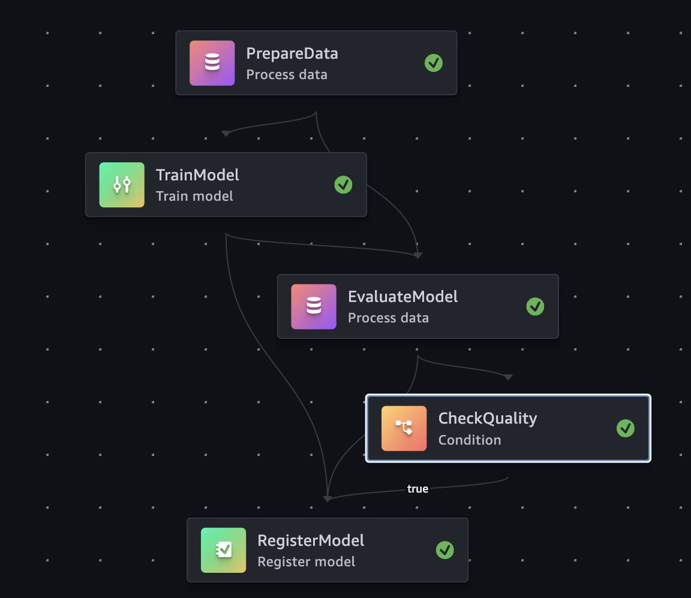

[English](README.md) | 한국어

# SageMaker XGBoost Pipeline

`sm-xgboost-lab`에서 사용한 실제 UCI 신용카드 연체 데이터를 네 단계의 SageMaker Pipeline으로 실행합니다.
로컬 PC에서 코드를 작성하고 Pipeline을 등록한 뒤 SageMaker Studio에서 실행합니다. 실행이 끝나면
Processing Job과 Training Job의 결과, 평가 결과, 그리고 평가 기준을 통과한 모델이 등록되는 과정을 확인할 수 있습니다.

```text
로컬 PC: UCI 다운로드 -> 데이터 버전별 S3 업로드 -> Pipeline 등록

PrepareData -> TrainModel -> EvaluateModel -> CheckQuality
                                               | AUC >= MinAuc
                                               +-> RegisterModel (PendingManualApproval)
                                               | AUC < MinAuc
                                               +-> 종료
```

| 단계 | 역할 | 실행 코드 |
| --- | --- | --- |
| `PrepareData` | 컬럼과 체크섬을 검증하고, 클래스 비율을 유지하며 70/15/15 비율의 train/validation/test 분할 생성 | `prepare.py` |
| `TrainModel` | script mode XGBoost Training Job 1회 실행, managed MLflow에 파라미터와 지표 기록 | `train.py` |
| `EvaluateModel` | 학습에 사용하지 않은 test 데이터로 평가한 뒤 AUC를 JSON으로 저장 | `evaluate.py` |
| `CheckQuality` | 평가 JSON의 AUC가 `MinAuc` 이상이면 모델 등록 | `step_register.py` |

전체 흐름은 `src/sagemaker_xgboost_pipeline/pipeline.py`의 각 `create_step()` 호출에 정의되어 있습니다.
Step property를 사용해 전처리 결과는 학습·평가 입력으로, 학습된 모델은 평가·등록 입력으로 연결합니다.
`CheckQuality`의 통과 분기에는 `RegisterModel` Step이 있습니다.

## 준비 사항

- `uv`, AWS CLI v2, 그리고 `linux/amd64` 이미지를 빌드할 수 있는 Docker 엔진이 실행 중인 로컬 PC
- 같은 상위 폴더에 있는 `sm-xgboost-lab`. 이 예제의 UCI 로더와 공유 인프라를 재사용합니다.
- 샘플 CloudFormation 배포, 실행 역할 정책 갱신, S3 업로드, ECR 이미지 푸시, Model Package Group 생성,
  Pipeline 등록·실행 권한이 있는 AWS 자격 증명. 권한이 있으면 SDK가 IAM policy simulation으로 학습 역할도 검증합니다.
  조직에서 permissions boundary를 사용한다면 샘플의 작업·아티팩트 접근 권한을 허용해야 합니다.
- 선택한 리전의 SageMaker Studio 접근 권한

기본 리전은 `ap-northeast-2`입니다. 다른 리전을 사용한다면 준비와 실행에 같은 `AWS_REGION`을 지정합니다.
Processing, Training, MLflow 사용과 아티팩트 저장에는 AWS 비용이 발생할 수 있습니다.

## 1. 공유 인프라 준비

앞의 `sm-xgboost-lab`에서 인프라를 이미 준비했다면 다음 절로 넘어갑니다.
처음 준비하는 환경이라면 `sm-pipeline-quick`에서 다음 명령을 실행합니다.

```bash
cd ../sm-xgboost-lab
./scripts/bootstrap-infra.sh
cd ../sm-pipeline-quick
```

이 실습은 앞 예제의 아티팩트 버킷, 실행 역할, managed MLflow App을 재사용합니다.

## 2. Pipeline 준비와 등록

`sm-pipeline-quick`에서 실행합니다.

```bash
./scripts/setup.sh
```

스크립트는 필요한 준비 작업을 순서대로 수행합니다.

1. lock 파일에 맞춰 Python 환경을 설치하고 `infra/pipeline.yaml`을
   `sagemaker-xgboost-lab-pipeline` CloudFormation stack으로 배포합니다. 기존 실행 역할에 Pipeline 작업,
   S3 출력, 모델 등록, 역할 전달 권한을 추가하고 Model Package Group을 준비합니다.
2. Processing 이미지를 `uci-v1` 태그로 빌드해 ECR에 푸시합니다.
3. 앞 예제의 `uv` 환경에서 `load_credit_default_data()`를 호출해 공개 데이터를 다운로드하고,
   `data.csv`와 `source.json`을 내용 해시로 구분한 S3 prefix에 업로드합니다.
4. `pipeline-definition.json`을 생성하고 `sagemaker-xgboost-lab-pipeline`을 등록합니다.

업로드 경로는 `artifacts/input/input-location.json`에 저장되며, Pipeline의 기본 `InputDataS3Uri`로
설정됩니다. 준비 중에 실패했다면 원인을 해결한 뒤 같은 setup 명령을 다시 실행합니다.

Pipeline 코드를 수정했다면 로컬 터미널에서 새 정의를 등록합니다.

```bash
./scripts/run-pipeline.sh --upsert
```

Processing 의존성을 변경했다면 등록 전에 `./scripts/build-processing-image.sh`로 이미지를 다시 빌드합니다.
두 명령은 같은 `IMAGE_TAG`를 사용합니다. Step 실행 스크립트는 Pipeline 정의를 생성할 때 업로드됩니다.

## 3. Studio에서 실행

SageMaker Studio의 **Pipelines**에서 `sagemaker-xgboost-lab-pipeline`을 선택하고 실행을 시작합니다.
첫 실행에서는 준비된 기본값을 그대로 사용합니다.

| 파라미터 | 기본값 | 의미 |
| --- | --- | --- |
| `InputDataS3Uri` | setup에서 실제로 업로드한 S3 경로 | `data.csv`와 `source.json`이 들어 있는 prefix |
| `MinAuc` | `0.70` | test AUC에 적용하는 예제용 모델 등록 기준 |

실행 DAG에는 `PrepareData`, `TrainModel`, `EvaluateModel`, `CheckQuality`의 네 단계가 표시됩니다.
컴퓨팅 작업은 Processing Job 2개와 Training Job 1개이며, 각각 CPU 인스턴스 1대를 사용합니다.
최대 실행 시간은 Processing Job마다 20분, Training Job은 30분으로 설정되어 있습니다.

등록된 Pipeline은 로컬 터미널에서도 실행할 수 있습니다.

```bash
aws sagemaker start-pipeline-execution \
  --pipeline-name sagemaker-xgboost-lab-pipeline \
  --region "${AWS_REGION:-ap-northeast-2}"
```

## 4. 결과 확인과 분기 체험

아래 Studio 실행 그래프는 `CheckQuality`의 `true` 분기를 거쳐 `RegisterModel`까지
성공한 실행 결과입니다.



- MLflow의 `sagemaker-xgboost-lab-pipeline` experiment에서 학습 파라미터와 train·validation 지표를
  확인합니다. `pipeline.execution_id` 태그로 실행을 찾을 수 있습니다.
- `EvaluateModel`의 S3 출력에서 `evaluation.json`을 확인합니다.
  조건 Step은 `binary_classification_metrics.auc.value` 값을 읽습니다.
- test AUC가 `MinAuc` 이상이면 `sagemaker-xgboost-lab-pipeline` Model Package Group에
  새 `PendingManualApproval` 버전이 생성됩니다.
- 조건이 false이면 등록 Step을 건너뛰고 실행이 종료됩니다. `MinAuc`를 앞에서 확인한 test AUC보다 높게 설정해
  다시 실행하면 이 분기를 확인할 수 있습니다.

MLflow는 모델 autologging을 끈 상태에서 학습 파라미터와 지표를 기록하고, 모델 등록은 Pipeline 조건에 따라
수행됩니다. validation은 학습 중 early stopping에, test는 최종 평가에 사용합니다.
이 실습은 소규모 워크플로를 익히기 위한 예제이며, 등록 임계값은 예시 값입니다.

## 데이터와 재현성

공개 데이터는 I.-C. Yeh의 *Default of Credit Card Clients*(UCI 데이터셋 `350`,
DOI `10.24432/C55S3H`)이며 라이선스는 CC BY 4.0입니다. 출처와 변수 설명은
[공유 데이터 가이드](../sm-xgboost-lab/docs/data-preparation.ko.md)를 참고하세요.
두 예제는 같은 로더로 23개 수치형 변수와 이진 정답을 읽습니다.

`data.csv`에는 헤더가 있고, `label` 다음에 23개 feature 컬럼이 옵니다. `source.json`에는 출처,
feature 순서, 행 수, SHA-256 체크섬이 들어 있습니다. `PrepareData`는 이 정보를 검증한 뒤 seed `42`로 분할해
정답이 첫 컬럼이고 헤더가 없는 학습용 CSV를 만듭니다. 30,000행은 train 21,000행, validation 4,500행,
test 4,500행으로 나뉩니다. 원본 데이터의 관측 기간이 하나뿐이므로, 클래스 비율을 유지하는 무작위 분할을 사용합니다.

입력 snapshot과 실행 코드는 공유 버킷의 Pipeline prefix에 저장됩니다. Processing 출력은
Pipeline 실행별 prefix에, 학습된 모델은 Training Job별 경로에 저장됩니다.
반복 실행할 때는 같은 입력 snapshot을 사용하고, 실행 결과는 실행마다 별도의 경로에 저장됩니다.

## 검증

```bash
uv sync --frozen --extra dev
uv run ruff check src tests scripts/prepare-input.py
uv run pytest
```

테스트는 분할의 재현성과 중복 없음, 잘못된 입력 처리, 모델 아카이브 읽기, AUC 출력을 검증합니다.
또한 AWS 호출을 모킹한 상태에서 실제 SDK로 Pipeline 정의를 생성해 DAG 연결과 조건 분기도 확인합니다.

## 정리

실습이 끝나면 Studio에서 Pipeline을 삭제하고, 더 이상 사용하지 않는 Model Package 버전과 Group을 정리합니다.
추가 권한 stack은 CloudFormation에서 삭제합니다. `sagemaker-xgboost-pipeline-processing` ECR 리포지토리와
Pipeline S3 아티팩트도 사용이 끝나면 정리합니다. 공유 버킷과 MLflow App 정리 방법은
[앞 예제 README](../sm-xgboost-lab/README.ko.md#리소스-정리)를 참고하세요.
