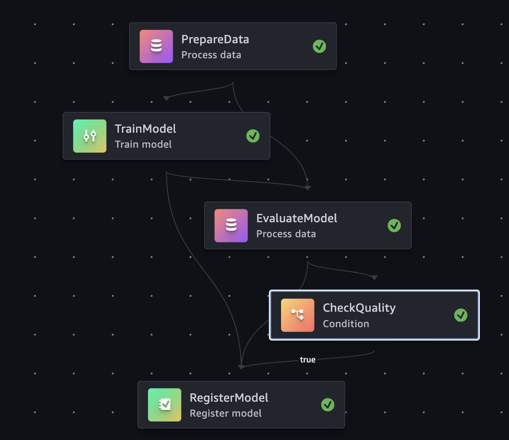

English | [한국어](README.ko.md)

# SageMaker XGBoost Pipeline

Run the public UCI credit-default example from `sm-xgboost-lab` as a four-stage SageMaker Pipeline.
Write and register the Pipeline on your local PC, start it in SageMaker Studio, and inspect the
Processing Jobs, Training Job, evaluation result, and conditional model registration.

```text
Local PC: download UCI data -> upload a versioned S3 snapshot -> register Pipeline

PrepareData -> TrainModel -> EvaluateModel -> CheckQuality
                                               | AUC >= MinAuc
                                               +-> RegisterModel (PendingManualApproval)
                                               | AUC < MinAuc
                                               +-> finish
```

| Stage | What it does | Code |
| --- | --- | --- |
| `PrepareData` | Checks input columns and checksum, then creates stratified 70/15/15 train/validation/test splits | `prepare.py` |
| `TrainModel` | Runs one script-mode XGBoost Training Job and records parameters and metrics in managed MLflow | `train.py` |
| `EvaluateModel` | Evaluates the saved model on the held-out test split and writes test AUC to JSON | `evaluate.py` |
| `CheckQuality` | Reads that JSON and registers the model when AUC meets `MinAuc` | `step_register.py` |

Start reading at `src/sagemaker_xgboost_pipeline/pipeline.py`. Each `create_step()` call adds one stage.
Step properties connect the preparation outputs to training and evaluation, and the trained model to
evaluation and registration. `CheckQuality` contains the `RegisterModel` Step in its passing branch.

## Prerequisites

- A local PC with `uv`, AWS CLI v2, and a running Docker engine capable of building `linux/amd64` images.
- The sibling `sm-xgboost-lab` directory, whose UCI loader and shared infrastructure are reused.
- AWS credentials able to deploy the sample CloudFormation stacks, update the execution role policy,
  upload S3 objects, push an ECR image, create the Model Package Group, and register/start Pipelines.
  When permitted, the SDK also validates the training role using IAM policy simulation. Organization permissions
  boundaries must allow the sample's job and artifact permissions.
- SageMaker Studio access in the selected region.

The default region is `ap-northeast-2`. Set `AWS_REGION` consistently for setup and execution when using
another region. Processing, Training, MLflow, and artifact storage can incur AWS charges.

## 1. Prepare the shared infrastructure

If you already completed the infrastructure setup in `sm-xgboost-lab`, continue to the next section.
For a fresh environment, run these commands from `sm-pipeline-quick`.

```bash
cd ../sm-xgboost-lab
./scripts/bootstrap-infra.sh
cd ../sm-pipeline-quick
```

The Pipeline reuses the artifact bucket, execution role, and managed MLflow App from that lab.

## 2. Prepare the Pipeline and register it

Run the setup command from `sm-pipeline-quick`.

```bash
./scripts/setup.sh
```

The script performs the complete preparation sequence.

1. Installs the locked Python environment and deploys `infra/pipeline.yaml` as the
   `sagemaker-xgboost-lab-pipeline` stack. This adds Pipeline job, S3 output, model registration, and
   role-passing permissions to the existing execution role, and prepares the Model Package Group.
2. Builds and pushes the Processing image with the `uci-v1` tag.
3. Calls the sibling lab's `load_credit_default_data()` in its own `uv` environment, downloads the public
   dataset, and uploads `data.csv` and `source.json` to a content-hashed S3 prefix.
4. Writes `pipeline-definition.json` and registers `sagemaker-xgboost-lab-pipeline`.

The dataset URI is saved in `artifacts/input/input-location.json` and becomes the Pipeline's default
`InputDataS3Uri`. The setup command is also the retry path after correcting a setup failure.

After editing Pipeline code, register the new definition from your local terminal.

```bash
./scripts/run-pipeline.sh --upsert
```

After changing Processing dependencies, rebuild with `./scripts/build-processing-image.sh` before
registering. `IMAGE_TAG` controls the tag consistently for both commands. Source scripts are uploaded
when the Pipeline definition is generated.

## 3. Execute in Studio

Open **Pipelines** in SageMaker Studio, select `sagemaker-xgboost-lab-pipeline`, and start an execution.
Use the prepared defaults for the first run.

| Parameter | Default | Meaning |
| --- | --- | --- |
| `InputDataS3Uri` | Actual S3 snapshot uploaded by setup | Prefix containing `data.csv` and `source.json` |
| `MinAuc` | `0.70` | Illustrative registration threshold for test AUC |

Watch `PrepareData`, `TrainModel`, `EvaluateModel`, and `CheckQuality` in the execution DAG.
The workload consists of two Processing Jobs and one Training Job, each using one CPU instance.
The scripts cap each Processing Job at 20 minutes and training at 30 minutes.

You can also start the registered definition from a local terminal.

```bash
aws sagemaker start-pipeline-execution \
  --pipeline-name sagemaker-xgboost-lab-pipeline \
  --region "${AWS_REGION:-ap-northeast-2}"
```

## 4. Inspect the result and try the branch

The Studio execution graph below shows a successful run: `CheckQuality` took the `true` branch
and `RegisterModel` completed.



- Open the `sagemaker-xgboost-lab-pipeline` MLflow experiment to inspect training parameters and
  train/validation metrics. The `pipeline.execution_id` tag identifies the execution.
- Open the S3 output of `EvaluateModel` and inspect `evaluation.json`. The condition reads
  `binary_classification_metrics.auc.value` from this file.
- If test AUC meets `MinAuc`, inspect the new `PendingManualApproval` version in the
  `sagemaker-xgboost-lab-pipeline` Model Package Group.
- If the condition is false, the execution finishes after the condition and skips registration.
  Raise `MinAuc` above the observed test AUC and run again to inspect this branch.

MLflow records training parameters and metrics with model autologging disabled. Model registration is
performed by the Pipeline condition. The test split is used by evaluation, while validation controls
training's early stopping. This is a small workflow demonstration with an illustrative quality threshold.

## Data and reproducibility

The public dataset is I.-C. Yeh's *Default of Credit Card Clients*, UCI dataset `350`,
DOI `10.24432/C55S3H`, licensed under CC BY 4.0. See the
[shared dataset guide](../sm-xgboost-lab/docs/data-preparation.md) for attribution and variable definitions.
The same 23 numeric features and binary label are loaded by both labs.

`data.csv` has a header and columns `label` followed by the 23 feature names. `source.json` records the
source, feature order, row count, and SHA-256 checksum. `PrepareData` validates the pair and uses a fixed
seed of `42` to write label-first, headerless training CSVs. For the 30,000-row dataset, the split sizes
are 21,000 training, 4,500 validation, and 4,500 test rows. The original data's single observation period
is handled with stratified random splits.

Input snapshots and generated code stay under the lab's Pipeline S3 prefix. Processing outputs use a
Pipeline-execution-specific prefix, and each Training Job writes its own model artifact. Repeat executions
can share the same input snapshot while keeping their outputs separate.

## Checks

```bash
uv sync --frozen --extra dev
uv run ruff check src tests scripts/prepare-input.py
uv run pytest
```

Tests cover reproducible/disjoint splits, invalid inputs, model archive loading, AUC output, and the actual
SDK-generated DAG and condition branches with AWS calls mocked.

## Clean up

After the exercise, delete the Pipeline in Studio and remove its Model Package versions and group when
finished with them. The additional policy stack can then be removed with CloudFormation. Delete the
`sagemaker-xgboost-pipeline-processing` ECR repository and the Pipeline S3 artifacts when they are no longer
needed. Shared bucket and MLflow App cleanup is described in the
[lab README](../sm-xgboost-lab/README.md#clean-up-resources).
