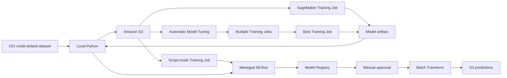

[English](architecture.md) | 한국어

# 아키텍처

이 예제는 로컬 Python 프로세스가 데이터와 실행을 준비하고, 실제 모델 학습은 SageMaker에서 수행하는 구조입니다.

로컬 Python은 데이터셋 다운로드, train/validation 분할, S3 업로드를 담당합니다.
기본 SageMaker Training Job은 built-in XGBoost 학습 코드를 실행합니다. autolog
예제는 같은 SageMaker XGBoost 컨테이너를 script mode로 사용하며, Training Job
안에서 MLflow에 직접 기록합니다. Automatic Model Tuning을 선택하면 SageMaker가
여러 Training Job을 실행하고 `validation:auc`가 가장 높은 Job을 선택합니다.

학습이 끝나면 로컬 Python은 SageMaker가 계산한 지표를 읽고 모델 아티팩트를
MLflow Logged Model로 기록합니다. AMT의 전체 trial은 SageMaker에서 확인하고, 최적
trial은 기존 수동 실험과 비교할 수 있도록 MLflow에 기록합니다.

MLflow UI에서 사용자가 선택한 모델만 SageMaker Model Registry에 버전으로 등록합니다. 사람이 지표와 아티팩트를 확인해 `Approved`로 변경하면 Batch Transform 스크립트가 최신 승인 버전을 사용합니다. 실시간 엔드포인트와 Pipeline은 만들지 않습니다.
