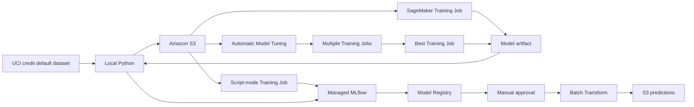

[English](architecture.md) | 한국어

# Architecture

이 예제는 local Python process가 data와 실행을 준비하고, 실제 model Training은 SageMaker에서 수행하는 구조입니다.

local Python은 dataset download, train/validation split과 S3 upload를 담당합니다.
기본 SageMaker Training Job은 built-in XGBoost 학습 code를 실행합니다. autolog
예제는 같은 SageMaker XGBoost container를 script mode로 사용하고, Training Job
안에서 MLflow에 직접 기록합니다. Automatic Model Tuning을 선택하면 SageMaker가
여러 Training Job을 실행하고 `validation:auc`가 가장 높은 Job을 선택합니다.

Training이 끝나면 local Python은 SageMaker가 계산한 metric을 읽고 model artifact를
MLflow Logged Model로 기록합니다. AMT의 전체 trial은 SageMaker에서 확인하고, 최적
trial은 기존 수동 실험과 비교할 수 있도록 MLflow에 기록합니다.

MLflow UI에서 사용자가 선택한 model만 SageMaker Model Registry에 version으로 등록합니다. 사람이 metric과 artifact를 확인해 `Approved`로 변경하면 Batch Transform script가 최신 승인 version을 사용합니다. real-time endpoint와 Pipeline은 만들지 않습니다.
