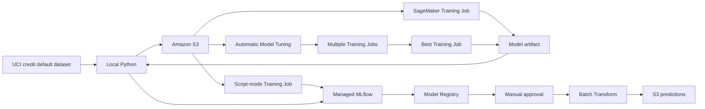

English | [한국어](architecture.ko.md)

# Architecture

In this example, a local Python process prepares the data and the runs, while the actual model Training is performed on SageMaker.

Local Python handles the dataset download, the train/validation split, and the S3 upload.
The default SageMaker Training Job runs the built-in XGBoost training code. The autolog
example uses the same SageMaker XGBoost container in script mode and logs directly to MLflow
from inside the Training Job. If you choose Automatic Model Tuning, SageMaker runs
multiple Training Jobs and selects the Job with the highest `validation:auc`.

When Training finishes, local Python reads the metrics computed by SageMaker and logs the model
artifact as an MLflow Logged Model. All AMT trials can be viewed in SageMaker, and the best
trial is logged to MLflow so that it can be compared with the existing manual experiments.

Only the model that the user selects in the MLflow UI is registered as a version in SageMaker Model Registry. After a person reviews the metrics and artifacts and changes the status to `Approved`, the Batch Transform script uses the latest approved version. No real-time endpoint or Pipeline is created.
