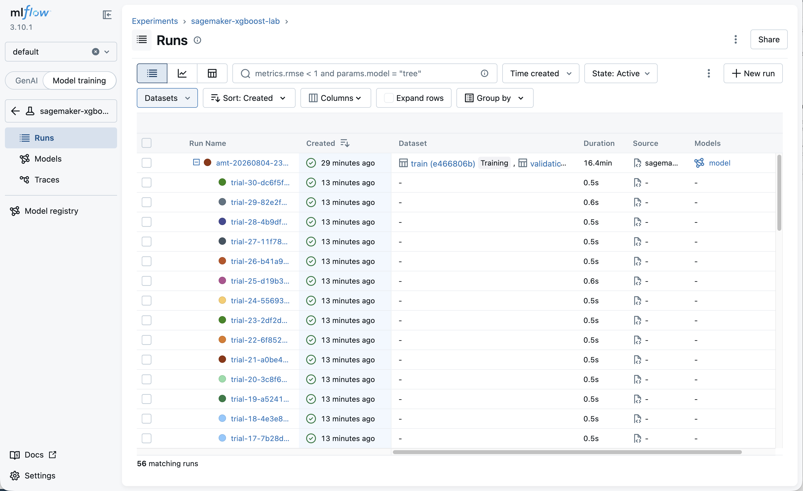
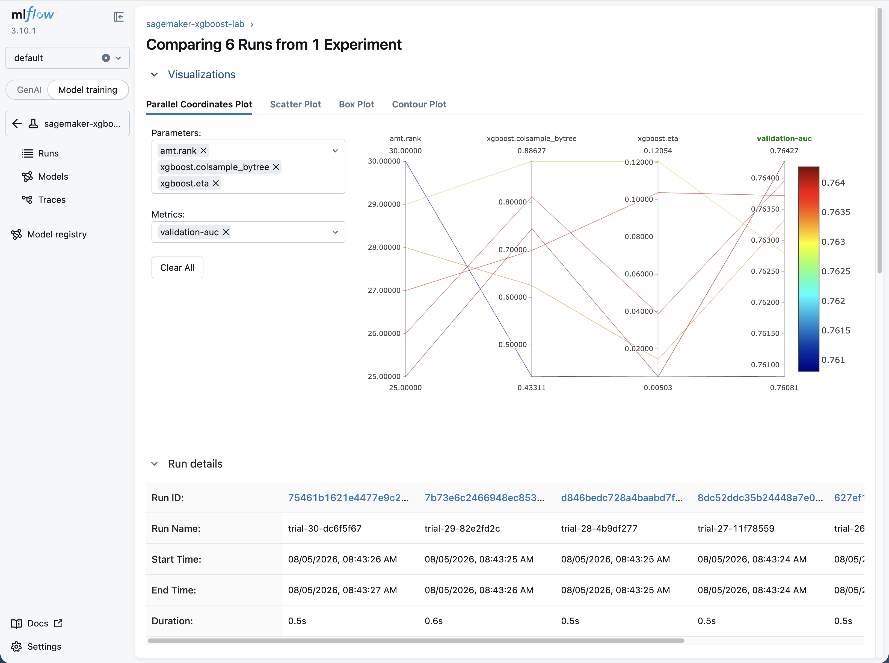

[English](automatic-model-tuning.md) | 한국어

# SageMaker Automatic Model Tuning

## 현재 사용하는 이름

이 기능의 공식 이름은 **Amazon SageMaker AI Automatic Model Tuning (AMT)**이며,
**hyperparameter tuning**이라고도 부릅니다.

Amazon SageMaker의 서비스 표기는 2024년 12월부터 **Amazon SageMaker AI**로
변경됐지만 기존 기능과 API는 그대로이며, Automatic Model Tuning이라는 이름도
유지됩니다.

AMT와 AutoML은 자동화 범위가 다릅니다.

| 기능 | 사람이 정하는 것 | SageMaker가 자동화하는 것 |
|---|---|---|
| Automatic Model Tuning | 알고리즘, metric, 탐색할 hyperparameter와 범위 | 여러 Training Job 실행, 다음 조합 선택, 최적 Job 선정 |
| SageMaker Autopilot AutoML | dataset, target, 문제 유형 | 전처리, feature engineering, 알고리즘 선택, tuning |

이 프로젝트는 이미 XGBoost가 적합하다는 가정으로 알고리즘과 input 형식을 학습하는
예제입니다. 따라서 더 넓은 AutoML보다 AMT가 코드 흐름을 이해하기 좋습니다.

- [Automatic model tuning with SageMaker AI](https://docs.aws.amazon.com/sagemaker/latest/dg/automatic-model-tuning.html)
- [Automated ML, no-code, or low-code](https://docs.aws.amazon.com/sagemaker/latest/dg/use-auto-ml.html)
- [Amazon SageMaker AI rename](https://docs.aws.amazon.com/sagemaker/latest/dg/whatis.html)

AMT 안에는 탐색 범위와 일부 Job 설정까지 추정하는 **Autotune** 옵션도 있습니다.
이 예제는 비용을 결정하는 Job 수와 탐색 의도를 코드에서 명확히 보여주기 위해
Autotune 대신 범위를 직접 지정합니다. 실제 탐색 범위를 아직 모르는 초기 실험에서는
Autotune을 별도로 검토할 수 있습니다.

- [Define ranges and use Autotune](https://docs.aws.amazon.com/sagemaker/latest/dg/automatic-model-tuning-define-ranges.html)

## 실행 전

Infrastructure와 local 환경을 한 번 준비합니다.

```bash
uv sync --extra dev
./scripts/bootstrap-infra.sh
```

AMT는 하나의 Job이 내부적으로 여러 Training Job을 생성합니다. 기본 설정은
`ml.c6i.xlarge` Training Job을 최대 30개 순차 실행하므로 실행 시간과 비용이
일반 Training 예제보다 큽니다.

## 실행

```bash
./scripts/run-tuning.sh
```

비용과 시간을 먼저 줄여 흐름만 확인하려면 다음처럼 실행합니다.

```bash
./scripts/run-tuning.sh --max-jobs 10
```

계정에 동시에 사용할 수 있는 Training instance quota가 충분하면 병렬도를 조정할 수
있습니다.

```bash
./scripts/run-tuning.sh --max-jobs 30 --max-parallel-jobs 2
```

Bayesian 전략은 앞선 trial 결과를 이용해 다음 조합을 선택합니다. 이 작은 예제는 그
과정을 보기 쉽고 초기 계정 quota에 덜 걸리도록 기본 병렬도를 `1`로 둡니다.

## 코드에서 정의하는 것

[`train_tunner.py`](../src/sagemaker_xgboost_lab/train_tunner.py)는 먼저 SDK v3 `ModelTrainer`로 모든
trial이 공유할 설정을 정의합니다.

```text
XGBoost built-in image
execution role
Training instance
train / validation S3 channel
고정 hyperparameter
model output S3 path
```

그 다음 `HyperparameterTuner`에 자동 탐색 설정을 전달합니다.

```text
strategy = Bayesian
objective = validation:auc 최대화
max jobs = 30
max parallel jobs = 1
early stopping = Auto
```

Built-in XGBoost는 `validation:auc`를 기본 metric으로 내보내므로 custom metric regex가
필요하지 않습니다.

현재 고정한 SageMaker SDK v3 버전에서는 Tuner가 간단한 `InputData`를 변환할 때
`content_type`을 보존하지 않습니다. CSV가 LIBSVM으로 잘못 해석되지 않도록
`train_tunner.py`는 `ContentType=text/csv`를 포함한 `Channel`을 직접 전달합니다.

## Boosting round와 두 종류의 early stopping

`num_round=1200`은 모든 trial을 무조건 1,200번 학습한다는 뜻이 아니라 최대
boosting round입니다. 낮은 `eta` 조합도 충분히 학습할 기회를 주기 위해 상한을 높게
두었습니다.

`early_stopping_rounds=50`은 개별 XGBoost booster가 validation AUC를 관찰하다가
50 round 동안 개선되지 않으면 해당 Training Job의 학습을 멈추고 가장 좋았던 model을
사용합니다. 반면 `HyperparameterTuner`의 `early_stopping_type="Auto"`는 여러 trial의
진행 상황을 비교해 최적 결과를 낼 가능성이 낮은 **Training Job 자체**를 조기
중단합니다. 둘은 서로 다른 수준에서 시간과 과적합을 줄입니다.

같은 split으로 40개 broad-search 조합을 점검했을 때 최적 round는 `23~1,047`에
분포했습니다. 기존 `num_round=300`은 일부 낮은 학습률 조합을 충분히 학습시키지
못하므로, `1200 + booster early stopping` 조합이 더 적합합니다.

- [XGBoost hyperparameters](https://docs.aws.amazon.com/sagemaker/latest/dg/xgboost_hyperparameters.html)

## 탐색 범위

이 예제는 30개 trial을 전제로 다음 일곱 개 범위를 탐색합니다.

| Hyperparameter | 범위 | Scale | 의미 |
|---|---:|---|---|
| `eta` | 0.005-0.2 | Logarithmic | 각 boosting 단계의 학습률 |
| `max_depth` | 2-10 | Integer | 각 tree의 최대 깊이 |
| `min_child_weight` | 0.5-100 | Logarithmic | leaf 분할의 보수성 |
| `subsample` | 0.5-1.0 | Auto | 각 tree가 사용할 학습 row 비율 |
| `colsample_bytree` | 0.4-1.0 | Auto | 각 tree가 사용할 feature 비율 |
| `gamma` | 0-10 | Auto | split에 요구되는 최소 loss 감소량 |
| `lambda` | 0.1-100 | Logarithmic | leaf weight에 적용하는 L2 regularization |

`objective`, `eval_metric`, `num_round`, `early_stopping_rounds`, `tree_method`, `seed`는
모든 trial에 동일하게 적용합니다. `eta`, `min_child_weight`, `lambda`는 값의 자릿수가
여러 단계에 걸치므로 logarithmic scale을 사용합니다.

같은 split의 local broad search에서는 수동 tuned model의 약 `0.762`에서
`0.768` 수준까지 개선되는 조합을 확인했습니다. 넓은 범위가 더 높은 성능을 보장하지는
않으며, 30개 trial은 이 sample에서 비용과 탐색 폭을 절충한 값입니다.

- [Tune an XGBoost model](https://docs.aws.amazon.com/sagemaker/latest/dg/xgboost-tuning.html)
- [Best practices for hyperparameter tuning](https://docs.aws.amazon.com/sagemaker/latest/dg/automatic-model-tuning-considerations.html)
- [Tuning strategies](https://docs.aws.amazon.com/sagemaker/latest/dg/automatic-model-tuning-how-it-works.html)

## SageMaker에서 확인

AWS Console의 **Amazon SageMaker AI → Training → Hyperparameter tuning jobs**에서
terminal에 출력된 `xgb-amt-...` Job을 엽니다.

다음 항목을 순서대로 확인합니다.

1. Objective metric이 `validation:auc`, 방향이 `Maximize`인지 확인합니다.
2. Training jobs 목록에서 trial마다 hyperparameter 값이 다른지 확인합니다.
3. Objective metric 기준으로 어떤 trial이 Best training job인지 확인합니다.
4. Best trial의 model artifact가 S3에 생성됐는지 확인합니다.

AMT는 지정한 범위 안에서 최선을 찾지만 전역 최적값이나 이전 모델보다 나은 결과를
보장하지는 않습니다.

## MLflow에서 확인

완료 후 `sagemaker-xgboost-lab` experiment에 `amt-<run-id>` run이 생깁니다.
이 run은 parent run이며, dataset lineage, AMT 설정, 전체 `tuning/trials.json`, 최적
model과 Registry 연결을 한 번만 기록합니다. 100개 이하 trial은 parent 아래의 child
run으로도 기록됩니다. 각 child run에는 hyperparameter, `validation-auc`, SageMaker
Training Job name과 상태만 남기며 dataset과 model artifact는 중복하지 않습니다.

수백~수천 trial을 실행할 때는 SageMaker AMT를 trial별 log, 상태, metric의 상세
원장으로 두고, MLflow에는 AMT 설정, 전체 요약, 최적 candidate와 Registry에 올릴
model만 남기는 편이 UI와 artifact를 과도하게 늘리지 않아 더 실용적입니다. 이 sample은
100개를 넘으면 자동으로 summary-only로 전환합니다.

| MLflow 항목 | 기록 내용 |
|---|---|
| Parameters | AMT 전략, Job 수, instance, 최적 hyperparameter |
| Metric | 최적 Training Job의 `validation-auc` |
| Tags | Tuning Job, 최적 Training Job, model S3 URI |
| Artifact | 모든 trial 요약 `tuning/trials.json`, dataset summary |
| Logged Model | 최적 XGBoost model과 signature |
| Datasets | train/validation schema, digest와 S3 source |
| Child runs | trial별 hyperparameter, validation AUC, Training Job link와 status |

SageMaker 화면은 전체 탐색 과정을 보는 곳이고, MLflow는 최적 결과를 기존 수동 실험과
비교하고 Registry에 등록하는 곳입니다.

### MLflow 화면 예시

아래 화면에서 `amt-...`는 전체 tuning을 대표하는 parent run입니다. 이 run에만
train/validation dataset과 선택된 최적 model이 표시됩니다. `trial-...` child run은
각 AMT Training Job의 parameter, `validation-auc`, 상태만 비교하기 위한 가벼운
기록이므로 Dataset과 Models column이 `-`인 것이 정상입니다.



child run 여러 개를 선택한 뒤 **Compare**에서 Parallel Coordinates Plot을 열면
hyperparameter 조합과 `validation-auc`의 관계를 빠르게 훑을 수 있습니다. 아래 예시는
`colsample_bytree`, `eta`와 AUC를 함께 선택한 모습입니다. 선의 색은 AUC를 나타내며,
좋은 score의 조합이 어느 값 범위에 모이는지 보는 탐색 도구로 사용합니다.



이 작은 dataset의 trial 수로는 plot의 특정 값 하나를 일반화하지 않습니다. 이 화면은
다음 탐색 범위를 좁히거나 넓힐 가설을 세우는 데 쓰고, 최종 선택은 독립된 test 또는
out-of-time data에서 확인합니다.

## TensorBoard와의 차이

TensorBoard는 epoch 또는 step별 학습 곡선을 시각화하는 도구이며, hyperparameter
조합을 선택하고 여러 Training Job을 관리하는 AMT를 대신하지 않습니다. 이 built-in
XGBoost 예제는 SageMaker가 제공하는 `validation:auc`를 AMT가 직접 사용하고, 결과
비교와 lineage는 SageMaker Tuning 화면과 managed MLflow에 남깁니다.

## 실제 신용평가 모델에 적용할 때

현재 validation set은 AMT가 최적 모델을 선택하는 데 사용하므로 더 이상 완전히
독립적인 최종 평가 data가 아닙니다. 실제 신용평가에서는 다음을 추가해야 합니다.

1. 학습 시점보다 미래 기간의 out-of-time test set을 별도로 보관합니다.
2. AMT가 선택한 모델을 test set에서 한 번만 최종 평가합니다.
3. AUC뿐 아니라 KS, calibration, 승인율별 연체율과 business cost를 함께 봅니다.
4. 탐색 범위와 Job 수를 늘리기 전에 baseline과 data leakage를 먼저 확인합니다.

AMT는 좋은 feature, 올바른 split, 적절한 평가 기준을 자동으로 만들어 주는 기능이
아닙니다. 사람이 정의한 문제 안에서 hyperparameter 탐색을 효율적으로 수행합니다.
