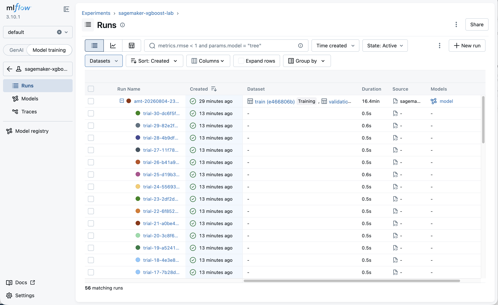
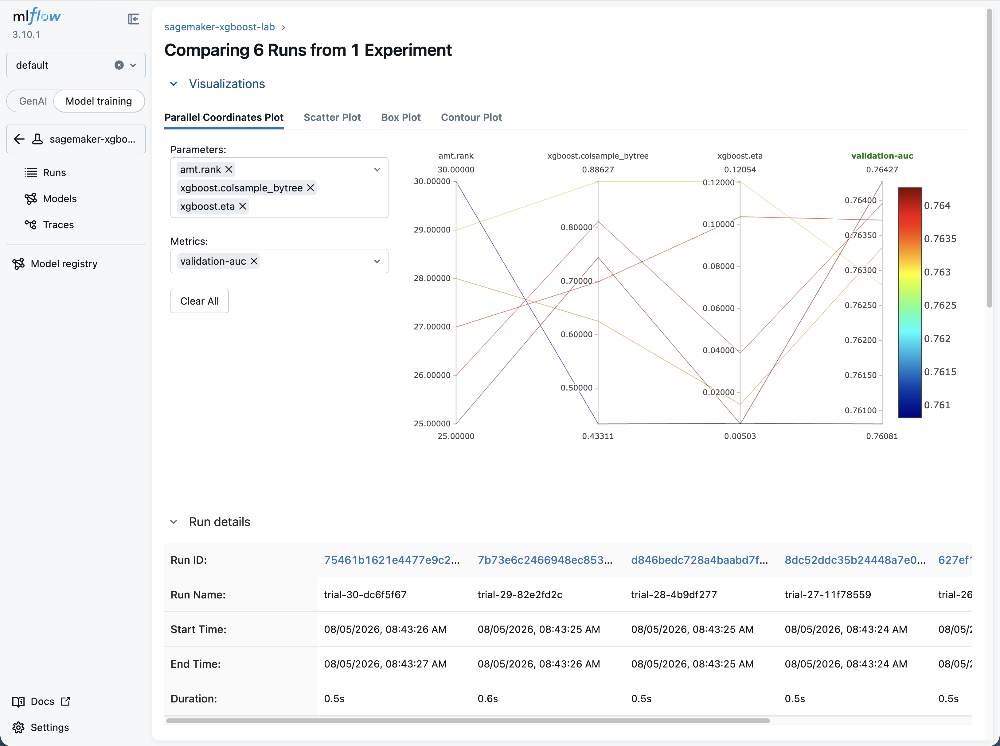

English | [한국어](automatic-model-tuning.ko.md)

# SageMaker Automatic Model Tuning

## Current name

The official name of this feature is **Amazon SageMaker AI Automatic Model Tuning (AMT)**,
also referred to as **hyperparameter tuning**.

Amazon SageMaker was renamed **Amazon SageMaker AI** in December 2024, but the existing
features and APIs remain unchanged, and the name Automatic Model Tuning is also
retained.

AMT and AutoML differ in what they automate.

| Feature | What you decide | What SageMaker automates |
|---|---|---|
| Automatic Model Tuning | Algorithm, metric, hyperparameters to search and their ranges | Running multiple Training Jobs, choosing the next combination, selecting the best Job |
| SageMaker Autopilot AutoML | Dataset, target, problem type | Preprocessing, feature engineering, algorithm selection, tuning |

This project is an example for learning the algorithm and input format under the assumption
that XGBoost is already a good fit. AMT therefore makes the code flow easier to follow than
the broader AutoML.

- [Automatic model tuning with SageMaker AI](https://docs.aws.amazon.com/sagemaker/latest/dg/automatic-model-tuning.html)
- [Automated ML, no-code, or low-code](https://docs.aws.amazon.com/sagemaker/latest/dg/use-auto-ml.html)
- [Amazon SageMaker AI rename](https://docs.aws.amazon.com/sagemaker/latest/dg/whatis.html)

AMT also includes an **Autotune** option that infers the search ranges and some Job settings.
This example specifies the ranges directly instead of using Autotune, so that the code clearly
shows the number of Jobs (which drives cost) and the search intent. For early experiments where
you do not yet know the right search ranges, Autotune is worth evaluating separately.

- [Define ranges and use Autotune](https://docs.aws.amazon.com/sagemaker/latest/dg/automatic-model-tuning-define-ranges.html)

## Before you run

Prepare the infrastructure and local environment once.

```bash
uv sync --extra dev
./scripts/bootstrap-infra.sh
```

A single AMT Job internally creates multiple Training Jobs. The default configuration runs up to
30 `ml.c6i.xlarge` Training Jobs sequentially, so it takes longer and costs more than the
regular Training example.

## Run

```bash
./scripts/run-tuning.sh
```

To reduce cost and time and just verify the flow first, run the following.

```bash
./scripts/run-tuning.sh --max-jobs 10
```

If your account has enough Training instance quota for concurrent use, you can adjust the
degree of parallelism.

```bash
./scripts/run-tuning.sh --max-jobs 30 --max-parallel-jobs 2
```

The Bayesian strategy uses the results of earlier trials to choose the next combination. This
small example sets the default parallelism to `1` so that the process is easy to observe and less
likely to hit the initial account quota.

## What the code defines

[`train_tuner.py`](../src/sagemaker_xgboost_lab/train_tuner.py) first uses the SDK v3 `ModelTrainer` to define the settings
shared by all trials.

```text
XGBoost built-in image
execution role
Training instance
train / validation S3 channel
fixed hyperparameters
model output S3 path
```

It then passes the automatic search settings to `HyperparameterTuner`.

```text
strategy = Bayesian
objective = maximize validation:auc
max jobs = 30
max parallel jobs = 1
early stopping = Auto
```

Built-in XGBoost emits `validation:auc` as a default metric, so no custom metric regex is
required.

In the pinned SageMaker SDK v3 version, the Tuner does not preserve `content_type` when it
converts a simple `InputData`. To prevent CSV from being misinterpreted as LIBSVM,
`train_tuner.py` passes a `Channel` that includes `ContentType=text/csv` directly.

## Boosting rounds and two kinds of early stopping

`num_round=1200` does not mean every trial always trains for 1,200 rounds; it is the maximum
number of boosting rounds. The upper limit is set high so that combinations with a low `eta`
still get enough opportunity to train.

With `early_stopping_rounds=50`, each individual XGBoost booster monitors validation AUC and,
if it does not improve for 50 rounds, stops training in that Training Job and uses the best
model so far. In contrast, `early_stopping_type="Auto"` in `HyperparameterTuner` compares the
progress of multiple trials and stops **the Training Job itself** early if it is unlikely to
produce the best result. The two reduce time and overfitting at different levels.

When 40 broad-search combinations were checked on the same split, the optimal round ranged from
`23` to `1,047`. The previous `num_round=300` does not train some low-learning-rate combinations
sufficiently, so the `1200 + booster early stopping` combination is a better fit.

- [XGBoost hyperparameters](https://docs.aws.amazon.com/sagemaker/latest/dg/xgboost_hyperparameters.html)

## Search ranges

Assuming 30 trials, this example searches the following seven ranges.

| Hyperparameter | Range | Scale | Meaning |
|---|---:|---|---|
| `eta` | 0.005-0.2 | Logarithmic | Learning rate for each boosting step |
| `max_depth` | 2-10 | Integer | Maximum depth of each tree |
| `min_child_weight` | 0.5-100 | Logarithmic | Conservativeness of leaf splits |
| `subsample` | 0.5-1.0 | Auto | Fraction of training rows used by each tree |
| `colsample_bytree` | 0.4-1.0 | Auto | Fraction of features used by each tree |
| `gamma` | 0-10 | Auto | Minimum loss reduction required to make a split |
| `lambda` | 0.1-100 | Logarithmic | L2 regularization applied to leaf weights |

`objective`, `eval_metric`, `num_round`, `early_stopping_rounds`, `tree_method`, and `seed` are
applied identically to all trials. `eta`, `min_child_weight`, and `lambda` span several orders
of magnitude, so they use a logarithmic scale.

A local broad search on the same split found combinations that improved from about `0.762` for
the manually tuned model to around `0.768`. A wider range does not guarantee better performance,
and 30 trials is a trade-off between cost and search breadth for this sample.

- [Tune an XGBoost model](https://docs.aws.amazon.com/sagemaker/latest/dg/xgboost-tuning.html)
- [Best practices for hyperparameter tuning](https://docs.aws.amazon.com/sagemaker/latest/dg/automatic-model-tuning-considerations.html)
- [Tuning strategies](https://docs.aws.amazon.com/sagemaker/latest/dg/automatic-model-tuning-how-it-works.html)

## Check in SageMaker

In the AWS Console, go to **Amazon SageMaker AI → Training → Hyperparameter tuning jobs** and
open the `xgb-amt-...` Job printed in the terminal.

Check the following items in order.

1. Confirm that the objective metric is `validation:auc` and the direction is `Maximize`.
2. In the Training jobs list, confirm that each trial has different hyperparameter values.
3. Identify which trial is the Best training job based on the objective metric.
4. Confirm that the Best trial's model artifact was created in S3.

AMT finds the best result within the specified ranges, but it does not guarantee a global
optimum or a result better than a previous model.

## Check in MLflow

After completion, an `amt-<run-id>` run appears in the `sagemaker-xgboost-lab` experiment.
This run is the parent run, and it records dataset lineage, AMT settings, the full
`tuning/trials.json`, the best model, and the Registry link exactly once. When there are 100 or
fewer trials, they are also recorded as child runs under the parent. Each child run contains only
hyperparameters, `validation-auc`, and the SageMaker Training Job name and status; datasets and
model artifacts are not duplicated.

When running hundreds to thousands of trials, it is more practical to keep SageMaker AMT as the
detailed ledger of per-trial logs, status, and metrics, and to record in MLflow only the AMT
settings, the overall summary, the best candidate, and the model to register in the Registry.
This avoids bloating the UI and artifacts. This sample automatically switches to summary-only
mode when there are more than 100 trials.

| MLflow item | What is recorded |
|---|---|
| Parameters | AMT strategy, number of Jobs, instance, best hyperparameters |
| Metric | `validation-auc` of the best Training Job |
| Tags | Tuning Job, best Training Job, model S3 URI |
| Artifact | Summary of all trials in `tuning/trials.json`, dataset summary |
| Logged Model | Best XGBoost model and signature |
| Datasets | train/validation schema, digest, and S3 source |
| Child runs | Per-trial hyperparameters, validation AUC, Training Job link and status |

The SageMaker console is where you view the entire search process, and MLflow is where you
compare the best result with earlier manual experiments and register it in the Registry.

### MLflow screen example

In the screen below, `amt-...` is the parent run representing the entire tuning job. Only this
run shows the train/validation datasets and the selected best model. The `trial-...` child runs
are lightweight records used only to compare each AMT Training Job's parameters,
`validation-auc`, and status, so it is expected that their Dataset and Models columns show `-`.



If you select several child runs and open the Parallel Coordinates Plot from **Compare**, you can
quickly scan the relationship between hyperparameter combinations and `validation-auc`. The
example below shows `colsample_bytree`, `eta`, and AUC selected together. The line color
represents AUC; use it as an exploration tool to see which value ranges the high-scoring
combinations cluster in.



With this small dataset and number of trials, do not generalize from any single value in the
plot. Use this screen to form hypotheses for narrowing or widening the next search ranges, and
confirm the final choice on an independent test or out-of-time dataset.

## Difference from TensorBoard

TensorBoard is a tool for visualizing per-epoch or per-step learning curves; it does not replace
AMT, which selects hyperparameter combinations and manages multiple Training Jobs. In this
built-in XGBoost example, AMT directly uses the `validation:auc` provided by SageMaker, and the
result comparison and lineage are kept in the SageMaker Tuning console and managed MLflow.

## Applying this to a real credit scoring model

The current validation set is used by AMT to select the best model, so it is no longer fully
independent final evaluation data. For real credit scoring, you should add the following.

1. Hold out a separate out-of-time test set from a period later than the training period.
2. Evaluate the model selected by AMT on the test set exactly once, as the final evaluation.
3. Look not only at AUC but also at KS, calibration, default rate by approval rate, and business cost.
4. Before increasing the search ranges and number of Jobs, check the baseline and data leakage first.

AMT does not automatically create good features, a correct split, or appropriate evaluation
criteria. It efficiently performs hyperparameter search within a problem defined by people.
