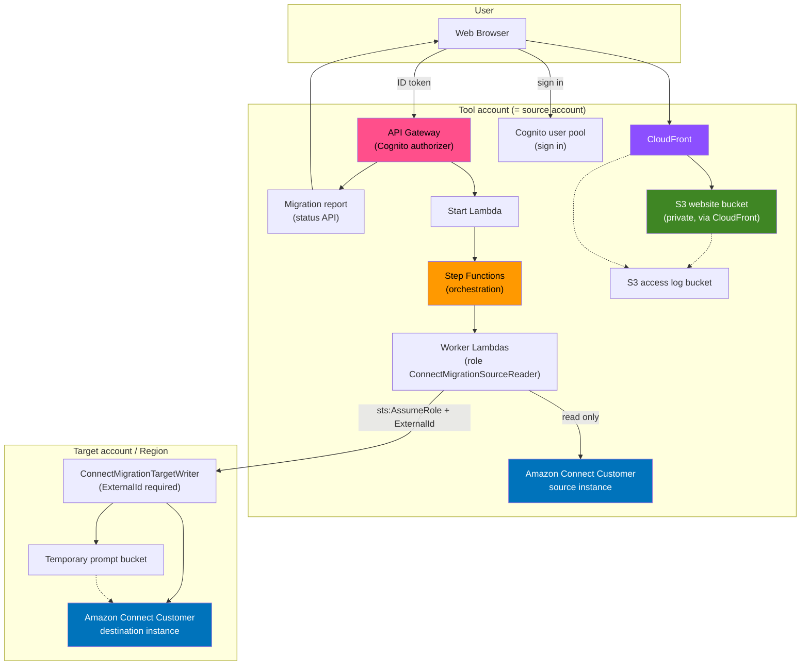

# Amazon Connect Customer Migration Tool: architecture

## Architecture Diagram


Source: [`images/architecture.dot`](./images/architecture.dot) (Graphviz), rendered to [`images/architecture.svg`](./images/architecture.svg) and `images/architecture.png`. The same flow as a Mermaid diagram (renders on GitHub):



## Component Description

| Component | Service | Purpose |
|-----------|---------|---------|
| Frontend | S3 + CloudFront | Static HTML/JS interface; `config.js` generated at deploy time |
| Sign in | Amazon Cognito | Managed sign in (authorization code with PKCE); admin created users only |
| API | API Gateway | Start, status, pre check, quota check and verification endpoints; every POST needs a Cognito ID token; CORS for the CloudFront origin only; throttled; X-Ray tracing |
| Orchestration | Step Functions | Runs the list and create Lambdas in dependency order |
| Migration logic | Lambda | Reads the source with the read only `ConnectMigrationSourceReader` role, writes to the target through `ConnectMigrationTargetWriter` |
| Storage | S3 | Private website, artifacts and access log buckets (SSE-S3, TLS only, versioned website and artifacts buckets) |
| Source | Amazon Connect Customer | Instance to migrate FROM (same account as the tool) |
| Destination | Amazon Connect Customer | Instance to migrate TO (any account and Region) |

## Data Flow

1. **User** signs in and opens the tool via the CloudFront URL
2. **Frontend** calls the API with the Cognito ID token (optional quota check and flow dependency pre check)
3. **User** selects resources and starts migration (target role ARN and External ID are sent with the request)
4. **Step Functions** runs the Lambda functions in order:
   - List resources from the source
   - Create resources in the destination, rewriting ARNs in flows for the target account and Region
   - Match Lambda functions and Lex bots by name in the destination
5. **Results**: the status API returns failed steps, the target verification and the manual follow up report
6. **Verification** runs in the state machine (`VerifyTarget`, before the secret cleanup); the UI can run the same checks again on demand

## Cross-Account Flow

```
┌──────────────────────────┐   sts:AssumeRole    ┌────────────────────────────┐
│ Worker Lambda            │   + ExternalId      │ Target account             │
│ ConnectMigrationSource-  │────────────────────▶│ ConnectMigrationTarget-    │
│ Reader (read only)       │                     │ Writer (trusts only the    │
└──────────────────────────┘                     │ source reader role)        │
                                                 └─────────────┬──────────────┘
                                                               ▼
                                                 ┌────────────────────────────┐
                                                 │ Amazon Connect Customer    │
                                                 │ destination instance       │
                                                 └────────────────────────────┘
```

The same path is used for same account migrations: the tool role itself never writes.

## Migration Order (Step Functions)

From `step-functions/migration-state-machine.json`:

```
┌──────────────────────────────────────────────────────────────────┐
│ PHASE 1 (parallel): agent statuses, hierarchy groups, prompts,   │
│ predefined attributes, data tables, views, rules, evaluation     │
│ forms, vocabularies, AI guardrails, AI prompts, AI agents,       │
│ Lambda and Lex matching, phone numbers (opt in only)             │
└──────────────────────────────────────────────────────────────────┘
                              │
                              ▼
┌──────────────────────────────────────────────────────────────────┐
│ PHASE 2 (parallel): contact flows, contact flow modules          │
└──────────────────────────────────────────────────────────────────┘
                              │
                              ▼
┌──────────────────────────────────────────────────────────────────┐
│ QUEUES: hours of operation → queues                              │
└──────────────────────────────────────────────────────────────────┘
                              │
                              ▼
┌──────────────────────────────────────────────────────────────────┐
│ USERS: security profiles → routing profiles → users              │
└──────────────────────────────────────────────────────────────────┘
                              │
                              ▼
┌──────────────────────────────────────────────────────────────────┐
│ QUICK CONNECTS                                                   │
└──────────────────────────────────────────────────────────────────┘
                              │
                              ▼
┌──────────────────────────────────────────────────────────────────┐
│ REPORT → ExternalId secret cleanup → Succeeded or Failed         │
└──────────────────────────────────────────────────────────────────┘
```

A failed queues or users phase is recorded and the next phase still runs
(results it needs are seeded empty). A phase 1 or phase 2 failure goes straight
to the report. `BuildMigrationReport` reads the execution history and marks each
step SUCCEEDED, COMPLETED_WITH_FAILURES (some items in `failedItems`, counted
by error code) or FAILED. The execution ends Succeeded only if no step and no
item failed; otherwise it ends in the `MigrationFailed` Fail state. The status
API returns the same report, so the UI, the report and the execution status
always agree.

Verification is part of the state machine: after the last migration phase,
`VerifyTarget` runs read only checks of the target (names, source references
and placeholders in flows and modules, queue, user and quick connect
references) and then `CleanupExternalIdSecret` runs. Its result is in the
report (`verification`). A FAIL verdict fails the report and ends the run in
`TargetVerificationFailed`; if the step itself errors, the cleanup and the
report still run and the run ends in `TargetVerificationErrored`. The UI's
Post-Migration Verification calls the same code on demand.
